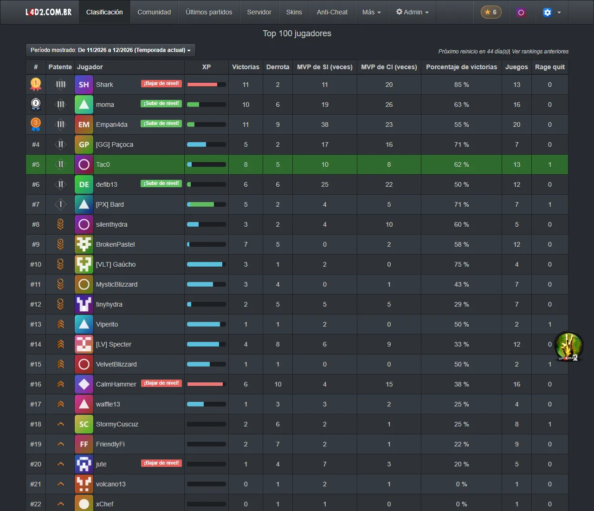
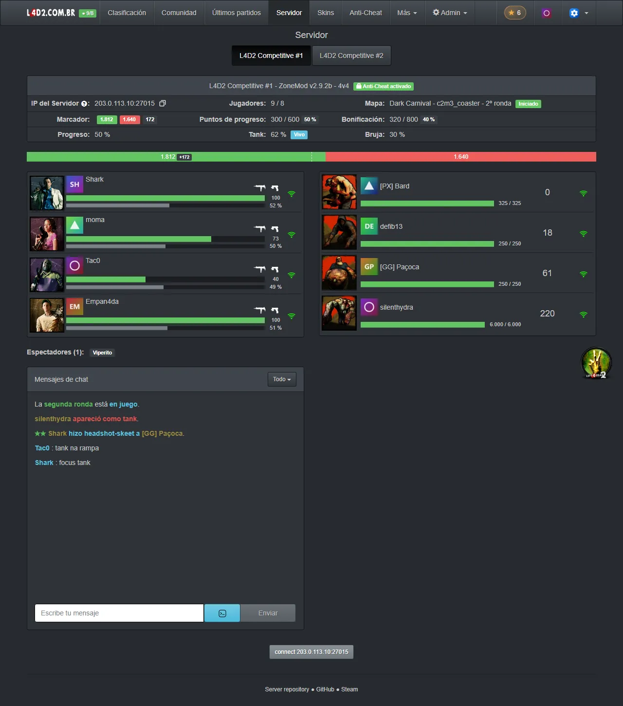
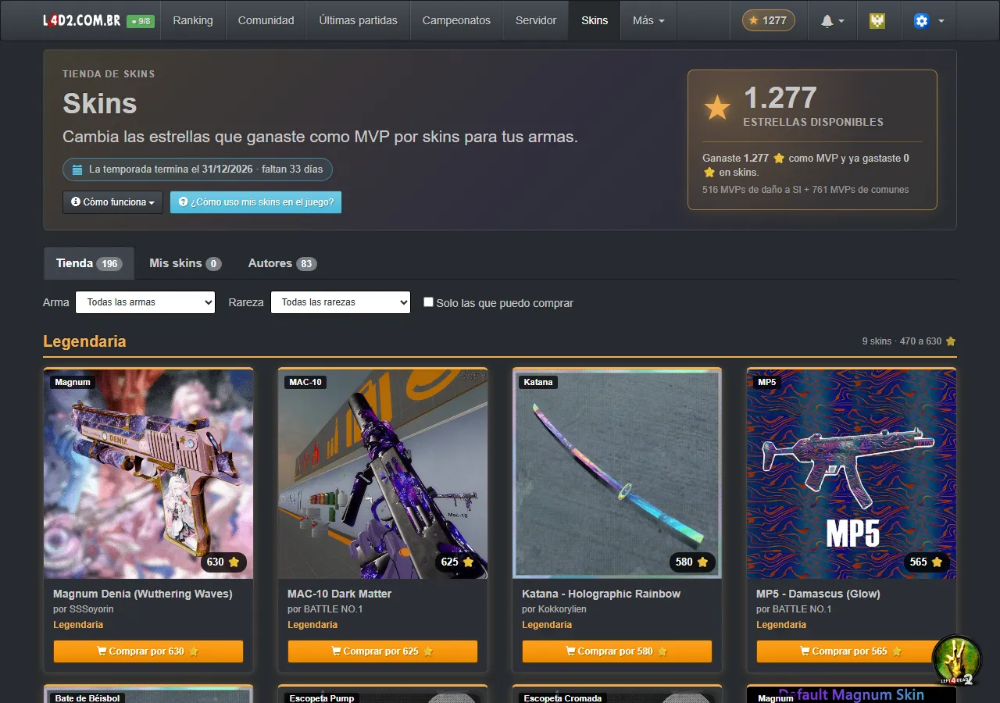

# L4D2 PlayStats Hub

🌐 [English](README.md) | [Português](README.pt.md) | **Español**

Una sola aplicación web autoalojada para servidores competitivos de Left 4 Dead 2: ranking, estadísticas de partidas, vista del servidor en vivo, tienda de skins de armas y un ranking de la comunidad, junto con los plugins de SourceMod que la alimentan.

> **Estado: primera versión publicada, migración terminada.** La aplicación, los plugins, el instalador para Linux y la imagen de Docker están disponibles en las [versiones publicadas](https://github.com/altair-sossai/l4d2-playstats-hub/releases). Los plugins todavía no se han ejecutado en un servidor de juego en vivo. El sitio de producción ([l4d2.com.br](https://l4d2.com.br/)) funciona con esta aplicación desde el 19 de noviembre de 2026, y los [repositorios que reemplazó](#repositorios-que-este-reemplazó) se archivaron el 22 de noviembre de 2026.

## Contenido

- [Por qué existe este proyecto](#por-qué-existe-este-proyecto)
- [Qué hace](#qué-hace)
- [Un recorrido rápido](#un-recorrido-rápido)
- [Instalación](#instalación)
- [Cómo encaja todo](#cómo-encaja-todo)
- [Qué queda fuera de este repositorio](#qué-queda-fuera-de-este-repositorio)
- [Repositorios que este reemplazó](#repositorios-que-este-reemplazó)
- [Documentación](#documentación)
- [Licencia](#licencia)

## Por qué existe este proyecto

El sistema empezó pequeño y creció hasta repartirse en varios repositorios: un analizador de estadísticas, una API, un sitio web con una tienda de skins y un conjunto de plugins para el servidor de juego. Ponerlo en marcha requería recursos de Azure, filas de almacenamiento creadas a mano y secretos repartidos en tres proyectos.

Este repositorio reúne la lógica para que cualquier dueño de servidor pueda ejecutar el mismo sistema de ranking y estadísticas con una sola aplicación, un solo archivo de base de datos y un solo comando de instalación.

## Qué hace

- **Ranking y estadísticas.** Cada partida jugada en tus servidores se convierte en un ranking, con patentes, detalles de la partida y una página por jugador que muestra resultados, promedios y con quién y contra quién juega.
- **Temporadas que tú configuras.** Eliges cuántos meses dura una temporada. El ranking empieza de nuevo en cada temporada, y las temporadas pasadas se pueden seguir consultando: ranking, partidas y jugadores.
- **Varios servidores de juego, un solo sitio.** Cada servidor tiene su propia clave. Los resultados de un jugador se suman entre todos ellos.
- **Modos de juego que tú configuras.** Eliges qué modos cuentan para el ranking y cuántos mapas forman una partida clasificatoria.
- **Servidor en vivo.** Marcador, jugadores, eventos y chat de la partida en curso, para cada servidor.
- **Tienda de skins de armas.** Los jugadores ganan estrellas con los MVP y las gastan en skins.
- **Ranking de la comunidad.** Los jugadores votan sobre pares de jugadores, y los votos forman un segundo ranking.
- **Páginas para dentro del juego.** `!ranking` abre el ranking en el navegador del propio juego, o una versión ligera hecha para él, y `!comandos` / `!commands` abren los comandos del servidor.
- **Módulos.** El administrador activa o desactiva cada una de estas funciones.
- **Configuración guiada.** Un asistente de primera ejecución y una página de estado que muestra si cada servidor de juego está conectado y qué falta.
- **Tres idiomas.** Inglés, portugués y español.
- **La base de datos que prefieras.** SQLite de forma predeterminada, sin ningún servidor que instalar. SQL Server, PostgreSQL y MySQL también son compatibles.

## Un recorrido rápido

El ranking de la temporada abre el sitio. Cada jugador tiene una página con sus resultados, estadísticas y relaciones, y cada partida tiene sus detalles.



La página del servidor en vivo sigue la partida en curso en cada servidor de juego.



Los jugadores gastan en la tienda de skins de armas las estrellas que ganaron como MVP.



El [manual de usuario](docs/manual/README.es.md) explica cada página, cómo se calculan los números y cada ajuste, con capturas de pantalla.

## Instalación

En un VPS Linux, un solo comando instala el sitio:

```bash
curl -fsSL https://raw.githubusercontent.com/altair-sossai/l4d2-playstats-hub/main/deploy/install.sh | sudo bash
```

El comando muestra la dirección del sitio y un código de configuración. Abre la dirección, pega el código, inicia sesión con Steam, y el sitio te guía por el resto.

Este comando descarga la última versión publicada. La aplicación también se puede [ejecutar desde el código fuente](CONTRIBUTING.es.md#cómo-ejecutarlo).

| Guía | Para |
|---|---|
| [Instalación en un VPS Linux](docs/install-linux.es.md) | La forma recomendada. |
| [Instalación con Docker](docs/install-docker.es.md) | Si ya usas contenedores. |
| [Instalación en Azure](docs/install-azure.es.md) | Una máquina virtual o App Service. |
| [Conectar un servidor de juego](docs/game-server.es.md) | Los plugins y sus ajustes. |
| [Cambiar desde el sitio antiguo](docs/switch-from-old-site.es.md) | Reemplazar una copia en funcionamiento del sitio anterior, paso a paso. |
| [Manual de usuario](docs/manual/README.es.md) | Todas las funciones del sitio, para administradores y jugadores. |

## Cómo encaja todo

```text
 servidor de juego 1 ─┐
 servidor de juego 2 ─┼─ plugins ──>    L4D2 PlayStats Hub    ──>  visitantes, en un navegador
 servidor de juego N ─┘               (sitio + API + tareas)  ──>  jugadores, dentro del juego
                                                │
                                        una base de datos
```

Los plugins envían al sitio el archivo de estadísticas de cada mapa y la partida en vivo. El sitio guarda los archivos, arma las partidas y los rankings a partir de ellos, y sirve las páginas.

## Qué queda fuera de este repositorio

| Repositorio | Por qué sigue separado |
|---|---|
| [l4d2-playstats](https://github.com/altair-sossai/l4d2-playstats) | Paquete NuGet que analiza los archivos de estadísticas. Es útil por sí solo y este proyecto lo usa como dependencia. |
| [l4d2-zone-server-assets](https://github.com/altair-sossai/l4d2-zone-server-assets) | Modelos, materiales y fotos de las skins de armas. Ocupan más de 500 MB, así que aquí solo vive la lógica de la tienda de skins. |

## Repositorios que este reemplazó

La migración se hizo paso a paso. l4d2-playstats-api y l4d2-playstats-web se archivaron el 22 de noviembre de 2026 y apuntan a este repositorio.

| Repositorio | Qué es | Qué pasa con él |
|---|---|---|
| [l4d2-playstats-api](https://github.com/altair-sossai/l4d2-playstats-api) | API en Azure Functions que guarda los archivos de estadísticas y calcula partidas, ranking y estrellas. | Se reemplazó por esta aplicación; se archivó el 22 de noviembre de 2026. |
| [l4d2-playstats-web](https://github.com/altair-sossai/l4d2-playstats-web) | Sitio web con ranking, estadísticas, página del servidor en vivo y tienda de skins de armas. | Se reemplazó por esta aplicación; se archivó el 22 de noviembre de 2026. |
| [l4d2-zone-server](https://github.com/altair-sossai/l4d2-zone-server) | Configuración de servidor competitivo con plugins propios. | Sus plugins de PlayStats ahora viven en [plugins/](plugins/README.es.md). |

## Documentación

| Documento | Contenido |
|---|---|
| [docs/manual/](docs/manual/README.es.md) | El manual de usuario: cada página y ajuste del sitio, con capturas de pantalla. |
| [docs/install-linux.es.md](docs/install-linux.es.md) | Instalar, actualizar y hacer copias de seguridad en un VPS Linux. |
| [docs/install-docker.es.md](docs/install-docker.es.md) | Ejecutar la imagen publicada. |
| [docs/install-azure.es.md](docs/install-azure.es.md) | Ejecutar en Azure. |
| [docs/game-server.es.md](docs/game-server.es.md) | Conectar un servidor de juego, paso a paso. |
| [docs/switch-from-old-site.es.md](docs/switch-from-old-site.es.md) | El cambio del sitio anterior a este, y cómo volver atrás. |
| [docs/databases.es.md](docs/databases.es.md) | Usar SQL Server, PostgreSQL o MySQL. |
| [plugins/README.es.md](plugins/README.es.md) | Todos los plugins, ajustes y comandos. |
| [docs/roadmap.es.md](docs/roadmap.es.md) | Diseño, decisiones, qué está hecho y qué sigue abierto. |
| [docs/in-game-browser.es.md](docs/in-game-browser.es.md) | Qué admite el navegador que está dentro del juego. |
| [docs/site-parity](docs/site-parity/README.es.md) | Cada pantalla del sitio que se está reemplazando, elemento por elemento, y su estado aquí. |
| [CONTRIBUTING.es.md](CONTRIBUTING.es.md) | Cómo está organizado el código y las reglas para los cambios. |
| [tools/screenshots](tools/screenshots/README.es.md) | La herramienta que toma las capturas de pantalla de la documentación. |
| [tools/e2e](tools/e2e/README.es.md) | Las pruebas en el navegador de las páginas principales, ejecutadas en cada push. |

El inglés es el idioma predeterminado de este repositorio. Cada documento tiene también una versión en portugués (`.pt.md`) y otra en español (`.es.md`).

## Licencia

La aplicación se distribuye bajo la [Licencia MIT](LICENSE). Cualquier persona puede usarla, modificarla y compartirla, incluso con fines comerciales, siempre que se conserve el aviso de copyright.

Los plugins de SourceMod que están en [plugins/](plugins/) se distribuyen bajo [GPL-3.0](plugins/LICENSE), porque SourceMod lo exige a los plugins compilados con sus includes.
