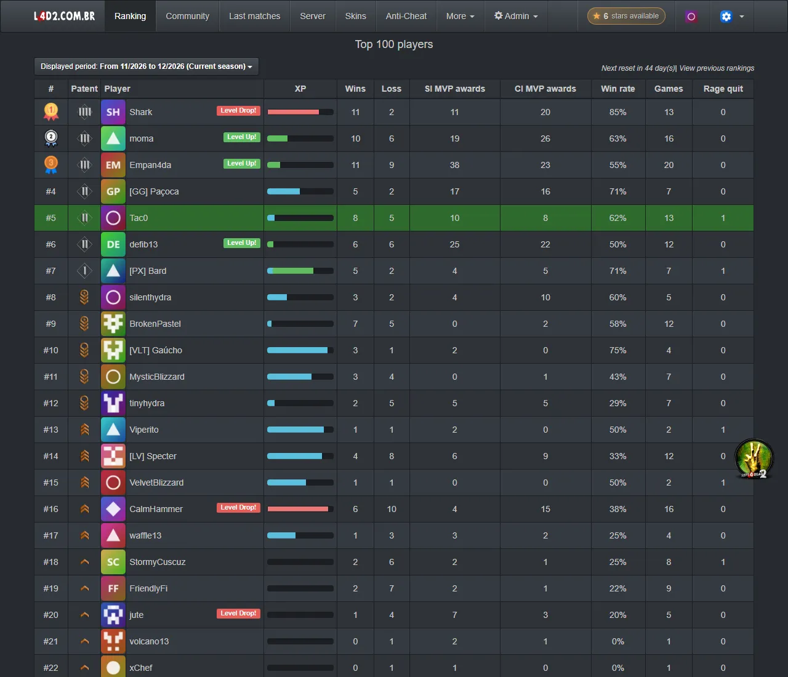
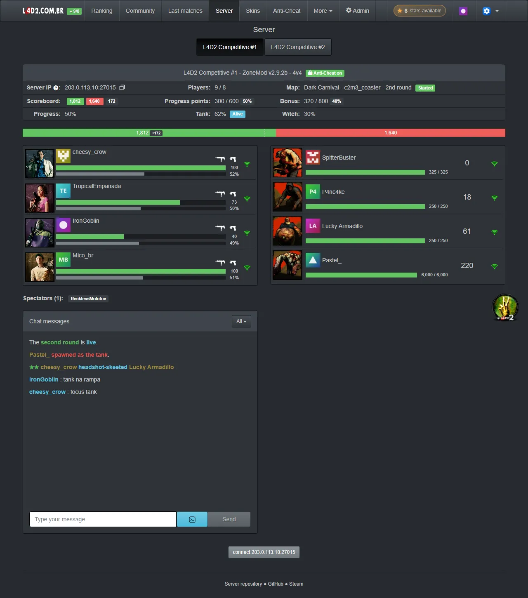
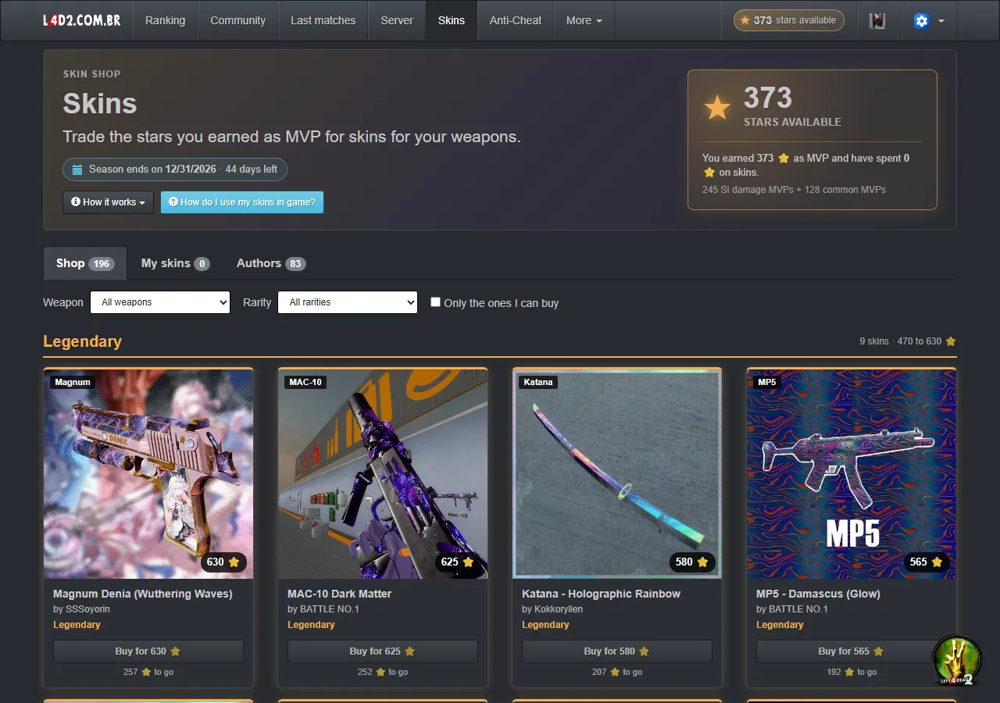

# L4D2 PlayStats Hub

🌐 **English** | [Português](README.pt.md) | [Español](README.es.md)

One self-hosted web application for competitive Left 4 Dead 2 servers: ranking, match statistics, live server view, weapon skin shop and a community ranking, together with the SourceMod plugins that feed it.

> **Status: first version published, migration finished.** The application, the plugins, the Linux installer and the Docker image are available in the [releases](https://github.com/altair-sossai/l4d2-playstats-hub/releases). The plugins have not been run on a live game server yet. The production site ([l4d2.com.br](https://l4d2.com.br/)) has run on this application since 19 November 2026, and the [repositories it replaced](#repositories-this-one-replaced) were archived on 22 November 2026.

## Contents

- [Why this project exists](#why-this-project-exists)
- [What it does](#what-it-does)
- [A short tour](#a-short-tour)
- [Installing](#installing)
- [How it fits together](#how-it-fits-together)
- [What stays outside this repository](#what-stays-outside-this-repository)
- [Repositories this one replaced](#repositories-this-one-replaced)
- [Documentation](#documentation)
- [License](#license)

## Why this project exists

The system started small and grew into several repositories: a statistics parser, an API, a website with a skin shop, and a set of game server plugins. Running it took Azure resources, storage rows created by hand and secrets spread over three projects.

This repository brings the logic together so that any server owner can run the same ranking and statistics system with one application, one database file and one install command.

## What it does

- **Ranking and statistics.** Every match played on your servers becomes a ranking, with patents, match details, and a page for each player showing results, averages, and who they play with and against.
- **Seasons you configure.** You choose how many months a season lasts. The ranking starts again at each season, and past seasons stay browsable: ranking, matches and players.
- **Several game servers, one site.** Each server has its own key. A player's results add up across all of them.
- **Game modes you configure.** You choose which modes count toward the ranking and how many maps make a ranked match.
- **Live server.** Scoreboard, players, events and chat of the match in progress, for each server.
- **Weapon skin shop.** Players earn stars from MVPs and spend them on skins.
- **Community ranking.** Players vote on pairs of players, and the votes build a second ranking.
- **Pages for inside the game.** `!ranking` opens the ranking in the game's own browser, or a light version made for it, and `!comandos` / `!commands` open the commands of the server.
- **Modules.** The administrator turns each of these on or off.
- **Guided setup.** A first-run wizard, and a status page that shows whether each game server is connected and what is missing.
- **Three languages.** English, Portuguese and Spanish.
- **Your choice of database.** SQLite by default, with no server to install. SQL Server, PostgreSQL and MySQL are supported.

## A short tour

The ranking of the season opens the site. Each player has a page with their results, statistics and relations, and each match has its details.



The live server page follows the match in progress on each game server.



Players spend the stars they earned as MVP in the weapon skin shop.



The [user manual](docs/manual/README.md) explains every page, how the numbers are calculated, and every setting, with screenshots.

## Installing

On a Linux VPS, one command installs the site:

```bash
curl -fsSL https://raw.githubusercontent.com/altair-sossai/l4d2-playstats-hub/main/deploy/install.sh | sudo bash
```

It prints the address of the site and a setup code. Open the address, paste the code, sign in with Steam, and the site guides you through the rest.

This command downloads the latest published version. The application can also be [run from the source](CONTRIBUTING.md#running-it).

| Guide | For |
|---|---|
| [Installing on a Linux VPS](docs/install-linux.md) | The recommended way. |
| [Installing with Docker](docs/install-docker.md) | If you already use containers. |
| [Installing on Azure](docs/install-azure.md) | A virtual machine or App Service. |
| [Connecting a game server](docs/game-server.md) | The plugins and their settings. |
| [Switching from the old site](docs/switch-from-old-site.md) | Replacing a running copy of the earlier site, step by step. |
| [User manual](docs/manual/README.md) | Every feature of the site, for administrators and players. |

## How it fits together

```text
 game server 1 ─┐
 game server 2 ─┼─ plugins ──>  L4D2 PlayStats Hub  ──>  visitors, in a browser
 game server N ─┘               (site + API + jobs)  ──>  players, inside the game
                                        │
                                   one database
```

The plugins send each map's statistics file and the live match to the site. The site stores the files, builds the matches and the rankings from them, and serves the pages.

## What stays outside this repository

| Repository | Why it stays separate |
|---|---|
| [l4d2-playstats](https://github.com/altair-sossai/l4d2-playstats) | NuGet package that parses the statistics files. It is useful on its own and this project uses it as a dependency. |
| [l4d2-zone-server-assets](https://github.com/altair-sossai/l4d2-zone-server-assets) | Weapon skin models, materials and photos. They are over 500 MB, so only the skin shop logic lives here. |

## Repositories this one replaced

The migration happened step by step. l4d2-playstats-api and l4d2-playstats-web were archived on 22 November 2026 and point to this repository.

| Repository | What it is | What happens to it |
|---|---|---|
| [l4d2-playstats-api](https://github.com/altair-sossai/l4d2-playstats-api) | Azure Functions API that stores the statistics files and computes matches, ranking and stars. | Replaced by this application; archived on 22 November 2026. |
| [l4d2-playstats-web](https://github.com/altair-sossai/l4d2-playstats-web) | Website with ranking, statistics, live server page and weapon skin shop. | Replaced by this application; archived on 22 November 2026. |
| [l4d2-zone-server](https://github.com/altair-sossai/l4d2-zone-server) | Competitive server setup with custom plugins. | Its PlayStats plugins now live in [plugins/](plugins/README.md). |

## Documentation

| Document | Contents |
|---|---|
| [docs/manual/](docs/manual/README.md) | The user manual: every page and setting of the site, with screenshots. |
| [docs/install-linux.md](docs/install-linux.md) | Installing, updating and backing up on a Linux VPS. |
| [docs/install-docker.md](docs/install-docker.md) | Running the published image. |
| [docs/install-azure.md](docs/install-azure.md) | Running on Azure. |
| [docs/game-server.md](docs/game-server.md) | Connecting a game server, step by step. |
| [docs/switch-from-old-site.md](docs/switch-from-old-site.md) | Moving from the earlier site to this one, and going back. |
| [docs/databases.md](docs/databases.md) | Using SQL Server, PostgreSQL or MySQL. |
| [plugins/README.md](plugins/README.md) | Every plugin, setting and command. |
| [docs/roadmap.md](docs/roadmap.md) | Design, decisions, what is done and what is open. |
| [docs/in-game-browser.md](docs/in-game-browser.md) | What the browser inside the game supports. |
| [docs/site-parity](docs/site-parity/README.md) | Every screen of the site being replaced, item by item, and its status here. |
| [CONTRIBUTING.md](CONTRIBUTING.md) | How the code is organised and the rules for changes. |
| [tools/screenshots](tools/screenshots/README.md) | The tool that takes the screenshots of the documentation. |
| [tools/e2e](tools/e2e/README.md) | The browser tests of the main pages, run on every push. |

English is the default language of this repository. Every document also has a Portuguese (`.pt.md`) and a Spanish (`.es.md`) version.

## License

The application is released under the [MIT License](LICENSE). Anyone can use, change and share it, including commercially, as long as the copyright notice is kept.

The SourceMod plugins in [plugins/](plugins/) are released under [GPL-3.0](plugins/LICENSE), because SourceMod requires that of plugins built with its includes.
