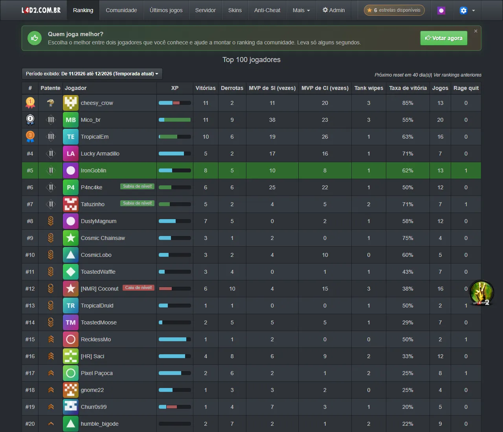
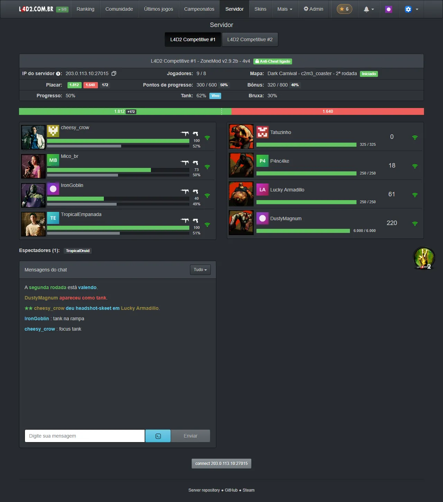
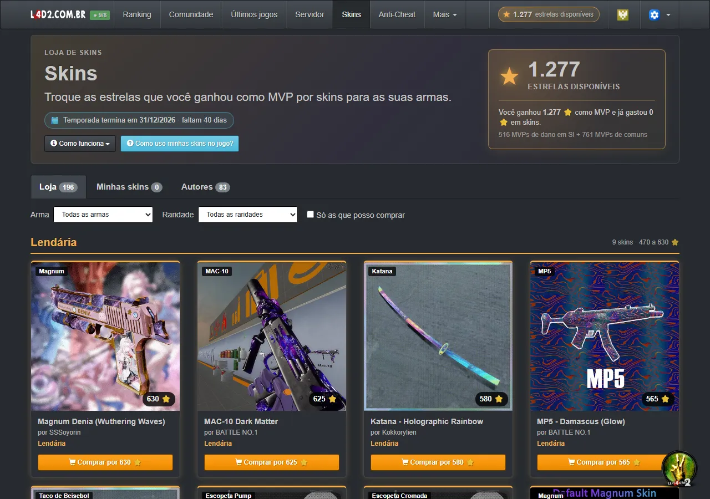

# L4D2 PlayStats Hub

🌐 [English](README.md) | **Português** | [Español](README.es.md)

Uma única aplicação web auto-hospedada para servidores competitivos de Left 4 Dead 2: ranking, estatísticas de partidas, visualização do servidor ao vivo, loja de skins de armas e um ranking da comunidade, junto com os plugins SourceMod que a alimentam.

> **Status: primeira versão publicada, migração em andamento.** A aplicação, os plugins, o instalador para Linux e a imagem Docker estão disponíveis nas [releases](https://github.com/altair-sossai/l4d2-playstats-hub/releases). Os plugins ainda não rodaram em um servidor de jogo real. Os [repositórios existentes](#repositórios-que-estão-sendo-consolidados) continuam rodando o site de produção ([l4d2.com.br](https://l4d2.com.br/)) até a migração terminar.

## Conteúdo

- [Por que este projeto existe](#por-que-este-projeto-existe)
- [O que ele faz](#o-que-ele-faz)
- [Um passeio rápido](#um-passeio-rápido)
- [Instalação](#instalação)
- [Como tudo se encaixa](#como-tudo-se-encaixa)
- [O que fica fora deste repositório](#o-que-fica-fora-deste-repositório)
- [Repositórios que estão sendo consolidados](#repositórios-que-estão-sendo-consolidados)
- [Documentação](#documentação)
- [Licença](#licença)

## Por que este projeto existe

O sistema começou pequeno e cresceu até virar vários repositórios: um parser de estatísticas, uma API, um site com loja de skins e um conjunto de plugins para o servidor de jogo. Rodá-lo exigia recursos do Azure, linhas de armazenamento criadas à mão e segredos espalhados por três projetos.

Este repositório reúne a lógica para que qualquer dono de servidor possa rodar o mesmo sistema de ranking e estatísticas com uma aplicação, um arquivo de banco de dados e um comando de instalação.

## O que ele faz

- **Ranking e estatísticas.** Cada partida jogada nos seus servidores vira ranking, com patentes, detalhes das partidas e uma página para cada jogador mostrando resultados, médias e com quem e contra quem ele joga.
- **Temporadas que você configura.** Você escolhe quantos meses dura uma temporada. O ranking recomeça a cada temporada, e as temporadas passadas continuam navegáveis: ranking, partidas e jogadores.
- **Vários servidores de jogo, um único site.** Cada servidor tem a própria chave. Os resultados de um jogador se somam entre todos eles.
- **Modos de jogo que você configura.** Você escolhe quais modos contam para o ranking e quantos mapas formam uma partida ranqueada.
- **Servidor ao vivo.** Placar, jogadores, eventos e chat da partida em andamento, para cada servidor.
- **Loja de skins de armas.** Os jogadores ganham estrelas com MVPs e as gastam em skins.
- **Ranking da comunidade.** Os jogadores votam em duplas de jogadores, e os votos formam um segundo ranking.
- **Páginas para dentro do jogo.** O `!ranking` abre uma versão leve do ranking, feita para o navegador do próprio jogo.
- **Módulos.** O administrador liga ou desliga cada um desses recursos.
- **Configuração guiada.** Um assistente de primeira configuração e uma página de status que mostra se cada servidor de jogo está conectado e o que está faltando.
- **Três idiomas.** Inglês, português e espanhol.
- **Banco de dados à sua escolha.** SQLite por padrão, sem servidor para instalar. SQL Server, PostgreSQL e MySQL são suportados.

## Um passeio rápido

O ranking da temporada abre o site. Cada jogador tem uma página com os resultados, as estatísticas e as relações dele, e cada partida tem os seus detalhes.



A página do servidor ao vivo acompanha a partida em andamento em cada servidor de jogo.



Os jogadores gastam as estrelas que ganharam como MVP na loja de skins de armas.



O [manual do usuário](docs/manual/README.pt.md) explica cada página, como os números são calculados e cada configuração, com capturas de tela.

## Instalação

Em uma VPS Linux, um único comando instala o site:

```bash
curl -fsSL https://raw.githubusercontent.com/altair-sossai/l4d2-playstats-hub/main/deploy/install.sh | sudo bash
```

Ele mostra o endereço do site e um código de configuração. Abra o endereço, cole o código, faça login com o Steam, e o site guia você pelo resto.

Esse comando baixa a versão publicada mais recente. A aplicação também pode ser [executada a partir do código-fonte](CONTRIBUTING.pt.md#como-rodar).

| Guia | Para |
|---|---|
| [Instalando em uma VPS Linux](docs/install-linux.pt.md) | O jeito recomendado. |
| [Instalando com Docker](docs/install-docker.pt.md) | Se você já usa contêineres. |
| [Instalando no Azure](docs/install-azure.pt.md) | Uma máquina virtual ou o App Service. |
| [Conectando um servidor de jogo](docs/game-server.pt.md) | Os plugins e as configurações deles. |
| [Trocando o site antigo](docs/switch-from-old-site.pt.md) | Substituir uma cópia em funcionamento do site anterior, passo a passo. |
| [Manual do usuário](docs/manual/README.pt.md) | Todos os recursos do site, para administradores e jogadores. |

## Como tudo se encaixa

```text
 servidor de jogo 1 ─┐
 servidor de jogo 2 ─┼─ plugins ──>  L4D2 PlayStats Hub  ──>  visitantes, em um navegador
 servidor de jogo N ─┘               (site + API + jobs)  ──>  jogadores, dentro do jogo
                                             │
                                     um banco de dados
```

Os plugins enviam ao site o arquivo de estatísticas de cada mapa e a partida ao vivo. O site armazena os arquivos, monta as partidas e os rankings a partir deles e serve as páginas.

## O que fica fora deste repositório

| Repositório | Por que fica separado |
|---|---|
| [l4d2-playstats](https://github.com/altair-sossai/l4d2-playstats) | Pacote NuGet que faz o parse dos arquivos de estatísticas. Ele é útil por si só, e este projeto o usa como dependência. |
| [l4d2-zone-server-assets](https://github.com/altair-sossai/l4d2-zone-server-assets) | Modelos, materiais e fotos das skins de armas. Eles passam de 500 MB, então só a lógica da loja de skins fica aqui. |

## Repositórios que estão sendo consolidados

A migração acontece passo a passo. Os repositórios antigos são arquivados quando ela terminar.

| Repositório | O que é | O que acontece com ele |
|---|---|---|
| [l4d2-playstats-api](https://github.com/altair-sossai/l4d2-playstats-api) | API em Azure Functions que armazena os arquivos de estatísticas e calcula partidas, ranking e estrelas. | Substituído por esta aplicação e depois arquivado. |
| [l4d2-playstats-web](https://github.com/altair-sossai/l4d2-playstats-web) | Site com ranking, estatísticas, página do servidor ao vivo e loja de skins de armas. | Substituído por esta aplicação e depois arquivado. |
| [l4d2-zone-server](https://github.com/altair-sossai/l4d2-zone-server) | Configuração de servidor competitivo com plugins personalizados. | Os plugins do PlayStats dele agora ficam em [plugins/](plugins/README.pt.md). |

## Documentação

| Documento | Conteúdo |
|---|---|
| [docs/manual/](docs/manual/README.pt.md) | O manual do usuário: cada página e configuração do site, com capturas de tela. |
| [docs/install-linux.pt.md](docs/install-linux.pt.md) | Instalação, atualização e backup em uma VPS Linux. |
| [docs/install-docker.pt.md](docs/install-docker.pt.md) | Como rodar a imagem publicada. |
| [docs/install-azure.pt.md](docs/install-azure.pt.md) | Como rodar no Azure. |
| [docs/game-server.pt.md](docs/game-server.pt.md) | Como conectar um servidor de jogo, passo a passo. |
| [docs/switch-from-old-site.pt.md](docs/switch-from-old-site.pt.md) | A mudança do site anterior para este, e como voltar atrás. |
| [docs/databases.pt.md](docs/databases.pt.md) | Como usar SQL Server, PostgreSQL ou MySQL. |
| [plugins/README.pt.md](plugins/README.pt.md) | Todos os plugins, configurações e comandos. |
| [docs/roadmap.pt.md](docs/roadmap.pt.md) | Arquitetura, decisões, o que está pronto e o que está em aberto. |
| [docs/in-game-browser.pt.md](docs/in-game-browser.pt.md) | O que o navegador dentro do jogo suporta. |
| [docs/site-parity](docs/site-parity/README.pt.md) | Cada tela do site que está sendo substituído, item por item, e a situação dela aqui. |
| [CONTRIBUTING.pt.md](CONTRIBUTING.pt.md) | Como o código está organizado e as regras para mudanças. |
| [tools/screenshots](tools/screenshots/README.pt.md) | A ferramenta que tira as capturas de tela da documentação. |

O inglês é o idioma padrão deste repositório. Todo documento também tem uma versão em português (`.pt.md`) e uma em espanhol (`.es.md`).

## Licença

A aplicação é distribuída sob a [Licença MIT](LICENSE). Qualquer pessoa pode usar, alterar e compartilhar, inclusive comercialmente, desde que o aviso de copyright seja mantido.

Os plugins SourceMod em [plugins/](plugins/) são distribuídos sob a [GPL-3.0](plugins/LICENSE), porque o SourceMod exige isso dos plugins compilados com os seus includes.
