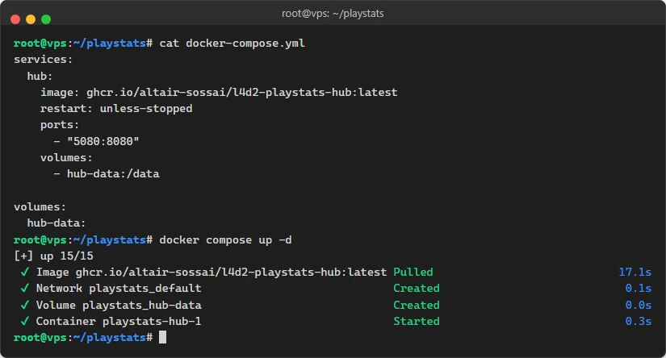
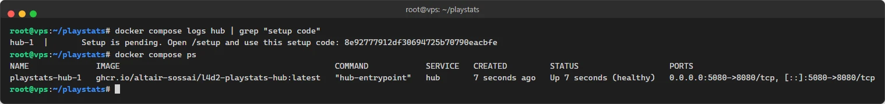
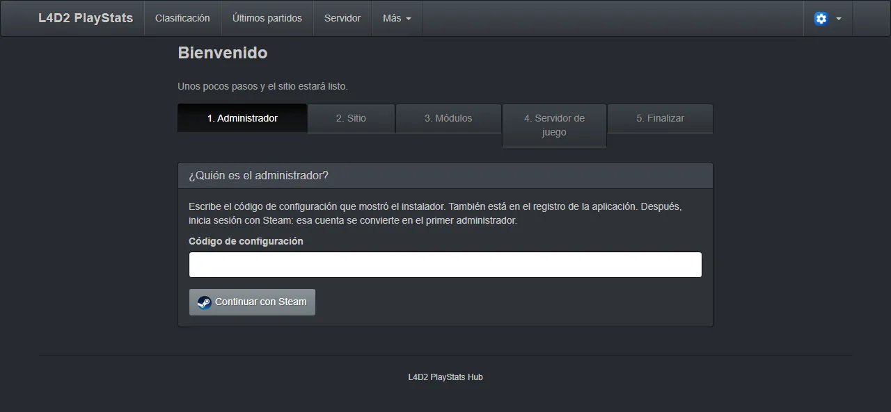

# Instalar con Docker

🌐 [English](install-docker.md) | [Português](install-docker.pt.md) | **Español**

Usa esta opción si ya ejecutas tus servicios en contenedores. Si solo tienes un VPS Linux, el [instalador](install-linux.es.md) es más sencillo.

Las capturas de pantalla de esta página son la salida real de los comandos, grabada en una máquina Ubuntu 24.04 limpia con Docker 29 y Compose 2.40, en una carpeta llamada `playstats`. Tus horarios y tu código de configuración serán distintos.

## Contenido

- [Lo que necesitas](#lo-que-necesitas)
- [Cómo iniciarlo](#cómo-iniciarlo)
- [El código de configuración](#el-código-de-configuración)
- [Actualizar](#actualizar)
- [Copia de seguridad](#copia-de-seguridad)
- [Agregar un administrador](#agregar-un-administrador)
- [Configuración](#configuración)
- [Construir la imagen tú mismo](#construir-la-imagen-tú-mismo)

## Lo que necesitas

Una máquina con Docker y el plugin Compose. La imagen se publica en `ghcr.io/altair-sossai/l4d2-playstats-hub` con cada versión.

## Cómo iniciarlo

Guarda esto como `docker-compose.yml`:

```yaml
services:
  hub:
    image: ghcr.io/altair-sossai/l4d2-playstats-hub:latest
    restart: unless-stopped
    ports:
      - "5080:8080"
    volumes:
      - hub-data:/data

volumes:
  hub-data:
```

Luego inícialo:

```bash
docker compose up -d
```

La primera vez, Docker descarga la imagen y luego crea la red, el volumen y el contenedor:



El sitio queda en `http://YOUR-SERVER-ADDRESS:5080`. La base de datos, los avatares y las claves están en el volumen `hub-data`, así que se conservan entre actualizaciones.

Ejecuta un solo contenedor de la aplicación. La partida en vivo se guarda en memoria, y dos contenedores tendrían cada uno la suya.

## El código de configuración

La primera página del sitio pide un código de configuración. Léelo en el registro:

```bash
docker compose logs hub | grep "setup code"
```



`docker compose ps` muestra el contenedor y su puerto. Abre el sitio, pega el código, inicia sesión con Steam y sigue las páginas. [Configuración inicial](manual/first-run.es.md) muestra cada una de ellas.



## Actualizar

```bash
docker compose pull
```

```bash
docker compose up -d
```

`pull` descarga la imagen más reciente, y `up -d` vuelve a crear el contenedor cuando la imagen cambió. Los datos del volumen se conservan, y el sitio actualiza sus tablas por sí solo al iniciar. Abajo, la imagen ya era la más reciente, así que el contenedor siguió en ejecución:


Para quedarte en una versión específica, reemplaza `latest` en el archivo de Compose por la versión, como `v1.2.0`.

## Copia de seguridad

Detén el contenedor, copia el volumen a un archivo y vuelve a iniciarlo:

```bash
docker compose stop hub
```

```bash
docker run --rm -v hub-data:/data -v "$PWD":/backup alpine tar -czf /backup/hub-backup.tar.gz -C /data .
```

```bash
docker compose start hub
```

El volumen puede llevar el nombre de tu carpeta como prefijo, por ejemplo `myfolder_hub-data`. `docker volume ls` muestra el nombre exacto. En el ejemplo de abajo la carpeta es `playstats`, así que el volumen es `playstats_hub-data`:


Para restaurar, detén el contenedor, vacía el volumen y extrae el archivo en él, y luego vuelve a iniciarlo:

```bash
docker compose stop hub
```

```bash
docker run --rm -v hub-data:/data -v "$PWD":/backup alpine sh -c "rm -rf /data/* && tar -xzf /backup/hub-backup.tar.gz -C /data"
```

```bash
docker compose start hub
```

## Agregar un administrador

Si pierdes el acceso a todas las cuentas de administrador, agrega una desde la máquina:

```bash
docker compose exec hub dotnet L4D2PlayStats.Hub.Web.dll admin add <SteamID64>
```

## Configuración

Los ajustes son variables de entorno. Agrégalas bajo `environment:` en el archivo de Compose.

| Variable | Significado | Valor predeterminado |
|---|---|---|
| `Hub__DataDirectory` | Carpeta con la base de datos, los avatares y las claves. | `/data` |
| `Database__Provider` | `Sqlite`, `SqlServer`, `PostgreSql` o `MySql`. | `Sqlite` |
| `Database__ConnectionString` | Cómo conectarse a la base de datos. | `Data Source=hub.db` |

Si pones un proxy inverso con HTTPS delante del contenedor, mantén una dirección HTTP simple accesible para el juego. [La dirección usada dentro del juego](install-linux.es.md#la-dirección-usada-dentro-del-juego) explica por qué.

## Construir la imagen tú mismo

Desde un clon del repositorio:

```bash
docker build -t l4d2-playstats-hub .
```
