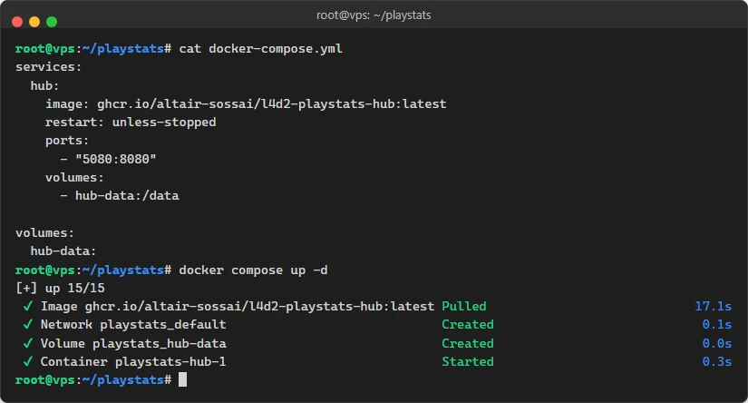
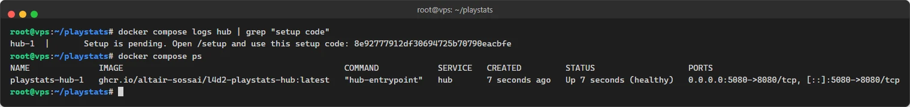
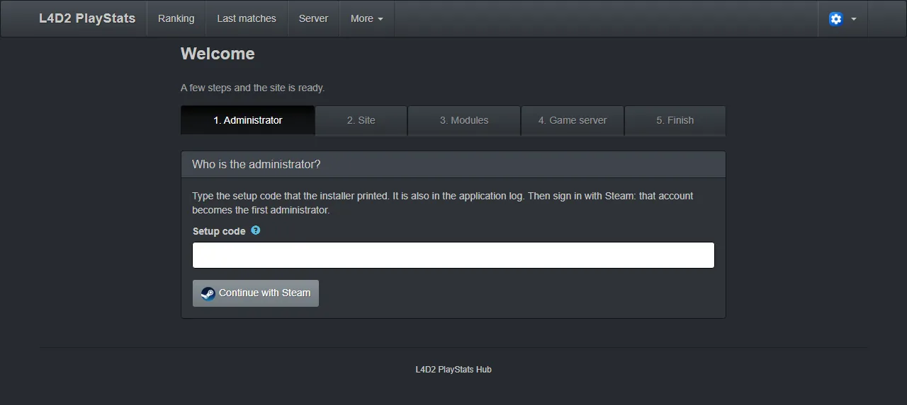

# Installing with Docker

🌐 **English** | [Português](install-docker.pt.md) | [Español](install-docker.es.md)

Use this if you already run your services in containers. If you just have a Linux VPS, the [installer](install-linux.md) is simpler.

The screenshots on this page are the real output of the commands, recorded on a clean Ubuntu 24.04 machine with Docker 29 and Compose 5.8, in a folder named `playstats`. Your times and setup code will be different.

## Contents

- [What you need](#what-you-need)
- [Starting it](#starting-it)
- [The setup code](#the-setup-code)
- [Health check](#health-check)
- [Updating](#updating)
- [Backup](#backup)
- [Adding an administrator](#adding-an-administrator)
- [Configuration](#configuration)
- [Building the image yourself](#building-the-image-yourself)

## What you need

A machine with Docker and the Compose plugin. The image is published at `ghcr.io/altair-sossai/l4d2-playstats-hub` with every release.

## Starting it

Save this as `docker-compose.yml`:

```yaml
services:
  hub:
    image: ghcr.io/altair-sossai/l4d2-playstats-hub:latest
    restart: unless-stopped
    ports:
      - "5080:8080"
    volumes:
      - hub-data:/data

volumes:
  hub-data:
```

Then start it:

```bash
docker compose up -d
```

The first time, Docker downloads the image, then creates the network, the volume and the container:



The site is at `http://YOUR-SERVER-ADDRESS:5080`. The database, the avatars and the keys are in the `hub-data` volume, so they survive updates.

Run only one container of the application. The live match is kept in memory, and two containers would each have their own.

The application runs as the unprivileged `app` user of the .NET image, not as root. When the container starts, it first gives that user the ownership of the data folder, then starts the site.

## The setup code

The first page of the site asks for a setup code. Read it from the log:

```bash
docker compose logs hub | grep "setup code"
```



`docker compose ps` shows the container and its port. Open the site, paste the code, sign in with Steam, and follow the pages. [First-run setup](manual/first-run.md) shows each of them.



## Health check

The image has a health check that needs no extra tools: every 30 seconds Docker runs `dotnet L4D2PlayStats.Hub.Web.dll health` inside the container, which asks the site for `/api/ping` on its own port. `docker compose ps` shows the container as `healthy` once the site answers, and as `unhealthy` after three failures in a row. To run the check by hand:

```bash
docker compose exec hub dotnet L4D2PlayStats.Hub.Web.dll health
```

It prints the answer and ends with 0 when the site is up, or 1 when it is not.

## Updating

```bash
docker compose pull
```

```bash
docker compose up -d
```

`pull` downloads the newest image, and `up -d` recreates the container when the image changed. The data in the volume is kept, and the site updates its tables by itself when it starts. Below, the image was already the newest, so the container kept running:


To stay on a specific version, replace `latest` in the compose file with the version, such as `v1.2.0`.

Images up to v0.3.0 ran the application as root, so the files in an existing volume belong to root. A newer container changes their owner to `app` when it starts, so the update needs nothing else. If you start the container with a fixed `user:` in the compose file, it cannot change the owner; fix it once with `docker run --rm -v hub-data:/data alpine chown -R 1654:1654 /data` (1654 is the `app` user of the image).

## Backup

Stop the container, copy the volume into a file, and start it again:

```bash
docker compose stop hub
```

```bash
docker run --rm -v hub-data:/data -v "$PWD":/backup alpine tar -czf /backup/hub-backup.tar.gz -C /data .
```

```bash
docker compose start hub
```

The volume may be named with your folder as a prefix, such as `myfolder_hub-data`. `docker volume ls` shows the exact name. In the example below the folder is `playstats`, so the volume is `playstats_hub-data`:


To restore, stop the container, empty the volume and extract the file into it, then start it again:

```bash
docker compose stop hub
```

```bash
docker run --rm -v hub-data:/data -v "$PWD":/backup alpine sh -c "rm -rf /data/* && tar -xzf /backup/hub-backup.tar.gz -C /data"
```

```bash
docker compose start hub
```

## Adding an administrator

If you lose access to every administrator account, add one from the machine:

```bash
docker compose exec -u app hub dotnet L4D2PlayStats.Hub.Web.dll admin add <SteamID64>
```

`-u app` runs the command as the same user as the site, so the files it touches keep the right owner.

## Configuration

Settings are environment variables. Add them under `environment:` in the compose file.

| Variable | Meaning | Default |
|---|---|---|
| `Hub__DataDirectory` | Folder with the database, avatars and keys. | `/data` |
| `Database__Provider` | `Sqlite`, `SqlServer`, `PostgreSql` or `MySql`. | `Sqlite` |
| `Database__ConnectionString` | How to reach the database. | `Data Source=hub.db` |
| `Hub__TrustedProxies` | Reverse proxies whose `X-Forwarded-For`, `X-Forwarded-Proto` and `X-Forwarded-Host` headers the site believes: IP addresses or networks such as `172.16.0.0/12`, separated by commas. The container itself (`127.0.0.1` and `::1`) is always trusted. | empty |

If you put a reverse proxy with HTTPS in front of the container, keep a plain HTTP address reachable for the game. [The address used inside the game](install-linux.md#the-address-used-inside-the-game) explains why.

A reverse proxy is never on the loopback address of the container: whether it runs in another container or on the host, the site usually sees a private address of the Docker network, such as `172.18.0.2` or the gateway `172.18.0.1`. Until that address is in `Hub__TrustedProxies`, the site ignores the forwarded headers, so it sees `http` instead of `https` and the address of the proxy instead of the visitor's. Trust the network of your containers:

```yaml
services:
  hub:
    environment:
      Hub__TrustedProxies: "172.16.0.0/12"
```

`docker network inspect` shows the exact subnet if you prefer a narrower range. Do not trust a network that visitors reach directly, or any of them could pretend to come from somewhere else.

## Building the image yourself

From a clone of the repository:

```bash
docker build -t l4d2-playstats-hub .
```
