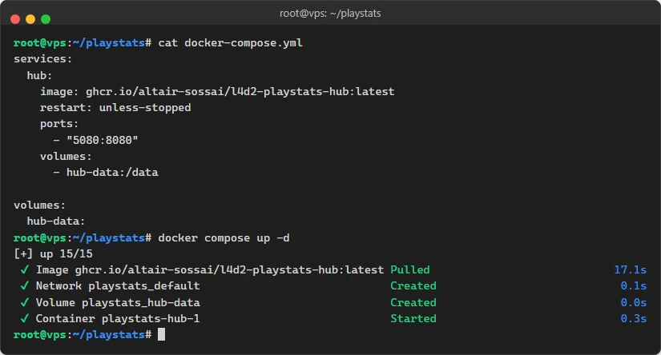
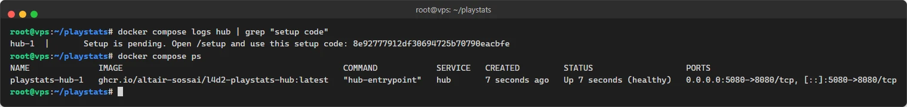
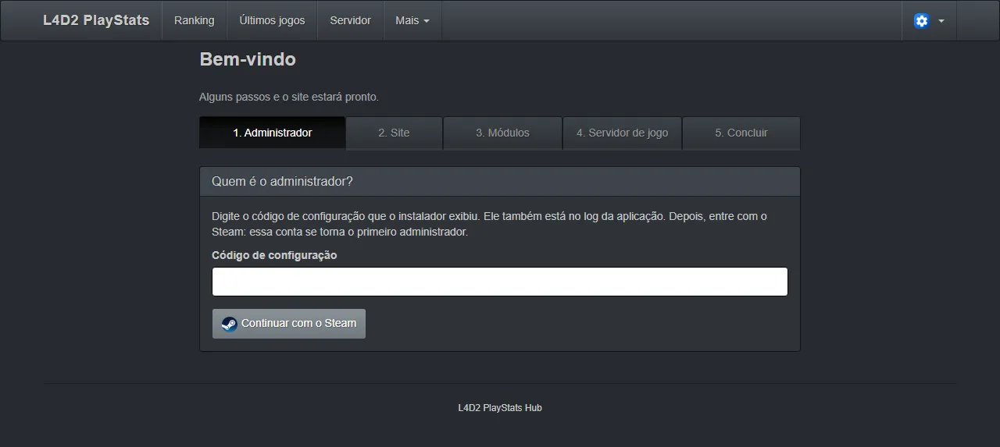
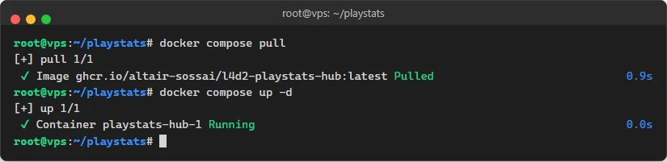

# Instalando com Docker

🌐 [English](install-docker.md) | **Português** | [Español](install-docker.es.md)

Use esta opção se você já roda os seus serviços em contêineres. Se você tem apenas uma VPS Linux, o [instalador](install-linux.pt.md) é mais simples.

As capturas de tela desta página são a saída real dos comandos, gravada em uma máquina Ubuntu 24.04 limpa, com Docker 29 e Compose 2.40, em uma pasta chamada `playstats`. Os seus horários e código de configuração vão ser diferentes.

## Conteúdo

- [O que você precisa](#o-que-você-precisa)
- [Iniciando](#iniciando)
- [O código de configuração](#o-código-de-configuração)
- [Atualizando](#atualizando)
- [Backup](#backup)
- [Adicionando um administrador](#adicionando-um-administrador)
- [Configuração](#configuração)
- [Construindo a imagem você mesmo](#construindo-a-imagem-você-mesmo)

## O que você precisa

Uma máquina com o Docker e o plugin Compose. A imagem é publicada em `ghcr.io/altair-sossai/l4d2-playstats-hub` a cada release.

## Iniciando

Salve isto como `docker-compose.yml`:

```yaml
services:
  hub:
    image: ghcr.io/altair-sossai/l4d2-playstats-hub:latest
    restart: unless-stopped
    ports:
      - "5080:8080"
    volumes:
      - hub-data:/data

volumes:
  hub-data:
```

Depois inicie:

```bash
docker compose up -d
```

Na primeira vez, o Docker baixa a imagem e depois cria a rede, o volume e o contêiner:



O site fica em `http://YOUR-SERVER-ADDRESS:5080`. O banco de dados, os avatares e as chaves ficam no volume `hub-data`, por isso sobrevivem às atualizações.

Rode apenas um contêiner da aplicação. A partida ao vivo fica guardada na memória, e dois contêineres teriam cada um a sua.

## O código de configuração

A primeira página do site pede um código de configuração. Leia-o no log:

```bash
docker compose logs hub | grep "setup code"
```



O `docker compose ps` mostra o contêiner e a porta dele. Abra o site, cole o código, faça login com o Steam e siga as páginas. A [Configuração inicial](manual/first-run.pt.md) mostra cada uma delas.



## Atualizando

```bash
docker compose pull
```

```bash
docker compose up -d
```

O `pull` baixa a imagem mais nova, e o `up -d` recria o contêiner quando a imagem mudou. Os dados do volume são mantidos, e o site atualiza as tabelas sozinho ao iniciar. Abaixo, a imagem já era a mais nova, então o contêiner continuou rodando:



Para ficar em uma versão específica, troque `latest` no arquivo do compose pela versão, como `v1.2.0`.

## Backup

Pare o contêiner, copie o volume para um arquivo e inicie-o de novo:

```bash
docker compose stop hub
```

```bash
docker run --rm -v hub-data:/data -v "$PWD":/backup alpine tar -czf /backup/hub-backup.tar.gz -C /data .
```

```bash
docker compose start hub
```

O volume pode receber o nome da sua pasta como prefixo, por exemplo `myfolder_hub-data`. O comando `docker volume ls` mostra o nome exato. No exemplo abaixo, a pasta é `playstats`, então o volume é `playstats_hub-data`:


Para restaurar, pare o contêiner, esvazie o volume e extraia o arquivo nele, depois inicie de novo:

```bash
docker compose stop hub
```

```bash
docker run --rm -v hub-data:/data -v "$PWD":/backup alpine sh -c "rm -rf /data/* && tar -xzf /backup/hub-backup.tar.gz -C /data"
```

```bash
docker compose start hub
```

## Adicionando um administrador

Se você perder o acesso a todas as contas de administrador, adicione uma pela máquina:

```bash
docker compose exec hub dotnet L4D2PlayStats.Hub.Web.dll admin add <SteamID64>
```

## Configuração

As configurações são variáveis de ambiente. Adicione-as em `environment:` no arquivo do compose.

| Variável | Significado | Padrão |
|---|---|---|
| `Hub__DataDirectory` | Pasta com o banco de dados, os avatares e as chaves. | `/data` |
| `Database__Provider` | `Sqlite`, `SqlServer`, `PostgreSql` ou `MySql`. | `Sqlite` |
| `Database__ConnectionString` | Como chegar ao banco de dados. | `Data Source=hub.db` |

Se você colocar um proxy reverso com HTTPS na frente do contêiner, mantenha um endereço HTTP simples acessível para o jogo. [O endereço usado dentro do jogo](install-linux.pt.md#o-endereço-usado-dentro-do-jogo) explica o motivo.

## Construindo a imagem você mesmo

A partir de um clone do repositório:

```bash
docker build -t l4d2-playstats-hub .
```
