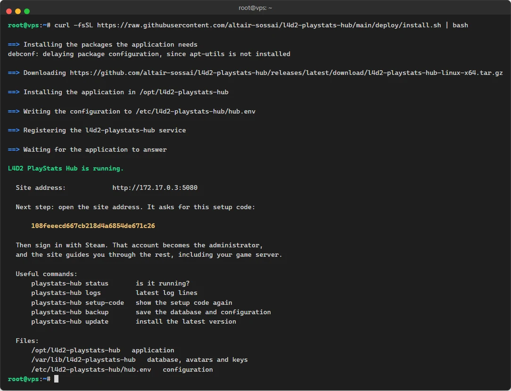
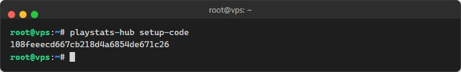
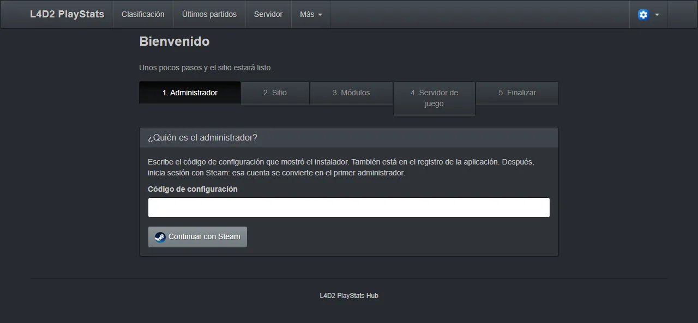
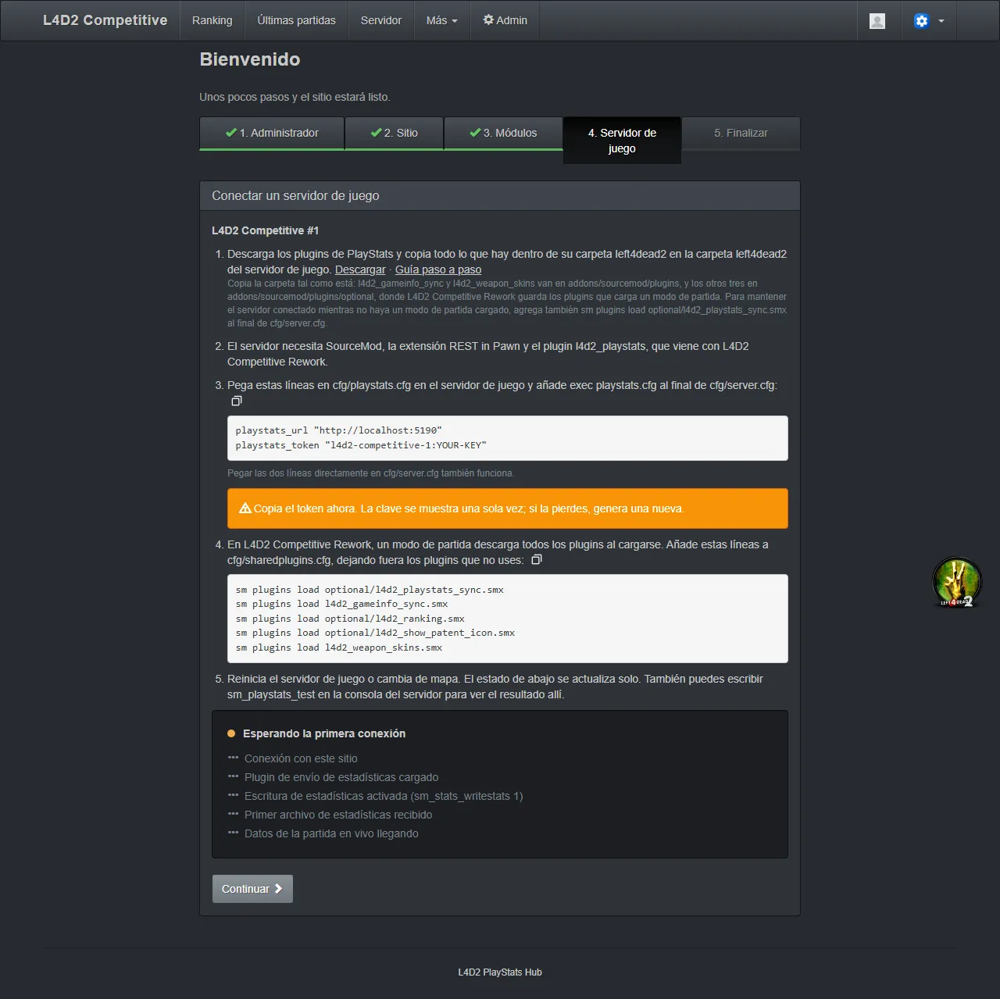
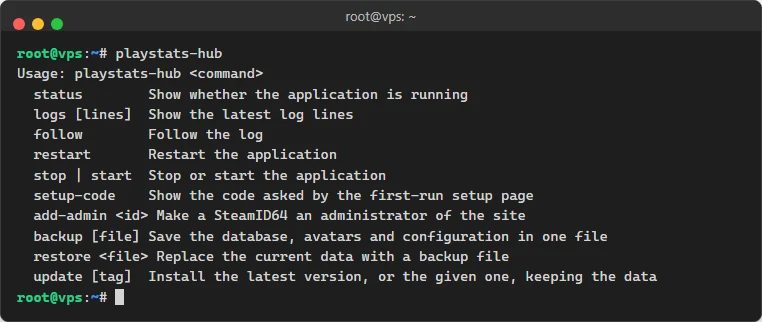
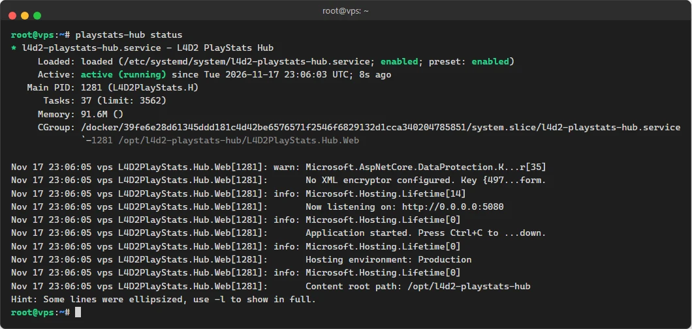

# Instalar en un VPS Linux

🌐 [English](install-linux.md) | [Português](install-linux.pt.md) | **Español**

Esta es la forma recomendada de ejecutar L4D2 PlayStats Hub. Un solo comando instala todo, y luego el sitio te guía en el resto.

Las capturas de pantalla de esta página son la salida real del instalador, grabada en una máquina Ubuntu 24.04 limpia donde los comandos se ejecutaron como root (por eso sin `sudo`). Tus direcciones, fechas y código de configuración serán distintos.

## Contenido

- [Lo que necesitas](#lo-que-necesitas)
- [Paso 1: conéctate al VPS](#paso-1-conéctate-al-vps)
- [Paso 2: ejecuta el instalador](#paso-2-ejecuta-el-instalador)
- [Paso 3: abre el sitio](#paso-3-abre-el-sitio)
- [Paso 4: sigue la configuración](#paso-4-sigue-la-configuración)
- [Usar un dominio con HTTPS](#usar-un-dominio-con-https)
- [La dirección usada dentro del juego](#la-dirección-usada-dentro-del-juego)
- [Comandos del día a día](#comandos-del-día-a-día)
- [Actualizar](#actualizar)
- [Copia de seguridad y restauración](#copia-de-seguridad-y-restauración)
- [Cambiar la configuración](#cambiar-la-configuración)
- [Desinstalar](#desinstalar)
- [Si algo sale mal](#si-algo-sale-mal)

## Lo que necesitas

| Elemento | Detalle |
|---|---|
| Un VPS | Cualquier proveedor. 1 CPU y 1 GB de memoria alcanzan para empezar. |
| Linux | Ubuntu 22.04 o 24.04, o Debian 12. Fedora, Rocky y AlmaLinux también funcionan. |
| Acceso root | Ejecutas un comando como root o con `sudo`. |
| Un puerto abierto | El puerto `5080`, o los puertos `80` y `443` si usas un dominio. |
| Una cuenta de Steam | La cuenta que será el primer administrador del sitio. |

No necesitas instalar .NET, una base de datos ni un servidor web. El instalador trae la aplicación lista para ejecutarse, y la base de datos es un solo archivo.

Puede ejecutarse en la misma máquina que tu servidor de juego o en otra.

## Paso 1: conéctate al VPS

Desde tu computadora, abre una terminal y conéctate con la dirección y el usuario que te dio tu proveedor:

```bash
ssh root@YOUR-SERVER-ADDRESS
```

## Paso 2: ejecuta el instalador

Pega esta línea y presiona Enter:

```bash
curl -fsSL https://raw.githubusercontent.com/altair-sossai/l4d2-playstats-hub/main/deploy/install.sh | sudo bash
```

Tarda cerca de un minuto. Instala los pocos paquetes que necesita la aplicación, descarga la última versión, crea el servicio `l4d2-playstats-hub` y espera hasta que el sitio responda. Al final muestra la dirección del sitio y el código de configuración:



Guarda la dirección y el código de configuración. En un VPS, la dirección es la dirección pública de la máquina. Puedes volver a ver el código en cualquier momento:

```bash
playstats-hub setup-code
```



## Paso 3: abre el sitio

Abre la dirección del sitio en tu navegador. La primera página pide el código de configuración.



1. Pega el código de configuración.
2. Haz clic en **Continuar con Steam** e inicia sesión.

La cuenta de Steam con la que inicias sesión se convierte en el primer administrador. Después de eso, el código deja de funcionar.

## Paso 4: sigue la configuración

El sitio hace algunas preguntas, una página a la vez:

| Página | Lo que decides |
|---|---|
| Sitio | El nombre y el logo del sitio, su idioma predeterminado, tu zona horaria, cuántos meses dura una temporada y una clave opcional de la Steam Web API. |
| Módulos | Lo que tiene el sitio: ranking, servidor en vivo, chat del sitio, comandos remotos, tienda de skins, ranking de la comunidad, página del Anti-Cheat. |
| Servidor de juego | Un nombre para tu servidor de juego. El sitio te da las líneas que debes pegar en su configuración. |
| Finalizar | Confirma. Todo se puede cambiar después en el área de administración. |



El sitio muestra si tu servidor está conectado y qué falta. [Configuración inicial](manual/first-run.es.md) muestra cada página del asistente, y [Conectar un servidor de juego](game-server.es.md) explica en detalle la parte del servidor de juego.

## Usar un dominio con HTTPS

Si tienes un dominio, primero apúntalo al VPS (un registro `A` con la dirección del VPS). Luego ejecuta el instalador con el dominio:

```bash
curl -fsSL https://raw.githubusercontent.com/altair-sossai/l4d2-playstats-hub/main/deploy/install.sh | sudo HUB_DOMAIN=stats.example.com bash
```

El instalador agrega [Caddy](https://caddyserver.com/), que obtiene y renueva el certificado HTTPS por sí solo. Tu sitio queda entonces en `https://stats.example.com`.

Caddy se ejecuta en la misma máquina y habla con el sitio a través de `127.0.0.1`, así que el sitio acepta la dirección del visitante y el esquema `https` que reenvía sin ningún ajuste. Un proxy en otra máquina tiene que estar en `Hub__TrustedProxies` (consulta [Cambiar la configuración](#cambiar-la-configuración)).

Puedes hacer esto en una máquina donde la aplicación ya está instalada. No se pierde nada.

## La dirección usada dentro del juego

Los jugadores abren el ranking dentro de Left 4 Dead 2 con el comando `!ranking`. El navegador integrado en el juego es de 2012 y lo esperable es que falle en los sitios HTTPS actuales, así que el juego debe abrir el sitio por HTTP simple.

Por eso el puerto `5080` sigue abierto incluso cuando usas un dominio:

| Quién lo abre | Dirección |
|---|---|
| Los visitantes, en un navegador normal | `https://stats.example.com` |
| El juego, mediante `!ranking` | `http://YOUR-SERVER-ADDRESS:5080` |

La dirección del juego se define en el servidor de juego, en `playstats_ingame_url`. Consulta [Conectar un servidor de juego](game-server.es.md).

## Comandos del día a día

| Comando | Qué hace |
|---|---|
| `playstats-hub status` | Muestra si la aplicación está en ejecución. |
| `playstats-hub logs` | Muestra las últimas líneas del registro. |
| `playstats-hub follow` | Sigue el registro a medida que se escribe. |
| `playstats-hub restart` | Reinicia la aplicación. |
| `playstats-hub setup-code` | Muestra el código de configuración mientras la configuración inicial no esté terminada. |
| `playstats-hub add-admin <SteamID64>` | Convierte una cuenta de Steam en administrador del sitio. |
| `playstats-hub stop`, `playstats-hub start` | Detiene o inicia la aplicación. |
| `playstats-hub` | Lista los comandos. |



`playstats-hub status` muestra si el servicio está en ejecución, desde cuándo, y sus últimas líneas del registro:



## Actualizar

```bash
playstats-hub update
```

Vuelve a ejecutar el instalador: instala la versión más reciente y conserva tu base de datos y tu configuración. Para instalar una versión específica, indica su nombre: `playstats-hub update v1.2.0`.


Si la configuración inicial todavía no está terminada, el resumen del final vuelve a mostrar el código de configuración; si no, dice que tus datos y tu configuración se conservaron.

## Copia de seguridad y restauración

Todo lo importante está en una sola carpeta. Este comando lo guarda en un solo archivo:

```bash
playstats-hub backup
```

El sitio se detiene unos segundos mientras se hace la copia. El archivo queda en `/root`, con la fecha en el nombre. Cópialo a otra máquina. Para guardarlo en otro lugar, indica una ruta: `playstats-hub backup /backups/hub.tar.gz`.


El archivo contiene la carpeta de datos (la base de datos, los avatares, el logo y las claves) y `hub.env`. [Copias de seguridad y actualizaciones](manual/backups-and-updates.es.md) explica qué es cada parte.

Para restaurar una copia de seguridad, en el mismo VPS o en uno nuevo donde hayas ejecutado el instalador:

```bash
playstats-hub restore /root/l4d2-playstats-hub-backup-20270115-030000.tar.gz
```

Esto reemplaza los datos actuales por los datos del archivo.

## Cambiar la configuración

Casi todo se cambia en el área de administración del sitio. Los pocos ajustes que están fuera de ella se encuentran en `/etc/l4d2-playstats-hub/hub.env`:

| Ajuste | Significado | Valor predeterminado |
|---|---|---|
| `ASPNETCORE_URLS` | Dirección y puerto en los que escucha la aplicación. | `http://0.0.0.0:5080` |
| `Hub__DataDirectory` | Carpeta con la base de datos, los avatares y las claves. | `/var/lib/l4d2-playstats-hub` |
| `Database__Provider` | `Sqlite`, `SqlServer`, `PostgreSql` o `MySql`. | `Sqlite` |
| `Database__ConnectionString` | Cómo conectarse a la base de datos. | `Data Source=hub.db` |
| `Hub__TrustedProxies` | Otros proxies inversos cuyas cabeceras `X-Forwarded-*` acepta el sitio: direcciones IP o redes como `10.0.0.0/8`, separadas por comas. Esta máquina (`127.0.0.1` y `::1`), donde el instalador pone Caddy, siempre es de confianza. | vacío |

Después de editar el archivo, reinicia: `playstats-hub restart`.

Para instalar en otro puerto, defínelo cuando ejecutes el instalador por primera vez: `sudo HUB_PORT=8080 bash`.

El uso de otra base de datos se describe en [Bases de datos](databases.es.md).

## Desinstalar

```bash
sudo systemctl disable --now l4d2-playstats-hub
sudo rm -rf /opt/l4d2-playstats-hub /etc/l4d2-playstats-hub /etc/systemd/system/l4d2-playstats-hub.service /usr/local/bin/playstats-hub
```

Tus datos quedan en `/var/lib/l4d2-playstats-hub`. Borra también esa carpeta si ya no los quieres.

## Si algo sale mal

| Lo que ves | Qué hacer |
|---|---|
| El instalador dice que la distribución no es compatible | Usa una de las distribuciones indicadas, o [Docker](install-docker.es.md). |
| El sitio no abre | Verifica que el puerto esté abierto en el firewall de tu proveedor. Ejecuta `playstats-hub status`. |
| "The application did not start" | Ejecuta `playstats-hub logs` y lee las últimas líneas. La causa habitual es un puerto que ya está en uso; instala con otro `HUB_PORT`. |
| El código de configuración es rechazado | Cópialo de nuevo con `playstats-hub setup-code`. No tiene espacios. |
| HTTPS no funciona con el dominio | El dominio ya debe apuntar al VPS, y los puertos 80 y 443 deben estar abiertos. Luego ejecuta `sudo systemctl restart caddy`. |
| Perdiste el acceso a la cuenta de administrador | En el VPS, ejecuta `playstats-hub add-admin <SteamID64>` con el SteamID64 de otra cuenta de Steam. |
