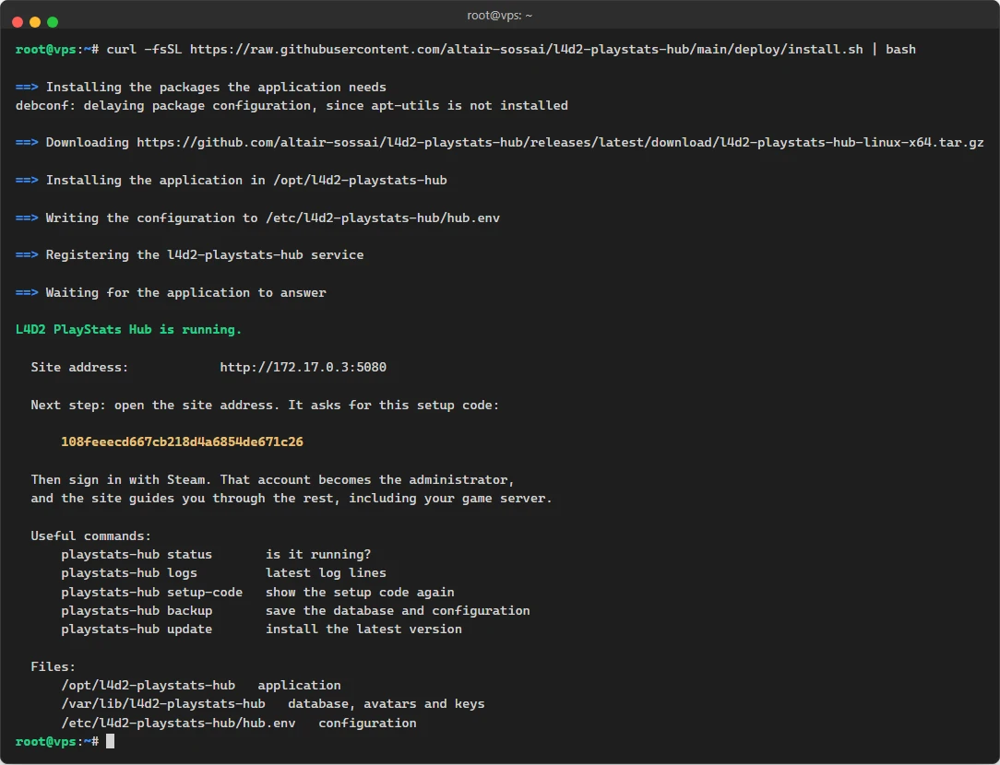
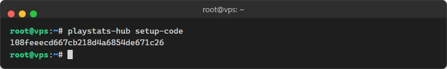
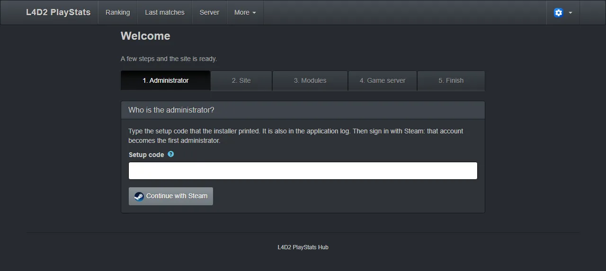
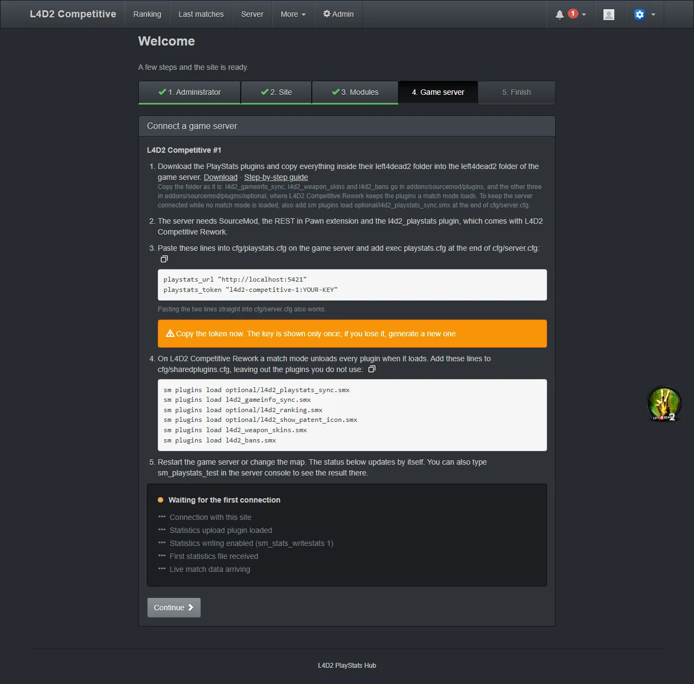
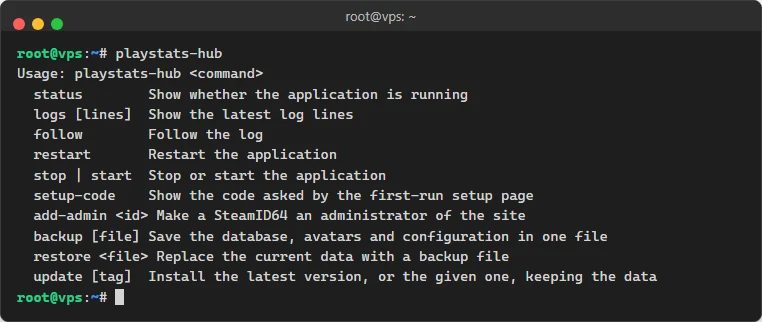
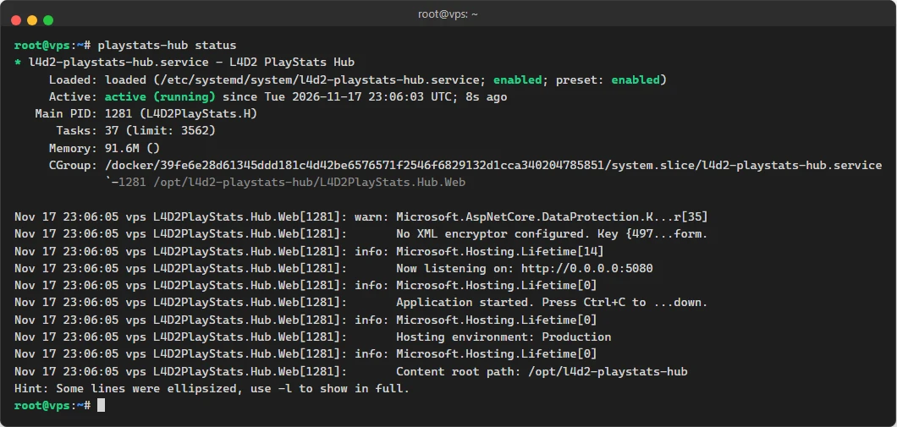
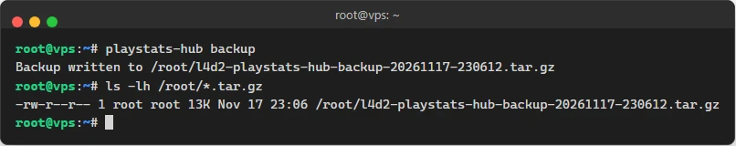

# Installing on a Linux VPS

🌐 **English** | [Português](install-linux.pt.md) | [Español](install-linux.es.md)

This is the recommended way to run L4D2 PlayStats Hub. One command installs everything, and the site then guides you through the rest.

The screenshots on this page are the real output of the installer, recorded on a clean Ubuntu 24.04 machine where the commands ran as root (so without `sudo`). Your addresses, dates and setup code will be different.

## Contents

- [What you need](#what-you-need)
- [Step 1: connect to the VPS](#step-1-connect-to-the-vps)
- [Step 2: run the installer](#step-2-run-the-installer)
- [Step 3: open the site](#step-3-open-the-site)
- [Step 4: follow the setup](#step-4-follow-the-setup)
- [Using a domain with HTTPS](#using-a-domain-with-https)
- [The address used inside the game](#the-address-used-inside-the-game)
- [Day-to-day commands](#day-to-day-commands)
- [Updating](#updating)
- [Backup and restore](#backup-and-restore)
- [Changing the configuration](#changing-the-configuration)
- [Removing it](#removing-it)
- [If something goes wrong](#if-something-goes-wrong)

## What you need

| Item | Detail |
|---|---|
| A VPS | Any provider. 1 CPU and 1 GB of memory are enough to start. |
| Linux | Ubuntu 22.04 or 24.04, or Debian 12. Fedora, Rocky and AlmaLinux also work. |
| Root access | You run one command as root or with `sudo`. |
| An open port | Port `5080`, or ports `80` and `443` if you use a domain. |
| A Steam account | The account that will be the first administrator of the site. |

You do not need to install .NET, a database or a web server. The installer brings the application ready to run, and the database is a single file.

It can run on the same machine as your game server or on another one.

## Step 1: connect to the VPS

From your computer, open a terminal and connect with the address and user your provider gave you:

```bash
ssh root@YOUR-SERVER-ADDRESS
```

## Step 2: run the installer

Paste this line and press Enter:

```bash
curl -fsSL https://raw.githubusercontent.com/altair-sossai/l4d2-playstats-hub/main/deploy/install.sh | sudo bash
```

It takes about a minute. It installs the few packages the application needs, downloads the latest release, creates the `l4d2-playstats-hub` service and waits until the site answers. At the end it prints the address of the site and the setup code:



Keep the address and the setup code. On a VPS the address is the public address of the machine. You can see the code again at any time:

```bash
playstats-hub setup-code
```



## Step 3: open the site

Open the site address in your browser. The first page asks for the setup code.



1. Paste the setup code.
2. Click **Continue with Steam** and sign in.

The Steam account you sign in with becomes the first administrator. The code stops working after that.

## Step 4: follow the setup

The site asks a few questions, one page at a time:

| Page | What you decide |
|---|---|
| Site | The name and logo of the site, its default language, your time zone, how many months a season lasts, and an optional Steam Web API key. |
| Modules | What the site has: ranking, live server, site chat, remote commands, skin shop, community ranking, Anti-Cheat page. |
| Game server | A name for your game server. The site gives you the lines to paste into its configuration. |
| Finish | Confirms. Everything can be changed later in the administration area. |



The site shows whether your server is connected and what is missing. [First-run setup](manual/first-run.md) shows every page of the wizard, and [Connecting a game server](game-server.md) explains the game server side in detail.

## Using a domain with HTTPS

If you have a domain, point it to the VPS first (an `A` record with the address of the VPS). Then run the installer with the domain:

```bash
curl -fsSL https://raw.githubusercontent.com/altair-sossai/l4d2-playstats-hub/main/deploy/install.sh | sudo HUB_DOMAIN=stats.example.com bash
```

The installer adds [Caddy](https://caddyserver.com/), which gets and renews the HTTPS certificate by itself. Your site is then at `https://stats.example.com`.

Caddy runs on the same machine and talks to the site through `127.0.0.1`, so the site believes the visitor address and the `https` scheme it forwards without any setting. A proxy on another machine has to be listed in `Hub__TrustedProxies` (see [Changing the configuration](#changing-the-configuration)). Caddy also passes the WebSocket the [live server page](manual/live-server.md) uses for its updates, with no extra setting.

You can do this on a machine where the application is already installed. Nothing is lost.

## The address used inside the game

Players open the ranking inside Left 4 Dead 2 with the `!ranking` command. The browser built into the game is from 2012 and is expected to fail on current HTTPS sites, so the game should open the site through plain HTTP.

That is why port `5080` stays open even when you use a domain:

| Who opens it | Address |
|---|---|
| Visitors, in a normal browser | `https://stats.example.com` |
| The game, through `!ranking` | `http://YOUR-SERVER-ADDRESS:5080` |

The game address is set on the game server, in `playstats_ingame_url`. See [Connecting a game server](game-server.md).

## Day-to-day commands

| Command | What it does |
|---|---|
| `playstats-hub status` | Shows whether the application is running. |
| `playstats-hub logs` | Shows the latest log lines. |
| `playstats-hub follow` | Follows the log as it is written. |
| `playstats-hub restart` | Restarts the application. |
| `playstats-hub setup-code` | Shows the setup code while the setup is not done. |
| `playstats-hub add-admin <SteamID64>` | Makes a Steam account an administrator of the site. |
| `playstats-hub stop`, `playstats-hub start` | Stops or starts the application. |
| `playstats-hub` | Lists the commands. |



`playstats-hub status` shows whether the service is running, since when, and its latest log lines:



## Updating

```bash
playstats-hub update
```

It runs the installer again: it installs the latest version and keeps your database and configuration. To install a specific version, give its name: `playstats-hub update v1.2.0`.


If the setup is not finished yet, the summary at the end shows the setup code again; otherwise it says that your data and configuration were kept.

## Backup and restore

Everything that matters is in one folder. This command saves it in one file:

```bash
playstats-hub backup
```

The site stops for a few seconds while the copy is made. The file goes to `/root`, with the date in its name. Copy it to another machine. To save it somewhere else, give a path: `playstats-hub backup /backups/hub.tar.gz`.



The file has the data folder (the database, the avatars, the logo and the keys) and `hub.env`. [Backups and updates](manual/backups-and-updates.md) explains what each part is.

To bring a backup back, on the same VPS or on a new one where you ran the installer:

```bash
playstats-hub restore /root/l4d2-playstats-hub-backup-20270115-030000.tar.gz
```

This replaces the current data with the data in the file.

## Changing the configuration

Almost everything is changed in the administration area of the site. The few settings that live outside it are in `/etc/l4d2-playstats-hub/hub.env`:

| Setting | Meaning | Default |
|---|---|---|
| `ASPNETCORE_URLS` | Address and port the application listens on. | `http://0.0.0.0:5080` |
| `Hub__DataDirectory` | Folder with the database, avatars and keys. | `/var/lib/l4d2-playstats-hub` |
| `Database__Provider` | `Sqlite`, `SqlServer`, `PostgreSql` or `MySql`. | `Sqlite` |
| `Database__ConnectionString` | How to reach the database. | `Data Source=hub.db` |
| `Hub__TrustedProxies` | Other reverse proxies whose `X-Forwarded-*` headers the site believes: IP addresses or networks such as `10.0.0.0/8`, separated by commas. This machine (`127.0.0.1` and `::1`), where the installer puts Caddy, is always trusted. | empty |
| `APPLICATIONINSIGHTS_CONNECTION_STRING` | Optional. The connection string of an Azure Application Insights resource: the site then sends what people open, how long each page and query takes, and the errors. The polling of the game servers, the avatars and the static files are left out. | empty (off) |

After editing the file, restart: `playstats-hub restart`.

To install on a different port, set it when you run the installer for the first time: `sudo HUB_PORT=8080 bash`.

Using another database is described in [Databases](databases.md).

## Removing it

```bash
sudo systemctl disable --now l4d2-playstats-hub
sudo rm -rf /opt/l4d2-playstats-hub /etc/l4d2-playstats-hub /etc/systemd/system/l4d2-playstats-hub.service /usr/local/bin/playstats-hub
```

Your data stays in `/var/lib/l4d2-playstats-hub`. Delete that folder too if you do not want it any more.

## If something goes wrong

| What you see | What to do |
|---|---|
| The installer says the distribution is not supported | Use one of the listed distributions, or [Docker](install-docker.md). |
| The site does not open | Check that the port is open in the firewall of your provider. Run `playstats-hub status`. |
| "The application did not start" | Run `playstats-hub logs` and read the last lines. A port already in use is the usual cause; install with another `HUB_PORT`. |
| The setup code is refused | Copy it again with `playstats-hub setup-code`. It has no spaces. |
| HTTPS does not work with the domain | The domain must already point to the VPS, and ports 80 and 443 must be open. Then run `sudo systemctl restart caddy`. |
| You lost access to the administrator account | On the VPS, run `playstats-hub add-admin <SteamID64>` with the SteamID64 of another Steam account. |
