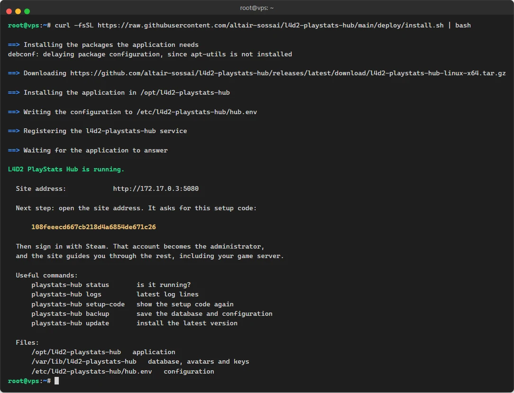
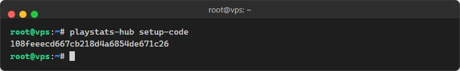
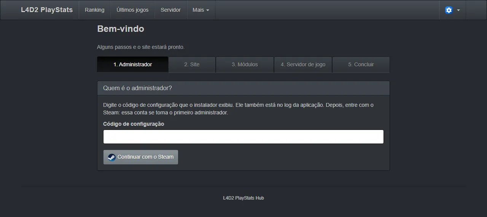
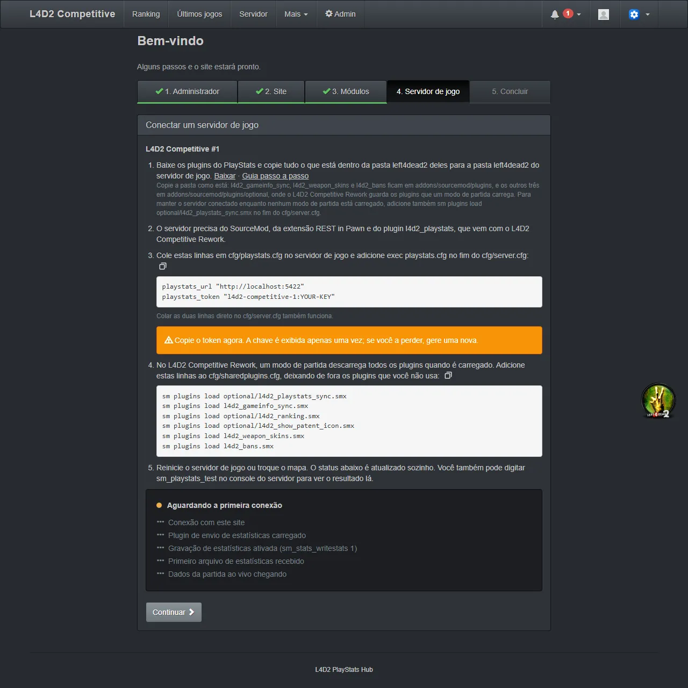
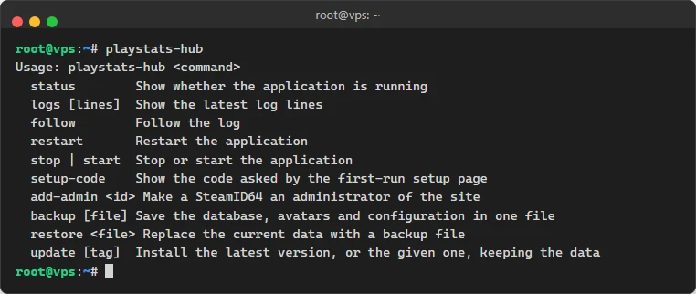
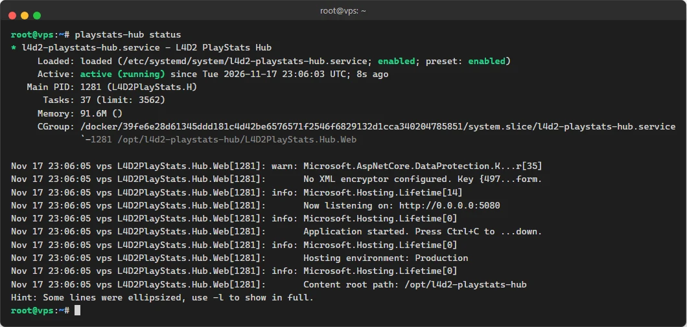

# Instalando em uma VPS Linux

🌐 [English](install-linux.md) | **Português** | [Español](install-linux.es.md)

Esta é a forma recomendada de rodar o L4D2 PlayStats Hub. Um único comando instala tudo, e depois o próprio site guia você pelo restante.

As capturas de tela desta página são a saída real do instalador, gravada em uma máquina Ubuntu 24.04 limpa, onde os comandos rodaram como root (por isso sem `sudo`). Os seus endereços, datas e código de configuração vão ser diferentes.

## Conteúdo

- [O que você precisa](#o-que-você-precisa)
- [Passo 1: conecte-se à VPS](#passo-1-conecte-se-à-vps)
- [Passo 2: execute o instalador](#passo-2-execute-o-instalador)
- [Passo 3: abra o site](#passo-3-abra-o-site)
- [Passo 4: siga a configuração](#passo-4-siga-a-configuração)
- [Usando um domínio com HTTPS](#usando-um-domínio-com-https)
- [O endereço usado dentro do jogo](#o-endereço-usado-dentro-do-jogo)
- [Comandos do dia a dia](#comandos-do-dia-a-dia)
- [Atualizando](#atualizando)
- [Backup e restauração](#backup-e-restauração)
- [A chave de segredos](#a-chave-de-segredos)
- [Alterando a configuração](#alterando-a-configuração)
- [Removendo](#removendo)
- [Se algo der errado](#se-algo-der-errado)

## O que você precisa

| Item | Detalhe |
|---|---|
| Uma VPS | Qualquer provedor. 1 CPU e 1 GB de memória são suficientes para começar. |
| Linux | Ubuntu 22.04 ou 24.04, ou Debian 12. Fedora, Rocky e AlmaLinux também funcionam. |
| Acesso root | Você executa um comando como root ou com `sudo`. |
| Uma porta aberta | A porta `5080`, ou as portas `80` e `443` se você usar um domínio. |
| Uma conta Steam | A conta que será o primeiro administrador do site. |

Você não precisa instalar o .NET, um banco de dados nem um servidor web. O instalador traz a aplicação pronta para rodar, e o banco de dados é um único arquivo.

Ele pode rodar na mesma máquina do seu servidor de jogo ou em outra.

## Passo 1: conecte-se à VPS

No seu computador, abra um terminal e conecte-se usando o endereço e o usuário que o seu provedor informou:

```bash
ssh root@YOUR-SERVER-ADDRESS
```

## Passo 2: execute o instalador

Cole esta linha e pressione Enter:

```bash
curl -fsSL https://raw.githubusercontent.com/altair-sossai/l4d2-playstats-hub/main/deploy/install.sh | sudo bash
```

Leva cerca de um minuto. Ele instala os poucos pacotes de que a aplicação precisa, baixa a release mais recente, cria o serviço `l4d2-playstats-hub` e espera até o site responder. No final, ele mostra o endereço do site e o código de configuração:



Guarde o endereço e o código de configuração. Em uma VPS, o endereço é o endereço público da máquina. Você pode ver o código de novo a qualquer momento:

```bash
playstats-hub setup-code
```



## Passo 3: abra o site

Abra o endereço do site no seu navegador. A primeira página pede o código de configuração.



1. Cole o código de configuração.
2. Clique em **Continuar com a Steam** e faça login.

A conta Steam com a qual você fizer login se torna o primeiro administrador. Depois disso, o código deixa de funcionar.

## Passo 4: siga a configuração

O site faz algumas perguntas, uma página por vez:

| Página | O que você decide |
|---|---|
| Site | O nome e a logo do site, o idioma padrão, o seu fuso horário, quantos meses dura uma temporada e uma chave opcional da Steam Web API. |
| Módulos | O que o site tem: ranking, servidor ao vivo, chat do site, comandos remotos, loja de skins, ranking da comunidade, página do Anti-Cheat. |
| Servidor de jogo | Um nome para o seu servidor de jogo. O site entrega as linhas que você deve colar na configuração dele. |
| Concluir | Confirma. Tudo pode ser alterado depois na área de administração. |



O site mostra se o seu servidor está conectado e o que está faltando. A [Configuração inicial](manual/first-run.pt.md) mostra cada página do assistente, e [Conectando um servidor de jogo](game-server.pt.md) explica o lado do servidor de jogo em detalhes.

## Usando um domínio com HTTPS

Se você tem um domínio, primeiro aponte-o para a VPS (um registro `A` com o endereço da VPS). Depois execute o instalador informando o domínio:

```bash
curl -fsSL https://raw.githubusercontent.com/altair-sossai/l4d2-playstats-hub/main/deploy/install.sh | sudo HUB_DOMAIN=stats.example.com bash
```

O instalador adiciona o [Caddy](https://caddyserver.com/), que obtém e renova o certificado HTTPS sozinho. O seu site passa a ficar em `https://stats.example.com`.

O Caddy roda na mesma máquina e fala com o site por `127.0.0.1`, então o site aceita o endereço do visitante e o esquema `https` que ele repassa sem nenhuma configuração. Um proxy em outra máquina precisa estar em `Hub__TrustedProxies` (veja [Alterando a configuração](#alterando-a-configuração)). O Caddy também repassa o WebSocket que a [página do servidor ao vivo](manual/live-server.pt.md) usa para as atualizações, sem nenhuma configuração extra.

Você pode fazer isso em uma máquina onde a aplicação já está instalada. Nada é perdido.

## O endereço usado dentro do jogo

Os jogadores abrem o ranking dentro do Left 4 Dead 2 com o comando `!ranking`. O navegador embutido no jogo é de 2012 e a expectativa é que ele falhe nos sites HTTPS atuais, por isso o jogo deve abrir o site por HTTP simples.

É por isso que a porta `5080` continua aberta mesmo quando você usa um domínio:

| Quem abre | Endereço |
|---|---|
| Visitantes, em um navegador normal | `https://stats.example.com` |
| O jogo, pelo `!ranking` | `http://YOUR-SERVER-ADDRESS:5080` |

O endereço do jogo é definido no servidor de jogo, em `playstats_ingame_url`. Veja [Conectando um servidor de jogo](game-server.pt.md).

## Comandos do dia a dia

| Comando | O que faz |
|---|---|
| `playstats-hub status` | Mostra se a aplicação está rodando. |
| `playstats-hub logs` | Mostra as últimas linhas do log. |
| `playstats-hub follow` | Acompanha o log enquanto ele é escrito. |
| `playstats-hub restart` | Reinicia a aplicação. |
| `playstats-hub setup-code` | Mostra o código de configuração enquanto a configuração não estiver concluída. |
| `playstats-hub add-admin <SteamID64>` | Torna uma conta Steam administradora do site. |
| `playstats-hub stop`, `playstats-hub start` | Para ou inicia a aplicação. |
| `playstats-hub` | Lista os comandos. |



O `playstats-hub status` mostra se o serviço está rodando, desde quando, e as últimas linhas do log:



## Atualizando

```bash
playstats-hub update
```

Ele executa o instalador de novo: instala a versão mais recente e mantém o seu banco de dados e a sua configuração. Para instalar uma versão específica, informe o nome dela: `playstats-hub update v1.2.0`.


Se a configuração ainda não foi concluída, o resumo no final mostra o código de configuração de novo; caso contrário, ele diz que os seus dados e a sua configuração foram mantidos.

O site continua acessível durante uma atualização e durante o `playstats-hub restart`. A porta pertence a um socket do systemd, `l4d2-playstats-hub.socket`, que continua aceitando conexões enquanto a aplicação reinicia: visitantes e servidores de jogo esperam alguns segundos em vez de receber um erro. A primeira atualização para uma versão com esse socket ainda fica alguns segundos fora do ar, enquanto o socket assume a porta. `playstats-hub stop`, `backup` e `restore` param o socket também, para que nada inicie a aplicação enquanto eles trabalham.

A primeira atualização para uma versão que criptografa os segredos cria a chave de segredos em `/etc/l4d2-playstats-hub/secrets.key` e adiciona `Hub__SecretsKeyFile` ao `hub.env`. Quando o site inicia, ele criptografa os segredos salvos pela versão anterior. Faça uma cópia da chave logo depois dessa atualização, como explica [A chave de segredos](#a-chave-de-segredos).

## Backup e restauração

Tudo o que importa fica em uma única pasta. Este comando salva essa pasta em um único arquivo:

```bash
playstats-hub backup
```

O site para por alguns segundos enquanto a cópia é feita. O arquivo vai para `/root`, com a data no nome. Copie-o para outra máquina. Para salvar em outro lugar, informe um caminho: `playstats-hub backup /backups/hub.tar.gz`.


O arquivo tem a pasta de dados (o banco de dados, os avatares, a logo e as chaves), o `hub.env` e a chave de segredos. [Backups e atualizações](manual/backups-and-updates.pt.md) explica o que é cada parte. Como ele contém a chave de segredos, qualquer pessoa com esse arquivo consegue ler os segredos salvos nas configurações: mantenha-o privado, como você mantém o próprio servidor.

Para restaurar um backup, na mesma VPS ou em uma nova onde você executou o instalador:

```bash
playstats-hub restore /root/l4d2-playstats-hub-backup-20270115-030000.tar.gz
```

Isso substitui os dados atuais, o `hub.env` e a chave de segredos pelos que estão no arquivo. Um backup feito antes de os segredos serem criptografados não tem chave de segredos: nesse caso o comando mantém a chave atual.

## A chave de segredos

A chave da API da Steam, o endereço ou a string de conexão do destino do backup e o código de configuração são salvos criptografados no banco de dados. A chave que os descriptografa é o arquivo `/etc/l4d2-playstats-hub/secrets.key`, de propósito fora da pasta de dados: o zip de backup do site e uma cópia da pasta de dados não a têm, então não revelam esses segredos.

- O instalador cria a chave uma vez, com 32 bytes aleatórios, legível só pelo usuário `playstats` (permissões `600`). As atualizações a mantêm.
- `playstats-hub backup` inclui a chave e `playstats-hub restore` a coloca de volta.
- O backup automático para o Azure Storage não inclui a chave. Guarde uma cópia dela em um lugar seguro, longe dos backups:

```bash
sudo cat /etc/l4d2-playstats-hub/secrets.key
```

Para levar o site para outra máquina com um zip do backup automático, execute o instalador lá, copie o seu `secrets.key` por cima do que ele criou e depois restaure o zip:

```bash
sudo install -o playstats -g playstats -m 600 secrets.key /etc/l4d2-playstats-hub/secrets.key
```

Sem a chave original o site inicia e todos os dados estão lá, mas os segredos salvos nas configurações ficam vazios: o log avisa, e você digita de novo a chave da API da Steam e o destino do backup na área de administração. Se a chave não puder ser lida, o site também inicia, escreve o motivo no log e o mostra em **Administração > Backup**, e mantém os segredos que não consegue descriptografar até a chave voltar.

## Alterando a configuração

Quase tudo é alterado na área de administração do site. As poucas configurações que ficam fora dela estão em `/etc/l4d2-playstats-hub/hub.env`:

| Configuração | Significado | Padrão |
|---|---|---|
| `ASPNETCORE_URLS` | Endereço e porta em que a aplicação escuta. | `http://0.0.0.0:5080` |
| `Hub__DataDirectory` | Pasta com o banco de dados, os avatares e as chaves. | `/var/lib/l4d2-playstats-hub` |
| `Hub__SecretsKeyFile` | O arquivo da chave de segredos. Veja [A chave de segredos](#a-chave-de-segredos). | `/etc/l4d2-playstats-hub/secrets.key` |
| `Hub__SecretsKey` | Opcional. A própria chave de segredos, 32 bytes aleatórios em base64 (`openssl rand -base64 32`), no lugar do arquivo. | vazio |
| `Database__Provider` | `Sqlite`, `SqlServer`, `PostgreSql` ou `MySql`. | `Sqlite` |
| `Database__ConnectionString` | Como chegar ao banco de dados. | `Data Source=hub.db` |
| `Hub__TrustedProxies` | Outros proxies reversos cujos cabeçalhos `X-Forwarded-*` o site aceita: endereços IP ou redes como `10.0.0.0/8`, separados por vírgulas. Esta máquina (`127.0.0.1` e `::1`), onde o instalador coloca o Caddy, é sempre confiável. | vazio |
| `APPLICATIONINSIGHTS_CONNECTION_STRING` | Opcional. A connection string de um recurso Azure Application Insights: o site passa a enviar o que as pessoas abrem, quanto tempo cada página e consulta leva e os erros. As consultas dos servidores de jogo, os avatares, os arquivos estáticos e as comparações de jogadores abertas sem referer (robôs) ficam de fora. | vazio (desligado) |

Depois de editar o arquivo, reinicie: `playstats-hub restart`.

Para instalar em uma porta diferente, defina-a ao executar o instalador pela primeira vez: `sudo HUB_PORT=8080 bash`.

O uso de outro banco de dados está descrito em [Bancos de dados](databases.pt.md).

## Removendo

```bash
sudo systemctl disable --now l4d2-playstats-hub.socket l4d2-playstats-hub
sudo rm -rf /opt/l4d2-playstats-hub /etc/l4d2-playstats-hub /etc/systemd/system/l4d2-playstats-hub.service /etc/systemd/system/l4d2-playstats-hub.socket /usr/local/bin/playstats-hub
```

Os seus dados continuam em `/var/lib/l4d2-playstats-hub`. Apague essa pasta também se você não quiser mais guardá-los. O segundo comando também apaga a chave de segredos: se você guardar os dados, guarde também uma cópia de `/etc/l4d2-playstats-hub/secrets.key`.

## Se algo der errado

| O que você vê | O que fazer |
|---|---|
| O instalador diz que a distribuição não é suportada | Use uma das distribuições listadas, ou o [Docker](install-docker.pt.md). |
| O site não abre | Verifique se a porta está aberta no firewall do seu provedor. Execute `playstats-hub status`. |
| "The application did not start" | Execute `playstats-hub logs` e leia as últimas linhas. A causa mais comum é uma porta já em uso; instale com outro `HUB_PORT`. |
| O código de configuração é recusado | Copie-o de novo com `playstats-hub setup-code`. Ele não tem espaços. |
| O HTTPS não funciona com o domínio | O domínio já precisa apontar para a VPS, e as portas 80 e 443 precisam estar abertas. Depois execute `sudo systemctl restart caddy`. |
| Você perdeu o acesso à conta de administrador | Na VPS, execute `playstats-hub add-admin <SteamID64>` com o SteamID64 de outra conta Steam. |
