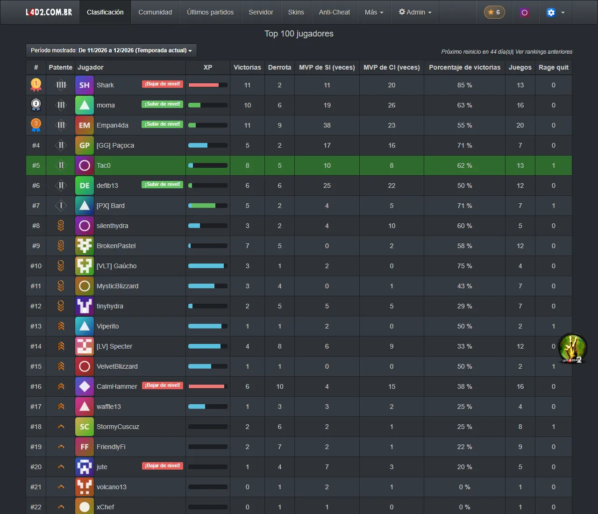

# Manual de usuario

🌐 [English](README.md) | [Português](README.pt.md) | **Español**

Este manual explica cada función de L4D2 PlayStats Hub: qué muestra cada página, cómo se calculan los números y qué puede cambiar el administrador. Está escrito para dos tipos de lectores:

- **Administradores de la comunidad**, que instalan y mantienen el sitio.
- **Jugadores**, que lo visitan para seguir el ranking, sus partidas y el servidor en vivo.

La lista de abajo indica qué páginas son para jugadores y cuáles para administradores. La instalación en sí se describe en las [guías de instalación](#instalación).

## Contenido

### Empieza aquí

| Página | Para | Qué cubre |
|---|---|---|
| [Qué es la aplicación](overview.es.md) | Todos | Qué hace el sitio, las palabras usadas en este manual y cómo encajan las partes. |
| [Configuración inicial](first-run.es.md) | Administradores | El asistente de instalación, paso a paso, hasta conectar tu primer servidor de juego. |

### El sitio

| Página | Para | Qué cubre |
|---|---|---|
| [Ranking](ranking.es.md) | Todos | El ranking principal, cómo se calcula la experiencia, los MVP, los rage quits, los castigos y el mínimo de partidas. |
| [Temporadas e historia](seasons-and-history.es.md) | Todos | Cómo funcionan las temporadas, el selector de período y los rankings de temporadas pasadas, de años y de todo el tiempo. |
| [Patentes](patents.es.md) | Todos | Los 15 niveles de patente y la experiencia que necesita cada uno. |
| [Partidas](matches.es.md) | Todos | La lista de partidas, los detalles de una partida, las estadísticas de un mapa y cómo los archivos se convierten en partidas. |
| [Jugadores](players.es.md) | Todos | La lista de jugadores, la página del jugador y sus pestañas, y la comparación de dos jugadores. |
| [Servidor en vivo](live-server.es.md) | Todos | La partida en curso en cada servidor de juego, el selector de servidores y el chat del sitio. |
| [Tienda de skins de armas](skin-shop.es.md) | Todos | Las estrellas, comprar y equipar skins, los regalos, los reembolsos al final de la temporada y los ajustes de la tienda. |
| [Ranking de la comunidad](community-ranking.es.md) | Todos | La votación entre pares de jugadores, la calificación, los límites de votos y sus ajustes. |
| [Anti-Cheat](anti-cheat.es.md) | Todos | La página que ofrece la descarga del Anti-Cheat, quién debe usar el Anti-Cheat en los servidores de juego, y sus ajustes. |
| [Páginas dentro del juego](in-game-pages.es.md) | Todos | Lo que abre `!ranking` dentro de Left 4 Dead 2. |
| [Comandos del servidor de juego](commands.es.md) | Todos | La página Comandos: todos los comandos del servidor de juego con ejemplos, y los catálogos de los que sale su texto. |
| [Idiomas, temas y teléfonos](languages-and-themes.es.md) | Todos | Los tres idiomas, los temas oscuro y claro, y el diseño en el teléfono. |

### Administrar el sitio

| Página | Para | Qué cubre |
|---|---|---|
| [Administración](administration.es.md) | Administradores | La vista general, los servidores de juego, los módulos, la configuración y los administradores. |
| [Modos de juego y campañas](game-modes-and-campaigns.es.md) | Administradores | Qué partidas cuentan para el ranking y qué mapas forman una partida. |
| [Moderación](moderation.es.md) | Administradores | Castigos, baneos del chat, comandos remotos y conexiones de jugadores. |
| [Copias de seguridad y actualizaciones](backups-and-updates.es.md) | Administradores | Qué respaldar, cómo restaurar y cómo actualizar. |
| [Preguntas y problemas](faq.es.md) | Todos | Preguntas frecuentes y qué hacer cuando algo no funciona. |

### Instalación

| Guía | Para |
|---|---|
| [Instalar en un VPS Linux](../install-linux.es.md) | La forma recomendada: un solo comando. |
| [Instalar con Docker](../install-docker.es.md) | Si ya usas contenedores. |
| [Instalar en Azure](../install-azure.es.md) | Una máquina virtual o App Service. |
| [Conectar un servidor de juego](../game-server.es.md) | Los plugins y sus ajustes, del lado del servidor de juego. |
| [Cambiar desde el sitio antiguo](../switch-from-old-site.es.md) | Reemplazar el sitio anterior por este, sin cambiar sus direcciones. |
| [Bases de datos](../databases.es.md) | SQL Server, PostgreSQL o MySQL en lugar de SQLite. |

## Sobre las capturas de pantalla

Las capturas muestran datos ficticios, en español: las partidas de una comunidad real, en la que cada jugador se reemplazó por uno inventado, con apodo, avatar y SteamID inventados. Ningún jugador en ellas es una persona real. Las mismas capturas existen en inglés y en portugués en las otras versiones de este manual. Se tomaron con la [herramienta de capturas](../../tools/screenshots/README.es.md), que hace esa copia ficticia de los datos y puede volver a tomar las capturas cuando las páginas cambien.

Algunas capturas se tomaron con el inicio de sesión de desarrollo, que muestra el SteamID64 del usuario conectado (por ejemplo `Player 76561201960265728`) donde un sitio real muestra el nombre de Steam.
