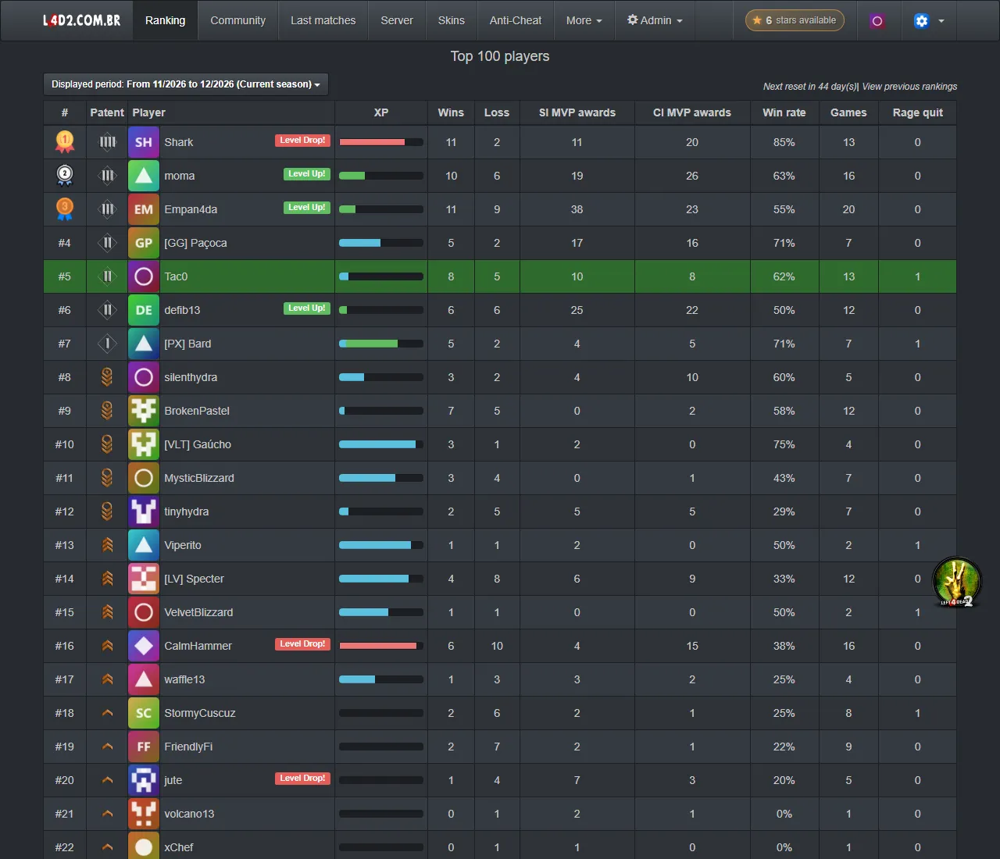

# User manual

🌐 **English** | [Português](README.pt.md) | [Español](README.es.md)

This manual explains every feature of L4D2 PlayStats Hub: what each page shows, how the numbers are calculated, and what the administrator can change. It is written for two kinds of readers:

- **Community administrators**, who install and run the site.
- **Players**, who visit it to follow the ranking, their matches and the live server.

Pages for players and pages for administrators are marked in the list below. The installation itself is described in the [installation guides](#installation).

## Contents

### Start here

| Page | For | What it covers |
|---|---|---|
| [What the application is](overview.md) | Everyone | What the site does, the words used in this manual, and how the parts fit together. |
| [First-run setup](first-run.md) | Administrators | The setup wizard, step by step, until your first game server is connected. |

### The site

| Page | For | What it covers |
|---|---|---|
| [Ranking](ranking.md) | Everyone | The main ranking, how experience is calculated, MVPs, tank wipes, rage quits, punishments and the minimum number of matches. |
| [Seasons and history](seasons-and-history.md) | Everyone | How seasons work, the period selector, and the rankings of past seasons, years and all time. |
| [Patents](patents.md) | Everyone | The 15 patent levels and the experience each one needs. |
| [Matches](matches.md) | Everyone | The match list, match details, map statistics, and how files become matches. |
| [Players](players.md) | Everyone | The player list, the player page and its tabs, and the comparison of two players. |
| [Live server](live-server.md) | Everyone | The match in progress on each game server, the server picker and the site chat. |
| [Weapon skin shop](skin-shop.md) | Everyone | Stars, buying and equipping skins, gifts, refunds at the end of the season, and the shop settings. |
| [Community ranking](community-ranking.md) | Everyone | Voting on pairs of players, the rating, the vote limits and their settings. |
| [Anti-Cheat](anti-cheat.md) | Everyone | The page that offers the Anti-Cheat download, who must use the Anti-Cheat on the game servers, and its settings. |
| [Championships](championships.md) | Everyone | Championships with round robin and knockout stages: teams, draft, brackets, dates proposed by the captains, results and statistics. |
| [Notifications](notifications.md) | Everyone | The bell in the top bar, the notifications page, and who is told about each event. |
| [Bans](bans.md) | Everyone | The players banned from the game servers: the public list, the warning on the player page, the bans given in the game, related accounts and alerts. |
| [Pages inside the game](in-game-pages.md) | Everyone | The light pages that `!ranking`, `!comandos` and `!commands` can open inside Left 4 Dead 2. |
| [Game server commands](commands.md) | Everyone | The Commands page: every command of the game server with examples, and the catalogs its text comes from. |
| [Languages, themes and phones](languages-and-themes.md) | Everyone | The three languages, the dark and light themes, and the layout on a phone. |

### Running the site

| Page | For | What it covers |
|---|---|---|
| [Administration](administration.md) | Administrators | The overview, game servers, modules, settings and administrators. |
| [Game modes and campaigns](game-modes-and-campaigns.md) | Administrators | Which matches count for the ranking, and which maps form a match. |
| [Moderation](moderation.md) | Administrators | Punishments, chat bans, remote commands and player connections. |
| [Backups and updates](backups-and-updates.md) | Administrators | What to back up, how to restore, and how to update. |
| [Questions and problems](faq.md) | Everyone | Common questions and what to do when something does not work. |

### Installation

| Guide | For |
|---|---|
| [Installing on a Linux VPS](../install-linux.md) | The recommended way: one command. |
| [Installing with Docker](../install-docker.md) | If you already use containers. |
| [Installing on Azure](../install-azure.md) | A virtual machine or App Service. |
| [Connecting a game server](../game-server.md) | The plugins and their settings, on the game server side. |
| [Switching from the old site](../switch-from-old-site.md) | Replacing the earlier site with this one, without changing its addresses. |
| [Databases](../databases.md) | SQL Server, PostgreSQL or MySQL instead of SQLite. |

## About the screenshots

The screenshots show fictional data, in English: the matches of a real community, in which every player was replaced by a made-up one, with an invented nickname, avatar and SteamID. No player in them is a real person. The same screenshots exist in Portuguese and Spanish in the translated versions of this manual. They were taken with the [screenshot tool](../../tools/screenshots/README.md), which makes that fictional copy of the data and can take the screenshots again after the pages change.

Some screenshots were taken with the development sign-in, which shows the SteamID64 of the signed-in user (for example `Player 76561201960265728`) where a real site shows the Steam name.
