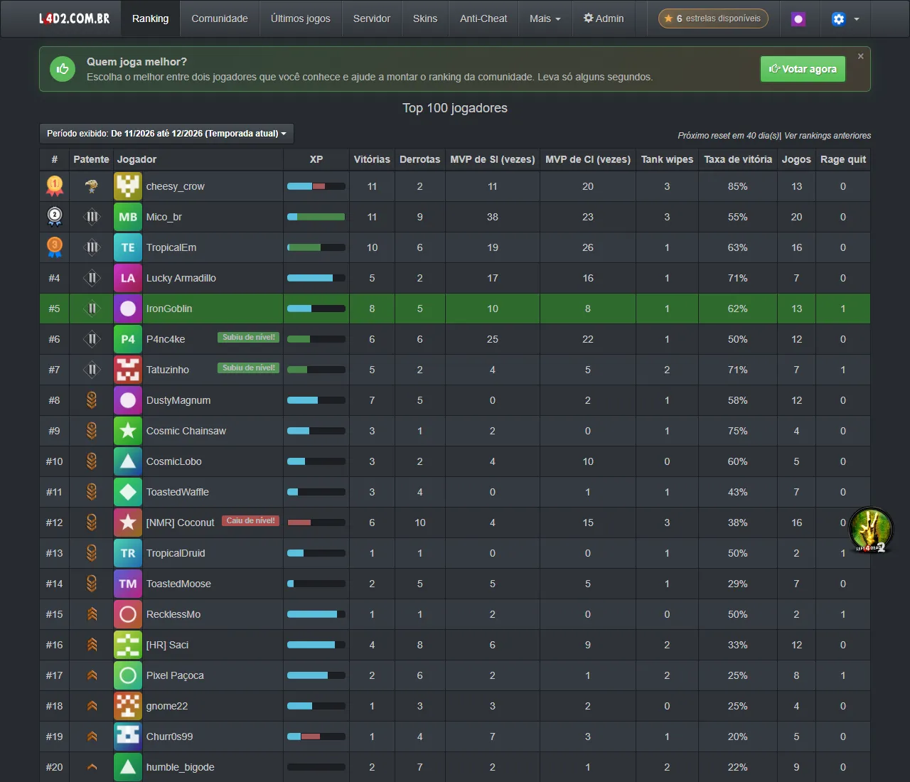

# Manual do usuário

🌐 [English](README.md) | **Português** | [Español](README.es.md)

Este manual explica cada recurso do L4D2 PlayStats Hub: o que cada página mostra, como os números são calculados e o que o administrador pode alterar. Ele foi escrito para dois tipos de leitor:

- **Administradores da comunidade**, que instalam e mantêm o site.
- **Jogadores**, que visitam o site para acompanhar o ranking, as partidas deles e o servidor ao vivo.

As páginas para jogadores e para administradores estão indicadas na lista abaixo. A instalação em si está descrita nos [guias de instalação](#instalação).

## Conteúdo

### Comece aqui

| Página | Para | O que explica |
|---|---|---|
| [O que é a aplicação](overview.pt.md) | Todos | O que o site faz, os termos usados neste manual e como as partes se encaixam. |
| [Configuração inicial](first-run.pt.md) | Administradores | O assistente de instalação, passo a passo, até o primeiro servidor de jogo conectado. |

### O site

| Página | Para | O que explica |
|---|---|---|
| [Ranking](ranking.pt.md) | Todos | O ranking principal, como a experiência é calculada, MVPs, rage quits, punições e o número mínimo de partidas. |
| [Temporadas e histórico](seasons-and-history.pt.md) | Todos | Como as temporadas funcionam, o seletor de período e os rankings de temporadas passadas, de anos e de todo o período. |
| [Patentes](patents.pt.md) | Todos | Os 15 níveis de patente e a experiência que cada um exige. |
| [Partidas](matches.pt.md) | Todos | A lista de partidas, os detalhes da partida, as estatísticas de cada mapa e como os arquivos viram partidas. |
| [Jogadores](players.pt.md) | Todos | A lista de jogadores, a página do jogador e suas abas, e a comparação entre dois jogadores. |
| [Servidor ao vivo](live-server.pt.md) | Todos | A partida em andamento em cada servidor de jogo, a escolha do servidor e o chat do site. |
| [Loja de skins de armas](skin-shop.pt.md) | Todos | Estrelas, compra e equipamento de skins, presentes, reembolsos no fim da temporada e as configurações da loja. |
| [Ranking da comunidade](community-ranking.pt.md) | Todos | A votação em duplas de jogadores, a pontuação, os limites de votos e suas configurações. |
| [Página do Anti-Cheat](anti-cheat.pt.md) | Todos | A página que oferece o download do Anti-Cheat, e suas configurações. |
| [Páginas dentro do jogo](in-game-pages.pt.md) | Todos | O que o `!ranking` abre dentro do Left 4 Dead 2. |
| [Idiomas, temas e celular](languages-and-themes.pt.md) | Todos | Os três idiomas, o tema escuro e o tema claro, e o layout no celular. |

### Administrando o site

| Página | Para | O que explica |
|---|---|---|
| [Administração](administration.pt.md) | Administradores | A visão geral, os servidores de jogo, os módulos, as configurações e os administradores. |
| [Modos de jogo e campanhas](game-modes-and-campaigns.pt.md) | Administradores | Quais partidas contam para o ranking e quais mapas formam uma partida. |
| [Moderação](moderation.pt.md) | Administradores | Punições, banimentos do chat, comandos remotos e conexões de jogadores. |
| [Backups e atualizações](backups-and-updates.pt.md) | Administradores | O que guardar no backup, como restaurar e como atualizar. |
| [Dúvidas e problemas](faq.pt.md) | Todos | Dúvidas comuns e o que fazer quando algo não funciona. |

### Instalação

| Guia | Para |
|---|---|
| [Instalando em uma VPS Linux](../install-linux.pt.md) | O caminho recomendado: um comando. |
| [Instalando com Docker](../install-docker.pt.md) | Se você já usa contêineres. |
| [Instalando no Azure](../install-azure.pt.md) | Uma máquina virtual ou um App Service. |
| [Conectando um servidor de jogo](../game-server.pt.md) | Os plugins e suas configurações, do lado do servidor de jogo. |
| [Bancos de dados](../databases.pt.md) | SQL Server, PostgreSQL ou MySQL no lugar do SQLite. |

## Sobre as capturas de tela

As capturas de tela mostram dados fictícios, em português: as partidas de uma comunidade real, em que cada jogador foi trocado por um inventado, com apelido, avatar e SteamID inventados. Nenhum jogador nelas é uma pessoa real. As mesmas capturas existem em inglês e em espanhol nas outras versões deste manual. Elas foram feitas com a [ferramenta de capturas de tela](../../tools/screenshots/README.pt.md), que faz essa cópia fictícia dos dados e pode refazer as capturas depois que as páginas mudarem.

Algumas capturas foram feitas com o login de desenvolvimento, que mostra o SteamID64 do usuário logado (por exemplo `Player 76561201960265728`) onde um site real mostra o nome da Steam.
