# Administración

🌐 [English](administration.md) | [Português](administration.pt.md) | **Español**

El área de administración es donde se configura el sitio. Solo está abierta para los administradores: **Admin** en el menú de arriba, o `/admin`. Todas las páginas del área tienen el [menú de administración](#el-menú-de-administración) a la izquierda.

Esta página cubre la vista general, los servidores de juego, los módulos, la configuración, los administradores y la copia de seguridad. Las demás páginas de administración se explican junto con su función:

| Elemento del menú | Se explica en |
|---|---|
| Modos de juego, Campañas | [Modos de juego y campañas](game-modes-and-campaigns.es.md) |
| Compras, Precios, Catálogo, Ajustes de la tienda | [Tienda de skins de armas > Para administradores](skin-shop.es.md#para-administradores) |
| Ranking de la comunidad | [Ranking de la comunidad > Para administradores](community-ranking.es.md#para-administradores) |
| Baneos de chat, Comandos remotos, Conexiones de jugadores | [Moderación](moderation.es.md) |
| Ajustes del Anti-Cheat | [Anti-Cheat > Para administradores](anti-cheat.es.md#para-administradores) |

Un elemento cuyo módulo está desactivado no aparece en el menú.

[Volver al manual](README.es.md)

## Contenido

- [El menú de administración](#el-menú-de-administración)
- [Vista general](#vista-general)
- [Servidores de juego](#servidores-de-juego)
- [Módulos](#módulos)
- [Configuración](#configuración)
- [Administradores](#administradores)
- [Copia de seguridad](#copia-de-seguridad)

## El menú de administración

Todas las páginas de administración tienen el mismo menú a la izquierda, con la página en la que estás resaltada. La página de un servidor de juego resalta **Servidores de juego**. El menú agrupa las páginas:

| Grupo | Páginas |
|---|---|
| Sitio | Vista general, Configuración, Módulos, Administradores, Copia de seguridad |
| Servidores de juego | Servidores de juego, Comandos remotos, Conexiones de jugadores, Baneos de chat |
| Ranking | Modos de juego, Campañas, Ranking de la comunidad |
| Tienda de skins | Compras, Precios, Catálogo, Ajustes de la tienda |
| Anti-Cheat | Ajustes del Anti-Cheat |

Una página cuyo módulo está desactivado no aparece en el menú, y un grupo que se queda sin páginas desaparece. En una página larga, el menú sigue a la vista mientras te desplazas. El menú de arriba del sitio sigue igual, con **Admin** para volver aquí desde cualquier página.

En el teléfono, el menú queda plegado en una barra encima de la página, que muestra la página en la que estás. Tócala para abrir la lista completa:

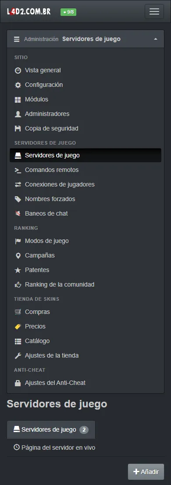

## Vista general

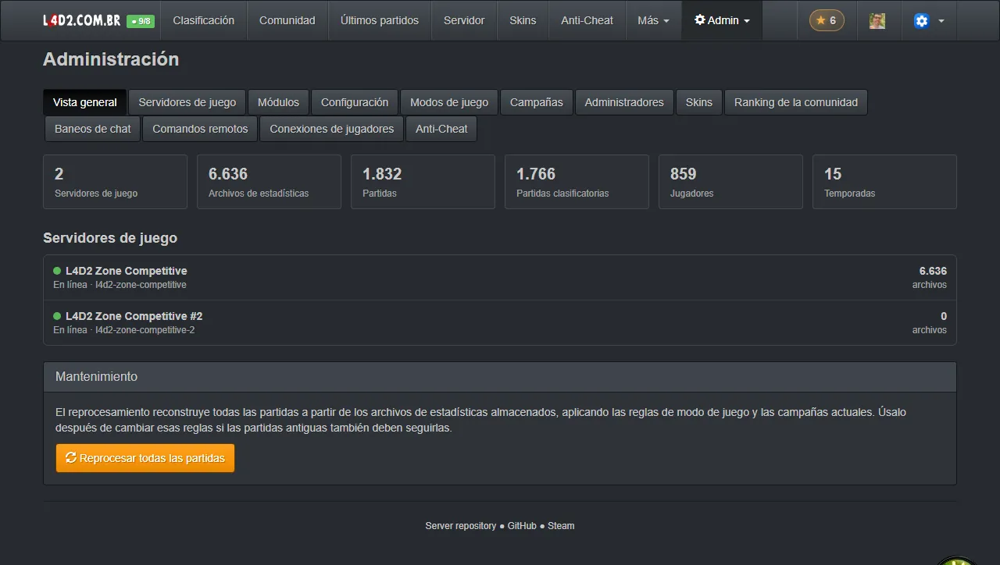

- **Los contadores**: servidores de juego, archivos de estadísticas recibidos, partidas, partidas del ranking, jugadores y temporadas.
- **Un aviso** cuando las configuraciones de juego vistas en tus servidores no coinciden con ninguna [regla de modo de juego](game-modes-and-campaigns.es.md#modos-de-juego). Sus partidas no cuentan para el ranking hasta que una regla las cubra. **Revisar los modos de juego** abre la página.
- **Servidores de juego**: cada servidor con su estado y la cantidad de archivos que envió.
- **Mantenimiento > Reprocesar todas las partidas**: reconstruye todas las partidas a partir de los archivos de estadísticas guardados, con los modos de juego y las campañas actuales y la opción sobre mapas desconocidos. Úsalo después de cambiar esas reglas si las partidas antiguas también deben seguirlas. Pide confirmación y dice cuántas partidas se reconstruyeron. Con muchos datos, tarda un rato.

## Servidores de juego

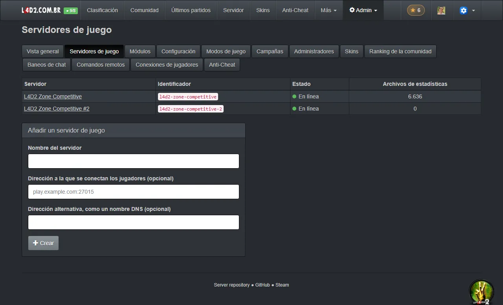

La pestaña **Servidores de juego** lista los servidores, 20 por página, con su identificador, su estado y la cantidad de archivos de estadísticas. **Editar** en una fila abre la [página del servidor](#la-página-de-un-servidor), y **Eliminar** lo borra después de una confirmación; un servidor que ya envió archivos de estadísticas solo se puede desactivar. El botón **Añadir**, encima de la lista a la derecha, abre la ventana **Añadir un servidor de juego**, que pide:

| Campo | Para qué sirve |
|---|---|
| Nombre del servidor | El nombre que se muestra en el sitio. |
| Dirección a la que se conectan los jugadores (opcional) | Se muestra en la página del servidor en vivo con un botón para copiar, y la usa el botón `connect`. Por ejemplo `play.example.com:27015` o una IP y un puerto. |
| Dirección alternativa, como un nombre DNS (opcional) | Se muestra junto a la dirección, como una segunda forma de conectarse. |

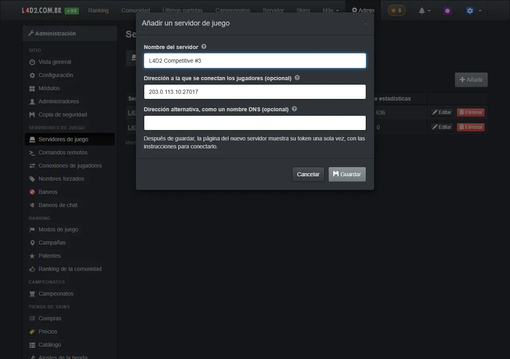

La pestaña **Página del servidor en vivo** define para todos los servidores, con **Guardar** al final: el retraso de la página en vivo (15 segundos), cada cuánto se actualiza una página en vivo abierta (2600 ms), los segundos sin señal hasta que el servidor aparece offline (90) y los minutos que un comando remoto espera al servidor (5).

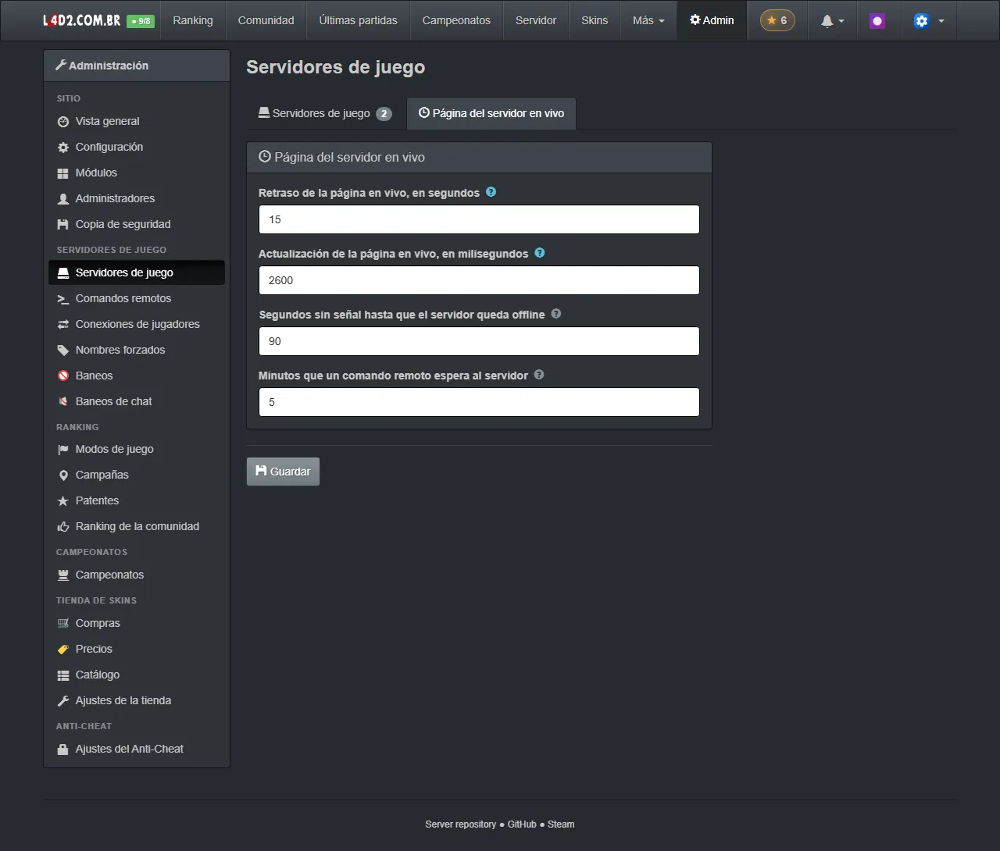

Después de **Guardar**, la página del servidor nuevo muestra el token una sola vez, con las instrucciones. Cópialo en ese momento: consulta [Configuración inicial > Paso 4](first-run.es.md#paso-4-el-servidor-de-juego).

### La página de un servidor

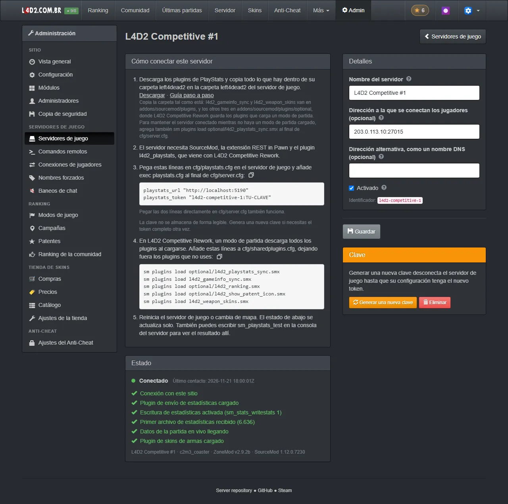

| Bloque | Qué tiene |
|---|---|
| Cómo conectar este servidor | La descarga de los plugins, las dos líneas para `cfg/playstats.cfg` (con `exec playstats.cfg` en `cfg/server.cfg`), las líneas `sm plugins load` para `cfg/sharedplugins.cfg` y qué hacer después. Después de la primera vez, la parte de la clave del token se muestra como `TU-CLAVE`, porque el sitio no la guarda. |
| Estado | El [estado de la conexión](first-run.es.md#el-estado-de-la-conexión) y la lista de verificación, actualizados cada 3 segundos, y el último nombre de host, mapa, configuración y versión de SourceMod que informó el servidor. |
| Detalles | El nombre, las dos direcciones, **Activado** y el identificador, con **Guardar** debajo del panel. Un servidor desactivado no se muestra en la página del servidor en vivo, y el sitio rechaza lo que envía. |
| Clave | **Generar una nueva clave** crea un token nuevo y lo muestra una sola vez. El servidor de juego queda desconectado hasta que su configuración tenga el token nuevo. **Eliminar** borra un servidor que nunca envió un archivo de estadísticas; un servidor con archivos solo se puede desactivar. |

El identificador se crea a partir del nombre cuando se crea el servidor y nunca cambia. Cambiarle el nombre a un servidor no cambia su token.

## Módulos

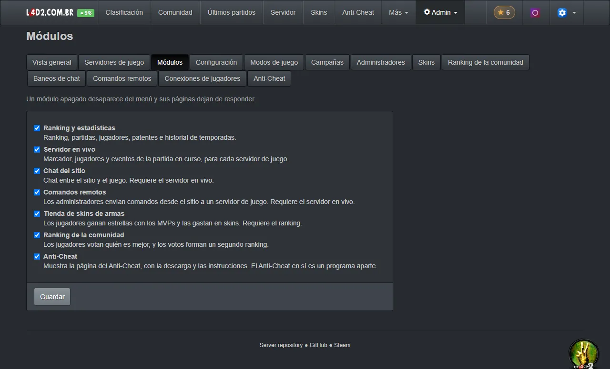

El núcleo siempre está activado: el registro de servidores de juego, la subida de estadísticas, el inicio de sesión con Steam y el área de administración. Todo lo demás es un módulo. Un módulo desactivado desaparece del menú, y sus páginas y su API responden como no encontradas. Desactivar un módulo no borra nada; sus datos vuelven cuando se activa de nuevo.

| Módulo | Qué contiene | Necesita | Predeterminado | Cuando está desactivado |
|---|---|---|---|---|
| Ranking y estadísticas | Ranking, partidas, jugadores, patentes, castigos y las páginas dentro del juego. | | Activado | La primera página muestra un texto corto de bienvenida. Las partidas se siguen construyendo a partir de los archivos, sin que se vean. Los enlaces de jugador siguen abriendo la [página básica del jugador](players.es.md#un-jugador-sin-estadísticas), con el perfil de Steam, pero sin estadísticas. |
| Servidor en vivo | La partida en curso en cada servidor. | | Activado | No hay elemento **Servidor** en el menú. Los datos en vivo de los plugins se rechazan. Las cuentas relacionadas y las conexiones de jugadores no se muestran, elijas lo que elijas en [Privacidad](#privacidad). |
| Chat del sitio | Escribir en el chat del juego desde la página en vivo, y los baneos del chat. | Servidor en vivo | Desactivado | No hay cuadro de chat en la página en vivo ni página **Baneos de chat**. |
| Comandos remotos | Comandos que los administradores envían desde el sitio a un servidor de juego. | Servidor en vivo | Desactivado | No hay página **Comandos remotos** ni terminal en la página en vivo. |
| Tienda de skins de armas | Estrellas, compras, regalos y skins equipadas. | Ranking | Desactivado | No hay elemento **Skins** en el menú, ni estrellas en la barra del menú, ni pestaña Skins en la página del jugador. El servidor de juego no recibe skins. |
| Ranking de la comunidad | Votación por parejas y su ranking. | | Desactivado | No hay elemento **Comunidad** en el menú. |
| Anti-Cheat | La página con la descarga y las instrucciones del Anti-Cheat, y quién debe usar el Anti-Cheat en los servidores de juego. | | Desactivado | No hay elemento **Anti-Cheat** en el menú ni página **Ajustes del Anti-Cheat**. El plugin de anti-cheat no recibe modo ni listas del sitio. |

Un módulo cuyo requisito está desactivado se comporta como desactivado, aunque su propia casilla esté marcada.

## Configuración

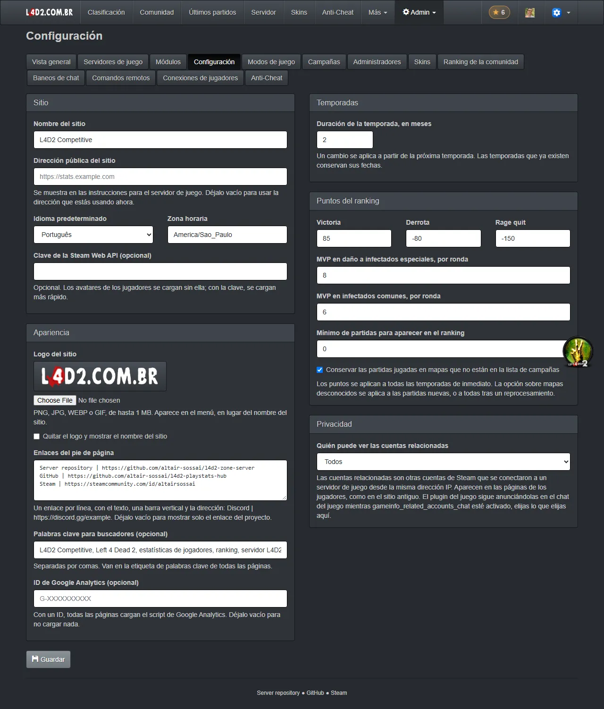

### Sitio

| Ajuste | Qué hace |
|---|---|
| Nombre del sitio | Se muestra en el menú cuando no hay logo, en el título de todas las páginas y en las páginas dentro del juego. |
| Dirección pública del sitio | La dirección que se escribe en las instrucciones para los servidores de juego (`playstats_url`). Déjala vacía para usar la dirección que estás usando ahora. Complétala cuando abres la administración por una dirección distinta de la que usan los servidores de juego, por ejemplo `https://stats.example.com`. |
| Idioma predeterminado | El idioma de los visitantes que no eligieron uno. |
| Zona horaria | El reloj del sitio: las fechas en las páginas, el día para los límites de votos y el inicio y el fin de cada temporada. Usa un nombre como `America/Sao_Paulo` o `Europe/Lisbon`. |
| Clave de la Steam Web API (opcional) | Los avatares y los nombres se cargan sin ella; con una clave se cargan más rápido. La clave también permite al sitio leer los [datos de Steam](players.es.md#datos-de-steam) de los jugadores: horas en Left 4 Dead 2, nivel de Steam, fecha de creación de la cuenta y baneos, y el nombre de Steam usado en el [nombre del jugador](players.es.md#el-nombre-del-jugador). |

### Apariencia

| Ajuste | Qué hace |
|---|---|
| Logo del sitio | PNG, JPG, WEBP o GIF de hasta 1 MB, que se muestra en el menú en lugar del nombre del sitio. **Quitar el logo y mostrar el nombre del sitio** vuelve al nombre. |
| Enlaces del pie de página | Una lista con descripción y dirección para cada enlace. **Añadir un enlace** crea una línea, las flechas cambian el orden y la papelera la quita. La dirección debe empezar con http:// o https://. Sin enlaces, el pie muestra solo el enlace del proyecto. |
| Palabras clave para buscadores (opcional) | Separadas por comas. Van en la etiqueta de palabras clave de todas las páginas. |
| ID de Google Analytics (opcional) | Con un ID como `G-XXXXXXXXXX`, todas las páginas cargan el script de Google Analytics. Vacío no carga nada. |

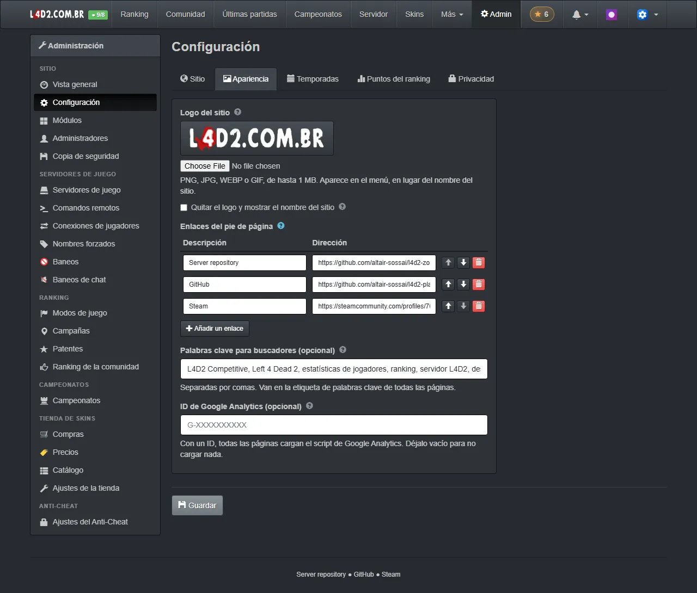

### Temporadas

| Ajuste | Qué hace |
|---|---|
| Duración de la temporada, en meses | De 1 a 24. Un cambio se aplica a partir de la próxima temporada; las temporadas que ya existen conservan sus fechas. Consulta [Temporadas e historia](seasons-and-history.es.md). |

### Puntos del ranking

| Ajuste | Predeterminado | Qué hace |
|---|---|---|
| Victoria | 85 | Experiencia por una partida ganada. |
| Derrotas | −80 | Experiencia por una partida perdida. |
| Rage quit | −150 | Experiencia por salir de una partida antes del final. Reemplaza todo lo demás de esa partida. |
| MVP en daño a infectados especiales, por ronda | 8 | Experiencia por cada premio de MVP de SI. |
| MVP en infectados comunes, por ronda | 6 | Experiencia por cada premio de MVP de CI. |
| Tank wipe, por ronda | 50 | Experiencia por cada [tank wipe](ranking.es.md#tank-wipes). 0 no da ninguna. |
| Mínimo de partidas para aparecer en el ranking | 0 | Partidas (victorias más derrotas) que un jugador necesita para aparecer en la lista. |
| Jugadores en el ranking de la página de inicio | 100 | Cuántos jugadores, como máximo, lista el ranking de la página de inicio y de las temporadas anteriores, hasta 500. |
| Jugadores mostrados antes de Mostrar más | 50 | Cuántos de ellos aparecen antes de **Mostrar más**. |
| Partidas por página en Últimas partidas | 50 | De 10 a 200. |
| Partidas recientes en la página del jugador | 50 | De 10 a 200. |
| Castigo predeterminado, en puntos | 150 | El valor que ya viene rellenado al castigar a un jugador desde la página del jugador. |
| Horas sin archivos que separan dos partidas | 6 | Los archivos de un servidor de juego más separados que esto pertenecen a partidas distintas. Vale para las partidas nuevas, o para todas después de **Reprocesar todas las partidas**. |
| Conservar las partidas jugadas en mapas que no están en la lista de campañas | Activado | Consulta [Partidas > Cómo los archivos se convierten en partidas](matches.es.md#cómo-los-archivos-se-convierten-en-partidas). |

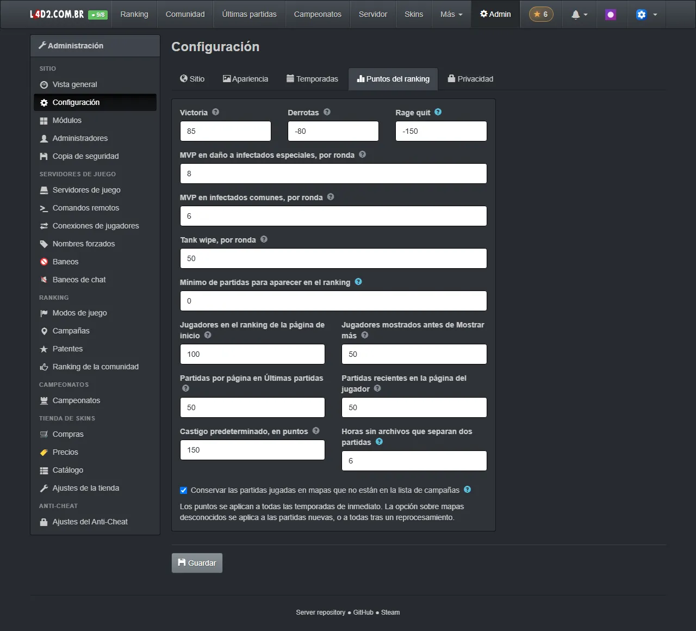

Los puntos se aplican a todas las temporadas de inmediato, incluidas las pasadas, porque los rankings se calculan a partir de las partidas. La opción sobre mapas desconocidos se aplica a las partidas nuevas, o a todas después de **Reprocesar todas las partidas**.

[Ranking](ranking.es.md#cómo-se-calcula-la-experiencia) explica cómo se usan estos valores.

### Privacidad

| Ajuste | Valor predeterminado | Qué hace |
|---|---|---|
| Quién puede ver las cuentas relacionadas | Todos | **Todos** muestra el panel [Cuentas relacionadas](players.es.md#cuentas-relacionadas) a cada visitante, como hacía el sitio antiguo. **Solo administradores** lo oculta a los visitantes y a los jugadores que no son administradores, en la página del jugador y en la página de un jugador que no está en el ranking. |
| Meses para guardar las conexiones de los jugadores | 3 | Las conexiones que no se ven desde hace más tiempo que esto, con sus direcciones IP, se borran todos los días. De 1 a 60. |

Este ajuste solo afecta al sitio. El plugin `l4d2_gameinfo_sync` sigue anunciando las cuentas relacionadas en el chat del juego mientras `gameinfo_related_accounts_chat` esté en `1`; ponlo en `0` en `cfg/playstats.cfg` para sacarlas también del chat. Los administradores siempre ven las conexiones en [Moderación > Conexiones de jugadores](moderation.es.md#conexiones-de-jugadores).

## Administradores

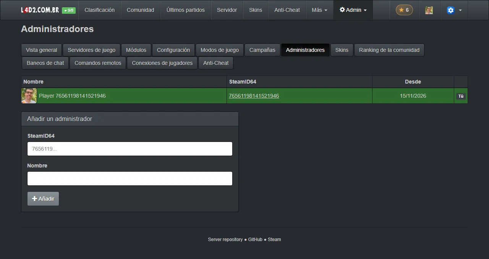

La lista muestra a cada administrador y desde cuándo lo es, 20 por página. El botón **Añadir**, encima de la lista a la derecha, abre una ventana que pide la cuenta, como SteamID64, como Steam ID con el formato `STEAM_1:0:123` o `[U:1:123]`, o como enlace del perfil, y, si quieres, un nombre; **Guardar** la añade. El botón de búsqueda junto al campo abre la [búsqueda de jugadores](#la-búsqueda-de-jugadores); el jugador elegido también completa el nombre cuando está vacío. **Editar**, en cada fila, abre la misma ventana para cambiar el nombre. **Quitar** le retira los permisos después de una confirmación. No puedes quitarte a ti mismo, y el último administrador no se puede quitar.

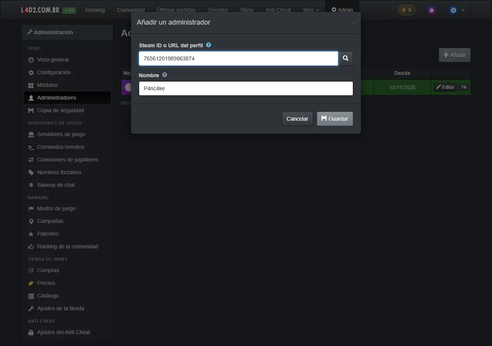

Si pierdes el acceso a todas las cuentas de administrador, agrega una desde la máquina donde se ejecuta el sitio:

- Linux: `playstats-hub add-admin <SteamID64>`
- Docker: `docker compose exec -u app hub dotnet L4D2PlayStats.Hub.Web.dll admin add <SteamID64>`

El SteamID64 es el número largo de la dirección de un perfil de Steam, como `76561198000000000`.

### La búsqueda de jugadores

Cada campo de la administración que recibe un jugador tiene al lado un botón que abre la misma ventana de búsqueda: administradores, votantes del ranking de la comunidad, conexiones de jugadores, baneos del chat, las listas del Anti-Cheat y los regalos de skins. Lista los jugadores que jugaron una partida o se conectaron a un servidor de juego, de los más recientes a los más antiguos, con su foto, nombre, Steam ID, cuándo se vieron por última vez y su posición en el ranking actual. Escribe parte de un nombre o un Steam ID en cualquier formato para filtrar, y **Cargar más** muestra los siguientes jugadores. Al hacer clic en un jugador se completa el campo. Un Steam ID que nunca jugó aquí también se puede elegir.

## Copia de seguridad

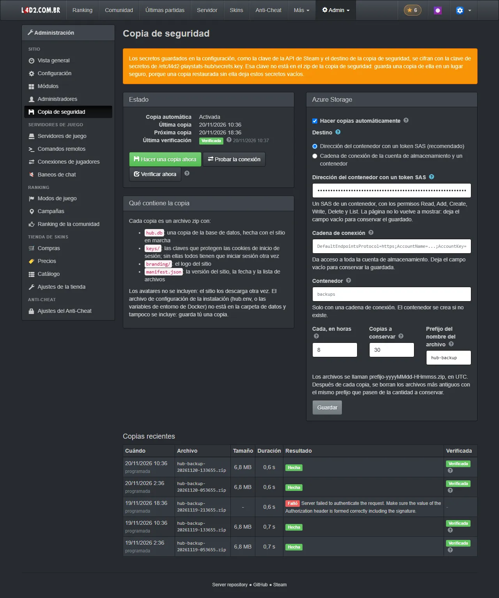

El sitio sube un zip de sus datos a un contenedor de Azure Storage cada pocas horas. [Copias de seguridad y actualizaciones > Copia automática en Azure Storage](backups-and-updates.es.md#copia-automática-en-azure-storage) explica qué contiene el zip, cómo crear el contenedor y cómo restaurar un zip.

| Campo | Qué hace |
|---|---|
| Hacer copias automáticamente | Activa la programación. **Hacer una copia ahora** funciona también con ella desactivada. |
| Destino | **Dirección del contenedor con un token SAS**, la recomendada, o **Cadena de conexión de la cuenta de almacenamiento y un contenedor**. |
| Dirección del contenedor con un token SAS | `https://<cuenta>.blob.core.windows.net/<contenedor>?sv=...&sig=...`: un SAS de ese contenedor con los permisos Read, Add, Create, Write, Delete y List. |
| Cadena de conexión | La cadena de conexión de la cuenta de almacenamiento, en **Claves de acceso** del portal de Azure. |
| Contenedor | Solo con una cadena de conexión. El contenedor se crea si no existe. |
| Cada, en horas | De 1 a 168. 8 por defecto. |
| Copias a conservar | De 1 a 1000. 30 por defecto. Después de cada copia se borran los archivos más antiguos que pasen de este número. |
| Prefijo del nombre del archivo | El comienzo del nombre de los archivos, `hub-backup` por defecto. Solo se cuentan y se borran los archivos con este prefijo. |

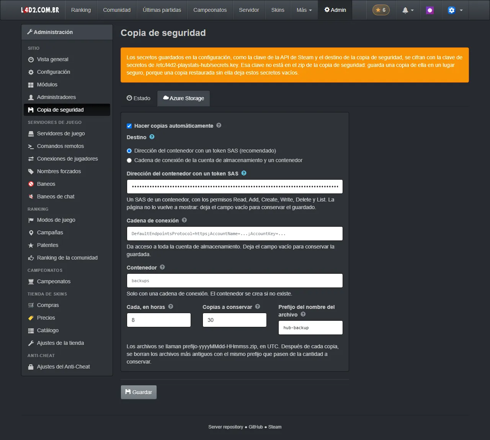

La dirección y la cadena de conexión son secretos. Una vez guardadas, la página solo las muestra enmascaradas, como `https://<cuenta>.blob.core.windows.net/<contenedor>?••••••••`; deja el campo vacío para conservar la guardada, o escribe una nueva para reemplazarla. Tampoco se escriben nunca en el registro.

- **Estado** muestra si la programación está activada, la última copia que salió bien, cuándo se hace la próxima y el resultado de la última verificación.
- **Hacer una copia ahora** hace una copia en el momento. **Probar la conexión** sube un archivo pequeño de prueba, comprueba que el contenedor lo lista y lo borra, sin hacer una copia. **Verificar ahora** descarga el zip más reciente del contenedor y comprueba que se restaura: el zip y su manifiesto, la comprobación de integridad de SQLite en `hub.db` y el número de partidas, archivos de estadísticas, jugadores y ajustes. La misma comprobación se ejecuta después de cada copia. Necesita SQLite; con otras bases de datos el botón está desactivado.
- **Copias recientes** lista las últimas 20 ejecuciones, programadas o manuales, con el archivo, su tamaño, cuánto tardó y, para una copia que falló, el error. Una copia que falló se intenta otra vez 30 minutos después. La columna **Verificada** muestra la comprobación de cada zip: **Verificada** (pasa el ratón sobre el icono de ayuda para ver los recuentos), **Verificación fallida** con el motivo, o **No disponible** sin SQLite. [Comprobar que cada copia se restaura](backups-and-updates.es.md#comprobar-que-cada-copia-se-restaura) lo explica.
- En un sitio que no usa SQLite, la página avisa que la base de datos no está en el zip.
- La página muestra dónde está la [clave de secretos](backups-and-updates.es.md#la-clave-de-secretos), la clave que cifra estos secretos y la clave de la API de Steam en la base de datos, y avisa que no está en el zip: guarda una copia de ella aparte. Cuando la clave no se puede cargar, la página lo avisa en rojo, y el registro dice por qué.
