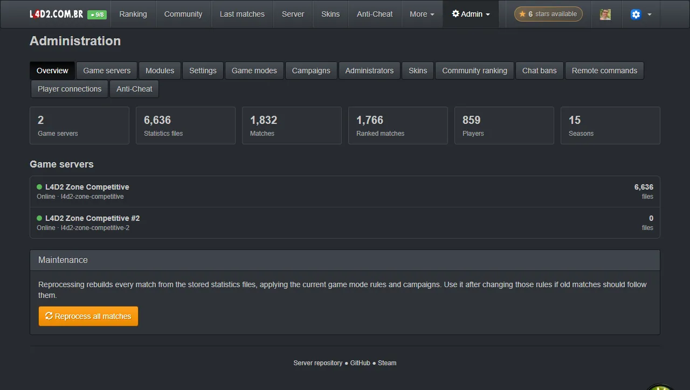
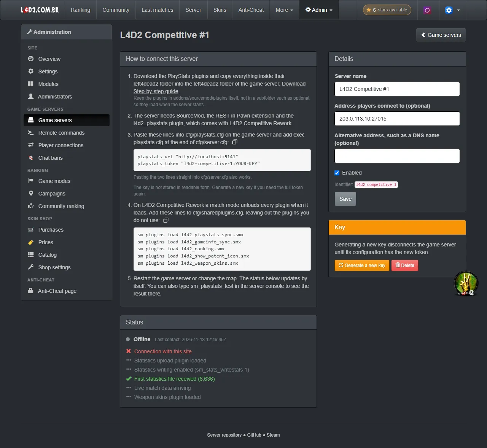

# Administration

🌐 **English** | [Português](administration.pt.md) | [Español](administration.es.md)

The administration area is where the site is configured. It is open only to administrators: **Admin > Administration** in the menu, or `/admin`. Every page has the same row of tabs at the top.

This page covers the overview, the game servers, the modules, the settings and the administrators. Other administration pages are explained with their feature:

| Tab | Explained in |
|---|---|
| Game modes, Campaigns | [Game modes and campaigns](game-modes-and-campaigns.md) |
| Skins | [Weapon skin shop > For administrators](skin-shop.md#for-administrators) |
| Community ranking | [Community ranking > For administrators](community-ranking.md#for-administrators) |
| Chat bans, Remote commands, Player connections | [Moderation](moderation.md) |
| Anti-Cheat | [Anti-Cheat page > For administrators](anti-cheat.md#for-administrators) |

A tab whose module is off is not shown.

[Back to the manual](README.md)

## Contents

- [Overview](#overview)
- [Game servers](#game-servers)
- [Modules](#modules)
- [Settings](#settings)
- [Administrators](#administrators)

## Overview

- **The counters**: game servers, statistics files received, matches, ranked matches, players and seasons.
- **A warning** when game configurations seen on your servers match no [game mode rule](game-modes-and-campaigns.md#game-modes). Their matches do not count for the ranking until a rule covers them. **Review the game modes** opens the page.
- **Game servers**: each server with its state and the number of files it sent.
- **Maintenance > Reprocess all matches**: rebuilds every match from the stored statistics files, with the current game modes, campaigns and the option about unknown maps. Use it after changing those rules if old matches should follow them. It asks for confirmation and says how many matches were rebuilt. With a lot of data it takes a while.

## Game servers

The list shows each server with its identifier, its state and the number of statistics files. **Add a game server** asks for:

| Field | What it is for |
|---|---|
| Server name | The name shown on the site. |
| Address players connect to (optional) | Shown on the live server page with a copy button, and used by the `connect` button. For example `play.example.com:27015` or an IP and port. |
| Alternative address, such as a DNS name (optional) | Shown next to the address, as a second way to connect. |

After **Create**, the page of the new server shows the token once, with the instructions. Copy it then: see [First-run setup > Step 4](first-run.md#step-4-the-game-server).

### The page of a server

| Block | What it has |
|---|---|
| How to connect this server | The download of the plugins, the two lines for `cfg/playstats.cfg` (with `exec playstats.cfg` in `cfg/server.cfg`), the `sm plugins load` lines for `cfg/sharedplugins.cfg`, and what to do next. After the first time, the key part of the token is shown as `YOUR-KEY`, because the site does not keep it. |
| Status | The [connection status](first-run.md#the-connection-status) and the checklist, updated every 3 seconds, and the last hostname, map, configuration and SourceMod version the server reported. |
| Details | The name, the two addresses, **Enabled**, and the identifier. A disabled server is not shown on the live server page, and the site refuses what it sends. |
| Key | **Generate a new key** creates a new token and shows it once. The game server is disconnected until its configuration has the new token. **Delete** removes a server that never sent a statistics file; a server with files can only be disabled. |

The identifier is made from the name when the server is created and never changes. Renaming a server does not change its token.

## Modules

The core is always on: game server registration, statistics upload, Steam sign-in and the administration area. Everything else is a module. A module that is off disappears from the menu, and its pages and its API answer as not found. Turning a module off deletes nothing; its data comes back when it is turned on again.

| Module | What it contains | Needs | Default | When it is off |
|---|---|---|---|---|
| Ranking and statistics | Ranking, matches, players, patents, history, punishments and the pages inside the game. | | On | The first page shows a short welcome text. Matches are still built from the files, out of sight. |
| Live server | The match in progress on each server. | | On | No **Server** menu item. The plugins' live data is refused. The related accounts and player connections are not shown. |
| Site chat | Writing in the game chat from the live page, and chat bans. | Live server | Off | No chat box on the live page and no **Chat bans** page. |
| Remote commands | Commands sent by administrators from the site to a game server. | Live server | Off | No **Remote commands** page and no terminal on the live page. |
| Weapon skin shop | Stars, purchases, gifts and equipped skins. | Ranking | Off | No **Skins** menu item, no stars in the menu bar, no Skins tab on the player page. The game server gets no skins. |
| Community ranking | Pairwise voting and its ranking. | | Off | No **Community** menu item. |
| Anti-Cheat | The page with the Anti-Cheat download and instructions. | | Off | No **Anti-Cheat** menu item. |

A module whose requirement is off behaves as off, even when its own box is ticked.

## Settings

### Site

| Setting | What it does |
|---|---|
| Site name | Shown in the menu when there is no logo, in the title of every page, and in the pages inside the game. |
| Public address of the site | The address written in the instructions for the game servers (`playstats_url`). Leave it empty to use the address you are using now. Fill it when you open the administration through a different address than the game servers use, for example `https://stats.example.com`. |
| Default language | The language of visitors who did not choose one. |
| Time zone | The clock of the site: dates on the pages, the day for the vote limits, and the start and end of each season. Use a name such as `America/Sao_Paulo` or `Europe/Lisbon`. |
| Steam Web API key (optional) | Avatars and names load without it; with a key they load faster. |

### Appearance

| Setting | What it does |
|---|---|
| Site logo | PNG, JPG, WEBP or GIF up to 1 MB, shown in the menu in place of the site name. **Remove the logo and show the site name** goes back to the name. |
| Footer links | One link per line, as a text, a vertical bar and the address: `Discord \| https://discord.gg/example`. Empty shows only the link to the project. |
| Keywords for search engines (optional) | Separated by commas. They go in the keywords tag of every page. |
| Google Analytics ID (optional) | With an ID such as `G-XXXXXXXXXX`, every page loads the Google Analytics script. Empty loads nothing. |

### Seasons

| Setting | What it does |
|---|---|
| Season length, in months | From 1 to 24. A change applies from the next season; seasons that already exist keep their dates. See [Seasons and history](seasons-and-history.md). |

### Ranking points

| Setting | Default | What it does |
|---|---|---|
| Win | 85 | Experience for a won match. |
| Loss | −80 | Experience for a lost match. |
| Rage quit | −150 | Experience for leaving a match before the end. It replaces everything else from that match. |
| MVP in special infected damage, per round | 8 | Experience for each SI MVP award. |
| MVP in common infected, per round | 6 | Experience for each CI MVP award. |
| Minimum matches to appear in the ranking | 0 | Games (wins plus losses) a player needs to be listed. |
| Keep matches played on maps that are not in the campaign list | On | See [Matches > How files become matches](matches.md#how-files-become-matches). |

The points apply to every season right away, past seasons included, because the rankings are calculated from the matches. The option about unknown maps applies to new matches, or to all of them after **Reprocess all matches**.

[Ranking](ranking.md#how-experience-is-calculated) explains how these values are used.

## Administrators

The list shows every administrator and since when. To add one, give the SteamID64 of the account and, optionally, a name. **Remove** takes the rights away. You cannot remove yourself, and the last administrator cannot be removed.

If you lose access to every administrator account, add one from the machine that runs the site:

- Linux: `playstats-hub add-admin <SteamID64>`
- Docker: `docker compose exec hub dotnet L4D2PlayStats.Hub.Web.dll admin add <SteamID64>`

The SteamID64 is the long number in the address of a Steam profile, such as `76561198000000000`.
