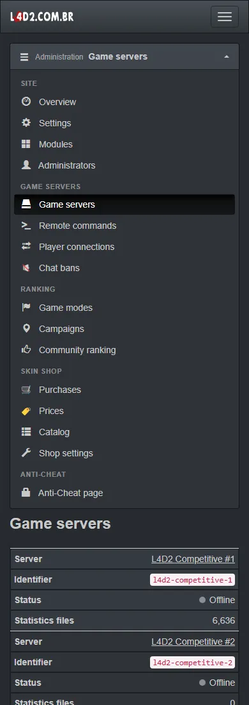
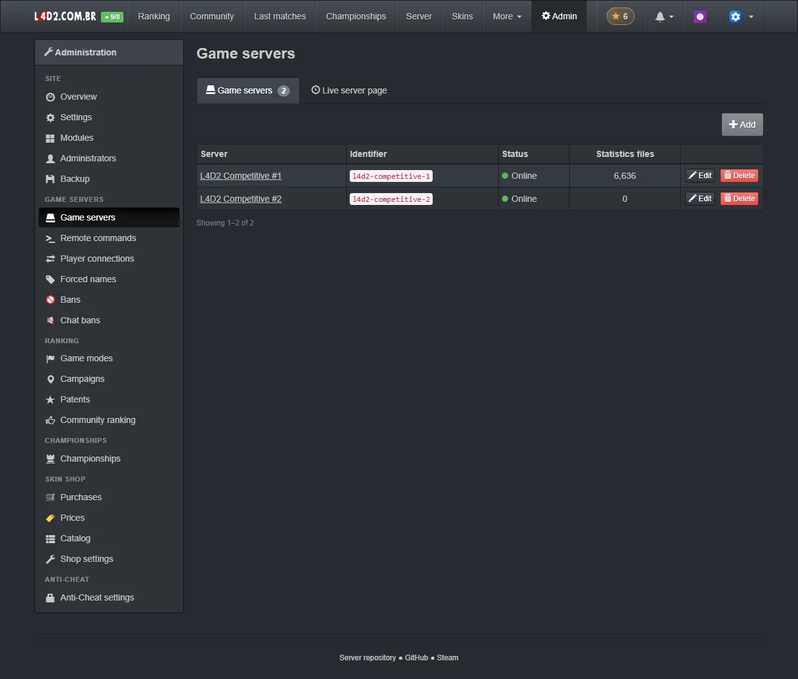
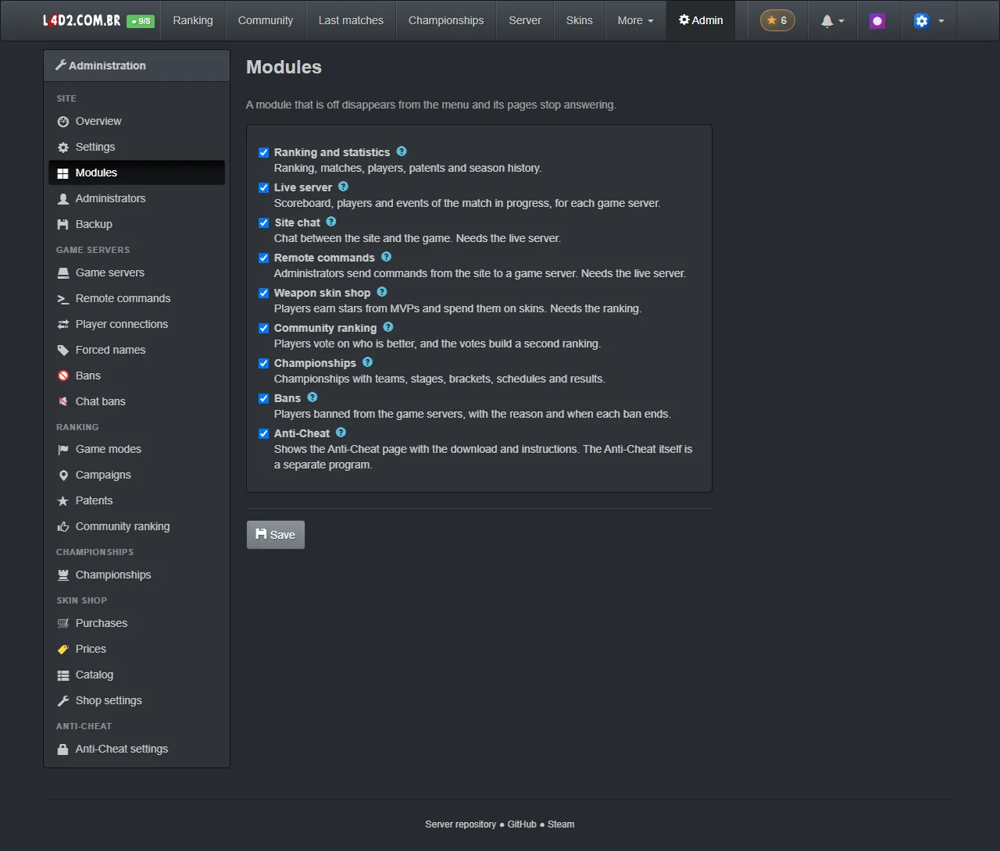
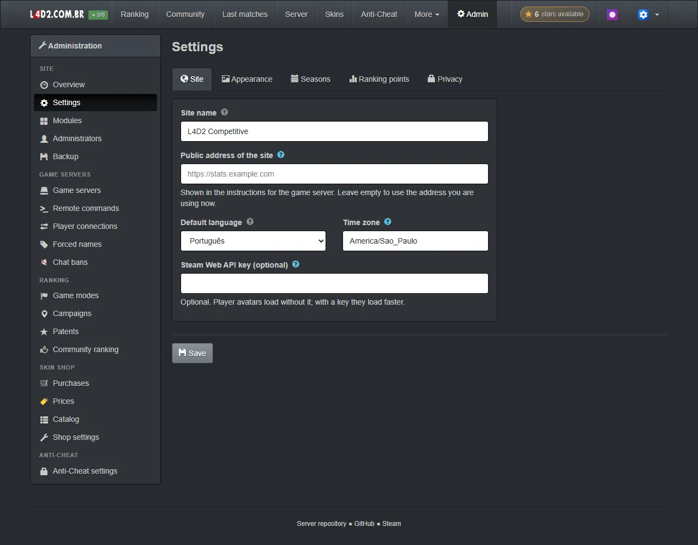
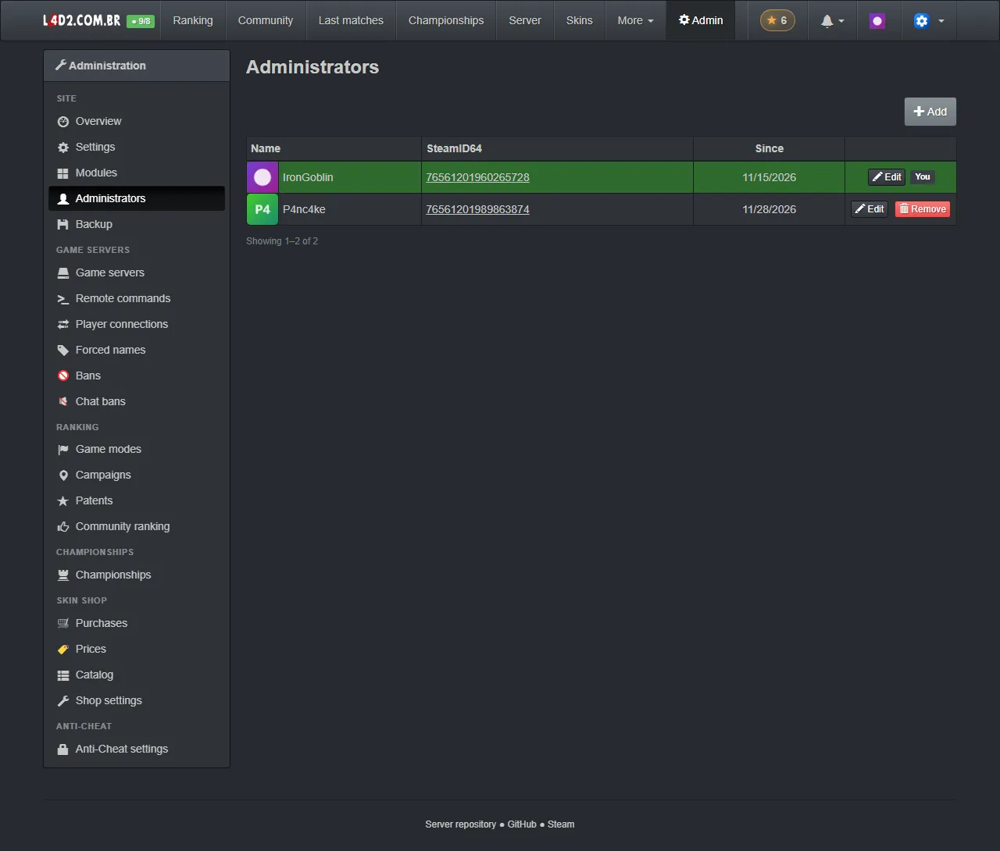
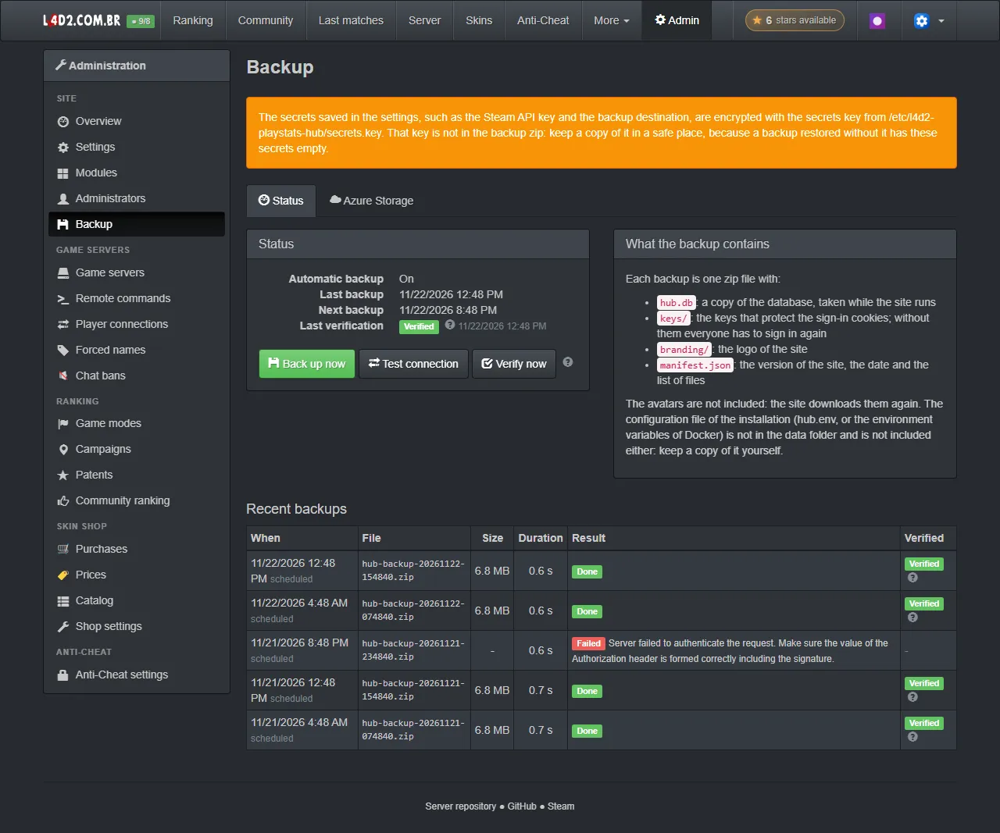

# Administration

🌐 **English** | [Português](administration.pt.md) | [Español](administration.es.md)

The administration area is where the site is configured. It is open only to administrators: **Admin** in the menu at the top, or `/admin`. Every page of the area has the [administration menu](#the-administration-menu) on the left.

This page covers the overview, the game servers, the modules, the settings, the administrators and the backup. Other administration pages are explained with their feature:

| Menu item | Explained in |
|---|---|
| Game modes, Campaigns | [Game modes and campaigns](game-modes-and-campaigns.md) |
| Purchases, Prices, Catalog, Shop settings | [Weapon skin shop > For administrators](skin-shop.md#for-administrators) |
| Community ranking | [Community ranking > For administrators](community-ranking.md#for-administrators) |
| Chat bans, Remote commands, Player connections | [Moderation](moderation.md) |
| Anti-Cheat settings | [Anti-Cheat > For administrators](anti-cheat.md#for-administrators) |

An item whose module is off is not in the menu.

[Back to the manual](README.md)

## Contents

- [The administration menu](#the-administration-menu)
- [Overview](#overview)
- [Game servers](#game-servers)
- [Modules](#modules)
- [Settings](#settings)
- [Administrators](#administrators)
- [Backup](#backup)

## The administration menu

Every administration page has the same menu on the left, with the page you are on highlighted. The page of one game server highlights **Game servers**. The menu groups the pages:

| Group | Pages |
|---|---|
| Site | Overview, Settings, Modules, Administrators, Backup |
| Game servers | Game servers, Remote commands, Player connections, Chat bans |
| Ranking | Game modes, Campaigns, Community ranking |
| Skin shop | Purchases, Prices, Catalog, Shop settings |
| Anti-Cheat | Anti-Cheat settings |

A page whose module is off is not in the menu, and a group with no pages left disappears. On a long page the menu stays in view while you scroll. The menu at the top of the site stays as it is, with **Admin** to come back here from any page.

On a phone the menu is folded into a bar above the page that names the page you are on. Tap it to open the full list:

## Overview

- **The counters**: game servers, statistics files received, matches, ranked matches, players and seasons.
- **A warning** when game configurations seen on your servers match no [game mode rule](game-modes-and-campaigns.md#game-modes). Their matches do not count for the ranking until a rule covers them. **Review the game modes** opens the page.
- **Game servers**: each server with its state and the number of files it sent.
- **Maintenance > Reprocess all matches**: rebuilds every match from the stored statistics files, with the current game modes, campaigns and the option about unknown maps. Use it after changing those rules if old matches should follow them. It asks for confirmation and says how many matches were rebuilt. With a lot of data it takes a while.

## Game servers

The **Game servers** tab lists the servers, 20 per page, with the identifier, the state and the number of statistics files. **Edit** on a row opens the [page of the server](#the-page-of-a-server), and **Delete** removes it after a confirmation; a server that already sent statistics files can only be disabled. The **Add** button, above the list on the right, opens the window **Add a game server**, which asks for:

| Field | What it is for |
|---|---|
| Server name | The name shown on the site. |
| Address players connect to (optional) | Shown on the live server page with a copy button, and used by the `connect` button. For example `play.example.com:27015` or an IP and port. |
| Alternative address, such as a DNS name (optional) | Shown next to the address, as a second way to connect. |

The **Live server page** tab sets for every server, with **Save** at the bottom: the delay of the live page (15 seconds), how often an open live page refreshes (2600 ms), the seconds without a signal before a server shows offline (90) and the minutes a remote command waits for the server (5).

After **Save**, the page of the new server shows the token once, with the instructions. Copy it then: see [First-run setup > Step 4](first-run.md#step-4-the-game-server).

### The page of a server

| Block | What it has |
|---|---|
| How to connect this server | The download of the plugins, the two lines for `cfg/playstats.cfg` (with `exec playstats.cfg` in `cfg/server.cfg`), the `sm plugins load` lines for `cfg/sharedplugins.cfg`, and what to do next. After the first time, the key part of the token is shown as `YOUR-KEY`, because the site does not keep it. |
| Status | The [connection status](first-run.md#the-connection-status) and the checklist, updated every 3 seconds, and the last hostname, map, configuration and SourceMod version the server reported. |
| Details | The name, the two addresses, **Enabled**, and the identifier, with **Save** under the panel. A disabled server is not shown on the live server page, and the site refuses what it sends. |
| Key | **Generate a new key** creates a new token and shows it once. The game server is disconnected until its configuration has the new token. **Delete** removes a server that never sent a statistics file; a server with files can only be disabled. |

The identifier is made from the name when the server is created and never changes. Renaming a server does not change its token.

## Modules

The core is always on: game server registration, statistics upload, Steam sign-in and the administration area. Everything else is a module. A module that is off disappears from the menu, and its pages and its API answer as not found. Turning a module off deletes nothing; its data comes back when it is turned on again.

| Module | What it contains | Needs | Default | When it is off |
|---|---|---|---|---|
| Ranking and statistics | Ranking, matches, players, patents, history, punishments and the pages inside the game. | | On | The first page shows a short welcome text. Matches are still built from the files, out of sight. The player links still open the [basic player page](players.md#a-player-without-statistics), with the Steam profile, but without statistics. |
| Live server | The match in progress on each server. | | On | No **Server** menu item. The plugins' live data is refused. The related accounts and player connections are not shown, whatever [Privacy](#privacy) says. |
| Site chat | Writing in the game chat from the live page, and chat bans. | Live server | Off | No chat box on the live page and no **Chat bans** page. |
| Remote commands | Commands sent by administrators from the site to a game server. | Live server | Off | No **Remote commands** page and no terminal on the live page. |
| Weapon skin shop | Stars, purchases, gifts and equipped skins. | Ranking | Off | No **Skins** menu item, no stars in the menu bar, no Skins tab on the player page. The game server gets no skins. |
| Community ranking | Pairwise voting and its ranking. | | Off | No **Community** menu item. |
| Anti-Cheat | The page with the Anti-Cheat download and instructions, and who must use the Anti-Cheat on the game servers. | | Off | No **Anti-Cheat** menu item and no **Anti-Cheat settings** page. The anti-cheat plugin gets no mode or lists from the site. |

A module whose requirement is off behaves as off, even when its own box is ticked.

## Settings

### Site

| Setting | What it does |
|---|---|
| Site name | Shown in the menu when there is no logo, in the title of every page, and in the pages inside the game. |
| Public address of the site | The address written in the instructions for the game servers (`playstats_url`). Leave it empty to use the address you are using now. Fill it when you open the administration through a different address than the game servers use, for example `https://stats.example.com`. |
| Default language | The language of visitors who did not choose one. |
| Time zone | The clock of the site: dates on the pages, the day for the vote limits, and the start and end of each season. Use a name such as `America/Sao_Paulo` or `Europe/Lisbon`. |
| Steam Web API key (optional) | Avatars and names load without it; with a key they load faster. |

### Appearance

| Setting | What it does |
|---|---|
| Site logo | PNG, JPG, WEBP or GIF up to 1 MB, shown in the menu in place of the site name. **Remove the logo and show the site name** goes back to the name. |
| Footer links | A list with a description and an address per link. **Add a link** adds a line, the arrows change the order and the trash button removes it. The address must start with http:// or https://. With no links, the footer shows only the link to the project. |
| Keywords for search engines (optional) | Separated by commas. They go in the keywords tag of every page. |
| Google Analytics ID (optional) | With an ID such as `G-XXXXXXXXXX`, every page loads the Google Analytics script. Empty loads nothing. |

### Seasons

| Setting | What it does |
|---|---|
| Season length, in months | From 1 to 24. A change applies from the next season; seasons that already exist keep their dates. See [Seasons and history](seasons-and-history.md). |

### Ranking points

| Setting | Default | What it does |
|---|---|---|
| Win | 85 | Experience for a won match. |
| Loss | −80 | Experience for a lost match. |
| Rage quit | −150 | Experience for leaving a match before the end. It replaces everything else from that match. |
| MVP in special infected damage, per round | 8 | Experience for each SI MVP award. |
| MVP in common infected, per round | 6 | Experience for each CI MVP award. |
| Minimum matches to appear in the ranking | 0 | Games (wins plus losses) a player needs to be listed. |
| Players in the ranking of the home page | 100 | How many players the ranking of the home page and of previous seasons lists at most, up to 500. |
| Players shown before Show more | 50 | How many of them appear before **Show more**. |
| Matches per page in Last matches | 50 | From 10 to 200. |
| Recent matches on the player page | 50 | From 10 to 200. |
| Default punishment, in points | 150 | The value already filled in when punishing a player from the player page. |
| Hours without files that split two matches | 6 | Files of a game server further apart than this belong to different matches. Applies to new matches, or to all of them after **Reprocess all matches**. |
| Keep matches played on maps that are not in the campaign list | On | See [Matches > How files become matches](matches.md#how-files-become-matches). |

The points apply to every season right away, past seasons included, because the rankings are calculated from the matches. The option about unknown maps applies to new matches, or to all of them after **Reprocess all matches**.

[Ranking](ranking.md#how-experience-is-calculated) explains how these values are used.

### Privacy

| Setting | Default | What it does |
|---|---|---|
| Who can see related accounts | Everyone | **Everyone** shows the [Related accounts](players.md#related-accounts) panel to every visitor, as the old site did. **Administrators only** hides it from visitors and players who are not administrators, on the player page and on the page of a player who is not ranked. |
| Months to keep the player connections | 3 | Connections not seen for longer than this, with the IP addresses, are deleted every day. From 1 to 60. |

This setting covers the site only. The `l4d2_gameinfo_sync` plugin still announces related accounts in the game chat while `gameinfo_related_accounts_chat` is `1`; set it to `0` in `cfg/playstats.cfg` to keep them out of the chat too. Administrators always see the connections in [Moderation > Player connections](moderation.md#player-connections).

## Administrators

The list shows every administrator and since when, 20 per page. The **Add** button, above the list on the right, opens a window that asks for the account, as a SteamID64, a Steam ID such as `STEAM_1:0:123` or `[U:1:123]`, or a profile link, and, optionally, a name; **Save** adds it. The search button next to the field opens the [player search](#the-player-search); the chosen player also fills in the name when it is empty. **Edit**, on each row, opens the same window to change the name. **Remove** takes the rights away after a confirmation. You cannot remove yourself, and the last administrator cannot be removed.

If you lose access to every administrator account, add one from the machine that runs the site:

- Linux: `playstats-hub add-admin <SteamID64>`
- Docker: `docker compose exec -u app hub dotnet L4D2PlayStats.Hub.Web.dll admin add <SteamID64>`

The SteamID64 is the long number in the address of a Steam profile, such as `76561198000000000`.

### The player search

Every field of the administration that takes a player has a button next to it that opens the same search window: administrators, community ranking voters, player connections, chat bans, the Anti-Cheat lists and skin gifts. It lists the players who played a match or connected to a game server, the most recent first, with their photo, name, Steam ID, when they were last seen and their position in the current ranking. Type part of a name or a Steam ID in any format to filter, and **Load more** shows the next players. Clicking a player fills in the field. A Steam ID that never played here can still be chosen.

## Backup

The site uploads a zip of its data to an Azure Storage container every few hours. [Backups and updates > Automatic backup to Azure Storage](backups-and-updates.md#automatic-backup-to-azure-storage) explains what the zip contains, how to create the container and how to restore a zip.

| Field | What it does |
|---|---|
| Back up automatically | Turns the schedule on. **Back up now** works with it off too. |
| Destination | **Container address with a SAS token**, the recommended one, or **Connection string of the storage account and a container**. |
| Container address with a SAS token | `https://<account>.blob.core.windows.net/<container>?sv=...&sig=...`: a SAS of that container with the Read, Add, Create, Write, Delete and List permissions. |
| Connection string | The connection string of the storage account, from **Access keys** in the Azure portal. |
| Container | Only with a connection string. The container is created when it does not exist. |
| Every, in hours | From 1 to 168. 8 by default. |
| Backups to keep | From 1 to 1000. 30 by default. After each backup the oldest files beyond this number are deleted. |
| File name prefix | The start of the file names, `hub-backup` by default. Only files with this prefix are counted and deleted. |

The address and the connection string are secrets. After they are saved the page shows them only masked, such as `https://<account>.blob.core.windows.net/<container>?••••••••`; leave the field empty to keep the saved one, or type a new one to replace it. They are never written to the log either.

- **Status** shows whether the schedule is on, the last backup that worked, when the next one runs and the result of the last verification.
- **Back up now** makes a backup at once. **Test connection** uploads a small test file, checks that the container lists it and deletes it, without making a backup. **Verify now** downloads the newest zip of the container and checks that it restores: the zip and its manifest, the SQLite integrity check of `hub.db` and the number of matches, statistics files, players and settings. The same check runs after every backup. It needs SQLite; on other databases the button is off.
- **Recent backups** lists the last 20 runs, scheduled or manual, with the file, its size, how long it took and, for a backup that failed, the error. A failed backup is tried again 30 minutes later. The **Verified** column shows the check of each zip: **Verified** (hover the help icon for the counts), **Verification failed** with the reason, or **Not available** without SQLite. [Checking that each backup restores](backups-and-updates.md#checking-that-each-backup-restores) explains it.
- On a site that does not use SQLite, the page warns that the database is not in the zip.
- The page says where the [secrets key](backups-and-updates.md#the-secrets-key) is, the key that encrypts these secrets and the Steam API key in the database, and warns that it is not in the zip: keep a copy of it apart. When the key cannot be loaded, the page says so in red, and the log says why.
