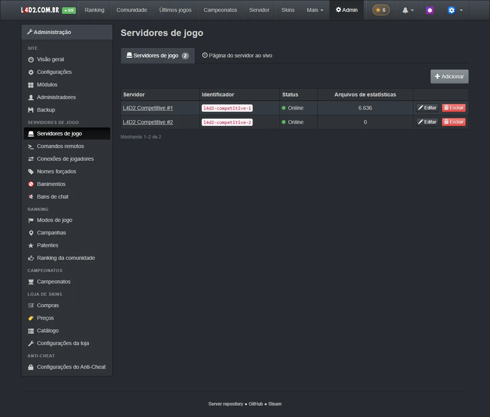
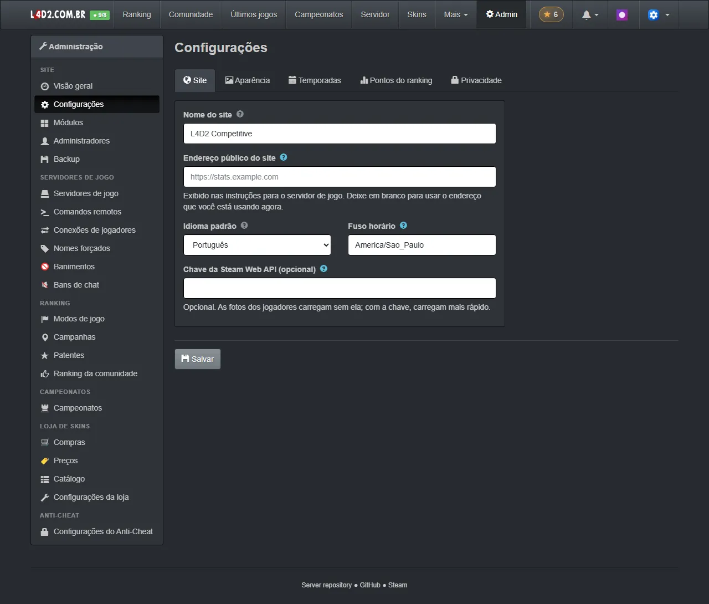
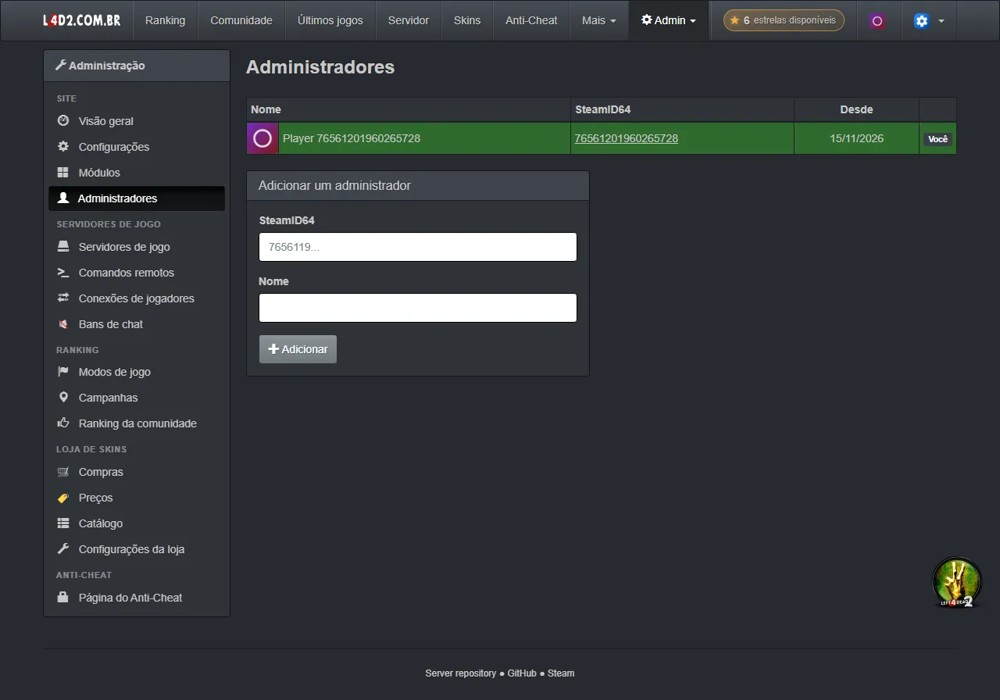

# Administração

🌐 [English](administration.md) | **Português** | [Español](administration.es.md)

A área de administração é onde o site é configurado. Ela só é acessível para administradores: **Admin > Administração** no menu, ou `/admin`. Todas as páginas têm a mesma fileira de abas no topo.

Esta página cobre a visão geral, os servidores de jogo, os módulos, as configurações e os administradores. As outras páginas da administração são explicadas junto com o recurso delas:

| Aba | Explicada em |
|---|---|
| Modos de jogo, Campanhas | [Modos de jogo e campanhas](game-modes-and-campaigns.pt.md) |
| Skins | [Loja de skins de armas > Para administradores](skin-shop.pt.md#para-administradores) |
| Ranking da comunidade | [Ranking da comunidade > Para administradores](community-ranking.pt.md#para-administradores) |
| Bans de chat, Comandos remotos, Conexões de jogadores | [Moderação](moderation.pt.md) |
| Anti-Cheat | [Página do Anti-Cheat > Para administradores](anti-cheat.pt.md#para-administradores) |

Uma aba cujo módulo está desligado não aparece.

[Voltar ao manual](README.pt.md)

## Conteúdo

- [Visão geral](#visão-geral)
- [Servidores de jogo](#servidores-de-jogo)
- [Módulos](#módulos)
- [Configurações](#configurações)
- [Administradores](#administradores)

## Visão geral

- **Os contadores**: servidores de jogo, arquivos de estatísticas recebidos, partidas, partidas ranqueadas, jogadores e temporadas.
- **Um aviso** quando configurações de jogo vistas nos seus servidores não batem com nenhuma [regra de modo de jogo](game-modes-and-campaigns.pt.md#modos-de-jogo). As partidas delas não contam para o ranking até que uma regra as cubra. **Revisar os modos de jogo** abre a página.
- **Servidores de jogo**: cada servidor com o estado dele e o número de arquivos que enviou.
- **Manutenção > Reprocessar todas as partidas**: reconstrói todas as partidas a partir dos arquivos de estatísticas armazenados, com os modos de jogo e as campanhas atuais e a opção sobre mapas desconhecidos. Use depois de mudar essas regras, se as partidas antigas tiverem que segui-las. Ele pede confirmação e diz quantas partidas foram reconstruídas. Com muitos dados, demora um pouco.

## Servidores de jogo

A lista mostra cada servidor com o identificador, o estado e o número de arquivos de estatísticas. **Adicionar um servidor de jogo** pede:

| Campo | Para que serve |
|---|---|
| Nome do servidor | O nome mostrado no site. |
| Endereço em que os jogadores se conectam (opcional) | Mostrado na página do servidor ao vivo com um botão de copiar, e usado pelo botão `connect`. Por exemplo `play.example.com:27015` ou um IP e porta. |
| Endereço alternativo, como um nome DNS (opcional) | Mostrado ao lado do endereço, como uma segunda forma de conectar. |

Depois de **Criar**, a página do novo servidor mostra o token uma única vez, com as instruções. Copie nessa hora: veja [Configuração inicial > Passo 4](first-run.pt.md#passo-4-o-servidor-de-jogo).

### A página de um servidor

| Bloco | O que tem |
|---|---|
| Como conectar este servidor | O download dos plugins, as duas linhas para o `cfg/playstats.cfg` (com `exec playstats.cfg` no `cfg/server.cfg`), as linhas `sm plugins load` para o `cfg/sharedplugins.cfg` e o que fazer em seguida. Depois da primeira vez, a parte da chave do token aparece como `SUA-CHAVE`, porque o site não a guarda. |
| Status | O [status da conexão](first-run.pt.md#o-status-da-conexão) e a lista de verificação, atualizados a cada 3 segundos, e o último hostname, mapa, configuração e versão do SourceMod que o servidor informou. |
| Detalhes | O nome, os dois endereços, **Ativado** e o identificador. Um servidor desativado não aparece na página do servidor ao vivo, e o site recusa o que ele envia. |
| Chave | **Gerar uma nova chave** cria um novo token e mostra uma única vez. O servidor de jogo fica desconectado até que a configuração dele tenha o novo token. **Excluir** remove um servidor que nunca enviou um arquivo de estatísticas; um servidor com arquivos só pode ser desativado. |

O identificador é gerado a partir do nome quando o servidor é criado e nunca muda. Renomear um servidor não muda o token dele.

## Módulos

O núcleo está sempre ligado: cadastro de servidores de jogo, envio de estatísticas, login com o Steam e a área de administração. Todo o resto é um módulo. Um módulo desligado some do menu, e as páginas e a API dele respondem como não encontradas. Desligar um módulo não apaga nada; os dados dele voltam quando ele é ligado de novo.

| Módulo | O que contém | Requer | Padrão | Quando está desligado |
|---|---|---|---|---|
| Ranking e estatísticas | Ranking, partidas, jogadores, patentes, histórico, punições e as páginas dentro do jogo. | | Ligado | A primeira página mostra um texto curto de boas-vindas. As partidas continuam sendo montadas a partir dos arquivos, sem aparecer. |
| Servidor ao vivo | A partida em andamento em cada servidor. | | Ligado | Sem o item **Servidor** no menu. Os dados ao vivo dos plugins são recusados. As contas relacionadas e as conexões de jogadores não aparecem, seja qual for a escolha em [Privacidade](#privacidade). |
| Chat do site | Escrever no chat do jogo pela página ao vivo, e os banimentos do chat. | Servidor ao vivo | Desligado | Sem caixa de chat na página ao vivo e sem a página **Bans de chat**. |
| Comandos remotos | Comandos enviados pelos administradores do site para um servidor de jogo. | Servidor ao vivo | Desligado | Sem a página **Comandos remotos** e sem terminal na página ao vivo. |
| Loja de skins de armas | Estrelas, compras, presentes e skins equipadas. | Ranking | Desligado | Sem o item **Skins** no menu, sem estrelas na barra do menu, sem a aba Skins na página do jogador. O servidor de jogo não recebe skins. |
| Ranking da comunidade | Votação em duplas e o ranking dela. | | Desligado | Sem o item **Comunidade** no menu. |
| Anti-Cheat | A página com o download e as instruções do Anti-Cheat. | | Desligado | Sem o item **Anti-Cheat** no menu. |

Um módulo cujo requisito está desligado se comporta como desligado, mesmo com a própria caixa marcada.

## Configurações

### Site

| Configuração | O que faz |
|---|---|
| Nome do site | Mostrado no menu quando não há logo, no título de todas as páginas e nas páginas dentro do jogo. |
| Endereço público do site | O endereço escrito nas instruções para os servidores de jogo (`playstats_url`). Deixe vazio para usar o endereço que você está usando agora. Preencha quando você abre a administração por um endereço diferente do que os servidores de jogo usam, por exemplo `https://stats.example.com`. |
| Idioma padrão | O idioma dos visitantes que não escolheram um. |
| Fuso horário | O relógio do site: as datas nas páginas, o dia para os limites de votos e o início e o fim de cada temporada. Use um nome como `America/Sao_Paulo` ou `Europe/Lisbon`. |
| Chave da Steam Web API (opcional) | Avatares e nomes carregam sem ela; com uma chave, carregam mais rápido. |

### Aparência

| Configuração | O que faz |
|---|---|
| Logo do site | PNG, JPG, WEBP ou GIF de até 1 MB, mostrado no menu no lugar do nome do site. **Remover a logo e mostrar o nome do site** volta para o nome. |
| Links do rodapé | Um link por linha, como um texto, uma barra vertical e o endereço: `Discord \| https://discord.gg/example`. Vazio mostra só o link do projeto. |
| Palavras-chave para buscadores (opcional) | Separadas por vírgulas. Elas vão na tag de palavras-chave de todas as páginas. |
| ID do Google Analytics (opcional) | Com um ID como `G-XXXXXXXXXX`, todas as páginas carregam o script do Google Analytics. Vazio não carrega nada. |

### Temporadas

| Configuração | O que faz |
|---|---|
| Duração da temporada, em meses | De 1 a 24. Uma alteração vale a partir da próxima temporada; as temporadas que já existem mantêm as datas delas. Veja [Temporadas e histórico](seasons-and-history.pt.md). |

### Pontos do ranking

| Configuração | Padrão | O que faz |
|---|---|---|
| Vitória | 85 | Experiência por uma partida vencida. |
| Derrotas | −80 | Experiência por uma partida perdida. |
| Rage quit | −150 | Experiência por sair de uma partida antes do fim. Substitui todo o resto daquela partida. |
| MVP em dano em infectados especiais, por rodada | 8 | Experiência por cada prêmio de MVP de SI. |
| MVP em infectados comuns, por rodada | 6 | Experiência por cada prêmio de MVP de CI. |
| Mínimo de partidas para aparecer no ranking | 0 | Jogos (vitórias mais derrotas) de que um jogador precisa para aparecer na lista. |
| Manter partidas jogadas em mapas que não estão na lista de campanhas | Ligado | Veja [Partidas > Como os arquivos viram partidas](matches.pt.md#como-os-arquivos-viram-partidas). |

Os pontos valem para todas as temporadas na hora, inclusive as passadas, porque os rankings são calculados a partir das partidas. A opção sobre mapas desconhecidos vale para as novas partidas, ou para todas depois de **Reprocessar todas as partidas**.

O [Ranking](ranking.pt.md#como-a-experiência-é-calculada) explica como esses valores são usados.

### Privacidade

| Configuração | Padrão | O que faz |
|---|---|---|
| Quem pode ver as contas relacionadas | Todos | **Todos** mostra o painel [Contas relacionadas](players.pt.md#contas-relacionadas) para todo visitante, como o site antigo fazia. **Somente administradores** esconde o painel dos visitantes e dos jogadores que não são administradores, na página do jogador e na página de um jogador que não está no ranking. |

Esta configuração vale só para o site. O plugin `l4d2_gameinfo_sync` continua anunciando as contas relacionadas no chat do jogo enquanto `gameinfo_related_accounts_chat` estiver em `1`; coloque `0` em `cfg/playstats.cfg` para tirá-las do chat também. Os administradores sempre veem as conexões em [Moderação > Conexões de jogadores](moderation.pt.md#conexões-de-jogadores).

## Administradores

A lista mostra todos os administradores e desde quando. Para adicionar um, informe o SteamID64 da conta e, se quiser, um nome. **Remover** tira os direitos. Você não pode remover a si mesmo, e o último administrador não pode ser removido.

Se você perder o acesso a todas as contas de administrador, adicione uma pela máquina que roda o site:

- Linux: `playstats-hub add-admin <SteamID64>`
- Docker: `docker compose exec -u app hub dotnet L4D2PlayStats.Hub.Web.dll admin add <SteamID64>`

O SteamID64 é o número longo no endereço de um perfil do Steam, como `76561198000000000`.
