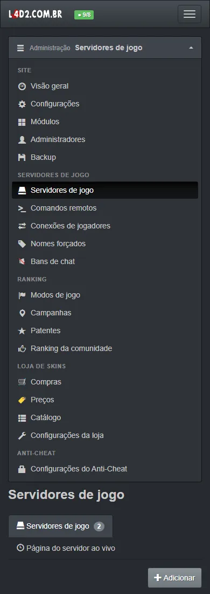
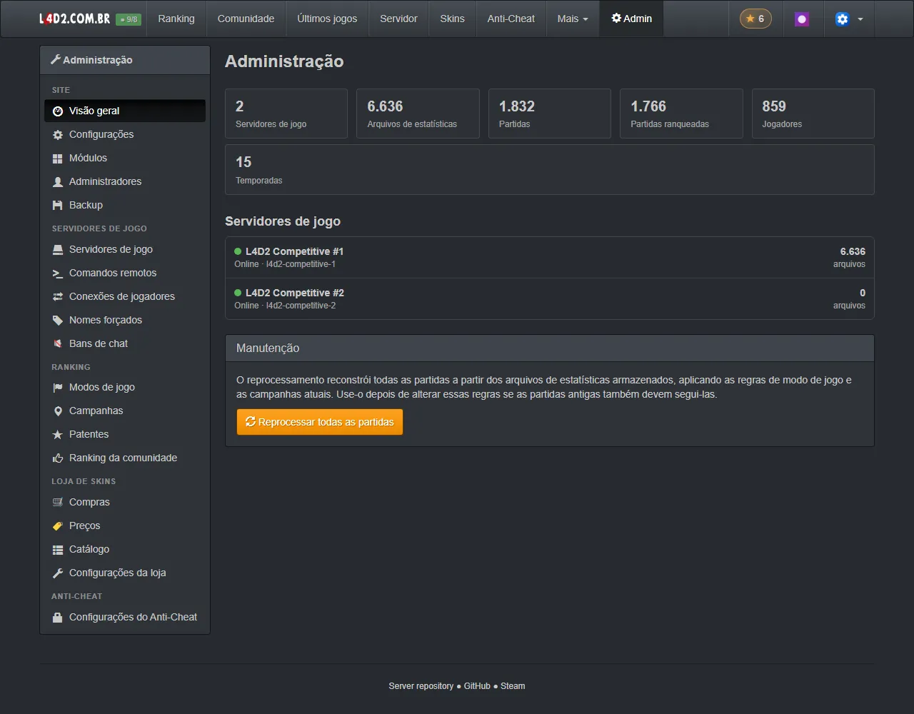
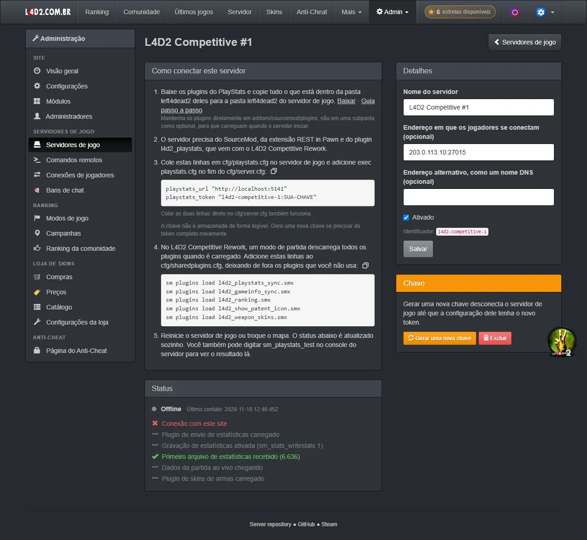
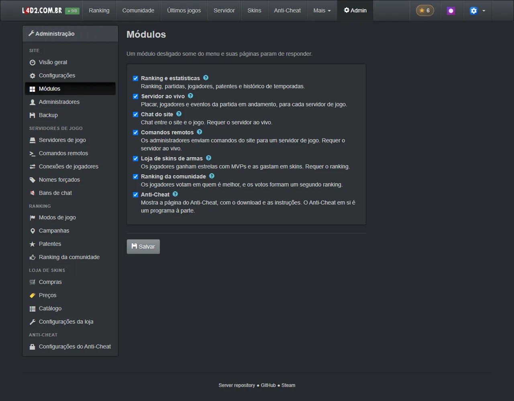
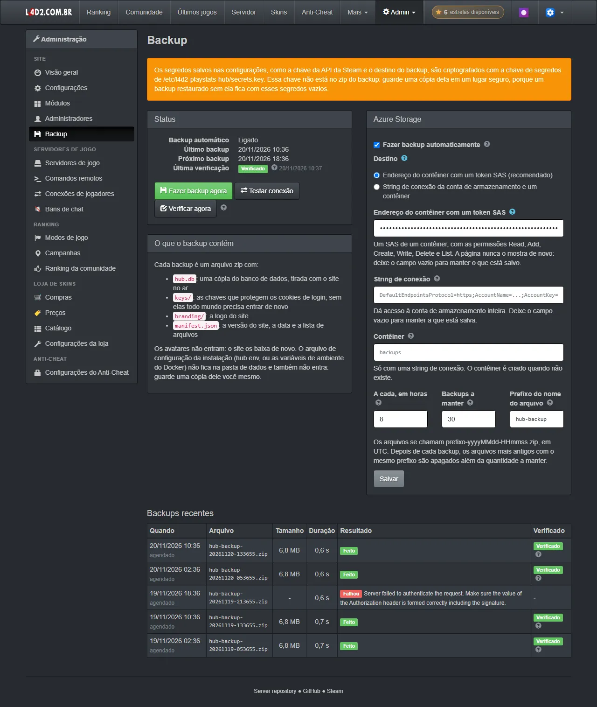

# Administração

🌐 [English](administration.md) | **Português** | [Español](administration.es.md)

A área de administração é onde o site é configurado. Ela só é acessível para administradores: **Admin > Administração** no menu, ou `/admin`. Todas as páginas da área têm o [menu da administração](#o-menu-da-administração) à esquerda.

Esta página cobre a visão geral, os servidores de jogo, os módulos, as configurações, os administradores e o backup. As outras páginas da administração são explicadas junto com o recurso delas:

| Item do menu | Explicado em |
|---|---|
| Modos de jogo, Campanhas | [Modos de jogo e campanhas](game-modes-and-campaigns.pt.md) |
| Compras, Preços, Catálogo, Configurações da loja | [Loja de skins de armas > Para administradores](skin-shop.pt.md#para-administradores) |
| Ranking da comunidade | [Ranking da comunidade > Para administradores](community-ranking.pt.md#para-administradores) |
| Bans de chat, Comandos remotos, Conexões de jogadores | [Moderação](moderation.pt.md) |
| Configurações do Anti-Cheat | [Anti-Cheat > Para administradores](anti-cheat.pt.md#para-administradores) |

Um item cujo módulo está desligado não aparece no menu.

[Voltar ao manual](README.pt.md)

## Conteúdo

- [O menu da administração](#o-menu-da-administração)
- [Visão geral](#visão-geral)
- [Servidores de jogo](#servidores-de-jogo)
- [Módulos](#módulos)
- [Configurações](#configurações)
- [Administradores](#administradores)
- [Backup](#backup)

## O menu da administração

Todas as páginas da administração têm o mesmo menu à esquerda, com a página em que você está destacada. A página de um servidor de jogo destaca **Servidores de jogo**. O menu agrupa as páginas:

| Grupo | Páginas |
|---|---|
| Site | Visão geral, Configurações, Módulos, Administradores, Backup |
| Servidores de jogo | Servidores de jogo, Comandos remotos, Conexões de jogadores, Bans de chat |
| Ranking | Modos de jogo, Campanhas, Ranking da comunidade |
| Loja de skins | Compras, Preços, Catálogo, Configurações da loja |
| Anti-Cheat | Configurações do Anti-Cheat |

Uma página cujo módulo está desligado não aparece no menu, e um grupo que fica sem páginas some. Em uma página comprida, o menu continua à vista enquanto você rola. O menu do topo do site continua como está, com **Admin** para voltar para cá de qualquer página.

No celular, o menu fica recolhido em uma barra acima da página, que mostra a página em que você está. Toque nela para abrir a lista completa:

## Visão geral

- **Os contadores**: servidores de jogo, arquivos de estatísticas recebidos, partidas, partidas ranqueadas, jogadores e temporadas.
- **Um aviso** quando configurações de jogo vistas nos seus servidores não batem com nenhuma [regra de modo de jogo](game-modes-and-campaigns.pt.md#modos-de-jogo). As partidas delas não contam para o ranking até que uma regra as cubra. **Revisar os modos de jogo** abre a página.
- **Servidores de jogo**: cada servidor com o estado dele e o número de arquivos que enviou.
- **Manutenção > Reprocessar todas as partidas**: reconstrói todas as partidas a partir dos arquivos de estatísticas armazenados, com os modos de jogo e as campanhas atuais e a opção sobre mapas desconhecidos. Use depois de mudar essas regras, se as partidas antigas tiverem que segui-las. Ele pede confirmação e diz quantas partidas foram reconstruídas. Com muitos dados, demora um pouco.

## Servidores de jogo

A lista mostra cada servidor com o identificador, o estado e o número de arquivos de estatísticas. **Adicionar um servidor de jogo** pede:

| Campo | Para que serve |
|---|---|
| Nome do servidor | O nome mostrado no site. |
| Endereço em que os jogadores se conectam (opcional) | Mostrado na página do servidor ao vivo com um botão de copiar, e usado pelo botão `connect`. Por exemplo `play.example.com:27015` ou um IP e porta. |
| Endereço alternativo, como um nome DNS (opcional) | Mostrado ao lado do endereço, como uma segunda forma de conectar. |

O painel **Página do servidor ao vivo**, ao lado, define para todos os servidores: o atraso da página ao vivo (15 segundos), de quanto em quanto tempo uma página ao vivo aberta se atualiza (2600 ms), os segundos sem sinal até o servidor aparecer offline (90) e os minutos que um comando remoto espera o servidor (5).

Depois de **Criar**, a página do novo servidor mostra o token uma única vez, com as instruções. Copie nessa hora: veja [Configuração inicial > Passo 4](first-run.pt.md#passo-4-o-servidor-de-jogo).

### A página de um servidor

| Bloco | O que tem |
|---|---|
| Como conectar este servidor | O download dos plugins, as duas linhas para o `cfg/playstats.cfg` (com `exec playstats.cfg` no `cfg/server.cfg`), as linhas `sm plugins load` para o `cfg/sharedplugins.cfg` e o que fazer em seguida. Depois da primeira vez, a parte da chave do token aparece como `SUA-CHAVE`, porque o site não a guarda. |
| Status | O [status da conexão](first-run.pt.md#o-status-da-conexão) e a lista de verificação, atualizados a cada 3 segundos, e o último hostname, mapa, configuração e versão do SourceMod que o servidor informou. |
| Detalhes | O nome, os dois endereços, **Ativado** e o identificador. Um servidor desativado não aparece na página do servidor ao vivo, e o site recusa o que ele envia. |
| Chave | **Gerar uma nova chave** cria um novo token e mostra uma única vez. O servidor de jogo fica desconectado até que a configuração dele tenha o novo token. **Excluir** remove um servidor que nunca enviou um arquivo de estatísticas; um servidor com arquivos só pode ser desativado. |

O identificador é gerado a partir do nome quando o servidor é criado e nunca muda. Renomear um servidor não muda o token dele.

## Módulos

O núcleo está sempre ligado: cadastro de servidores de jogo, envio de estatísticas, login com o Steam e a área de administração. Todo o resto é um módulo. Um módulo desligado some do menu, e as páginas e a API dele respondem como não encontradas. Desligar um módulo não apaga nada; os dados dele voltam quando ele é ligado de novo.

| Módulo | O que contém | Requer | Padrão | Quando está desligado |
|---|---|---|---|---|
| Ranking e estatísticas | Ranking, partidas, jogadores, patentes, histórico, punições e as páginas dentro do jogo. | | Ligado | A primeira página mostra um texto curto de boas-vindas. As partidas continuam sendo montadas a partir dos arquivos, sem aparecer. |
| Servidor ao vivo | A partida em andamento em cada servidor. | | Ligado | Sem o item **Servidor** no menu. Os dados ao vivo dos plugins são recusados. As contas relacionadas e as conexões de jogadores não aparecem, seja qual for a escolha em [Privacidade](#privacidade). |
| Chat do site | Escrever no chat do jogo pela página ao vivo, e os banimentos do chat. | Servidor ao vivo | Desligado | Sem caixa de chat na página ao vivo e sem a página **Bans de chat**. |
| Comandos remotos | Comandos enviados pelos administradores do site para um servidor de jogo. | Servidor ao vivo | Desligado | Sem a página **Comandos remotos** e sem terminal na página ao vivo. |
| Loja de skins de armas | Estrelas, compras, presentes e skins equipadas. | Ranking | Desligado | Sem o item **Skins** no menu, sem estrelas na barra do menu, sem a aba Skins na página do jogador. O servidor de jogo não recebe skins. |
| Ranking da comunidade | Votação em duplas e o ranking dela. | | Desligado | Sem o item **Comunidade** no menu. |
| Anti-Cheat | A página com o download e as instruções do Anti-Cheat, e quem precisa usar o Anti-Cheat nos servidores de jogo. | | Desligado | Sem o item **Anti-Cheat** no menu e sem a página **Configurações do Anti-Cheat**. O plugin de anti-cheat não recebe modo nem listas do site. |

Um módulo cujo requisito está desligado se comporta como desligado, mesmo com a própria caixa marcada.

## Configurações

### Site

| Configuração | O que faz |
|---|---|
| Nome do site | Mostrado no menu quando não há logo, no título de todas as páginas e nas páginas dentro do jogo. |
| Endereço público do site | O endereço escrito nas instruções para os servidores de jogo (`playstats_url`). Deixe vazio para usar o endereço que você está usando agora. Preencha quando você abre a administração por um endereço diferente do que os servidores de jogo usam, por exemplo `https://stats.example.com`. |
| Idioma padrão | O idioma dos visitantes que não escolheram um. |
| Fuso horário | O relógio do site: as datas nas páginas, o dia para os limites de votos e o início e o fim de cada temporada. Use um nome como `America/Sao_Paulo` ou `Europe/Lisbon`. |
| Chave da Steam Web API (opcional) | Avatares e nomes carregam sem ela; com uma chave, carregam mais rápido. |

### Aparência

| Configuração | O que faz |
|---|---|
| Logo do site | PNG, JPG, WEBP ou GIF de até 1 MB, mostrado no menu no lugar do nome do site. **Remover a logo e mostrar o nome do site** volta para o nome. |
| Links do rodapé | Um link por linha, como um texto, uma barra vertical e o endereço: `Discord \| https://discord.gg/example`. Vazio mostra só o link do projeto. |
| Palavras-chave para buscadores (opcional) | Separadas por vírgulas. Elas vão na tag de palavras-chave de todas as páginas. |
| ID do Google Analytics (opcional) | Com um ID como `G-XXXXXXXXXX`, todas as páginas carregam o script do Google Analytics. Vazio não carrega nada. |

### Temporadas

| Configuração | O que faz |
|---|---|
| Duração da temporada, em meses | De 1 a 24. Uma alteração vale a partir da próxima temporada; as temporadas que já existem mantêm as datas delas. Veja [Temporadas e histórico](seasons-and-history.pt.md). |

### Pontos do ranking

| Configuração | Padrão | O que faz |
|---|---|---|
| Vitória | 85 | Experiência por uma partida vencida. |
| Derrota | −80 | Experiência por uma partida perdida. |
| Rage quit | −150 | Experiência por sair de uma partida antes do fim. Substitui todo o resto daquela partida. |
| MVP em dano em infectados especiais, por rodada | 8 | Experiência por cada prêmio de MVP de SI. |
| MVP em infectados comuns, por rodada | 6 | Experiência por cada prêmio de MVP de CI. |
| Mínimo de partidas para aparecer no ranking | 0 | Jogos (vitórias mais derrotas) de que um jogador precisa para aparecer na lista. |
| Jogadores no ranking da página inicial | 100 | Quantos jogadores, no máximo, o ranking da página inicial e das temporadas anteriores lista, até 500. |
| Jogadores mostrados antes de Mostrar mais | 50 | Quantos deles aparecem antes de **Mostrar mais**. |
| Punição padrão, em pontos | 150 | O valor que já vem preenchido ao punir um jogador pela página do jogador. |
| Horas sem arquivos que separam duas partidas | 6 | Arquivos de um servidor de jogo mais distantes que isso pertencem a partidas diferentes. Vale para as novas partidas, ou para todas depois de **Reprocessar todas as partidas**. |
| Manter partidas jogadas em mapas que não estão na lista de campanhas | Ligado | Veja [Partidas > Como os arquivos viram partidas](matches.pt.md#como-os-arquivos-viram-partidas). |

Os pontos valem para todas as temporadas na hora, inclusive as passadas, porque os rankings são calculados a partir das partidas. A opção sobre mapas desconhecidos vale para as novas partidas, ou para todas depois de **Reprocessar todas as partidas**.

O [Ranking](ranking.pt.md#como-a-experiência-é-calculada) explica como esses valores são usados.

### Privacidade

| Configuração | Padrão | O que faz |
|---|---|---|
| Quem pode ver as contas relacionadas | Todos | **Todos** mostra o painel [Contas relacionadas](players.pt.md#contas-relacionadas) para todo visitante, como o site antigo fazia. **Somente administradores** esconde o painel dos visitantes e dos jogadores que não são administradores, na página do jogador e na página de um jogador que não está no ranking. |
| Meses para guardar as conexões dos jogadores | 3 | Conexões que não aparecem há mais tempo que isso, com os endereços IP, são apagadas todo dia. De 1 a 60. |

Esta configuração vale só para o site. O plugin `l4d2_gameinfo_sync` continua anunciando as contas relacionadas no chat do jogo enquanto `gameinfo_related_accounts_chat` estiver em `1`; coloque `0` em `cfg/playstats.cfg` para tirá-las do chat também. Os administradores sempre veem as conexões em [Moderação > Conexões de jogadores](moderation.pt.md#conexões-de-jogadores).

## Administradores

A lista mostra todos os administradores e desde quando. Para adicionar um, informe a conta como SteamID64, como Steam ID no formato `STEAM_1:0:123` ou `[U:1:123]`, ou pelo link do perfil, e, se quiser, um nome. O botão de busca ao lado do campo abre a [busca de jogadores](#a-busca-de-jogadores); o jogador escolhido também preenche o nome quando ele está vazio. **Remover** tira os direitos. Você não pode remover a si mesmo, e o último administrador não pode ser removido.

Se você perder o acesso a todas as contas de administrador, adicione uma pela máquina que roda o site:

- Linux: `playstats-hub add-admin <SteamID64>`
- Docker: `docker compose exec -u app hub dotnet L4D2PlayStats.Hub.Web.dll admin add <SteamID64>`

O SteamID64 é o número longo no endereço de um perfil do Steam, como `76561198000000000`.

### A busca de jogadores

Todo campo da administração que recebe um jogador tem ao lado um botão que abre a mesma janela de busca: administradores, votantes do ranking da comunidade, conexões de jogadores, banimentos do chat, as listas do Anti-Cheat e os presentes de skins. Ela lista os jogadores que jogaram uma partida ou entraram num servidor de jogo, dos mais recentes para os mais antigos, com foto, nome, Steam ID, quando foram vistos por último e a posição no ranking atual. Digite parte de um nome ou um Steam ID em qualquer formato para filtrar, e **Carregar mais** mostra os próximos jogadores. Clicar num jogador preenche o campo. Um Steam ID que nunca jogou aqui também pode ser escolhido.

## Backup

O site envia um zip dos dados dele para um contêiner do Azure Storage a cada algumas horas. [Backups e atualizações > Backup automático no Azure Storage](backups-and-updates.pt.md#backup-automático-no-azure-storage) explica o que o zip contém, como criar o contêiner e como restaurar um zip.

| Campo | O que faz |
|---|---|
| Fazer backup automaticamente | Liga o agendamento. **Fazer backup agora** funciona com ele desligado também. |
| Destino | **Endereço do contêiner com um token SAS**, o recomendado, ou **String de conexão da conta de armazenamento e um contêiner**. |
| Endereço do contêiner com um token SAS | `https://<conta>.blob.core.windows.net/<contêiner>?sv=...&sig=...`: um SAS desse contêiner com as permissões Read, Add, Create, Write, Delete e List. |
| String de conexão | A string de conexão da conta de armazenamento, em **Chaves de acesso** no portal do Azure. |
| Contêiner | Só com uma string de conexão. O contêiner é criado quando não existe. |
| A cada, em horas | De 1 a 168. 8 por padrão. |
| Backups a manter | De 1 a 1000. 30 por padrão. Depois de cada backup, os arquivos mais antigos além desse número são apagados. |
| Prefixo do nome do arquivo | O começo do nome dos arquivos, `hub-backup` por padrão. Só os arquivos com esse prefixo são contados e apagados. |

O endereço e a string de conexão são segredos. Depois de salvos, a página só os mostra mascarados, como `https://<conta>.blob.core.windows.net/<contêiner>?••••••••`; deixe o campo vazio para manter o que está salvo, ou digite um novo para trocar. Eles também nunca vão para o log.

- **Status** mostra se o agendamento está ligado, o último backup que deu certo e quando roda o próximo.
- **Fazer backup agora** faz um backup na hora. **Testar conexão** envia um arquivo pequeno de teste, confere se o contêiner o lista e o apaga, sem fazer backup.
- **Backups recentes** lista as últimas 20 execuções, agendadas ou manuais, com o arquivo, o tamanho, quanto tempo levou e, para um backup que falhou, o erro. Um backup que falhou é tentado de novo 30 minutos depois.
- Num site que não usa SQLite, a página avisa que o banco não está no zip.
