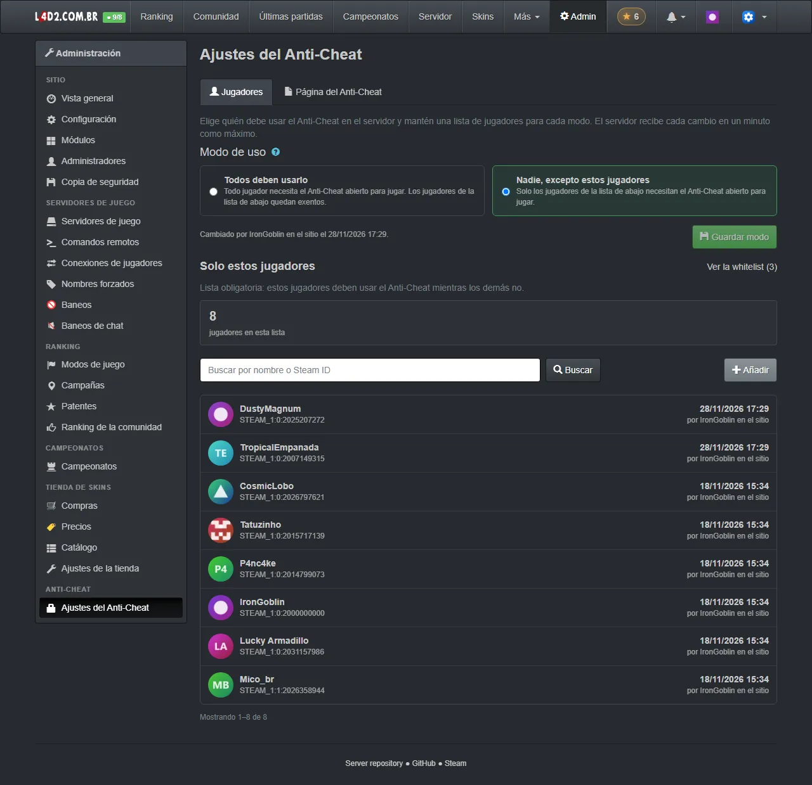
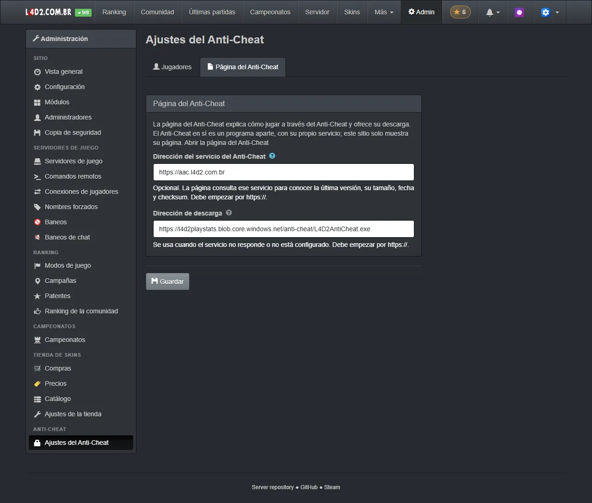

# Anti-Cheat

🌐 [English](anti-cheat.md) | [Português](anti-cheat.pt.md) | **Español**

Algunas comunidades piden a los jugadores que abran el juego con un programa Anti-Cheat antes de entrar al servidor competitivo. La página **Anti-Cheat** del sitio explica cómo usar ese programa y ofrece su descarga, y los **Ajustes del Anti-Cheat** deciden quién debe usarlo en los servidores de juego.

El Anti-Cheat en sí es un programa de Windows aparte, con su propio servicio, y es el plugin de anti-cheat del servidor de juego el que mueve a quien no lo tiene a los espectadores. Ninguno de los dos forma parte de este repositorio, y este sitio no comprueba si un jugador lo tiene abierto. El sitio muestra la página y guarda el modo de uso y las dos listas de jugadores que lee el plugin, y el servidor en vivo muestra una insignia **Anti-Cheat activado** cuando el servidor de juego lo informa.

La página y los ajustes son un módulo, desactivado de forma predeterminada.

[Volver al manual](README.es.md)

## Contenido

- [Lo que ven los jugadores](#lo-que-ven-los-jugadores)
- [Para administradores](#para-administradores)
- [Quién debe usar el Anti-Cheat](#quién-debe-usar-el-anti-cheat)
- [Activado por los jugadores](#activado-por-los-jugadores)
- [Cambios hechos en el juego](#cambios-hechos-en-el-juego)

## Lo que ven los jugadores

- **Descargar Anti-Cheat**, con la versión, el tamaño y la fecha de publicación.
- **Verificar el archivo**: el comando de PowerShell para calcular el hash SHA-256 de la descarga, y el valor con el que tiene que coincidir.
- **Cómo usarlo**: descargar y ejecutar, responder y esperar, jugar con la ventana abierta.
- **Qué muestra la ventana**: el significado de cada estado del programa (iniciando, actualizando, activo, con error).
- **Problemas comunes**: respuestas a las preguntas habituales.
- **Sobre -insecure (sin VAC)**: el programa abre el juego sin VAC, así que no hay riesgo de ban de VAC, y mientras está abierto solo se puede entrar a servidores sin VAC.
- **Privacidad**: lo que envía el programa y lo que no hace.

Un jugador que inició sesión también lee, debajo del título, si su cuenta de Steam necesita tener el Anti-Cheat abierto para jugar en los servidores de juego o si puede jugar sin él. La respuesta sigue el modo de uso y las listas de abajo. Los visitantes que no iniciaron sesión no lo ven, y ningún jugador ve el modo ni quién más está en una lista.

Los textos de la página son parte del sitio y se traducen con él.

## Para administradores

**Administración > Ajustes del Anti-Cheat** tiene el modo de uso, la lista de jugadores de ese modo y las direcciones de la página.

- **Modo de uso**: elige uno de los dos modos y haz clic en **Guardar modo**. Debajo de las opciones la página dice quién cambió el modo por última vez, en el sitio o en el juego, y cuándo. Mientras no se guarde ningún modo, dice que el servidor de juego usa el `anti_cheat_mode` de su archivo de configuración.
- **La lista**: la página muestra la lista que usa el modo actual, con el número de jugadores, una búsqueda por nombre o Steam ID y 20 jugadores por página. El enlace junto a su título abre la otra lista, que queda guardada para cuando cambie el modo.
- **Añadir**, a la derecha de la búsqueda: escribe un Steam ID en cualquier formato o un enlace de perfil, o usa **Elegir jugador** entre los jugadores del sitio. Mientras escribes, la página muestra el nombre y la foto del jugador, y si jugó aquí o solo tiene un perfil de Steam. Un jugador que ya está en la lista no se puede añadir otra vez. **Guardar** añade al jugador; si el jugador tiene [cuentas relacionadas](moderation.es.md#incluir-las-cuentas-relacionadas) que no están en la lista, pregunta antes si también hay que añadirlas.
- **Quitar**: haz clic en un jugador para ver sus IDs, su perfil de Steam, y cuándo y quién lo añadió, en el sitio o en el juego. **Quitar de la lista** pide una segunda confirmación.

| Ajuste | Qué hace |
|---|---|
| Dirección del servicio del Anti-Cheat | Opcional. La página le pide a este servicio la última versión, su tamaño, su fecha y su checksum. Tiene que empezar con `https://`. |
| Dirección de descarga | Se usa cuando el servicio no responde o no está configurado. Tiene que empezar con `https://`. |

**Abrir la página del Anti-Cheat** muestra el resultado. Activa o desactiva la página y los ajustes en [Módulos](administration.es.md#módulos); cuando el módulo está desactivado, los elementos del menú desaparecen, las páginas responden como no encontradas y el plugin de anti-cheat no recibe modo ni listas del sitio.

## Quién debe usar el Anti-Cheat

| Modo | En el sitio | `anti_cheat_mode` | Quién debe usar el Anti-Cheat | Lista usada |
|---|---|---|---|---|
| Todos | **Todos deben usarlo** | `0` | Todos los jugadores, excepto los de la whitelist. | Whitelist ("Excepto estos jugadores") |
| Solo la lista | **Nadie, excepto estos jugadores** | `1` | Solo los jugadores de la lista obligatoria. Los demás juegan sin él. | Lista obligatoria ("Solo estos jugadores") |

- Cada lista tiene su propia tabla, así que cambiar el modo no borra ninguna de las dos.
- El modo guardado en el sitio prevalece sobre el `anti_cheat_mode` del servidor de juego. Mientras no se guarde ningún modo, cada servidor de juego usa su propio valor, `1` de forma predeterminada. Consulta [Conectar un servidor de juego](../game-server.es.md#opcional-el-plugin-del-anti-cheat).
- El modo y las listas son los mismos para todos los servidores de juego del sitio.
- Después de cada cambio en el sitio, el sitio pone en cola `sm_aac sync` para cada servidor de juego habilitado, y el plugin vuelve a leer las listas en segundos. Un comando que todavía espera a un servidor no se pone en cola dos veces. Quien busca el comando es `l4d2_gameinfo_sync`, así que esto necesita el módulo del servidor en vivo, pero no el de comandos remotos. Cada uno aparece en el registro de auditoría de [Comandos remotos](moderation.es.md#comandos-remotos). Sin el módulo del servidor en vivo, el plugin sigue leyendo las listas por sí mismo cada minuto.
- Los ajustes solo deciden quién debe usar el programa. Si un servidor de juego lo exige o no es el ajuste `anti_cheat_enabled` del plugin, o una votación de los jugadores (ver abajo).

## Activado por los jugadores

Cuando el servidor de juego ejecuta el plugin del anti-cheat con la exigencia desactivada (`anti_cheat_enabled 0`), los jugadores pueden activarla en la partida con una votación. Esto necesita la versión 1.6.0 del plugin, y nada cambia en el sitio.

- **El aviso**: unos 30 segundos después de entrar, mientras una votación es posible, cada jugador lee una vez en el chat que el Anti-Cheat está desactivado y que puede escribir `!aac vote` para jugar la partida con él.
- **Cuándo puede empezar la votación**: solo antes de que empiece la partida, en el ready-up del primer mapa, con los dos equipos completos, por un jugador de uno de los equipos, y no durante un mix ni con otra votación abierta.
- **La votación**: Sí o No, mostrada a los jugadores de los dos equipos. Pasa con más de la mitad de ellos (5 de 8); quien no vota cuenta como no.
- **Cuando pasa**: el Anti-Cheat se activa en la partida, y el modo de uso y las listas de arriba siguen decidiendo quién debe usarlo. Quien debe y no tiene el programa abierto pasa a espectador, y debe cerrar el juego y abrirlo desde el Anti-Cheat. El servidor en vivo muestra la insignia **Anti-Cheat activado**.
- **Cuánto dura**: hasta que termina la partida, hasta que un administrador escribe `!aac off` o hasta que el servidor de juego queda vacío durante 10 minutos. Sobrevive al reinicio del servidor de juego cuando todos salen para abrir el juego de nuevo.

La votación solo activa el Anti-Cheat; ninguna votación lo desactiva. El plugin documenta sus ajustes (`anti_cheat_vote_enabled` y los demás).

## Cambios hechos en el juego

Los administradores también pueden cambiar el modo y las listas desde el juego, con el menú `!aac config` o los comandos `sm_aac` del plugin de anti-cheat:

| Comando | Qué hace |
|---|---|
| `sm_aac mode everyone` o `sm_aac mode listed` | Cambia el modo de uso. |
| `sm_aac add <jugador> [whitelist o required]` | Añade un jugador a una lista; sin la lista, a la lista del modo actual. |
| `sm_aac remove <jugador> [whitelist o required]` | Quita un jugador de una lista. |
| `sm_aac list` | Lista los jugadores de las listas. |
| `sm_aac sync` | Vuelve a leer el modo y las listas del sitio. |

Cuando el servidor de juego está conectado al sitio, estos cambios se guardan en el sitio y aparecen en **Ajustes del Anti-Cheat** como hechos **en el juego**, con el nombre del administrador que los hizo, o `Console`. No ponen en cola `sm_aac sync`: el servidor de juego que hizo el cambio recibe las nuevas listas en la respuesta, y los otros servidores de juego las leen en un minuto como máximo. El plugin de anti-cheat documenta cada comando.
