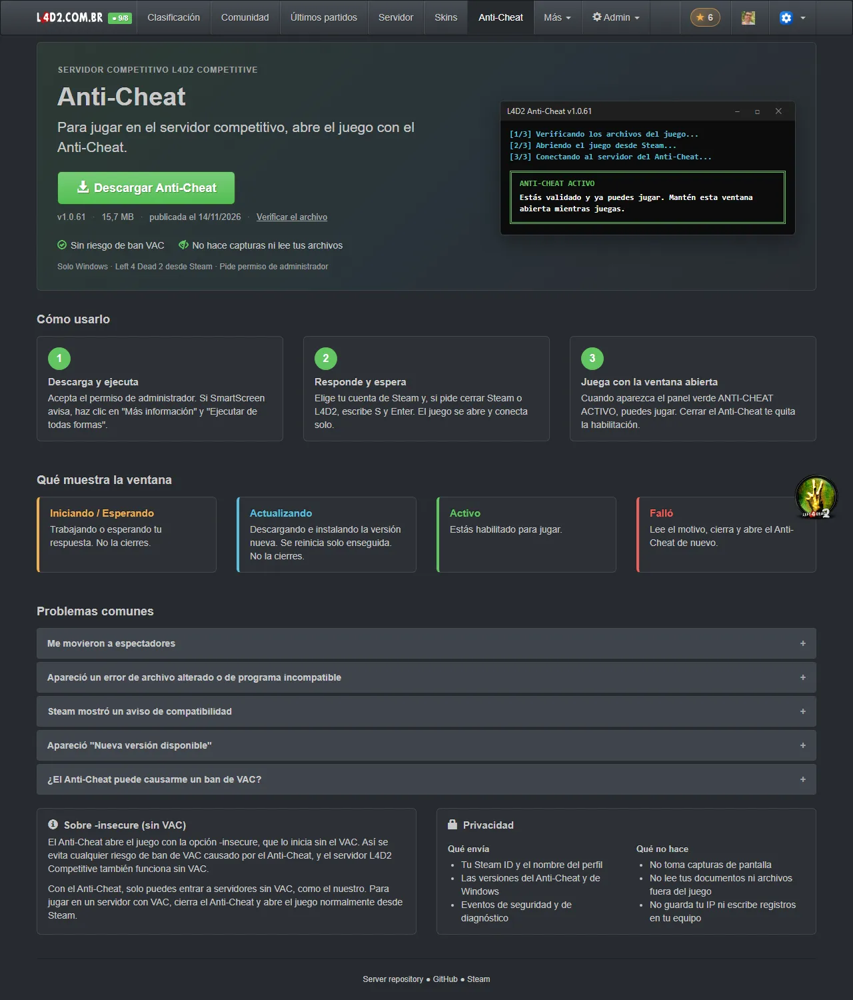

# Página del Anti-Cheat

🌐 [English](anti-cheat.md) | [Português](anti-cheat.pt.md) | **Español**

Algunas comunidades piden a los jugadores que abran el juego con un programa Anti-Cheat antes de entrar al servidor competitivo. La página **Anti-Cheat** del sitio explica cómo usar ese programa y ofrece su descarga.

El Anti-Cheat en sí es un programa de Windows aparte, con su propio servicio. No forma parte de este repositorio, y este sitio no comprueba si un jugador lo tiene abierto. El sitio solo muestra la página, y el servidor en vivo muestra una insignia **Anti-Cheat activado** cuando el servidor de juego lo informa.

La página es un módulo, desactivado de forma predeterminada.

[Volver al manual](README.es.md)

## Contenido

- [Lo que ven los jugadores](#lo-que-ven-los-jugadores)
- [Para administradores](#para-administradores)

## Lo que ven los jugadores

- **Descargar Anti-Cheat**, con la versión, el tamaño y la fecha de publicación.
- **Verificar el archivo**: el comando de PowerShell para calcular el hash SHA-256 de la descarga, y el valor con el que tiene que coincidir.
- **Cómo usarlo**: descargar y ejecutar, responder y esperar, jugar con la ventana abierta.
- **Qué muestra la ventana**: el significado de cada estado del programa (iniciando, actualizando, activo, con error).
- **Problemas comunes**: respuestas a las preguntas habituales.
- **Sobre -insecure (sin VAC)**: el programa abre el juego sin VAC, así que no hay riesgo de ban de VAC, y mientras está abierto solo se puede entrar a servidores sin VAC.
- **Privacidad**: lo que envía el programa y lo que no hace.

Los textos de la página son parte del sitio y se traducen con él.

## Para administradores

**Administración > Anti-Cheat** tiene dos direcciones.

| Ajuste | Qué hace |
|---|---|
| Dirección del servicio del Anti-Cheat | Opcional. La página le pide a este servicio la última versión, su tamaño, su fecha y su checksum. Tiene que empezar con `https://`. |
| Dirección de descarga | Se usa cuando el servicio no responde o no está configurado. Tiene que empezar con `https://`. |

**Abrir la página del Anti-Cheat** muestra el resultado. Activa o desactiva la página en [Módulos](administration.es.md#módulos); cuando está desactivada, el elemento del menú desaparece y la página responde como no encontrada.
