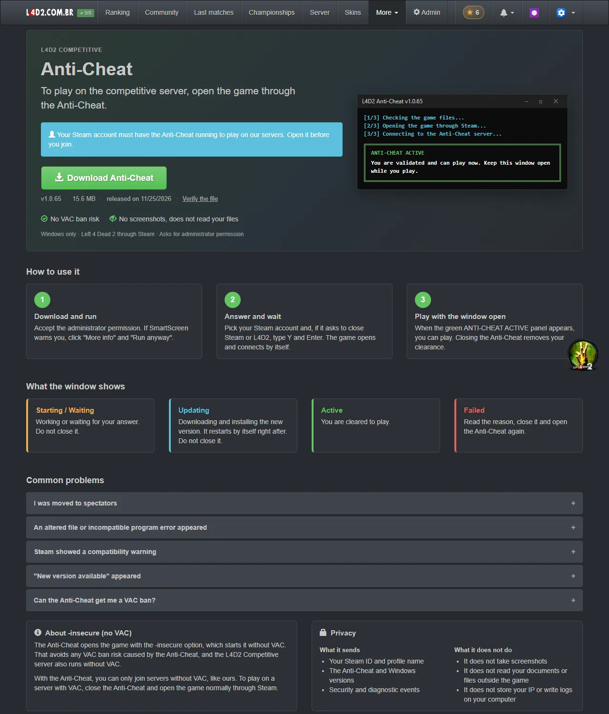
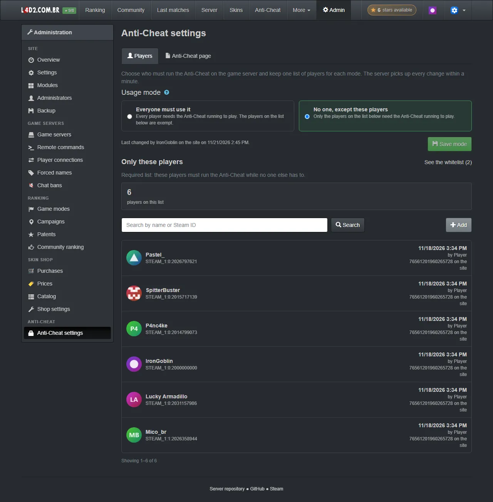
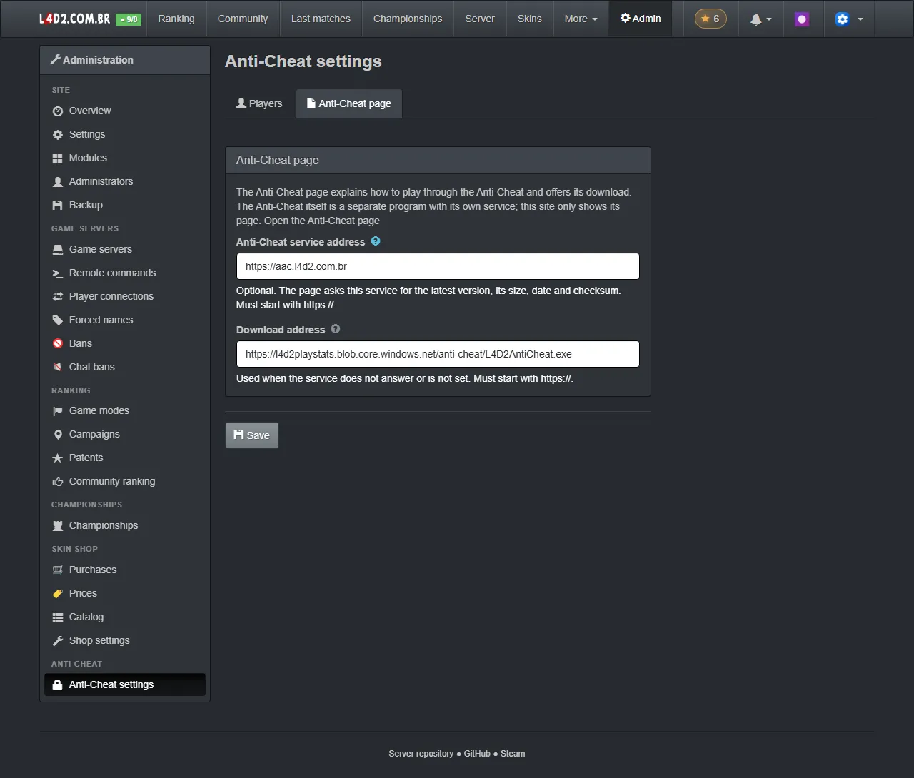

# Anti-Cheat

🌐 **English** | [Português](anti-cheat.pt.md) | [Español](anti-cheat.es.md)

Some communities ask players to open the game through an Anti-Cheat program before they join the competitive server. The **Anti-Cheat** page of the site explains how to use that program and offers its download, and the **Anti-Cheat settings** decide who must use it on the game servers.

The Anti-Cheat itself is a separate Windows program with its own service, and the anti-cheat plugin of the game server is what moves a player without it to the spectators. Neither is part of this repository, and this site does not check whether a player is running the program. The site shows the page and keeps the usage mode and the two lists of players that the plugin reads, and the live server shows an **Anti-Cheat on** badge when the game server reports it.

The page and the settings are a module, off by default.

[Back to the manual](README.md)

## Contents

- [What players see](#what-players-see)
- [For administrators](#for-administrators)
- [Who must use the Anti-Cheat](#who-must-use-the-anti-cheat)
- [Turned on by the players](#turned-on-by-the-players)
- [Changes made in the game](#changes-made-in-the-game)

## What players see

- **Download Anti-Cheat**, with the version, the size and the release date.
- **Verify the file**: the PowerShell command to compute the SHA-256 hash of the download, and the value it must match.
- **How to use it**: download and run, answer and wait, play with the window open.
- **What the window shows**: the meaning of each state of the program (starting, updating, active, failed).
- **Common problems**: answers to the usual questions.
- **About -insecure (no VAC)**: the program opens the game without VAC, so it carries no VAC ban risk, and only servers without VAC can be joined while it runs.
- **Privacy**: what the program sends and what it does not do.

A signed-in player also reads, under the title, whether their Steam account must have the Anti-Cheat running to play on the game servers or can play without it. The answer follows the usage mode and the lists below. Visitors who are not signed in do not see it, and no player sees the mode or who else is on a list.

The texts of the page are part of the site and are translated with it.

## For administrators

**Administration > Anti-Cheat settings** has the usage mode, the list of players of that mode and the addresses of the page.

- **Usage mode**: choose one of the two modes and click **Save mode**. Under the choices the page says who changed the mode last, on the site or in the game, and when. Until a mode is saved, it says that the game server uses the `anti_cheat_mode` of its config file.
- **The list**: the page shows the list the current mode uses, with the number of players, a search by name or Steam ID, and 20 players per page. The link next to its title opens the other list, which stays saved for when the mode changes.
- **Add**, on the right of the search: type a Steam ID in any format or a profile link, or **Pick a player** from the players of the site. While you type, the page shows the name and the photo of the player, and whether they played here or only have a Steam profile. A player who is already on the list cannot be added again. **Save** adds the player; if the player has [related accounts](moderation.md#including-the-related-accounts) that are not on the list, it first asks whether to add them too.
- **Remove**: click a player to see their IDs, their Steam profile, and when and by whom they were added, on the site or in the game. **Remove from the list** asks for a second confirmation.

| Setting | What it does |
|---|---|
| Anti-Cheat service address | Optional. The page asks this service for the latest version, its size, its date and its checksum. Must start with `https://`. |
| Download address | Used when the service does not answer or is not set. Must start with `https://`. |

**Open the Anti-Cheat page** shows the result. Turn the page and the settings on or off in [Modules](administration.md#modules); when the module is off, the menu items disappear, the pages answer as not found, and the anti-cheat plugin gets no mode or lists from the site.

## Who must use the Anti-Cheat

| Mode | On the site | `anti_cheat_mode` | Who must use the Anti-Cheat | List used |
|---|---|---|---|---|
| Everyone | **Everyone must use it** | `0` | Every player, except the players on the whitelist. | Whitelist ("Except these players") |
| Only the list | **No one, except these players** | `1` | Only the players on the required list. Everyone else plays without it. | Required list ("Only these players") |

- Each list has its own table, so changing the mode loses neither of them.
- The mode saved on the site wins over the `anti_cheat_mode` of the game server. Until a mode is saved, each game server uses its own value, `1` by default. See [Connecting a game server](../game-server.md#optional-the-anti-cheat-plugin).
- The mode and the lists are the same for every game server of the site.
- After each change on the site, the site queues `sm_aac sync` for every enabled game server, so the plugin reads the lists again within seconds. A command already waiting for a server is not queued twice. `l4d2_gameinfo_sync` fetches the command, so this needs the live server module, but not the remote commands module. Each one shows in the audit log of [Remote commands](moderation.md#remote-commands). Without the live server module, the plugin still reads the lists by itself every minute.
- The settings only decide who must use the program. Whether a game server enforces it at all is the `anti_cheat_enabled` setting of the plugin, or a vote of the players (see below).

## Turned on by the players

When the game server runs the anti-cheat plugin with enforcement off (`anti_cheat_enabled 0`), the players can turn it on for the match with a vote. This needs version 1.6.0 of the plugin, and nothing on the site changes.

- **The notice**: about 30 seconds after joining, while a vote can start, each player reads once in the chat that the Anti-Cheat is off and that they can type `!aac vote` to play the match with it.
- **When the vote can start**: only before the match begins, in the ready-up of the first map, with both teams full, by a player of one of the teams, and not while a mix is running or another vote is open.
- **The vote**: Yes or No, shown to the players of the two teams. It passes with more than half of them (5 of 8); a player who does not vote counts as no.
- **When it passes**: the Anti-Cheat turns on for the match, and the usage mode and the lists above still decide who must use it. A player who must and does not have the program open goes to the spectators, and must close the game and open it through the Anti-Cheat. The live server shows the **Anti-Cheat on** badge.
- **How long it lasts**: until the match ends, until an administrator types `!aac off`, or until the game server stays empty for 10 minutes. It survives the restart of the game server when everyone leaves to reopen the game.

The vote only turns the Anti-Cheat on; no vote turns it off. The plugin documents its settings (`anti_cheat_vote_enabled` and the others).

## Changes made in the game

Administrators can also change the mode and the lists from the game, with the `!aac config` menu or the `sm_aac` commands of the anti-cheat plugin:

| Command | What it does |
|---|---|
| `sm_aac mode everyone` or `sm_aac mode listed` | Changes the usage mode. |
| `sm_aac add <player> [whitelist or required]` | Adds a player to a list; without the list, to the list of the current mode. |
| `sm_aac remove <player> [whitelist or required]` | Removes a player from a list. |
| `sm_aac list` | Lists the players of the lists. |
| `sm_aac sync` | Reads the mode and the lists from the site again. |

When the game server is connected to the site, these changes are saved on the site and show on **Anti-Cheat settings** as made **in the game**, with the name of the administrator who made them, or `Console`. They do not queue `sm_aac sync`: the game server that made the change gets the new lists in the answer, and the other game servers read them within a minute. The anti-cheat plugin documents each command.
