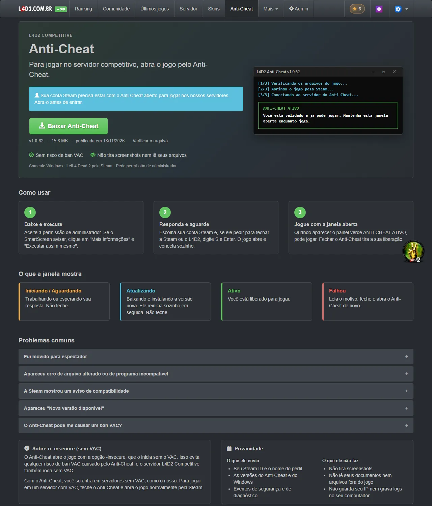
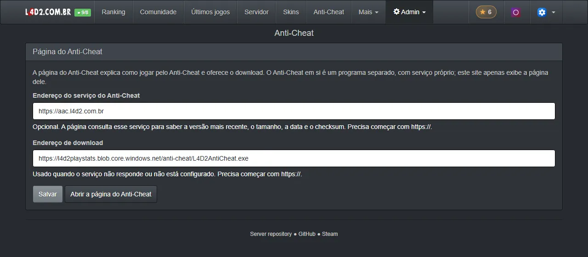
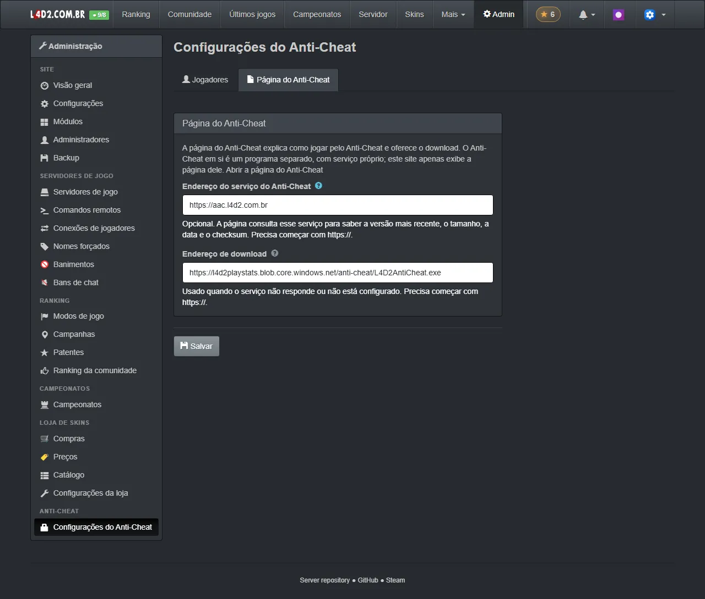

# Anti-Cheat

🌐 [English](anti-cheat.md) | **Português** | [Español](anti-cheat.es.md)

Algumas comunidades pedem que os jogadores abram o jogo por um programa de Anti-Cheat antes de entrar no servidor competitivo. A página **Anti-Cheat** do site explica como usar esse programa e oferece o download, e as **Configurações do Anti-Cheat** decidem quem precisa usá-lo nos servidores de jogo.

O Anti-Cheat em si é um programa separado para Windows, com serviço próprio, e é o plugin de anti-cheat do servidor de jogo que move para os espectadores quem está sem ele. Nenhum dos dois faz parte deste repositório, e este site não verifica se um jogador está rodando o programa. O site mostra a página e guarda o modo de uso e as duas listas de jogadores que o plugin lê, e o servidor ao vivo mostra o selo **Anti-Cheat ligado** quando o servidor de jogo informa isso.

A página e as configurações são um módulo, desligado por padrão.

[Voltar ao manual](README.pt.md)

## Conteúdo

- [O que os jogadores veem](#o-que-os-jogadores-veem)
- [Para administradores](#para-administradores)
- [Quem precisa usar o Anti-Cheat](#quem-precisa-usar-o-anti-cheat)
- [Ligado pelos jogadores](#ligado-pelos-jogadores)
- [Alterações feitas no jogo](#alterações-feitas-no-jogo)

## O que os jogadores veem

- **Baixar Anti-Cheat**, com a versão, o tamanho e a data de lançamento.
- **Verificar o arquivo**: o comando do PowerShell que calcula o hash SHA-256 do download, e o valor com que ele precisa bater.
- **Como usar**: baixe e execute, responda e espere, jogue com a janela aberta.
- **O que a janela mostra**: o significado de cada estado do programa (iniciando, atualizando, ativo, com falha).
- **Problemas comuns**: respostas para as dúvidas mais frequentes.
- **Sobre o -insecure (sem VAC)**: o programa abre o jogo sem o VAC, então não traz risco de ban VAC, e enquanto ele está aberto só dá para entrar em servidores sem VAC.
- **Privacidade**: o que o programa envia e o que ele não faz.

Um jogador logado também lê, abaixo do título, se a conta Steam dele precisa estar com o Anti-Cheat aberto para jogar nos servidores de jogo ou se pode jogar sem ele. A resposta segue o modo de uso e as listas abaixo. Visitantes que não estão logados não veem esse aviso, e nenhum jogador vê o modo nem quem mais está numa lista.

Os textos da página fazem parte do site e são traduzidos junto com ele.

## Para administradores

**Administração > Configurações do Anti-Cheat** tem o modo de uso, a lista de jogadores desse modo e os endereços da página.

- **Modo de uso**: escolha um dos dois modos e clique em **Salvar modo**. Abaixo das opções a página diz quem mudou o modo por último, no site ou no jogo, e quando. Enquanto nenhum modo foi salvo, ela diz que o servidor de jogo usa o `anti_cheat_mode` do seu arquivo de configuração.
- **A lista**: a página mostra a lista que o modo atual usa, com o número de jogadores, uma busca por nome ou Steam ID e 20 jogadores por página. O link ao lado do título abre a outra lista, que fica guardada para quando o modo mudar.
- **Adicionar**, à direita da busca: digite um Steam ID em qualquer formato ou um link de perfil, ou use **Escolher jogador** entre os jogadores do site. Enquanto você digita, a página mostra o nome e a foto do jogador, e se ele jogou aqui ou só tem um perfil Steam. Um jogador que já está na lista não pode ser adicionado de novo. **Salvar** adiciona o jogador.
- **Remover**: clique em um jogador para ver os IDs, o perfil Steam, e quando e por quem ele foi adicionado, no site ou no jogo. **Remover da lista** pede uma segunda confirmação.

| Configuração | O que faz |
|---|---|
| Endereço do serviço do Anti-Cheat | Opcional. A página pede a esse serviço a versão mais recente, o tamanho, a data e o checksum. Precisa começar com `https://`. |
| Endereço de download | Usado quando o serviço não responde ou não está configurado. Precisa começar com `https://`. |

**Abrir a página do Anti-Cheat** mostra o resultado. Ligue ou desligue a página e as configurações em [Módulos](administration.pt.md#módulos); quando o módulo está desligado, os itens somem do menu, as páginas respondem como não encontradas e o plugin de anti-cheat não recebe modo nem listas do site.

## Quem precisa usar o Anti-Cheat

| Modo | No site | `anti_cheat_mode` | Quem precisa usar o Anti-Cheat | Lista usada |
|---|---|---|---|---|
| Todos | **Todos devem usar** | `0` | Todo jogador, exceto os jogadores da whitelist. | Whitelist ("Exceto estes jogadores") |
| Só a lista | **Ninguém, exceto estes jogadores** | `1` | Só os jogadores da lista obrigatória. Os demais jogam sem ele. | Lista obrigatória ("Apenas estes jogadores") |

- Cada lista tem a sua própria tabela, então mudar o modo não apaga nenhuma das duas.
- O modo salvo no site vale mais que o `anti_cheat_mode` do servidor de jogo. Enquanto nenhum modo foi salvo, cada servidor de jogo usa o seu próprio valor, `1` por padrão. Veja [Conectando um servidor de jogo](../game-server.pt.md#opcional-o-plugin-do-anti-cheat).
- O modo e as listas são os mesmos para todos os servidores de jogo do site.
- Depois de cada alteração no site, o site enfileira `sm_aac sync` para cada servidor de jogo habilitado, e o plugin relê as listas em segundos. Um comando que ainda espera por um servidor não é enfileirado duas vezes. Quem busca o comando é o `l4d2_gameinfo_sync`, então isso precisa do módulo do servidor ao vivo, mas não do módulo de comandos remotos. Cada um aparece no registro de auditoria de [Comandos remotos](moderation.pt.md#comandos-remotos). Sem o módulo do servidor ao vivo, o plugin continua relendo as listas sozinho a cada minuto.
- As configurações só decidem quem precisa usar o programa. Se um servidor de jogo exige o programa ou não é a configuração `anti_cheat_enabled` do plugin, ou uma votação dos jogadores (veja abaixo).

## Ligado pelos jogadores

Quando o servidor de jogo roda o plugin do anti-cheat com a exigência desligada (`anti_cheat_enabled 0`), os jogadores podem ligá-la na partida com uma votação. Isso precisa da versão 1.6.0 do plugin, e nada muda no site.

- **O aviso**: uns 30 segundos depois de entrar, enquanto uma votação é possível, cada jogador lê uma vez no chat que o Anti-Cheat está desligado e que pode digitar `!aac vote` para jogar a partida com ele.
- **Quando a votação pode começar**: só antes do início da partida, no ready-up do primeiro mapa, com os dois times completos, por um jogador de um dos times, e não durante um mix ou com outra votação aberta.
- **A votação**: Sim ou Não, mostrada aos jogadores dos dois times. Passa com mais da metade deles (5 de 8); quem não vota conta como não.
- **Quando passa**: o Anti-Cheat liga na partida, e o modo de uso e as listas acima continuam decidindo quem precisa usá-lo. Quem precisa e não está com o programa aberto vai para o espectador, e precisa fechar o jogo e abri-lo pelo Anti-Cheat. O servidor ao vivo mostra o selo **Anti-Cheat ligado**.
- **Quanto tempo dura**: até a partida terminar, até um administrador digitar `!aac off` ou até o servidor de jogo ficar vazio por 10 minutos. Sobrevive à reinicialização do servidor de jogo quando todos saem para reabrir o jogo.

A votação só liga o Anti-Cheat; nenhuma votação o desliga. O plugin documenta as configurações dele (`anti_cheat_vote_enabled` e as outras).

## Alterações feitas no jogo

Os administradores também podem mudar o modo e as listas pelo jogo, com o menu `!aac config` ou os comandos `sm_aac` do plugin de anti-cheat:

| Comando | O que faz |
|---|---|
| `sm_aac mode everyone` ou `sm_aac mode listed` | Muda o modo de uso. |
| `sm_aac add <jogador> [whitelist ou required]` | Adiciona um jogador a uma lista; sem a lista, à lista do modo atual. |
| `sm_aac remove <jogador> [whitelist ou required]` | Remove um jogador de uma lista. |
| `sm_aac list` | Lista os jogadores das listas. |
| `sm_aac sync` | Relê o modo e as listas do site. |

Quando o servidor de jogo está conectado ao site, essas alterações são salvas no site e aparecem em **Configurações do Anti-Cheat** como feitas **no jogo**, com o nome do administrador que as fez, ou `Console`. Elas não enfileiram `sm_aac sync`: o servidor de jogo que fez a alteração recebe as novas listas na resposta, e os outros servidores de jogo as leem em até um minuto. O plugin de anti-cheat documenta cada comando.
