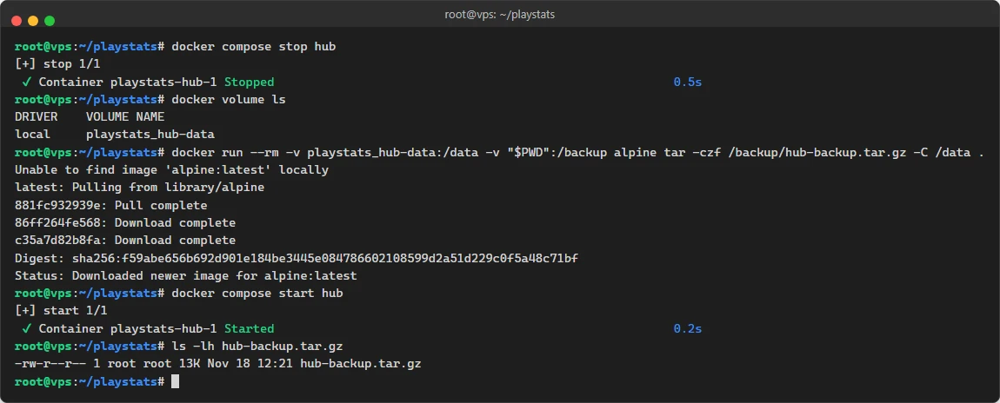

# Copias de seguridad y actualizaciones

🌐 [English](backups-and-updates.md) | [Português](backups-and-updates.pt.md) | **Español**

Todo lo que guarda el sitio está en una sola carpeta, la carpeta de datos. Haz una copia de seguridad de ella, guarda una copia de la [clave de secretos](#la-clave-de-secretos), que está fuera de ella, y podrás reconstruir el sitio en cualquier máquina.

[Volver al manual](README.es.md)

## Contenido

- [Qué hay en la carpeta de datos](#qué-hay-en-la-carpeta-de-datos)
- [La clave de secretos](#la-clave-de-secretos)
- [Copia automática en Azure Storage](#copia-automática-en-azure-storage)
- [Copia de seguridad en Linux](#copia-de-seguridad-en-linux)
- [Copia de seguridad con Docker](#copia-de-seguridad-con-docker)
- [Restaurar](#restaurar)
- [Actualizar](#actualizar)
- [Qué se pierde al reiniciar](#qué-se-pierde-al-reiniciar)

## Qué hay en la carpeta de datos

| Elemento | Qué es |
|---|---|
| `hub.db` (y `hub.db-wal`, `hub.db-shm` mientras el sitio está en ejecución) | La base de datos SQLite: cada archivo de estadísticas recibido, las partidas, los ajustes, las skins, los votos, todo. |
| `avatars/` | Los avatares de Steam que descargó el sitio. Se pueden volver a descargar. |
| `branding/` | El logo subido en la configuración. |
| `keys/` | Las claves que protegen las cookies de inicio de sesión. Sin ellas, todos tienen que volver a iniciar sesión. |
| `setup-code.txt` | El código de configuración, solo hasta que termina la configuración inicial. |

La carpeta es `/var/lib/l4d2-playstats-hub` con el instalador para Linux y el volumen `hub-data` (montado en `/data`) con Docker. En Linux, los pocos ajustes que están fuera de la base de datos están en `/etc/l4d2-playstats-hub/hub.env`.

Con SQL Server, PostgreSQL o MySQL, los datos están en esa base de datos: haz la copia de seguridad con las herramientas de esa base de datos y guarda una copia de la carpeta de datos por las claves y el logo. Consulta [Bases de datos](../databases.es.md).

Como se guarda cada archivo de estadísticas, la base de datos alcanza para reconstruir todas las partidas y los rankings.

## La clave de secretos

La clave de la API de Steam, la dirección o la cadena de conexión del destino de la copia de seguridad y el código de configuración se guardan cifrados en la base de datos, con AES-256-GCM. La clave que los descifra es un archivo guardado fuera de la carpeta de datos:

| Instalación | Clave de secretos |
|---|---|
| Instalador para Linux | `/etc/l4d2-playstats-hub/secrets.key` |
| Docker | `/secrets/secrets.key`, en el volumen `hub-secrets` |
| Azure App Service | `/home/secrets/secrets.key`, o la configuración de la aplicación `Hub__SecretsKey` |
| Cualquier otra | `secrets.key` junto a la carpeta de datos, o el archivo indicado en `Hub__SecretsKeyFile` |

- Cuando no hay clave, el sitio crea una la primera vez que arranca (el instalador para Linux la crea él mismo) y escribe en el registro dónde está, nunca su valor.
- Las versiones antiguas guardaban estos secretos en texto plano. El primer arranque de una versión que los cifra cifra lo que se guardó antes, y un secreto todavía en texto plano se lee tal cual.
- El zip de copia de seguridad no contiene la clave, y la carpeta de datos tampoco: quien consiga una copia no puede leer los secretos. La página **Copia de seguridad** de la administración muestra dónde está la clave. `playstats-hub backup` en Linux sí la incluye.
- Guarda una copia de la clave en un lugar seguro, separada de las copias de seguridad. Para restaurar en otra máquina, vuelve a poner la clave antes de arrancar el sitio. Sin ella el sitio arranca y todos los datos están, pero estos secretos quedan vacíos: el registro lo avisa, y vuelves a escribirlos en el área de administración.

## Copia automática en Azure Storage

El sitio puede hacer su propia copia de seguridad. En [Administración > Copia de seguridad](administration.es.md#copia-de-seguridad) le indicas un contenedor de Azure Storage y, cada pocas horas, 8 por defecto, sube allí un archivo zip. El sitio sigue en marcha: la base de datos se copia mientras funciona.

### Qué contiene el zip

| Archivo | Qué es |
|---|---|
| `hub.db` | Una copia de la base de datos SQLite, hecha con la función de copia de SQLite con el sitio en marcha, así que es coherente aunque lleguen estadísticas. |
| `keys/` | Las claves que protegen las cookies de inicio de sesión. |
| `branding/` | El logo. |
| `manifest.json` | La versión del sitio, la hora de la copia en UTC, el proveedor de la base de datos y la lista de archivos. |

- Los avatares quedan fuera: el sitio los descarga otra vez.
- `hub.env` (Linux) o las variables de entorno (Docker) están fuera de la carpeta de datos y no van en el zip. Guarda una copia de ellos, o ejecuta `playstats-hub backup` de vez en cuando, que incluye `hub.env`.
- Con SQL Server, PostgreSQL o MySQL el zip no tiene `hub.db`: haz la copia de esa base de datos con sus propias herramientas. El zip sigue guardando las claves y el logo.
- La clave de secretos no está en el zip, a propósito. Guarda una copia de ella aparte: consulta [La clave de secretos](#la-clave-de-secretos).

Los archivos se llaman `<prefijo>-yyyyMMdd-HHmmss.zip`, en UTC, como `hub-backup-20261119-160000.zip`. Después de cada subida se borran los archivos más antiguos con el mismo prefijo que pasen de la cantidad a conservar (30 por defecto). Los demás archivos del contenedor no se tocan nunca. Una copia que falla se intenta otra vez 30 minutos después, y la página muestra el error.

### Crear el contenedor y su dirección SAS

El destino más seguro es una dirección SAS de un contenedor: con ella el sitio solo puede usar ese contenedor.

En el portal de Azure:

1. Abre la cuenta de almacenamiento, **Almacenamiento de datos > Contenedores**, y crea un contenedor, como `hub-backups`, con acceso privado.
2. Abre el contenedor y **Configuración > Tokens de acceso compartido**. Firma con una clave de la cuenta, marca los permisos **Read, Add, Create, Write, Delete y List**, elige una fecha de expiración lejana y haz clic en **Generar URL y token de SAS**.
3. Copia la **URL de SAS de blob**. Tiene la forma `https://<cuenta>.blob.core.windows.net/hub-backups?sv=...&sig=...`.

Con la CLI de Azure:

```bash
az storage container create --account-name <cuenta> --name hub-backups --auth-mode key
```

```bash
az storage container generate-sas --account-name <cuenta> --name hub-backups --permissions racwdl --expiry 2028-12-31T23:59Z --https-only --auth-mode key -o tsv
```

El segundo comando muestra el token. La dirección es `https://<cuenta>.blob.core.windows.net/hub-backups?` seguida de él.

Pega la dirección en **Administración > Copia de seguridad**, marca **Hacer copias automáticamente**, guarda y haz clic en **Probar la conexión**. El SAS deja de funcionar en su fecha de expiración: crea uno nuevo antes, o las copias empiezan a fallar, como muestra la página.

Una cadena de conexión de la cuenta de almacenamiento también sirve, junto con el nombre de un contenedor; el sitio crea el contenedor si no existe. Da acceso a toda la cuenta, así que es mejor la dirección SAS.

### Restaurar un zip

Descarga el zip del contenedor: en el portal, abre el archivo y haz clic en **Descargar**; con la CLI, `az storage blob download`.

En Linux, detén el sitio, pon los archivos del zip en la carpeta de datos e inícialo otra vez. `unzip` puede necesitar `sudo apt install unzip`.

```bash
sudo systemctl stop l4d2-playstats-hub
```

```bash
sudo rm -f /var/lib/l4d2-playstats-hub/hub.db-wal /var/lib/l4d2-playstats-hub/hub.db-shm
```

```bash
sudo unzip -o hub-backup-20261119-160000.zip -x manifest.json -d /var/lib/l4d2-playstats-hub
```

```bash
sudo chown -R playstats:playstats /var/lib/l4d2-playstats-hub
```

```bash
sudo systemctl start l4d2-playstats-hub
```

Borra los archivos `-wal` y `-shm` antes de extraer: son de la base de datos que se reemplaza. En una máquina nueva, ejecuta antes el instalador, pon tu clave de secretos en `/etc/l4d2-playstats-hub/secrets.key` (consulta [La clave de secretos](#la-clave-de-secretos)), después restaura, y vuelve a poner tu `hub.env` si lo cambiaste.

Con Docker, detén el contenedor, extrae el zip en el volumen e inícialo otra vez. El contenedor entrega los archivos a su usuario al iniciar. En una máquina nueva, pon también la clave de secretos en el volumen `hub-secrets`, como muestra [Instalar con Docker](../install-docker.es.md#la-clave-de-secretos).

```bash
docker compose stop hub
```

```bash
docker run --rm -v playstats_hub-data:/data -v "$PWD":/backup alpine sh -c "rm -f /data/hub.db-wal /data/hub.db-shm && unzip -o /backup/hub-backup-20261119-160000.zip -x manifest.json -d /data"
```

```bash
docker compose start hub
```

## Copia de seguridad en Linux

```bash
playstats-hub backup
```


El sitio se detiene unos segundos mientras se hace la copia. El archivo queda en `/root` con la fecha en el nombre, y contiene la carpeta de datos, `hub.env` y la clave de secretos, así que mantenlo privado. Indica otra ruta para guardarlo en otro lugar: `playstats-hub backup /backups/hub.tar.gz`. Copia el archivo a otra máquina.

Para hacer una cada noche, agrega una línea al crontab de root (`sudo crontab -e`):

```text
0 4 * * * /usr/local/bin/playstats-hub backup
```

Las copias antiguas no se borran solas.

## Copia de seguridad con Docker

Detén el contenedor, copia el volumen a un archivo y vuelve a iniciarlo:



El nombre del volumen lleva delante el nombre de tu carpeta, como `playstats_hub-data`. `docker volume ls` lo muestra. [Instalar con Docker](../install-docker.es.md#copia-de-seguridad) tiene los comandos. Copia también el volumen `hub-secrets`: guarda la clave de secretos.

## Restaurar

En Linux, en la misma máquina o en una nueva donde hayas ejecutado el instalador:

```bash
playstats-hub restore /root/l4d2-playstats-hub-backup-20270115-030000.tar.gz
```

Reemplaza los datos actuales, `hub.env` y la clave de secretos por los del archivo y vuelve a iniciar el sitio. Una copia hecha antes de que los secretos se cifraran no tiene clave, y se conserva la actual.

Con Docker, detén el contenedor, extrae el archivo en el volumen y vuelve a iniciarlo:

```bash
docker compose stop hub
```

```bash
docker run --rm -v playstats_hub-data:/data -v "$PWD":/backup alpine sh -c "rm -rf /data/* && tar -xzf /backup/hub-backup.tar.gz -C /data"
```

```bash
docker compose start hub
```

## Actualizar

Las versiones nuevas se publican en las [versiones publicadas](https://github.com/altair-sossai/l4d2-playstats-hub/releases). Una actualización conserva los datos y los ajustes. Cuando una versión cambia la base de datos, el sitio actualiza las tablas por sí solo al iniciar.

En Linux:

```bash
playstats-hub update
```


Para instalar una versión específica: `playstats-hub update v1.2.0`.

Con Docker:


Las imágenes hasta la v0.3.0 ejecutaban el sitio como root; las más nuevas lo ejecutan con el usuario `app`. Un volumen creado por una imagen antigua pasa a ese usuario cuando el nuevo contenedor inicia, así que no hace falta nada más. [Instalar con Docker > Actualizar](../install-docker.es.md#actualizar) tiene los detalles.

Una copia de seguridad antes de actualizar lleva un minuto y te permite volver atrás.

Los plugins de los servidores de juego se publican junto con el sitio. Revisa las notas de la versión para ver si cambiaron; [Conectar un servidor de juego](../game-server.es.md) explica cómo reemplazarlos.

## Qué se pierde al reiniciar

Un reinicio, una actualización o una restauración conservan todo lo guardado. Solo lo que vive en memoria empieza vacío:

- la partida en curso en la página del servidor en vivo, hasta que los servidores de juego envíen la próxima actualización;
- los mensajes del chat del sitio y los comandos que esperan ser entregados;
- el estado de la conexión de los servidores de juego, hasta que cada uno envíe su próxima señal.
