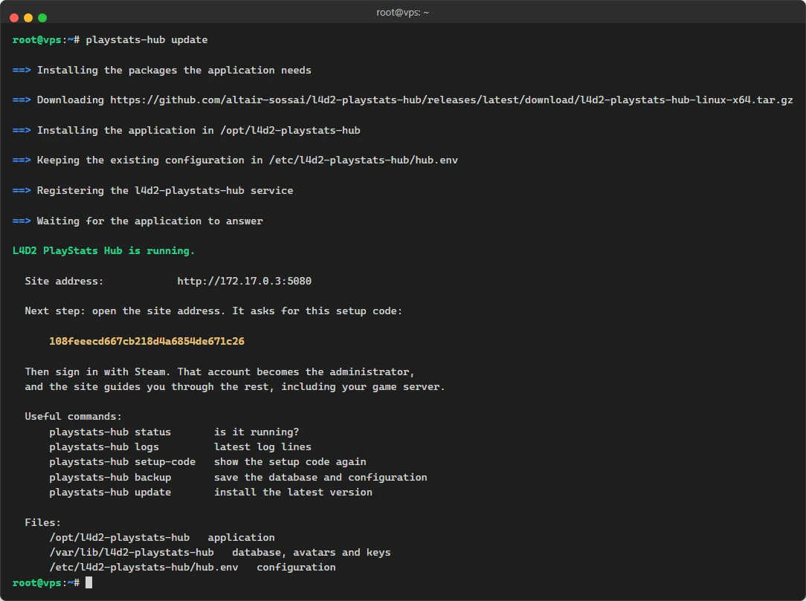

# Backups e atualizações

🌐 [English](backups-and-updates.md) | **Português** | [Español](backups-and-updates.es.md)

Tudo o que o site guarda fica em uma pasta só, a pasta de dados. Faça backup dela e você consegue montar o site de novo em qualquer máquina.

[Voltar ao manual](README.pt.md)

## Conteúdo

- [O que fica na pasta de dados](#o-que-fica-na-pasta-de-dados)
- [Fazendo backup no Linux](#fazendo-backup-no-linux)
- [Fazendo backup com Docker](#fazendo-backup-com-docker)
- [Restaurando](#restaurando)
- [Atualizando](#atualizando)
- [O que se perde ao reiniciar](#o-que-se-perde-ao-reiniciar)

## O que fica na pasta de dados

| Item | O que é |
|---|---|
| `hub.db` (e `hub.db-wal`, `hub.db-shm` enquanto o site está rodando) | O banco de dados SQLite: todos os arquivos de estatísticas recebidos, as partidas, as configurações, as skins, os votos, tudo. |
| `avatars/` | Os avatares do Steam que o site baixou. Eles podem ser baixados de novo. |
| `branding/` | A logo enviada nas configurações. |
| `keys/` | As chaves que protegem os cookies de login. Sem elas, todo mundo precisa fazer login de novo. |
| `setup-code.txt` | O código de configuração, só até a configuração ser concluída. |

A pasta é `/var/lib/l4d2-playstats-hub` com o instalador para Linux e o volume `hub-data` (montado em `/data`) com Docker. No Linux, as poucas configurações que ficam fora do banco estão em `/etc/l4d2-playstats-hub/hub.env`.

Com SQL Server, PostgreSQL ou MySQL, os dados ficam nesse banco: faça backup dele com as ferramentas desse banco, e guarde uma cópia da pasta de dados por causa das chaves e da logo. Veja [Bancos de dados](../databases.pt.md).

Como todo arquivo de estatísticas é guardado, o banco basta para montar de novo todas as partidas e rankings.

## Fazendo backup no Linux

```bash
playstats-hub backup
```


O site para por alguns segundos enquanto a cópia é feita. O arquivo vai para `/root` com a data no nome e contém a pasta de dados e o `hub.env`. Informe outro caminho para salvar em outro lugar: `playstats-hub backup /backups/hub.tar.gz`. Copie o arquivo para outra máquina.

Para fazer um toda noite, adicione uma linha ao crontab do root (`sudo crontab -e`):

```text
0 4 * * * /usr/local/bin/playstats-hub backup
```

Os backups antigos não são apagados sozinhos.

## Fazendo backup com Docker

Pare o contêiner, copie o volume para um arquivo e inicie de novo:


O nome do volume tem o nome da sua pasta na frente, como `playstats_hub-data`. O `docker volume ls` mostra o nome. [Instalando com Docker](../install-docker.pt.md#backup) tem os comandos.

## Restaurando

No Linux, na mesma máquina ou em uma nova onde você rodou o instalador:

```bash
playstats-hub restore /root/l4d2-playstats-hub-backup-20270115-030000.tar.gz
```

Ele substitui os dados atuais e o `hub.env` pelos que estão no arquivo e inicia o site de novo.

Com Docker, pare o contêiner, extraia o arquivo no volume e inicie de novo:

```bash
docker compose stop hub
```

```bash
docker run --rm -v playstats_hub-data:/data -v "$PWD":/backup alpine sh -c "rm -rf /data/* && tar -xzf /backup/hub-backup.tar.gz -C /data"
```

```bash
docker compose start hub
```

## Atualizando

As novas versões são publicadas nas [releases](https://github.com/altair-sossai/l4d2-playstats-hub/releases). Uma atualização mantém os dados e as configurações. Quando uma versão muda o banco de dados, o site atualiza as tabelas sozinho ao iniciar.

No Linux:

```bash
playstats-hub update
```



Para instalar uma versão específica: `playstats-hub update v1.2.0`.

Com Docker:


Um backup antes de uma atualização custa um minuto e permite voltar atrás.

Os plugins dos servidores de jogo são lançados junto com o site. Confira as notas da versão para ver se eles mudaram; [Conectando um servidor de jogo](../game-server.pt.md) explica como substituí-los.

## O que se perde ao reiniciar

Reiniciar, atualizar ou restaurar mantém tudo o que está armazenado. Só o que fica na memória começa vazio:

- a partida em andamento na página do servidor ao vivo, até os servidores de jogo enviarem a próxima atualização;
- as mensagens do chat do site e os comandos esperando para ser entregues;
- o status da conexão dos servidores de jogo, até cada um enviar o próximo sinal.
