# Campeonatos

🌐 [English](championships.md) | [Português](championships.pt.md) | **Español**

El módulo Campeonatos organiza campeonatos jugados en los servidores de juego de la comunidad: los participantes, los equipos y cómo se forman, las fases (liga, con grupos, y eliminatoria), las campañas de cada juego, las fechas, los resultados y las estadísticas. Viene desactivado; actívalo en [Administración > Módulos](administration.es.md#módulos).

[Volver al manual](README.es.md)

## Contenido

- [Para jugadores](#para-jugadores)
  - [La página de campeonatos](#la-página-de-campeonatos)
  - [La página de un campeonato](#la-página-de-un-campeonato)
  - [Pedir participar](#pedir-participar)
  - [La página de una serie](#la-página-de-una-serie)
  - [El área del capitán](#el-área-del-capitán)
- [Para administradores](#para-administradores)
  - [Crear un campeonato](#crear-un-campeonato)
  - [Configuración](#configuración)
  - [Reglas](#reglas)
  - [Participantes](#participantes)
  - [Equipos](#equipos)
  - [Draft](#draft)
  - [Fases](#fases)
  - [Juegos y resultados](#juegos-y-resultados)
  - [Historial](#historial)
- [Cómo funcionan las reglas](#cómo-funcionan-las-reglas)

## Para jugadores

### La página de campeonatos

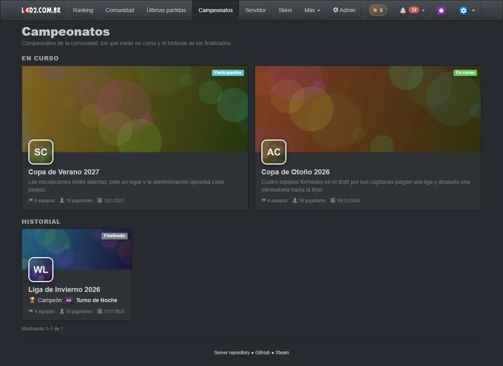

**Campeonatos** en el menú muestra cada campeonato en una tarjeta con su banner, su logotipo, su estado, sus equipos, sus jugadores y su fecha de inicio: los en curso arriba, en tarjetas más grandes, y debajo el historial de los finalizados y cancelados, con el campeón de cada uno. Un campeonato sin banner recibe un fondo de color, y uno sin logotipo muestra sus iniciales. Un campeonato en borrador no aparece: solo los administradores lo ven.

### La página de un campeonato

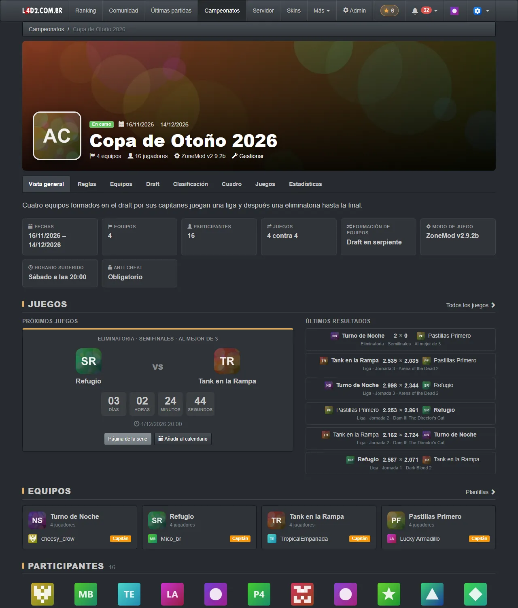

Cada campeonato tiene su dirección, como `/championships/copa-2027`. Cada página del campeonato empieza con su banner, su logotipo, su nombre, su estado y sus fechas, seguidos de sus pestañas.

La primera pestaña, **Visión general**, es la página del campeonato en sí, leída de arriba abajo:

1. **Acerca de**: la descripción y los datos principales: las fechas, el número de equipos y de participantes (con las plazas, cuando hay límite), el tamaño de cada juego, como 4 contra 4, la formación de equipos y el modo de juego.
2. **Inscripciones**, cuando el campeonato acepta solicitudes para participar: ver [Pedir participar](#pedir-participar).
3. **Dónde ver**: botones a la transmisión y a los vídeos, cuando la administración dio los enlaces.
4. **Juegos**: el próximo juego, con una cuenta regresiva hasta su fecha y los botones **Página de la serie** y **Añadir al calendario**, los otros juegos programados y los últimos resultados. **Todos los juegos** abre la pestaña Juegos.
5. **Equipos**: cada equipo con su capitán y su vicecapitán. **Plantillas** abre la pestaña Equipos.
6. **Participantes**: la foto y el nombre de cada jugador del campeonato, cada uno con el enlace a la página del jugador.
7. **Formato**: cada fase en orden, con su tipo, grupos, al mejor de y regla de campañas, si está finalizada, en curso, a continuación o después, y cuántas series se jugaron.
8. **Podio**: el campeón, el subcampeón y el tercer puesto, cuando el campeonato terminó.
9. **Galería**: las fotos y artes del campeonato; un clic abre cada una en tamaño grande.

Una sección sin nada que mostrar se omite. Las otras pestañas van más a fondo:

| Pestaña | Qué muestra |
|---|---|
| Reglas | Las reglas escritas por la administración, en el idioma de la página cuando hay traducción. |
| Equipos | Cada equipo con su bandera, capitán, vicecapitán y jugadores, con las horas de Left 4 Dead 2 de cada uno. |
| Draft | El orden de los capitanes y cada elección, cuando los equipos se formaron por draft, ruleta o bombos. |
| Clasificación | La tabla de cada fase de liga y de cada grupo, con los equipos que pasan a la siguiente fase marcados en verde. |
| Cuadro | El cuadro de cada fase eliminatoria, ronda a ronda, con el partido por el tercer puesto cuando lo hay. |
| Juegos | Todas las series por fase y jornada, con su fecha, su plazo y su resultado. |
| Estadísticas | Las series y los juegos ganados por cada equipo, y los números de cada jugador en los juegos vinculados a partidas del servidor: MVPs, daño SI, comunes, skeets, levels, crowns, daño al Tank y muertes. |

Una pestaña solo aparece cuando tiene algo que mostrar.

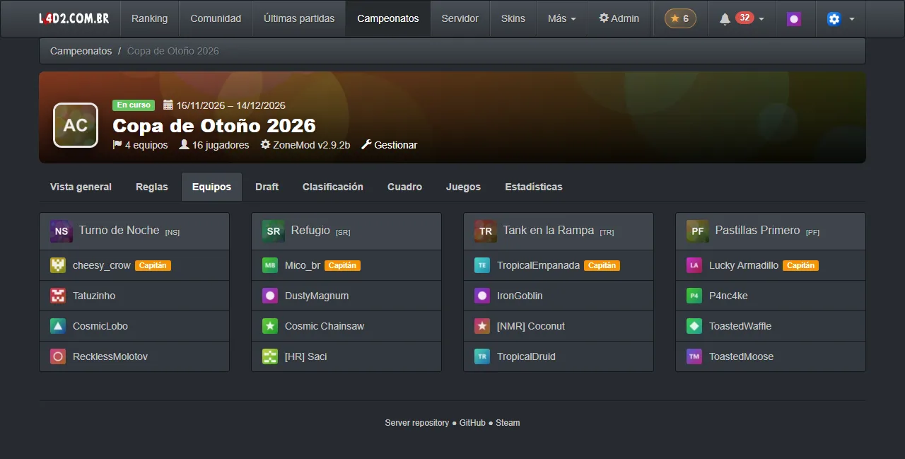

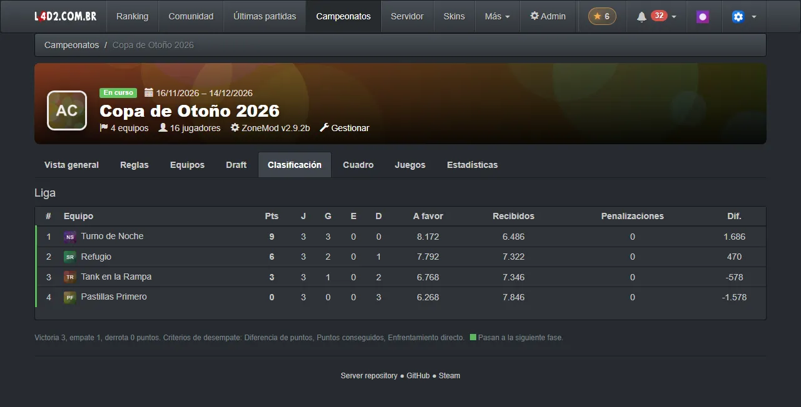

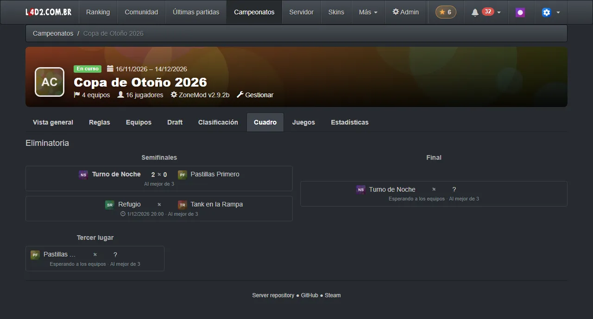

### Pedir participar

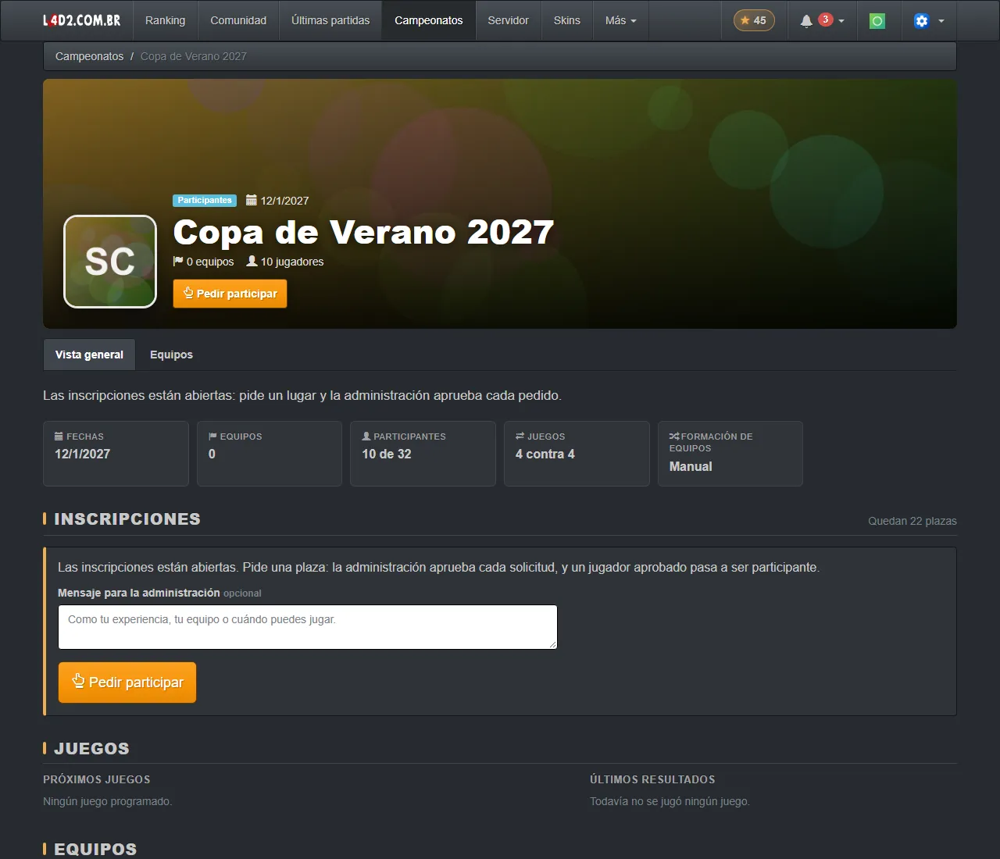

Cuando la administración deja que los jugadores pidan participar, la página del campeonato tiene una sección **Inscripciones**, y la parte de arriba de la página un botón **Pedir participar**, mientras el estado es Participantes y quedan plazas. Entra con Steam, escribe un mensaje para la administración si quieres (como tu experiencia o cuándo puedes jugar) y pulsa **Pedir participar**. La sección pasa a decir que tu solicitud está esperando; **Cancelar la solicitud** la retira, y puedes pedirlo de nuevo después.

La administración aprueba o rechaza cada solicitud. Una vez aprobada eres participante y la sección lo dice; una solicitud rechazada aparece como rechazada, y no puedes pedirlo de nuevo en ese campeonato. La sección también muestra cuántas plazas quedan, y avisa cuando no queda ninguna.

### La página de una serie

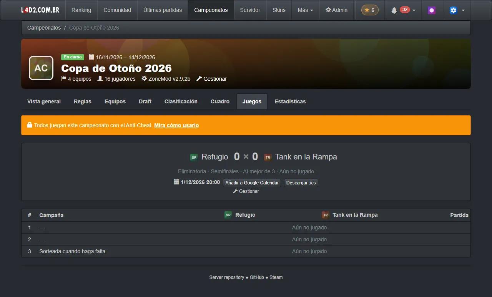

Una serie es el enfrentamiento de dos equipos: un juego (al mejor de 1) o más (al mejor de 3, al mejor de 5). Su página muestra el marcador en juegos, el estado, la fecha con los botones **Añadir a Google Calendar** y **Descargar .ics**, el plazo, los vetos y cada juego con su campaña, quién la eligió, el marcador y el enlace a la partida del servidor.

Un juego decidido por una penalización muestra los puntos descontados. En una eliminatoria, un juego que ya no hace falta, como el tercero después de un 2 a 0, aparece como **No necesario**. Un juego que se está jugando en el servidor aparece como **En curso**, con el marcador de los mapas jugados hasta el momento.

### El área del capitán

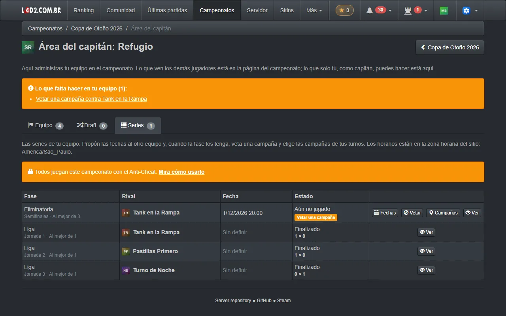

Las páginas de un campeonato solo muestran información. Lo que un capitán o un vicecapitán hace por su equipo está en una página aparte, el **área del capitán**, en `/championships/<dirección>/captain`. Inicia sesión con Steam: cuando lideras un equipo de un campeonato que no es un borrador ni terminó, aparece un icono de torre junto a tu foto arriba en todas las páginas, con un número rojo cuando tu equipo tiene algo que hacer, y las páginas del campeonato muestran **Abrir el área del capitán**.

El área del capitán empieza con la lista de lo que tu equipo tiene que hacer, cada cosa con un enlace a su pestaña, y tiene estas pestañas:

| Pestaña | Qué haces en ella |
|---|---|
| Equipo | **Cambiar nombre, sigla o bandera** envía un nuevo nombre, sigla o bandera (una imagen cuadrada, idealmente de 1024 × 1024 píxeles, PNG, JPG, WEBP o GIF de hasta 2 MB) para su aprobación. Hasta que la administración lo apruebe, la página indica que está en espera y los demás jugadores siguen viendo los actuales; **Retirar el cambio** lo deshace. Cuando la administración lo rechaza, el motivo aparece aquí. **Quitar la bandera** quita la bandera al instante. La tabla lista los jugadores del equipo, y el capitán hace vicecapitán a uno de ellos o quita al vicecapitán. |
| Draft | En un draft en serpiente o en línea, el orden de los capitanes, las elecciones hechas y los jugadores sin equipo. Cuando es el turno de tu equipo, **Elegir** pone al jugador en tu equipo y elige el siguiente equipo. No hay límite de tiempo y nada pasa en vivo: cada capitán elige cuando puede, el mismo día o el siguiente. |
| Series | Cada serie de tu equipo, con su fecha y su estado. **Fechas** lista las propuestas de los dos equipos: propón una fecha (tu propuesta ya sale aceptada por tu equipo) y acepta o rechaza las del otro equipo. Cuando los dos equipos aceptan la misma fecha, la serie queda programada. Los equipos no pueden eliminar una fecha confirmada. Cada equipo puede tener como máximo 5 fechas esperando respuesta, y una fecha que ya pasó solo se puede rechazar. **Vetar** (cuando la fase tiene vetos) veta una campaña antes del primer juego: no se elige ni se sortea en la serie, y no se puede cambiar. **Campañas** (cuando los equipos las eligen) elige la campaña de los juegos de tu turno: el mejor cabeza de serie el primer juego, el otro equipo el segundo, y así sucesivamente; el desempate se sortea solo cuando hace falta. |

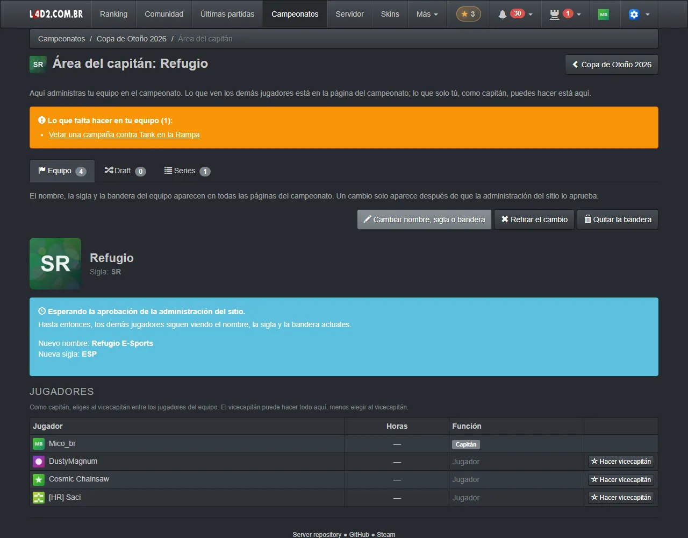

El vicecapitán puede hacer todo lo que hace el capitán, menos elegir al vicecapitán. Las horas están en la zona horaria del sitio, que se muestra en la pestaña Series. Los resultados siempre salen de las partidas del servidor: los capitanes no escriben ni cambian marcadores.

## Para administradores

**Administración > Campeonatos** lista todos los campeonatos, incluidos los borradores, en una tabla con su estado, equipos, participantes y campeón. **Añadir** abre una ventana para crear uno; **Editar** abre la página del campeonato y **Eliminar** lo borra con sus equipos, fases, juegos e historial (las partidas del servidor no se tocan).

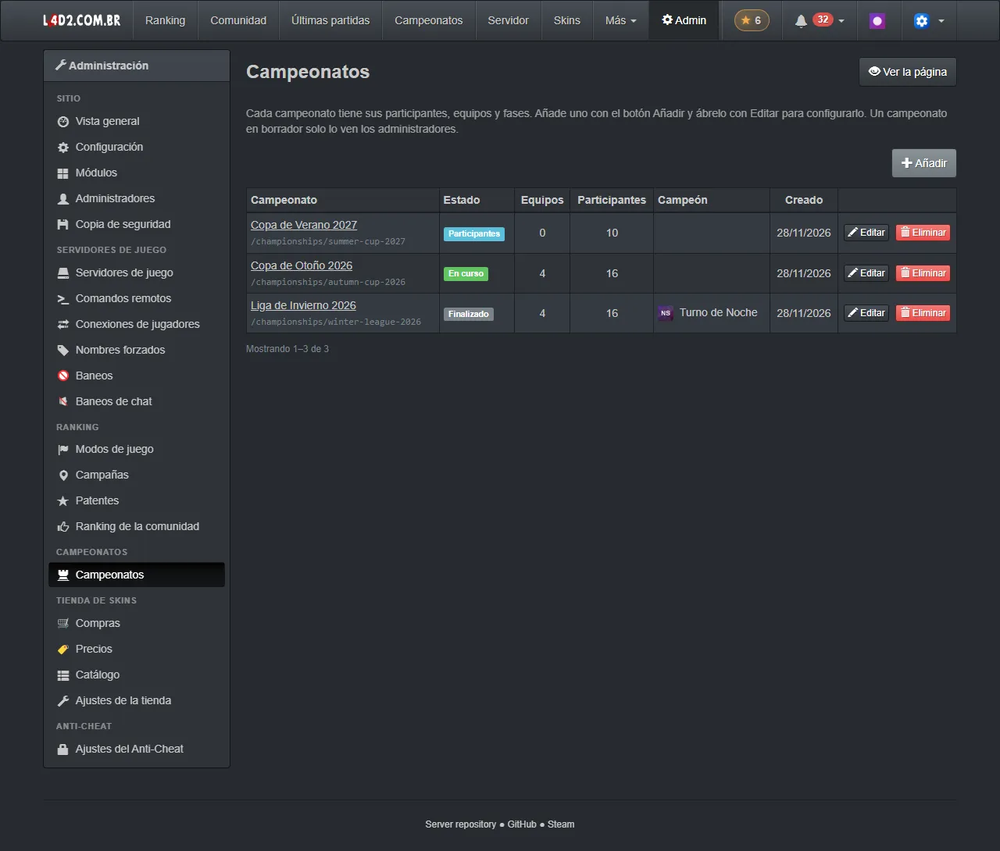

La página de un campeonato muestra sus números arriba (participantes, equipos, fases armadas y series terminadas) y las pestañas Configuración, Reglas, Participantes, Equipos, Draft (cuando la formación de equipos no es manual), Fases, Juegos e Historial. Cada pestaña empieza explicando para qué sirve y con los botones de sus acciones; todo cambio se hace en una ventana, y la dirección guarda la pestaña, así que la página recargada después de guardar abre en la misma pestaña.

### Crear un campeonato

En la ventana **Añadir**, escribe el nombre y elige el formato. El formato solo crea las primeras fases; todo se puede cambiar en la pestaña Fases hasta que cada fase se arme.

| Formato | Fases |
|---|---|
| Liga | Todos los equipos se enfrentan una vez, al mejor de 1, con una campaña sorteada para cada jornada. |
| Liga + eliminatoria | Una liga, y los cuatro mejores juegan una eliminatoria al mejor de 3, eligiendo los equipos las campañas. |
| Eliminatoria | Solo una eliminatoria al mejor de 3, con el cuadro sorteado. |
| Grupos + eliminatoria | Dos grupos, y los dos mejores de cada grupo juegan una eliminatoria al mejor de 3. |

Un campeonato nuevo es un borrador, que solo ven los administradores, y su página abre en la pestaña Configuración.

### Configuración

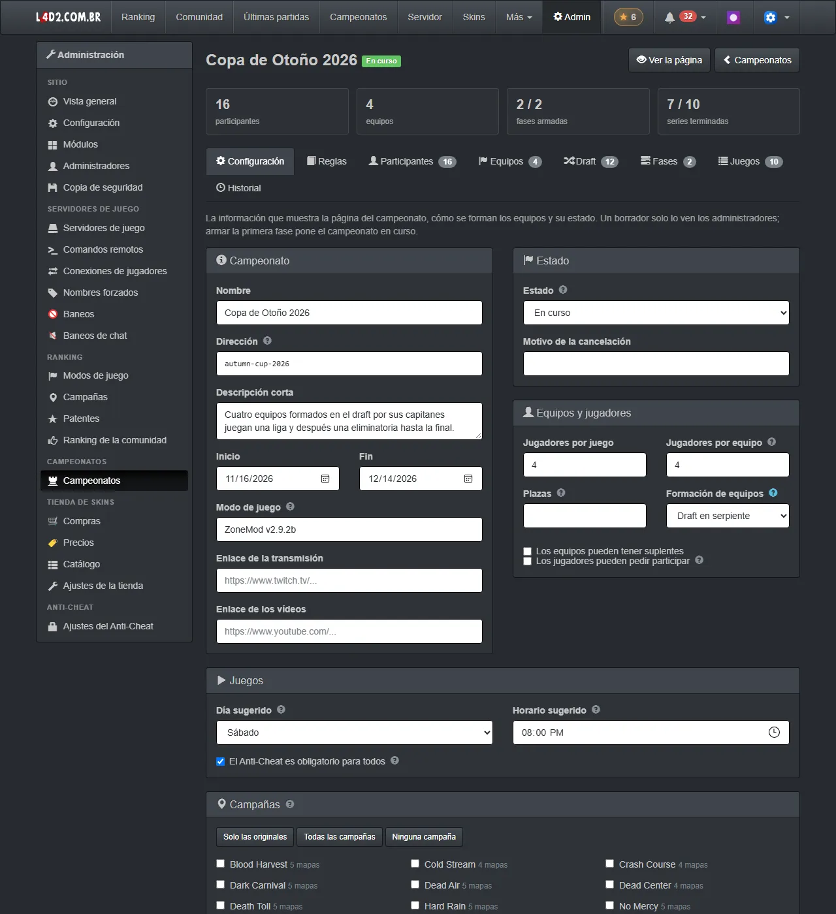

Un único formulario, guardado con el botón **Guardar** al pie:

- **Campeonato**: nombre, dirección, descripción corta, fechas de inicio y fin, modo de juego (como ZoneMod v2.9.1b) y los enlaces de la transmisión y de los vídeos.
- **Estado**: Borrador, Participantes, Formación de equipos, En curso, Finalizado o Cancelado, con el motivo de la cancelación. Armar la primera fase pone el campeonato en curso. Márcalo como finalizado después de la final: el historial pasa a mostrar el campeón.
- **Equipos y jugadores**: jugadores por juego, jugadores por equipo (el máximo de jugadores de un equipo, contando los suplentes), plazas (el máximo de participantes), la formación de equipos (manual, ruleta, bombos, draft en serpiente o draft en línea) si los equipos pueden tener suplentes y si los **jugadores pueden pedir participar** (ver [Solicitudes para participar](#participantes)).
- **Juegos**: el **día sugerido** y el **horario sugerido**, solo una sugerencia, mostrada en la página del campeonato y rellenada cuando un capitán propone una fecha (los capitanes pueden elegir otro día y otra hora), y si **el Anti-Cheat es obligatorio para todos**, mostrado en la página del campeonato, en la página de cada serie y a los capitanes. Los servidores de juego exigen el Anti-Cheat según la [configuración del Anti-Cheat](anti-cheat.es.md#quién-debe-usar-el-anti-cheat).
- **Campañas**: las campañas que pueden elegirse, vetarse o sortearse en este campeonato, por los capitanes o por la administración. **Solo las originales** marca las campañas que vienen con el juego. No marques ninguna para permitirlas todas. El mínimo de mapas de cada fase sigue valiendo, y una campaña ya elegida para un juego se queda en él.
- **Imágenes**: el **banner**, una imagen ancha como 1920 × 600 que se muestra arriba de cada página del campeonato y en su tarjeta; el **logotipo**, una imagen cuadrada como 512 × 512; y la **galería**, hasta 12 fotos y artes que se muestran al final de la página. Cada una es un archivo PNG, JPG, WEBP o GIF de hasta 2 MB. Elige un archivo solo para cambiarla: guardar sin archivo mantiene la imagen actual. **Quitar el banner**, **Quitar el logotipo** y **Quitar** debajo de cada imagen de la galería la borran al guardar. Un archivo que no es una de estas imágenes, un archivo por encima del límite o más de 12 imágenes en la galería se rechaza, y entonces no se guarda nada del formulario. Los archivos quedan en la carpeta de datos del hub, en `branding/championships`, así que van con las copias de seguridad, y cada cambio queda en el historial.
- **Resultados**: si las partidas del servidor se vinculan solas a los juegos, las **Horas de tolerancia** (cuántas horas antes o después de la fecha de la serie puede empezar la partida, 6 por defecto) y **Terminar después de (minutos)** (cuánto espera un juego en curso por nuevas estadísticas antes de terminar, 60 por defecto). Consulta [Juegos y resultados](#juegos-y-resultados).

### Reglas

Las reglas en inglés, portugués y español, una debajo de la otra, guardadas con el botón **Guardar** al pie de la pestaña. Se escriben en Markdown: `#` títulos, `-` listas, `**negrita**`, `*cursiva*` y `[enlaces](https://...)`. La página muestra el texto del idioma del visitante, o el inglés.

### Participantes

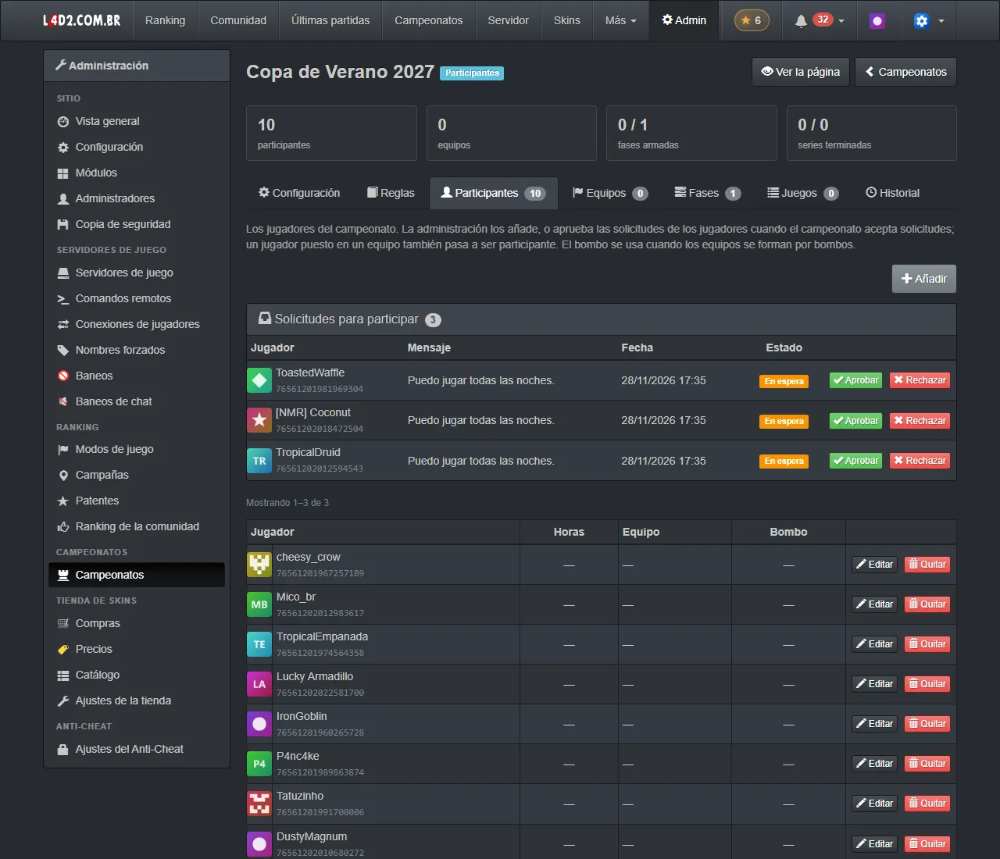

La administración añade los participantes, o aprueba las solicitudes de los jugadores. Con **Los jugadores pueden pedir participar** activado en la pestaña Configuración, el panel **Solicitudes para participar** arriba de la pestaña Participantes lista cada solicitud que espera respuesta, con el jugador, el mensaje, la fecha y un contador de cuántas esperan. **Aprobar** hace al jugador participante, salvo que el campeonato esté lleno, y **Rechazar** responde que no; una solicitud rechazada sigue en la lista, así que todavía puede aprobarse después. Cada solicitud, aprobación y rechazo queda en el historial.

**Añadir** abre una ventana donde pegas IDs de Steam, uno por línea, o usas **Elegir de la lista** en la ventana de búsqueda de jugadores. La tabla, con 20 jugadores por página, muestra las horas de Left 4 Dead 2 de cada jugador, su equipo y su bombo; **Editar** cambia el bombo, usado en el sorteo por bombos, y **Quitar** saca al jugador del campeonato y de su equipo.

### Equipos

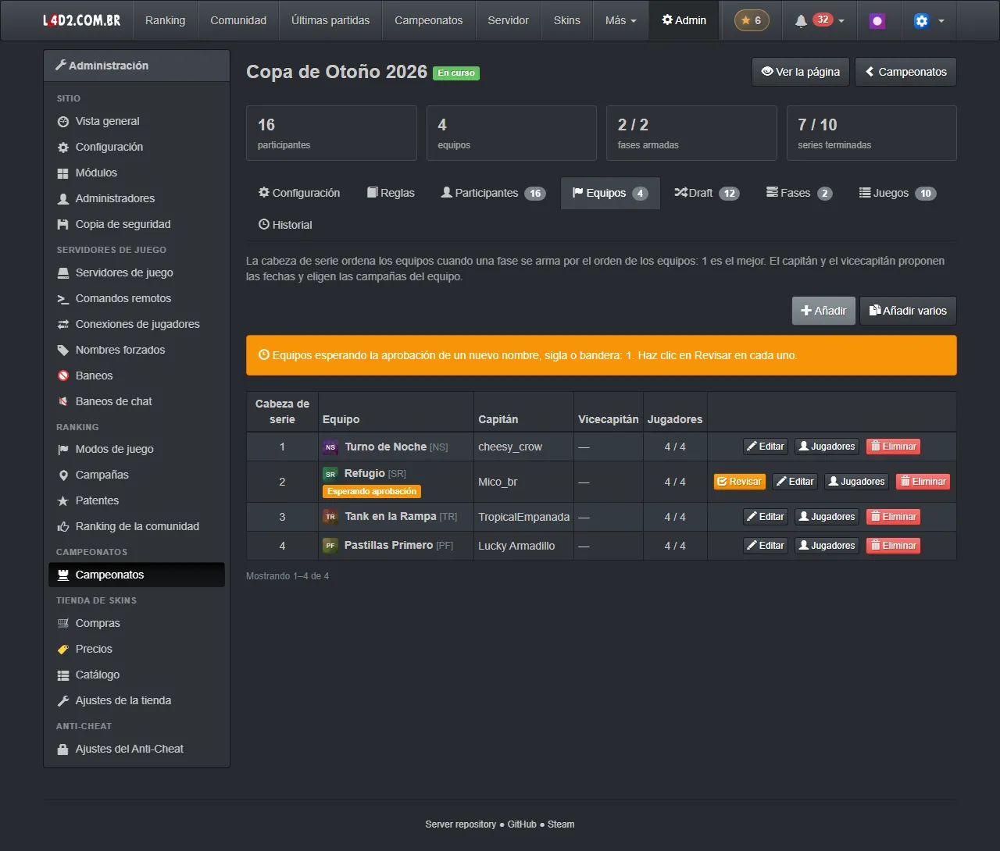

**Añadir** crea un equipo, y **Añadir varios** crea Equipo A, Equipo B, Equipo C y así sucesivamente. La tabla muestra la cabeza de serie (1 es el mejor; ordena los equipos cuando una fase se arma por el orden de los equipos), el capitán, el vicecapitán y los jugadores de cada equipo. En cada fila:

- **Editar**: nombre, sigla, cabeza de serie, capitán, vicecapitán y bandera. Un capitán o vicecapitán sin equipo entra en este equipo, y así se eligen los capitanes de un draft. Un nombre, sigla o bandera cambiado aquí se muestra al instante.
- **Revisar**, cuando el capitán envió un nuevo nombre, sigla o bandera: la ventana muestra lo que el equipo tiene ahora junto a lo que se propuso. **Aprobar** lo pone en todas las páginas; **Rechazar**, con un motivo opcional, lo descarta y muestra el motivo al capitán. Aprueba solo nombres e imágenes que no sean ofensivos ni sensibles: nada de lo que envía un capitán aparece antes de aprobarse, y la imagen en espera de aprobación solo la ven los administradores y los líderes del equipo.
- **Jugadores**: los jugadores del equipo, con **Quitar**, y **Añadir jugador** con un ID de Steam o la ventana de búsqueda de jugadores.
- **Eliminar**, mientras el equipo no está en ninguna fase.

La pestaña avisa cuando hay equipos en espera de aprobación. Un jugador solo puede estar en un equipo, y un equipo no puede pasar del límite de jugadores.

### Draft

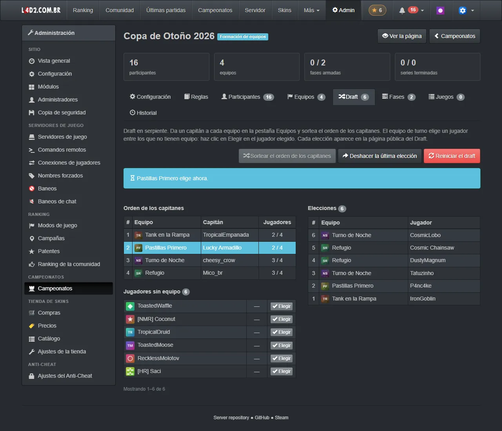

Los botones de arriba siguen el método elegido en la configuración, y **Deshacer la última elección** y **Reiniciar el draft** deshacen las elecciones. Cada elección aparece en la página pública del Draft.

| Método | Cómo funciona |
|---|---|
| Manual | No hay pestaña Draft: la administración pone cada jugador en un equipo en la pestaña Equipos. |
| Ruleta | **Girar la ruleta** sortea un equipo entre los que tienen menos jugadores y un jugador sin equipo. |
| Bombos | Fija el bombo de cada participante en la pestaña Participantes. **Sortear los bombos** da a cada equipo un jugador de cada bombo; el jugador del primer bombo pasa a ser el capitán de un equipo que aún no tiene. |
| Draft en serpiente | Da un capitán a cada equipo en la pestaña Equipos y **Sortear el orden de los capitanes**. Después cada capitán elige en el [área del capitán](#el-área-del-capitán) cuando es el turno de su equipo, sin límite de tiempo. El equipo de turno queda resaltado aquí, y **Elegir** elige por él, por ejemplo cuando un capitán lo pide en el chat. El orden es A, B, C, D y después D, C, B, A. |
| Draft en línea | Lo mismo, siempre en el orden A, B, C, D. |

### Fases

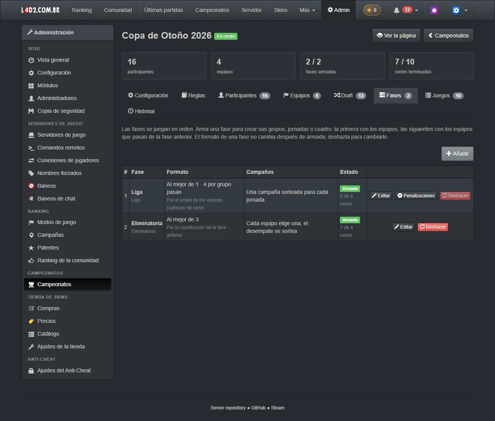

Las fases se juegan en orden. **Añadir** añade una al final, con nombre y tipo. La tabla muestra el formato, la regla de campañas y si cada fase está armada, y sus filas tienen:

- **Editar**: la ventana con todos los campos de la fase, abajo.
- **Armar**: una ventana con los equipos que entran, en su orden, y el botón que crea los grupos y jornadas, o el cuadro. La primera fase recibe todos los equipos; las siguientes reciben los que pasan de la fase anterior, que tiene que estar armada y terminada.
- **Penalizaciones** (fases de liga armadas): puntos descontados de la clasificación, con un motivo.
- **Deshacer** (fases armadas): borra las series y resultados de la fase para empezar de nuevo, siempre que la siguiente fase no se haya armado.
- **Eliminar** (fases no armadas).

| Campo | Significado |
|---|---|
| Tipo | Liga o eliminatoria. Una fase eliminatoria tiene que ser la última. |
| Orden de los equipos | Por el orden de los equipos (cabezas de serie), por sorteo o por la clasificación de la fase anterior. |
| Al mejor de | El número de juegos de cada serie. La eliminatoria tiene su **Final al mejor de**. |
| Grupos y Vueltas | Liga: cuántos grupos, y si cada equipo se enfrenta a los demás una o dos veces. |
| Clasificados por grupo | Cuántos equipos de cada grupo entran en la siguiente fase. 0 para todos. Solo cuando hay una siguiente fase. |
| Victoria, Empate, Derrota | Los puntos de una serie en la clasificación. |
| Desempates | Hasta tres, en orden: diferencia de puntos, puntos conseguidos, enfrentamiento directo, victorias. |
| Partido por el tercer puesto | Eliminatoria: los perdedores de las semifinales juegan por el tercer puesto. |
| Campañas | Una campaña sorteada para cada jornada, cada equipo elige una con el desempate sorteado, o la administración elige. |
| Mínimo de mapas | Solo se pueden elegir o sortear campañas con al menos esta cantidad de mapas. |
| Vetos y una vez por equipo | Cada equipo veta una campaña por serie, y un equipo elige cada campaña una sola vez en el campeonato. |

En una eliminatoria con un número de equipos que no es potencia de dos, los mejores cabezas de serie pasan directo a la ronda siguiente. Con seis equipos, por ejemplo, el primero y el segundo esperan en las semifinales, el tercero juega contra el sexto y el cuarto contra el quinto. Después de armada, el tipo, los juegos, los grupos y la regla de campañas no cambian; los puntos, los desempates, el mínimo de mapas, los vetos y la regla de una vez por equipo sí se pueden cambiar.

### Juegos y resultados

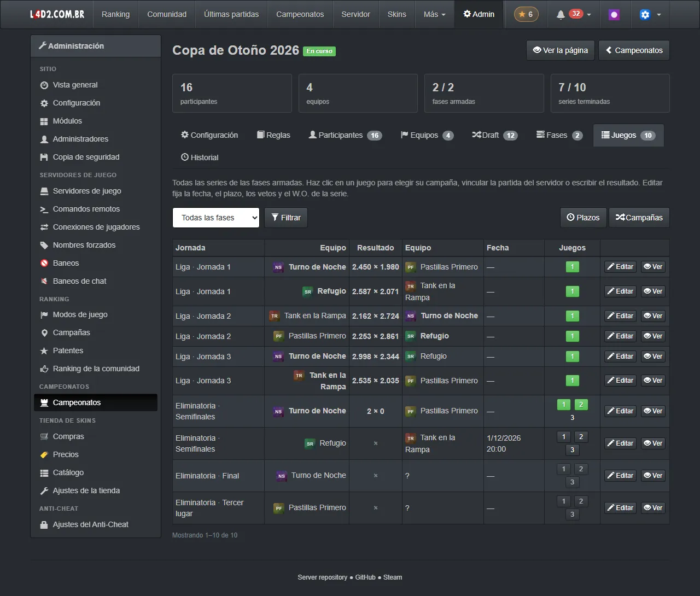

La pestaña Juegos lista todas las series de las fases armadas, 20 por página, con filtro por fase. Arriba:

- **Plazos**: la fecha hasta la que se deben jugar todas las series de una jornada, que se muestra en las páginas de los juegos. Déjala vacía para quitarla.
- **Campañas**: sortear de nuevo, o borrar, las campañas de los juegos aún no jugados de una fase.

Cada serie muestra su jornada, los equipos, el resultado, la fecha y un botón numerado por juego: verde cuando se jugó, atenuado cuando no hace falta. El botón de un juego abre la ventana del juego:

- **Campaña**, elegida por la administración en cualquier momento entre las campañas del campeonato. En una fase en la que eligen los equipos, la elección de la administración cuenta como la elección del equipo de ese turno.
- **Resultado**: aún no jugado; **Partida del servidor**, entre las partidas de los últimos 60 días con jugadores de los dos equipos, de la más nueva a la más antigua, que da el marcador y descubre de qué lado jugó cada equipo (una partida solo se puede vincular a un juego, y las estadísticas del campeonato salen de las partidas vinculadas); o **Escribir el resultado**, para un juego que no tiene partida en el servidor.
- **Penalización** de cada equipo y observaciones: puntos descontados del marcador de un equipo en el juego. Pueden cambiar el ganador.

**Editar** en una serie abre su ventana: la fecha, el plazo, las observaciones, los vetos de cada equipo (cuando la fase tiene vetos), el W.O. (el equipo que gana sin jugar; los juegos no jugados se cancelan) y las propuestas de fecha de los equipos, que se pueden eliminar. **Ver** abre la página pública de la serie.

**Partidas vinculadas solas.** Los juegos se juegan en los servidores de la comunidad, así que los archivos de estadísticas llegan solos. Cuando la opción está activada en la configuración, cada partida que llega se vincula al juego que tiene:

- la misma campaña que la partida;
- al menos la mitad de los jugadores de cada equipo en la partida, en lados opuestos;
- una serie con fecha, y la partida empezó dentro de las horas de tolerancia antes o después de ella (un juego puede empezar tarde o temprano).

Mientras se juega la partida, el juego está **En curso**: su botón es amarillo, las páginas públicas muestran el marcador de los mapas jugados, y la clasificación y el cuadro no cambian, así que ningún equipo pasa antes de que termine el juego. El juego termina, y el ganador pasa, cuando:

- se juegan todos los mapas de la campaña;
- no llegan estadísticas de la partida durante los minutos fijados en la configuración, para un juego que termina antes, como en el tercer mapa;
- o un administrador hace clic en **Terminar el juego** en la ventana del juego.

Un archivo de estadísticas de la partida que llega después todavía actualiza el marcador. Para deshacer un vínculo equivocado, elige **Aún no jugado** en la ventana del juego: esa partida no se vuelve a vincular a ese juego. La administración siempre puede vincular una partida a mano o escribir un resultado.

El ganador de una serie eliminatoria pasa solo a la siguiente serie. Un resultado que cambiaría un ganador que ya empezó la siguiente serie se rechaza: borra antes los resultados de la siguiente serie.

### Historial

Todos los cambios del campeonato, con quién los hizo y cuándo, 20 por página.

## Cómo funcionan las reglas

- **Una serie** termina cuando un equipo gana la mayoría de sus juegos, como dos de tres. En una liga también termina después de todos sus juegos, y un número igual de victorias es empate.
- **Un juego** lo gana el equipo con más puntos después de su penalización. En una liga, un empate es empate. En una eliminatoria, un juego empatado no cuenta para nadie, y se añade un nuevo juego a la serie con una campaña sorteada.
- **La clasificación** da los puntos de victoria, empate y derrota, menos los puntos de penalización. La diferencia de puntos es lo conseguido menos lo recibido menos las penalizaciones de los juegos. Con los puntos iguales, se usan los desempates en orden, y después la cabeza de serie.
- **Los sorteos de campañas** evitan las campañas ya elegidas en la serie y los vetos, y solo usan las campañas del campeonato con el mínimo de mapas.
- **Los juegos de un campeonato** son partidas normales del servidor: cuentan para el ranking como cualquier otra. La página de la partida muestra el campeonato y lleva a su serie.
- **Un juego en curso** no cuenta para nadie hasta que termina: la clasificación, el cuadro y las siguientes series lo esperan.
