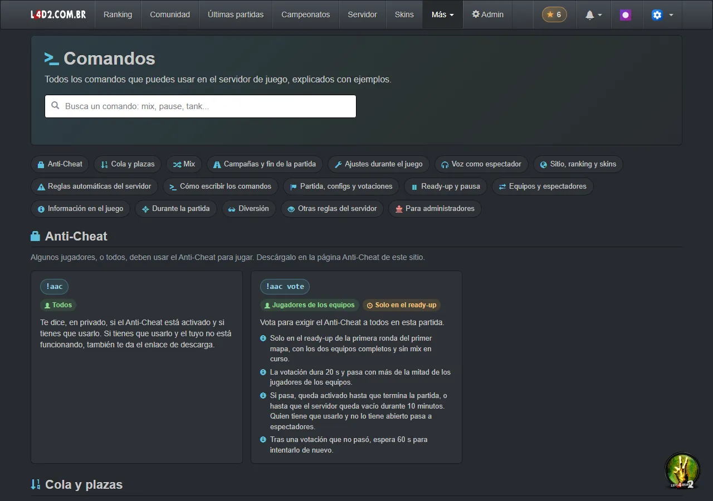

# Comandos del servidor de juego

🌐 [English](commands.md) | [Português](commands.pt.md) | **Español**

La página **Comandos** enseña a los jugadores todos los comandos del servidor de juego, con ejemplos. Es pública y está siempre disponible, sean cuales sean los módulos activados.

[Volver al manual](README.es.md)

## Contenido

- [La página de comandos](#la-página-de-comandos)
- [Dónde está el contenido](#dónde-está-el-contenido)

## La página de comandos

**Más > Comandos** (`/commands`) empieza con un cuadro de búsqueda y una fila de enlaces, uno por sección. La búsqueda filtra los comandos mientras escribes, por el nombre, el alias o cualquier palabra de la explicación, e ignora los acentos. Cada enlace salta a su sección.

Cada comando es una tarjeta con sus nombres y alias, cómo escribirlo, quién puede usarlo y cuándo, una explicación, ejemplos y notas. Las secciones siguen el orden en que el jugador las necesita: cómo escribir los comandos, la cola, el mix, configs y votaciones, ready-up y pausa, equipos y espectadores, información, ayudas durante la partida, el sitio y las skins, el Anti-Cheat, los comandos de diversión y las reglas automáticas del servidor. Los comandos de los administradores van al final, plegados.

La página sigue los [módulos](administration.es.md#módulos): los comandos que necesitan un módulo desactivado se ocultan. Por ejemplo, `!rmix` solo aparece con el ranking de la comunidad, `!skin` solo con la tienda de skins, `!ranking` solo con el ranking, y la sección del Anti-Cheat solo con el módulo Anti-Cheat.

## Dónde está el contenido

El texto de la página no está en el HTML. Está en un catálogo por idioma, en `src/L4D2PlayStats.Hub.Web/Resources/Commands`:

| Archivo | Idioma |
|---|---|
| `commands.en.json` | Inglés, usado también para cualquier otro idioma |
| `commands.pt-BR.json` | Portugués |
| `commands.es-ES.json` | Español |

Cada catálogo tiene una lista de `sections` (`id`, `icon`, `title`, `intro`, y opcionalmente `module` y `admin`), y cada sección una lista de `commands` con `id`, un `title` opcional, `names`, `syntax`, `who`, `when`, `module`, `description`, `examples` (`code` y un `text` opcional) y `notes`. El `icon` es el nombre de un glyphicon de Bootstrap 3 sin el prefijo `glyphicon-`, y `module` es el nombre de un módulo, como `CommunityRanking`, `SkinShop`, `Ranking` o `AntiCheat`. El texto entre comillas invertidas se muestra como código.

Una comunidad con otros plugins puede editar estos archivos para describir su propio servidor. Los tres archivos deben mantener las mismas secciones y los mismos comandos, con los mismos ids, en el mismo orden; una prueba lo comprueba para que una traducción no se aleje de las demás. Reinicia el sitio después de cambiarlos.
