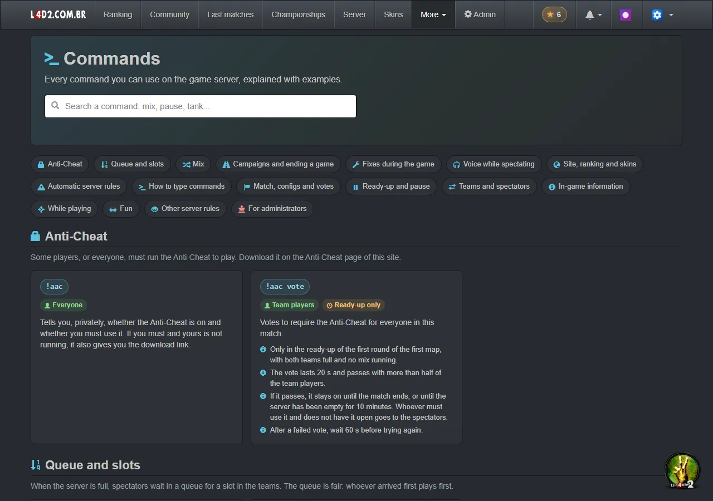

# Game server commands

🌐 **English** | [Português](commands.pt.md) | [Español](commands.es.md)

The **Commands** page teaches players every command of the game server, with examples. It is public and always available, whatever modules are on.

[Back to the manual](README.md)

## Contents

- [The commands page](#the-commands-page)
- [Where the content lives](#where-the-content-lives)

## The commands page

**More > Commands** (`/commands`) starts with a search box and a row of links, one per section. The search filters the commands as you type, by name, alias or any word of the explanation, and ignores accents. Each link jumps to its section.

Each command is a card with its names and aliases, how to type it, who can use it and when, an explanation, examples and notes. The Anti-Cheat comes first, then the plugins written for this community (the queue, the mix, campaigns and ending a game, voice while spectating, the site and skins, and the automatic rules of those plugins), and then the competitive plugins the server uses: how to type commands, configs and votes, ready-up and pause, teams and spectators, information, help while playing, fun commands and other server rules. The administrator commands come last, folded.

The page follows the [modules](administration.md#modules): commands that need a module that is off are hidden. For example, `!rmix` shows only with the community ranking, `!skin` only with the skin shop, `!ranking` only with the ranking, and the Anti-Cheat section only with the Anti-Cheat module.

Players can also read the commands inside the game: `!comandos` or `!commands` open the same list, without the administrator commands, in the game panel. When the server opens the compact in-game pages (`ranking_motd_path "/ingame"`), the panel of `!ranking` also has a **Commands** tab. See [Pages inside the game](in-game-pages.md#the-four-pages).

## Where the content lives

The text of the page is not in the HTML. It is in one catalog per language, in `src/L4D2PlayStats.Hub.Web/Resources/Commands`:

| File | Language |
|---|---|
| `commands.en.json` | English, also used for any other language |
| `commands.pt-BR.json` | Portuguese |
| `commands.es-ES.json` | Spanish |

Each catalog has a list of `sections` (`id`, `icon`, `title`, `intro`, and optionally `module` and `admin`), and each section a list of `commands` with `id`, an optional `title`, `names`, `syntax`, `who`, `when`, `module`, `description`, `examples` (`code` and an optional `text`) and `notes`. The `icon` is the name of a Bootstrap 3 glyphicon without the `glyphicon-` prefix, and `module` is the name of a module, such as `CommunityRanking`, `SkinShop`, `Ranking` or `AntiCheat`. Text between backticks is shown as code.

A community with other plugins can edit these files to describe its own server. The three files must keep the same sections and commands, with the same ids, in the same order; a test checks this so that a translation cannot drift from the others. Restart the site after changing them.
