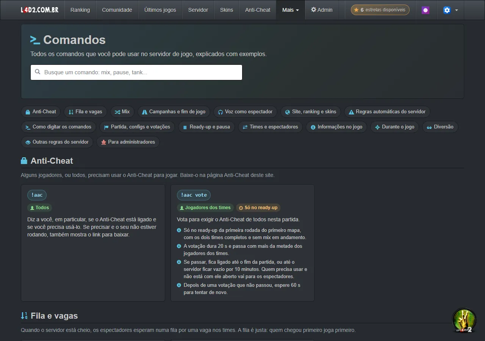

# Comandos do servidor de jogo

🌐 [English](commands.md) | **Português** | [Español](commands.es.md)

A página **Comandos** ensina aos jogadores todos os comandos do servidor de jogo, com exemplos. Ela é pública e está sempre disponível, quaisquer que sejam os módulos ligados.

[Voltar ao manual](README.pt.md)

## Conteúdo

- [A página de comandos](#a-página-de-comandos)
- [Onde fica o conteúdo](#onde-fica-o-conteúdo)

## A página de comandos

**Mais > Comandos** (`/commands`) começa com uma caixa de busca e uma linha de links, um por seção. A busca filtra os comandos enquanto você digita, pelo nome, pelo apelido ou por qualquer palavra da explicação, e ignora acentos. Cada link pula para a sua seção.

Cada comando é um cartão com os seus nomes e apelidos, como digitá-lo, quem pode usá-lo e quando, uma explicação, exemplos e observações. As seções seguem a ordem em que o jogador precisa delas: como digitar os comandos, a fila, o mix, configs e votações, ready-up e pausa, times e espectadores, informações, ajudas durante o jogo, o site e as skins, o Anti-Cheat, os comandos de diversão e as regras automáticas do servidor. Os comandos dos administradores vêm por último, recolhidos.

A página segue os [módulos](administration.pt.md#módulos): os comandos que precisam de um módulo desligado ficam ocultos. Por exemplo, o `!rmix` só aparece com o ranking da comunidade, o `!skin` só com a loja de skins, o `!ranking` só com o ranking, e a seção do Anti-Cheat só com o módulo Anti-Cheat.

## Onde fica o conteúdo

O texto da página não está no HTML. Ele fica num catálogo por idioma, em `src/L4D2PlayStats.Hub.Web/Resources/Commands`:

| Arquivo | Idioma |
|---|---|
| `commands.en.json` | Inglês, usado também para qualquer outro idioma |
| `commands.pt-BR.json` | Português |
| `commands.es-ES.json` | Espanhol |

Cada catálogo tem uma lista de `sections` (`id`, `icon`, `title`, `intro`, e opcionalmente `module` e `admin`), e cada seção uma lista de `commands` com `id`, um `title` opcional, `names`, `syntax`, `who`, `when`, `module`, `description`, `examples` (`code` e um `text` opcional) e `notes`. O `icon` é o nome de um glyphicon do Bootstrap 3 sem o prefixo `glyphicon-`, e o `module` é o nome de um módulo, como `CommunityRanking`, `SkinShop`, `Ranking` ou `AntiCheat`. O texto entre crases aparece como código.

Uma comunidade com outros plugins pode editar esses arquivos para descrever o seu próprio servidor. Os três arquivos precisam manter as mesmas seções e os mesmos comandos, com os mesmos ids, na mesma ordem; um teste verifica isso para que uma tradução não se afaste das outras. Reinicie o site depois de alterá-los.
