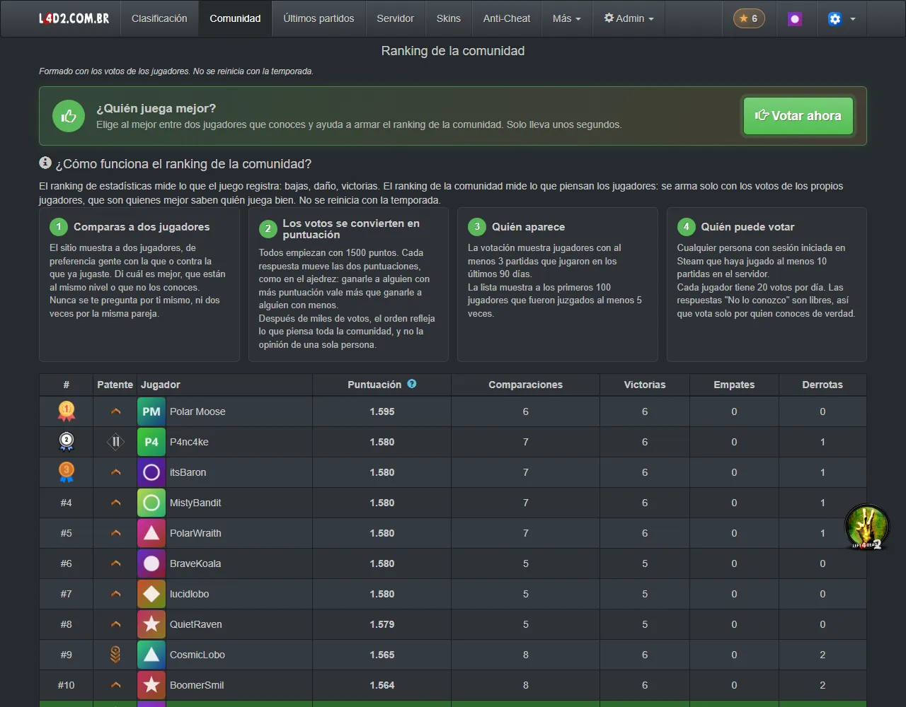
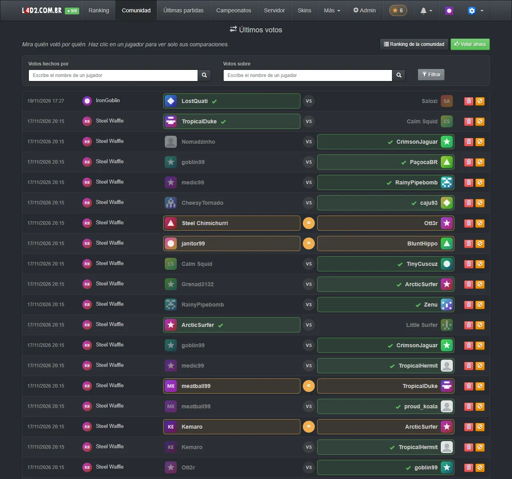
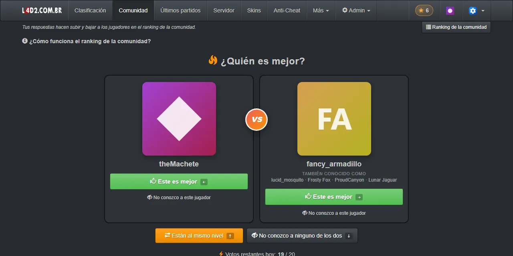
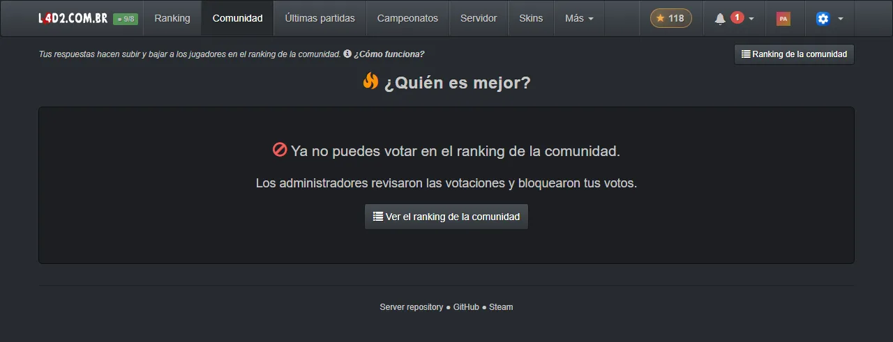
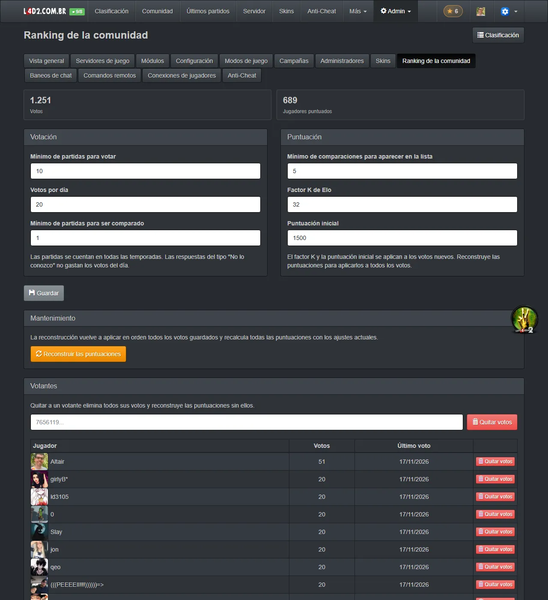
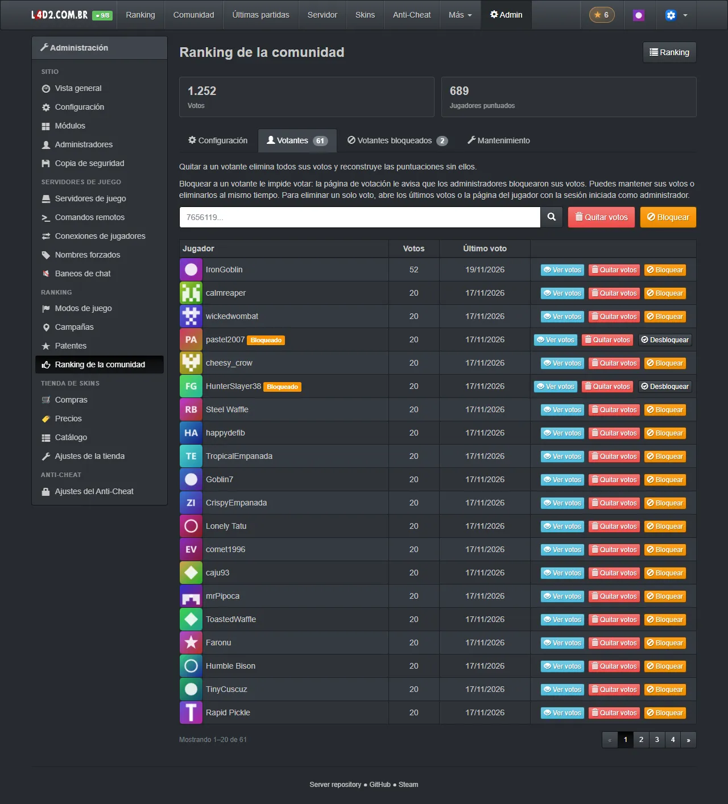
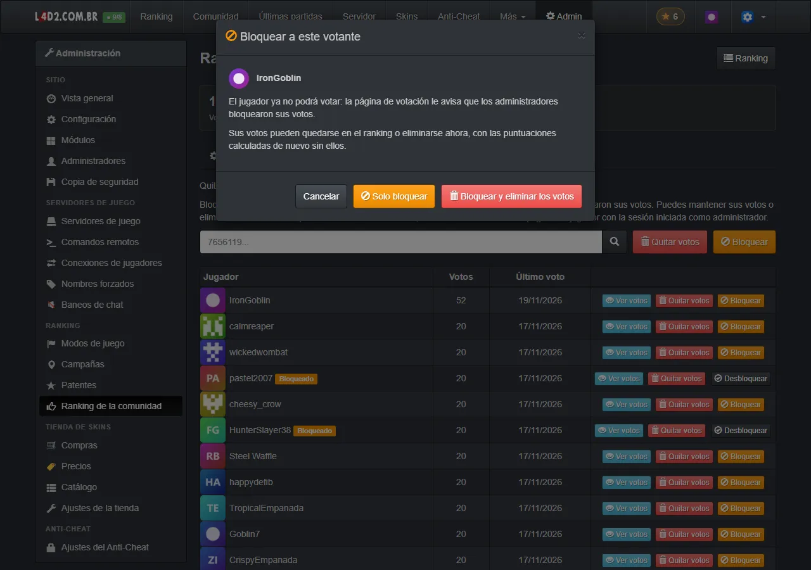
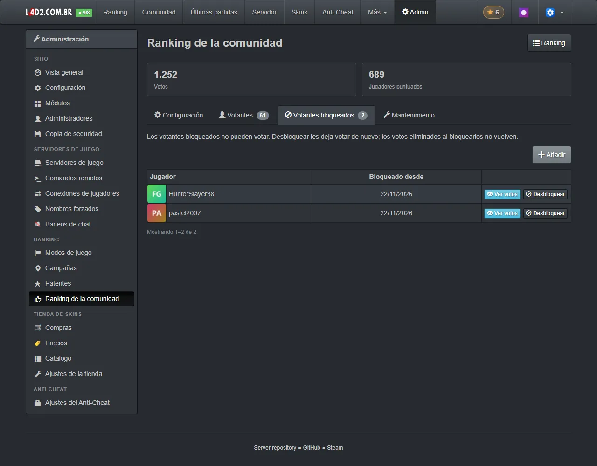

# Ranking de la comunidad

🌐 [English](community-ranking.md) | [Português](community-ranking.pt.md) | **Español**

El ranking de la comunidad es un segundo ranking, construido a partir de lo que los jugadores piensan unos de otros. El sitio le muestra dos jugadores a un votante y le pregunta cuál es mejor. Cada respuesta sube o baja a los dos jugadores. No se reinicia con la temporada.

[Volver al manual](README.es.md)

## Contenido

- [La página del ranking de la comunidad](#la-página-del-ranking-de-la-comunidad)
- [Votar](#votar)
- [Quién puede votar, y cuánto](#quién-puede-votar-y-cuánto)
- [Cómo se elige la pareja](#cómo-se-elige-la-pareja)
- [Cómo se calcula la puntuación](#cómo-se-calcula-la-puntuación)
- [Para administradores](#para-administradores)

## La página del ranking de la comunidad

**Comunidad** en el menú abre la lista.

| Columna | Significado |
|---|---|
| # | Posición. Los tres primeros tienen una medalla. |
| Patente | La patente del jugador en la temporada actual del ranking de estadísticas. |
| Jugador | Avatar y nombre. |
| Puntuación | La puntuación construida a partir de los votos. Todos empiezan con 1500. |
| Comparaciones | Cuántas veces se juzgó al jugador frente a otro jugador. |
| Victorias, Empates, Derrotas | Cuántas comparaciones ganó, empató y perdió el jugador. |

**Ver los últimos votos**, encima y debajo de la tabla, abre **Últimos votos**: una tarjeta por voto con quién votó, los dos jugadores lado a lado, el elegido en verde (o los dos en amarillo si están al mismo nivel) y cuándo. Las respuestas "No lo conozco" no aparecen. Hacer clic en un jugador, o en el icono de flechas junto a un nombre en la tabla, muestra solo sus comparaciones. Los filtros **Votos hechos por** y **Votos sobre** aceptan un nombre, o el botón de búsqueda junto a cada uno abre una ventana con los jugadores de la votación, de los más recientes a los más antiguos. Un administrador puede ocultar quién votó.

En el teléfono la tabla muestra solo la posición, el jugador y la puntuación. El **?** junto a **Puntuación** abre una ventana que explica cada columna.

Solo aparecen los jugadores con suficientes comparaciones: 5 de forma predeterminada. El jugador también tiene que haber jugado el mínimo de partidas para ser comparado, 1 de forma predeterminada. Los dos mínimos están escritos debajo de la tabla, y la lista se detiene en los primeros 100 jugadores de forma predeterminada. Cuando hay más jugadores en la lista, la tabla muestra 100 por página, con los enlaces de las páginas debajo. **¿Cómo funciona?**, en el recuadro, abre una ventana que explica en cuatro pasos cómo los votos se convierten en la lista, con los números de los ajustes actuales. La página de votación tiene el mismo enlace, también cuando se acabaron los votos del día. Hacer clic en la fila de un jugador abre una ventana con su puntuación, sus comparaciones y una barra de victorias, empates y derrotas, con enlaces a sus comparaciones y su perfil. **Votar ahora**, en el recuadro encima de la tabla, abre la página de votación. El mismo recuadro aparece encima del ranking de estadísticas en la página de inicio; allí el jugador puede cerrarlo, y vuelve después de 7 días. El recuadro solo aparece para quien no inició sesión y para los jugadores que todavía pueden votar hoy; quien ya usó todos los votos del día, no tiene suficientes partidas o está bloqueado no lo ve.

## Votar

La página muestra dos jugadores con sus avatares. Responde con una de estas opciones:

| Respuesta | Qué hace |
|---|---|
| Este es mejor (izquierda o derecha), o un clic en la foto | El jugador elegido gana la comparación y el otro la pierde. |
| Están al mismo nivel | Un empate. |
| No conozco a uno de ellos | No cambia nada, y esa pareja no se te vuelve a mostrar. Los dos jugadores todavía pueden aparecer en otras parejas. |

Debajo de cada nombre la tarjeta muestra hasta 4 nombres más que el jugador usó en las partidas, del más usado al menos usado, para que reconozcas a quien cambió de nombre. Después de cada respuesta la página marca tu elección y entra la siguiente pareja. En el ordenador, las flechas ← y → eligen al jugador de la izquierda o de la derecha, ↓ dice que están al mismo nivel y ↑ que no conoces a uno de ellos. **Votos restantes hoy** muestra cuántos votos te quedan.

## Quién puede votar, y cuánto

| Regla | Predeterminado |
|---|---|
| Tienes que haber iniciado sesión con Steam. | |
| Tienes que haber jugado un número mínimo de partidas, contadas en todas las temporadas, del ranking o no. | 10 |
| Tienes un número de votos por día. El día sigue la zona horaria del sitio. Solo las respuestas que juzgan (mejor o mismo nivel) gastan un voto; "No lo conozco" no. | 20 |
| Un jugador se ofrece para comparar solo después de un número mínimo de partidas. | 1 |
| Un jugador se ofrece solo si su última partida fue dentro de un número de días. Con 0, sin importar cuánto hace. | 0 |
| Nunca se te pregunta por ti mismo, ni dos veces por la misma pareja. | |

Cuando no puedes votar, la página dice por qué: tienes que iniciar sesión, necesitas más partidas (con tu cantidad), usaste todos los votos del día, no queda nadie para que compares o los administradores bloquearon tus votos.

## Cómo se elige la pareja

El sitio elige la pareja; quien vota no elige a quién juzgar, y una respuesta solo se acepta para la pareja que el sitio ofreció.

1. Prefiere jugadores con los que o contra los que jugaste, porque los conoces mejor. Solo cuando no queda ninguna pareja así ofrece otros jugadores.
2. Entre ellos, empieza por uno de los jugadores cuya puntuación es menos segura (en general los que tienen menos comparaciones), para que los jugadores nuevos sean evaluados.
3. Junta a ese jugador con el rival cuya respuesta más enseña: alguien de puntuación cercana, de preferencia también incierta. Así los mejores jugadores se comparan entre sí, y no con jugadores mucho más débiles.
4. Cuál aparece a la izquierda se sortea.

## Cómo se calcula la puntuación

La puntuación usa el modelo de Bradley–Terry, el modelo estadístico hecho para comparaciones en parejas.

- Con cada respuesta que evalúa, el sitio calcula de nuevo todas las puntuaciones con todos los votos juntos. El orden de los votos no importa, y un voto vale lo mismo siendo el primero o el último.
- Ser elegido frente a un jugador de puntuación alta vale más que frente a uno de puntuación baja, porque el modelo pesa cada respuesta según quién es el otro jugador. "Están al mismo nivel" vale media victoria para cada uno.
- Una diferencia de 400 puntos significa una probabilidad de unos 10 a 1 de ser juzgado mejor. La escala está centrada en la puntuación inicial, 1500 de forma predeterminada.
- Cada puntuación tiene un margen de incertidumbre (±), mostrado a su lado. Empieza grande y se reduce a medida que el jugador es comparado con más jugadores. Un jugador con muy pocos votos se queda cerca del centro de la escala hasta que los votos digan lo contrario.
- La posición en el ranking usa la puntuación menos dos veces el margen. Un jugador con dos votos de suerte no pasa por delante de un jugador que ganó muchas comparaciones.
- Las respuestas "no conozco" no cambian nada.

La puntuación es permanente. No vuelve a empezar con la temporada.

## Para administradores

**Administración > Ranking de la comunidad** tiene arriba los totales de votos y de jugadores evaluados y cuatro pestañas: **Configuración**, **Votantes**, **Votantes bloqueados** y **Mantenimiento**, que tiene **Reconstruir las puntuaciones** y **Reiniciar el ranking de la comunidad**. La dirección guarda la pestaña y la página abiertas, así que recargar o abrir un enlace vuelve al mismo lugar.

Cada campo tiene un **?** junto a su nombre: al pasar el ratón muestra una explicación corta, y los campos que necesitan más muestran una ventana con los detalles al hacer clic.

| Ajuste | Qué hace | Predeterminado |
|---|---|---|
| Mínimo de partidas para votar | Partidas que un jugador tiene que haber jugado, en todas las temporadas, para votar. | 10 |
| Votos por día | Respuestas que juzgan que cada votante puede dar por día. Como mínimo 1. | 20 |
| Mínimo de partidas para ser comparado y aparecer en la lista | Partidas que un jugador tiene que haber jugado, en todas las temporadas, para que se ofrezca para comparar y para aparecer en el ranking de la comunidad. | 1 |
| Máximo de días desde la última partida para ser comparado | Un jugador cuya última partida es más antigua que esto deja de ofrecerse para comparar, pero sigue en el ranking de la comunidad. 0 es sin límite. | 0 |
| Mínimo de comparaciones para aparecer en la lista | Comparaciones que un jugador necesita para aparecer en el ranking de la comunidad. | 5 |
| Mostrar quién votó en los últimos votos | Muestra el nombre y el avatar de cada votante en la página Últimos votos. Desactivado, cada voto muestra solo "Un jugador votó". | Activado |
| Máximo de jugadores en el ranking | El ranking de la comunidad muestra como máximo esta cantidad de jugadores, de la puntuación más alta hacia abajo. 0 muestra a todos. | 100 |
| Puntuación inicial | El centro de la escala: la puntuación de un jugador que nunca fue comparado. | 1500 |

Las puntuaciones se calculan de nuevo con todos los votos en cada voto nuevo. **Reconstruir las puntuaciones** lo hace en el momento, por ejemplo después de cambiar la puntuación inicial.

**Reiniciar el ranking de la comunidad**, en un panel rojo, borra todos los votos y todas las puntuaciones, y el ranking de la comunidad vuelve a empezar desde cero; los ajustes se conservan. Una ventana muestra cuántos votos y jugadores se borrarán y pide confirmación, ya que no se puede deshacer.

**Votantes** lista a todos los que votaron, con su cantidad de votos y su último voto, 20 por página, los que tienen más votos primero; **Ver votos** abre, en una pestaña nueva, los últimos votos de ese votante. **Quitar votos** elimina todos los votos de un votante y reconstruye las puntuaciones sin ellos, por ejemplo cuando alguien votó de mala fe. El campo acepta al votante en cualquier formato de Steam ID o como enlace del perfil, y el botón de búsqueda junto a él abre la [búsqueda de jugadores](administration.es.md#la-búsqueda-de-jugadores).

**Bloquear** impide votar a un votante, desde el mismo campo o desde la fila del votante. Abre una ventana con dos opciones: **Solo bloquear** mantiene los votos ya dados, y **Bloquear y eliminar los votos** también los elimina y calcula las puntuaciones de nuevo sin ellos. La página de votación de un votante bloqueado pasa a decir que ya no puede votar porque los administradores revisaron las votaciones y bloquearon sus votos, y cualquier respuesta que envíe es rechazada. **Votantes bloqueados** lista a todos los que están bloqueados, desde cuándo, 20 por página, con **Desbloquear** para dejarlos votar de nuevo; los votos eliminados al bloquear no vuelven. **Añadir**, en esa pestaña, abre la ventana **Bloquear a un jugador**: bloquea a cualquiera elegido en el campo o con la búsqueda de jugadores, también a quien todavía no votó, y **Eliminar también los votos que ya dio** borra también sus votos. **Guardar** bloquea al jugador.

Para eliminar un solo voto, abre **Últimos votos** o las pestañas **Votos recibidos** y **Votos hechos** de la página de un jugador con la sesión iniciada como administrador. Cada voto pasa a tener un botón rojo que lo elimina, y las puntuaciones se calculan de nuevo sin él, y un botón amarillo que bloquea al jugador que lo dio. Los administradores siempre ven quién votó, incluso con **Mostrar quién votó en los últimos votos** desactivado.

Desactivar el módulo del ranking de la comunidad en [Módulos](administration.es.md#módulos) quita **Comunidad** del menú. Los votos se conservan.
