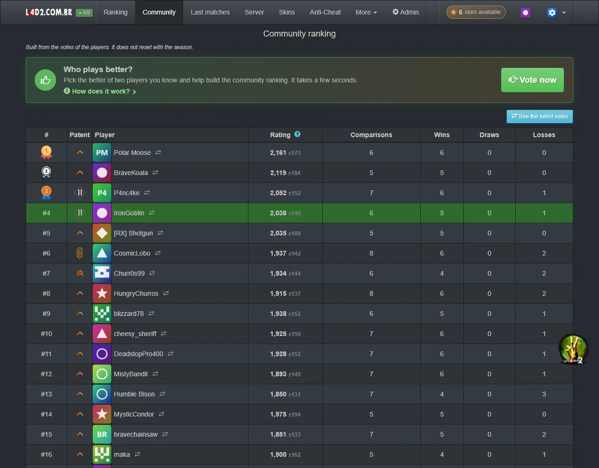
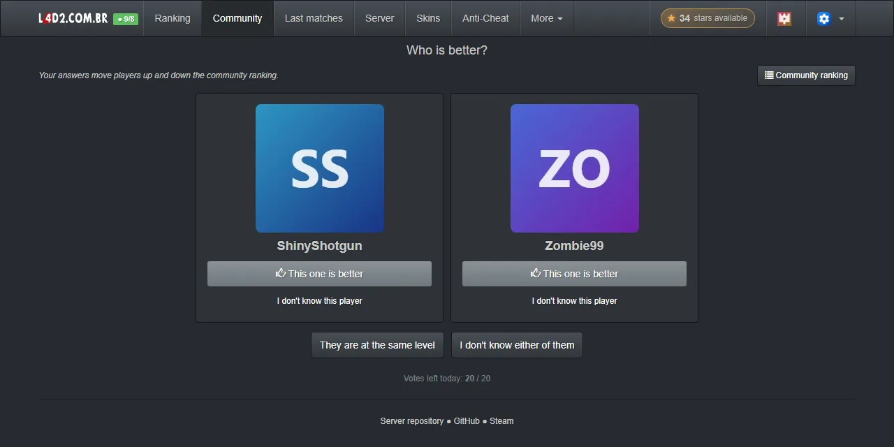
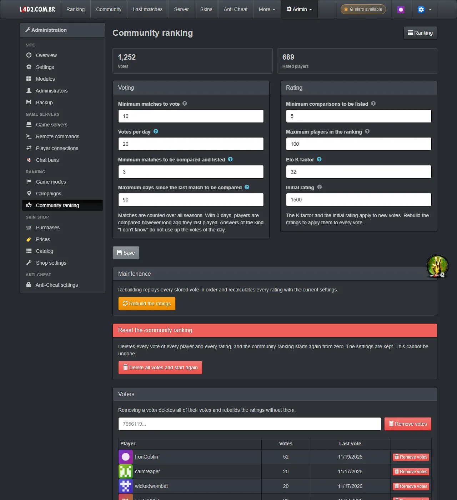

# Community ranking

🌐 **English** | [Português](community-ranking.pt.md) | [Español](community-ranking.es.md)

The community ranking is a second ranking, built from what the players think of each other. The site shows a voter two players and asks which one is better. Each answer moves the two players up or down. It does not reset with the season.

[Back to the manual](README.md)

## Contents

- [The community ranking page](#the-community-ranking-page)
- [Voting](#voting)
- [Who can vote, and how much](#who-can-vote-and-how-much)
- [How the pair is chosen](#how-the-pair-is-chosen)
- [How the rating is calculated](#how-the-rating-is-calculated)
- [For administrators](#for-administrators)

## The community ranking page

**Community** in the menu opens the list.

| Column | Meaning |
|---|---|
| # | Position. The first three have a medal. |
| Patent | The player's patent in the current season of the statistics ranking. |
| Player | Avatar and name. |
| Rating | The rating built from the votes. Everybody starts at 1500. |
| Comparisons | How many times the player was judged against another player. |
| Wins, Draws, Losses | How many comparisons the player won, drew and lost. |

Only players with enough comparisons are listed: 5 by default. A player must also have played the minimum number of matches to be compared, 1 by default. Both minimums are written under the table, and the list stops at the first 100 players by default. **Vote now**, in the box above the table, opens the voting page. The same box appears above the statistics ranking on the home page; a player can close it there, and it comes back after 7 days.

## Voting

The page shows two players with their avatars. Answer with one of:

| Answer | What it does |
|---|---|
| This one is better (left or right) | The chosen player wins the comparison, the other loses. |
| They are at the same level | A draw. |
| I don't know this player (under one of them) | Nothing changes, and that player is not shown to you again. |
| I don't know either of them | Nothing changes, and neither player is shown to you again. |

After each answer the page marks your choice and the next pair slides in. On a computer the ← and → keys pick the left or the right player, ↑ says they are at the same level and ↓ that you know neither of them. **Votes left today** shows how many votes you still have.

## Who can vote, and how much

| Rule | Default |
|---|---|
| You must be signed in with Steam. | |
| You must have played a minimum number of matches, counted over all seasons, ranked or not. | 10 |
| You have a number of votes per day. A day follows the time zone of the site. Only answers that judge (better or same level) use a vote; "I don't know" does not. | 20 |
| A player is offered for comparison only after a minimum number of matches. | 1 |
| A player can be offered only if their last match was within a number of days. With 0, however long ago it was. | 0 |
| You are never asked about yourself, and never asked about the same pair twice. | |

When you cannot vote, the page says why: you need to sign in, you need more matches (with your count), you used all the votes of the day, or there is nobody left for you to compare.

## How the pair is chosen

The site chooses the pair; a voter cannot choose who to judge, and an answer is accepted only for the pair the site offered.

1. It prefers players you have played with or against, since you know them best. Only when there is no such pair left does it offer other players.
2. Among those, it starts from one of the players with the fewest comparisons, so that new players get rated.
3. It pairs that player with someone of a close rating.
4. Which one appears on the left is random.

## How the rating is calculated

The rating uses the Elo system, the same idea as in chess.

- Every player starts at the initial rating, 1500 by default.
- Before a comparison, the site works out the chance of each player being judged better, from the difference of their ratings. A difference of 400 points means about 10 to 1.
- The winner gains and the loser loses the same number of points: the K factor (32 by default) times the difference between the result (1 for a win, ½ for a draw, 0 for a loss) and the expected chance.
- Beating a player with a much higher rating gives many points; beating a much weaker one gives few. A draw between players of different ratings moves the weaker one up.
- "I don't know" answers change nothing.

The rating is permanent. It does not start again with the season.

## For administrators

**Administration > Community ranking** has the settings, the maintenance and the list of voters.

Each field has a **?** next to its name: hovering it shows a short explanation, and the fields that need more show a window with the details when clicked.

| Setting | What it does | Default |
|---|---|---|
| Minimum matches to vote | Matches a player must have played, over all seasons, to vote. | 10 |
| Votes per day | Judging answers each voter can give per day. At least 1. | 20 |
| Minimum matches to be compared and listed | Matches a player must have played, over all seasons, to be offered for comparison and to appear in the community ranking. | 1 |
| Maximum days since the last match to be compared | A player whose last match is older than this is no longer offered for comparison, but stays in the community ranking. 0 means no limit. | 0 |
| Minimum comparisons to be listed | Comparisons a player needs to appear in the community ranking. | 5 |
| Maximum players in the ranking | The community ranking shows at most this many players, from the highest rating down. 0 shows everyone. | 100 |
| Elo K factor | How much one vote moves the ratings, from 1 to 200. | 32 |
| Initial rating | The rating of a player who was never compared. | 1500 |

The K factor and the initial rating apply to new votes. **Rebuild the ratings** replays every stored vote in order with the current settings, so that they apply to all votes.

**Voters** lists everybody who voted, with their number of votes and their last vote. **Remove votes** deletes all the votes of one voter and rebuilds the ratings without them, for example when someone voted in bad faith.

Turning off the community ranking module in [Modules](administration.md#modules) removes **Community** from the menu. The votes are kept.
