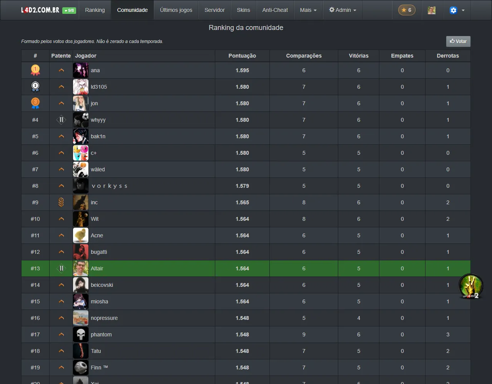
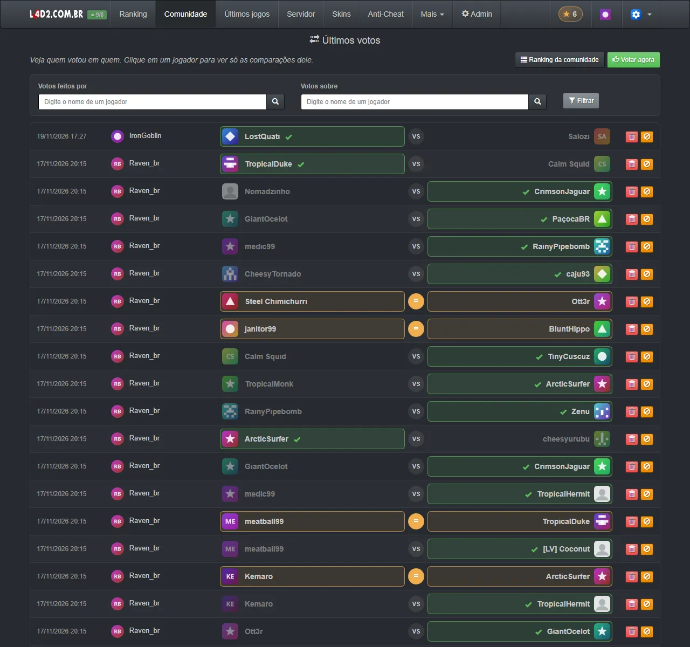
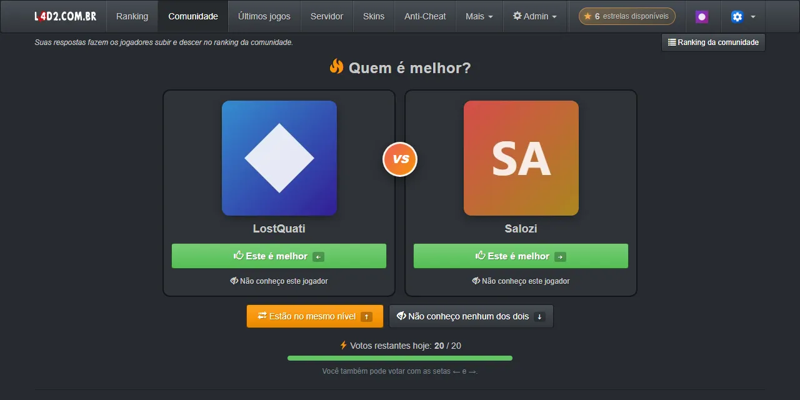
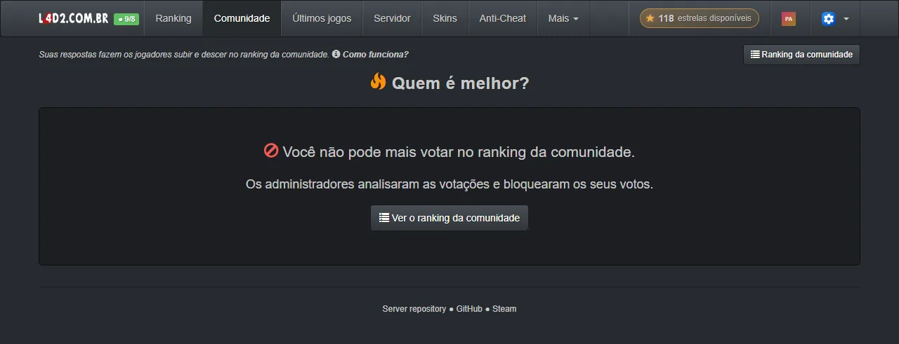
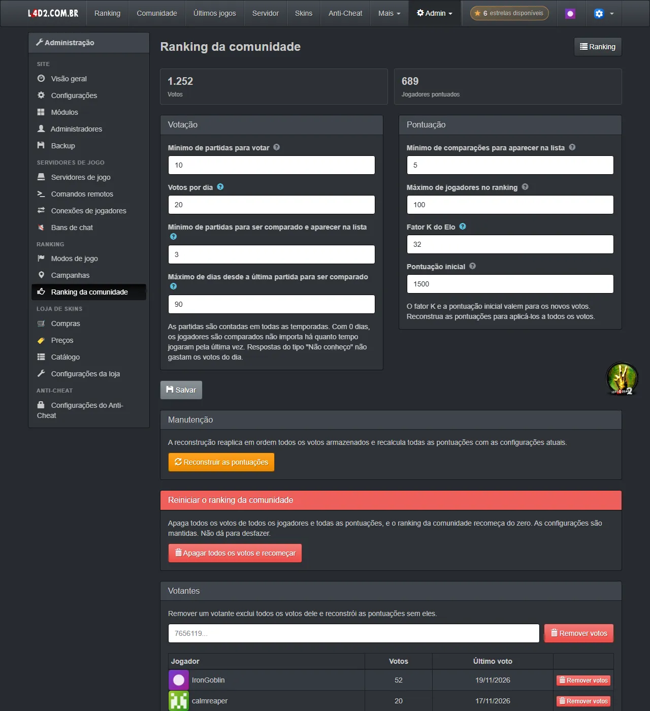
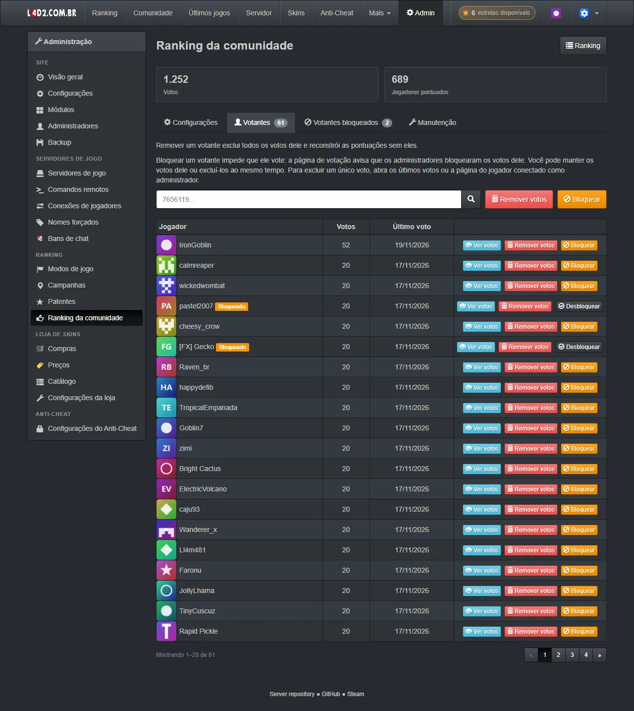
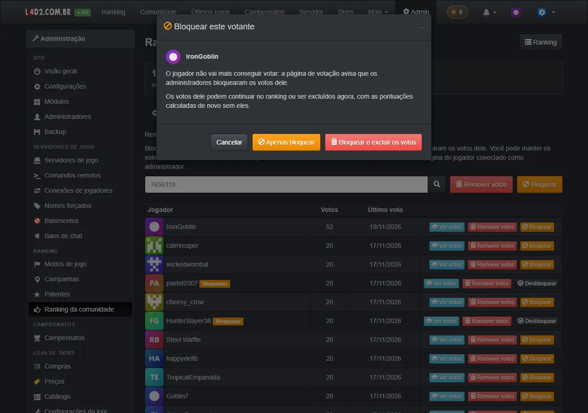
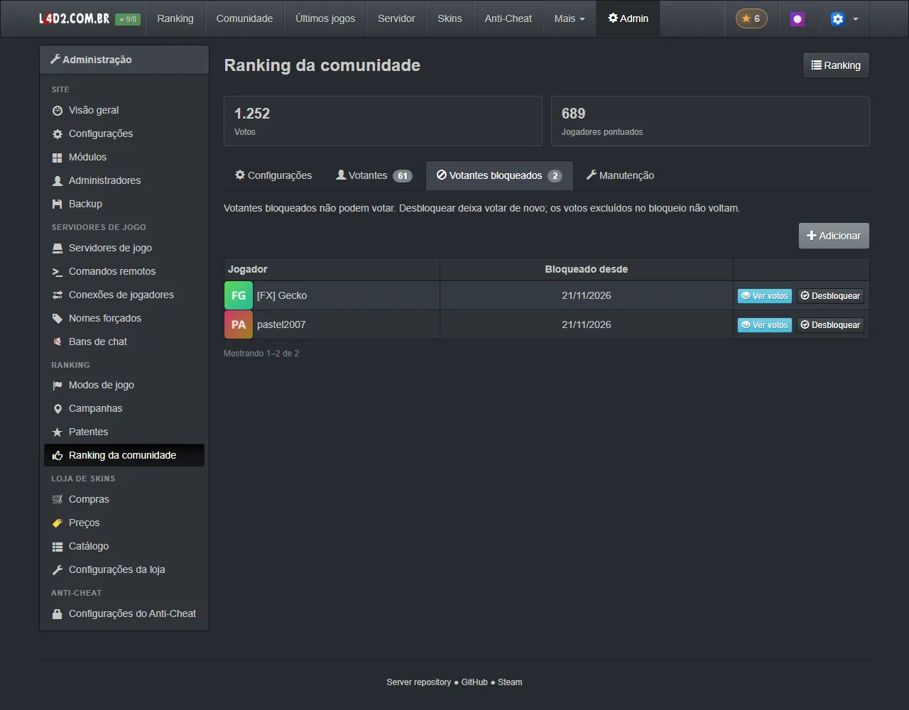

# Ranking da comunidade

🌐 [English](community-ranking.md) | **Português** | [Español](community-ranking.es.md)

O ranking da comunidade é um segundo ranking, formado pelo que os jogadores acham uns dos outros. O site mostra dois jogadores para quem vota e pergunta qual é o melhor. Cada resposta faz os dois jogadores subirem ou descerem. Ele não é zerado a cada temporada.

[Voltar ao manual](README.pt.md)

## Conteúdo

- [A página do ranking da comunidade](#a-página-do-ranking-da-comunidade)
- [Votando](#votando)
- [Quem pode votar, e quanto](#quem-pode-votar-e-quanto)
- [Como a dupla é escolhida](#como-a-dupla-é-escolhida)
- [Como a pontuação é calculada](#como-a-pontuação-é-calculada)
- [Para administradores](#para-administradores)

## A página do ranking da comunidade

**Comunidade**, no menu, abre a lista.

| Coluna | Significado |
|---|---|
| # | Posição. Os três primeiros têm uma medalha. |
| Patente | A patente do jogador na temporada atual do ranking de estatísticas. |
| Jogador | Avatar e nome. |
| Pontuação | A pontuação formada pelos votos. Todo mundo começa com 1500. |
| Comparações | Quantas vezes o jogador foi avaliado contra outro jogador. |
| Vitórias, Empates, Derrotas | Quantas comparações o jogador ganhou, empatou e perdeu. |

**Ver os últimos votos**, acima e abaixo da tabela, abre **Últimos votos**: um cartão por voto com quem votou, os dois jogadores lado a lado, o escolhido em verde (ou os dois em amarelo quando estão no mesmo nível) e quando. As respostas "Não conheço" não aparecem. Clicar em um jogador, ou no ícone de setas ao lado do nome na tabela, mostra só as comparações dele. Os filtros **Votos feitos por** e **Votos sobre** aceitam um nome, ou o botão de busca ao lado de cada um abre uma janela com os jogadores da votação, dos mais recentes para os mais antigos. Um administrador pode esconder quem votou.

No celular a tabela mostra só a posição, o jogador e a pontuação. O **?** ao lado de **Pontuação** abre uma janela que explica cada coluna.

Só aparecem na lista os jogadores com comparações suficientes: 5 por padrão. O jogador também precisa ter jogado o mínimo de partidas para ser comparado, 1 por padrão. Os dois mínimos aparecem embaixo da tabela, e a lista para nos 100 primeiros jogadores por padrão. Quando há mais jogadores na lista, a tabela mostra 100 por página, com os links das páginas embaixo dela. **Como funciona?**, no quadro, abre uma janela que explica em quatro passos como os votos viram a lista, com os números das configurações atuais. A página de votação tem o mesmo link, inclusive quando os votos do dia acabaram. Clicar na linha de um jogador abre uma janela com a pontuação, as comparações e uma barra de vitórias, empates e derrotas, com links para as comparações e o perfil dele. **Votar agora**, no quadro acima da tabela, abre a página de votação. O mesmo quadro aparece acima do ranking de estatísticas na página inicial; lá o jogador pode fechá-lo, e ele volta depois de 7 dias. A caixa só aparece para quem não fez login e para jogadores que ainda podem votar hoje; quem já usou todos os votos do dia, não tem partidas suficientes ou está bloqueado não a vê.

## Votando

A página mostra dois jogadores com seus avatares. Responda com uma destas opções:

| Resposta | O que faz |
|---|---|
| Este é melhor (à esquerda ou à direita), ou um clique na foto | O jogador escolhido ganha a comparação, o outro perde. |
| Estão no mesmo nível | Um empate. |
| Não conheço um deles | Nada muda, e essa dupla não aparece mais para você. Os dois jogadores ainda podem aparecer em outras duplas. |

Embaixo de cada nome o cartão mostra até 4 outros nomes que o jogador já usou nas partidas, do mais usado para o menos usado, para você reconhecer quem trocou de nome. Depois de cada resposta a página marca a sua escolha e a próxima dupla entra na tela. No computador, as setas ← e → escolhem o jogador da esquerda ou da direita, ↓ diz que estão no mesmo nível e ↑ que você não conhece um deles. **Votos restantes hoje** mostra quantos votos você ainda tem.

## Quem pode votar, e quanto

| Regra | Padrão |
|---|---|
| Você precisa estar logado com o Steam. | |
| Você precisa ter jogado um número mínimo de partidas, contadas em todas as temporadas, ranqueadas ou não. | 10 |
| Você tem um número de votos por dia. O dia segue o fuso horário do site. Só as respostas que avaliam (melhor ou mesmo nível) gastam um voto; "Não conheço" não gasta. | 20 |
| Um jogador só é oferecido para comparação depois de um número mínimo de partidas. | 1 |
| Um jogador só é oferecido se a última partida dele foi dentro de um número de dias. Com 0, não importa há quanto tempo. | 0 |
| Você nunca é perguntado sobre você mesmo, nem sobre a mesma dupla duas vezes. | |

Quando você não pode votar, a página diz o motivo: você precisa fazer login, precisa de mais partidas (com a sua contagem), já usou todos os votos do dia, não há mais ninguém para você comparar ou os administradores bloquearam os seus votos.

## Como a dupla é escolhida

O site escolhe a dupla; quem vota não escolhe quem vai julgar, e uma resposta só é aceita para a dupla que o site ofereceu.

1. Ele prefere jogadores com quem ou contra quem você jogou, porque você os conhece melhor. Só quando não sobra nenhuma dupla assim ele oferece outros jogadores.
2. Entre esses, ele começa por um dos jogadores cuja pontuação é menos certa (em geral os com menos comparações), para que os jogadores novos sejam avaliados.
3. Ele junta esse jogador com o adversário cuja resposta mais ensina: alguém de pontuação próxima, de preferência também incerta. Assim os melhores jogadores são comparados entre si, e não com jogadores bem mais fracos.
4. Qual aparece à esquerda é sorteado.

## Como a pontuação é calculada

A pontuação usa o modelo de Bradley–Terry, o modelo estatístico feito para comparações em pares.

- A cada resposta que avalia, o site calcula de novo todas as pontuações com todos os votos juntos. A ordem dos votos não importa, e um voto vale o mesmo sendo o primeiro ou o último.
- Ser escolhido contra um jogador de pontuação alta vale mais do que contra um de pontuação baixa, porque o modelo pesa cada resposta por quem é o outro jogador. "Estão no mesmo nível" vale meia vitória para cada um.
- Uma diferença de 400 pontos significa uma chance de cerca de 10 para 1 de ser julgado melhor. A escala é centrada na pontuação inicial, 1500 por padrão.
- Cada pontuação tem uma margem de incerteza (±), mostrada ao lado dela. Ela começa grande e diminui conforme o jogador é comparado com mais jogadores. Um jogador com pouquíssimos votos fica perto do meio da escala até os votos dizerem o contrário.
- A posição no ranking usa a pontuação menos duas vezes a margem. Um jogador com dois votos de sorte não passa à frente de um jogador que ganhou muitas comparações.
- Respostas "não conheço" não mudam nada.

A pontuação é permanente. Ela não recomeça com a temporada.

## Para administradores

**Administração > Ranking da comunidade** tem no topo os totais de votos e de jogadores avaliados e quatro abas: **Configurações**, **Votantes**, **Votantes bloqueados** e **Manutenção**, que tem **Reconstruir as pontuações** e **Reiniciar o ranking da comunidade**. O endereço guarda a aba e a página abertas, então recarregar ou abrir um link volta ao mesmo lugar.

Cada campo tem um **?** ao lado do nome: passar o mouse mostra uma explicação curta, e os campos que precisam de mais mostram uma janela com os detalhes ao clicar.

| Configuração | O que faz | Padrão |
|---|---|---|
| Mínimo de partidas para votar | Partidas que um jogador precisa ter jogado, em todas as temporadas, para votar. | 10 |
| Votos por dia | Respostas que avaliam que cada votante pode dar por dia. No mínimo 1. | 20 |
| Mínimo de partidas para ser comparado e aparecer na lista | Partidas que um jogador precisa ter jogado, em todas as temporadas, para ser oferecido para comparação e para aparecer no ranking da comunidade. | 1 |
| Máximo de dias desde a última partida para ser comparado | Um jogador cuja última partida é mais antiga que isso deixa de ser oferecido para comparação, mas continua no ranking da comunidade. 0 é sem limite. | 0 |
| Mínimo de comparações para aparecer na lista | Comparações de que um jogador precisa para aparecer no ranking da comunidade. | 5 |
| Mostrar quem votou nos últimos votos | Mostra o nome e o avatar de cada votante na página Últimos votos. Desligado, cada voto mostra só "Um jogador votou". | Ligado |
| Máximo de jogadores no ranking | O ranking da comunidade mostra no máximo esse número de jogadores, da maior pontuação para baixo. 0 mostra todos. | 100 |
| Pontuação inicial | O meio da escala: a pontuação de um jogador que nunca foi comparado. | 1500 |

As pontuações são calculadas de novo com todos os votos a cada voto novo. **Reconstruir as pontuações** faz isso na hora, por exemplo depois de mudar a pontuação inicial.

**Reiniciar o ranking da comunidade**, num painel vermelho, apaga todos os votos e todas as pontuações, e o ranking da comunidade recomeça do zero; as configurações são mantidas. Uma janela mostra quantos votos e jogadores serão apagados e pede confirmação, já que não dá para desfazer.

**Votantes** lista todo mundo que votou, com o número de votos e o último voto, 20 por página, quem tem mais votos primeiro; **Ver votos** abre, numa nova aba, os últimos votos desse votante. **Remover votos** exclui todos os votos de um votante e reconstrói as pontuações sem eles, por exemplo quando alguém votou de má-fé. O campo aceita o votante em qualquer formato de Steam ID ou pelo link do perfil, e o botão de busca ao lado abre a [busca de jogadores](administration.pt.md#a-busca-de-jogadores).

**Bloquear** impede um votante de votar, pelo mesmo campo ou pela linha do votante. Ele abre uma janela com duas opções: **Apenas bloquear** mantém os votos já dados, e **Bloquear e excluir os votos** também os exclui e calcula as pontuações de novo sem eles. A página de votação de um votante bloqueado passa a dizer que ele não pode mais votar porque os administradores analisaram as votações e bloquearam os votos dele, e qualquer resposta que ele enviar é recusada. **Votantes bloqueados** lista todo mundo que está bloqueado, desde quando, 20 por página, com **Desbloquear** para deixar votar de novo; os votos excluídos no bloqueio não voltam. **Adicionar**, nessa aba, abre a janela **Bloquear um jogador**: ela bloqueia qualquer pessoa escolhida no campo ou na busca de jogadores, também quem ainda não votou, e **Excluir também os votos que ele já deu** exclui os votos dele junto. **Salvar** bloqueia o jogador.

Para excluir um único voto, abra **Últimos votos** ou as abas **Votos recebidos** e **Votos feitos** da página de um jogador conectado como administrador. Cada voto passa a ter um botão vermelho que o exclui, e as pontuações são calculadas de novo sem ele, e um botão amarelo que bloqueia o jogador que o deu. Os administradores sempre veem quem votou, mesmo com **Mostrar quem votou nos últimos votos** desligado.

Desligar o módulo do ranking da comunidade em [Módulos](administration.pt.md#módulos) tira **Comunidade** do menu. Os votos são mantidos.
