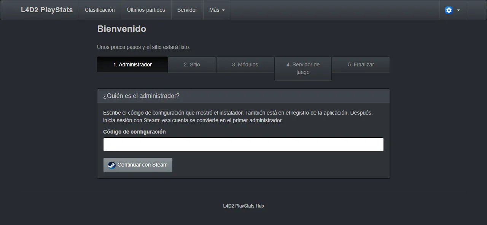
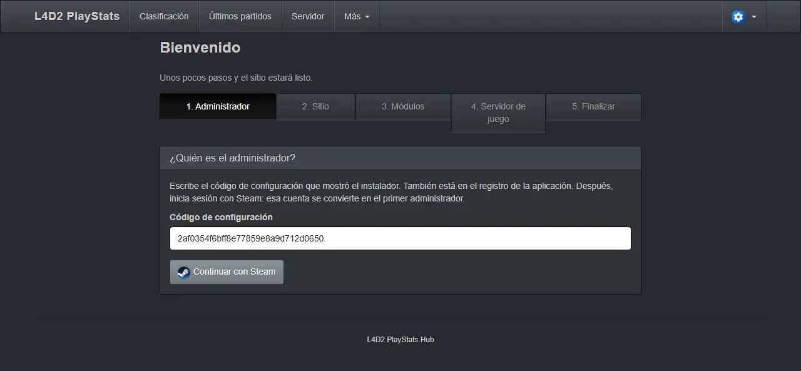
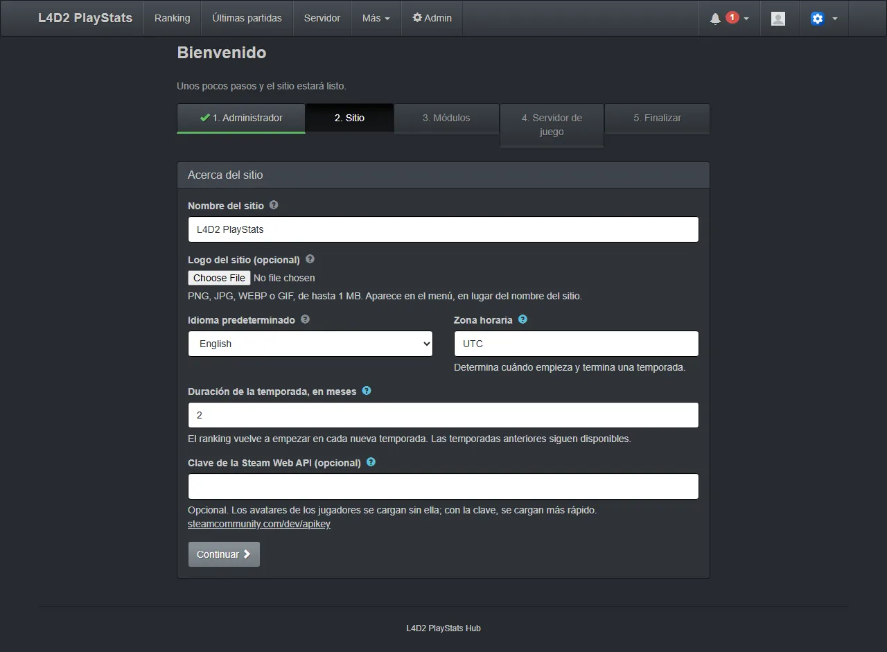
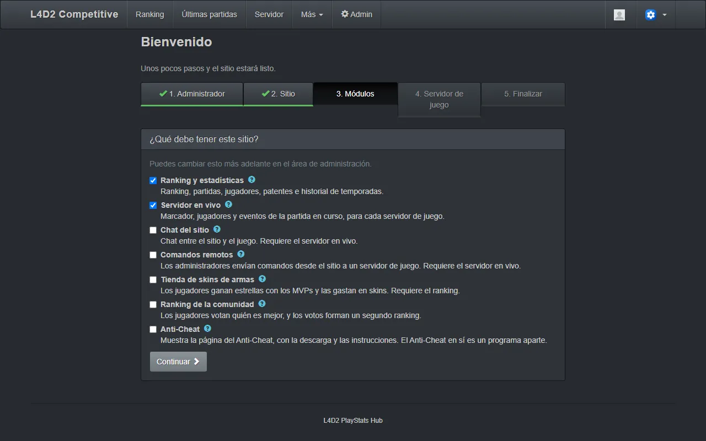
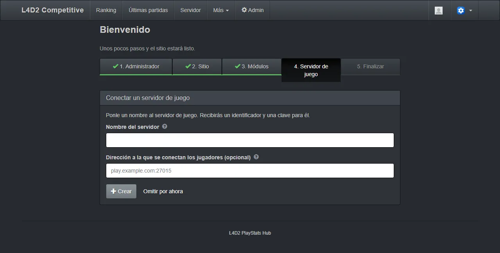
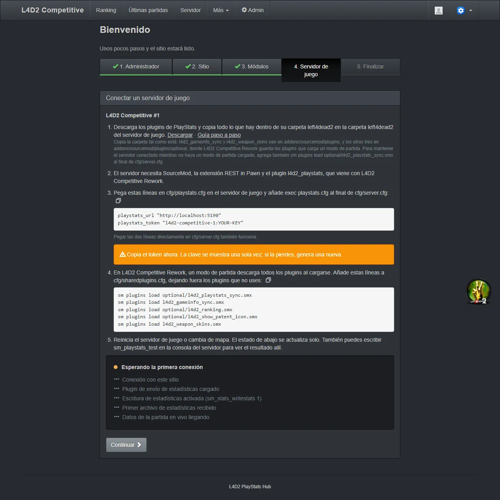
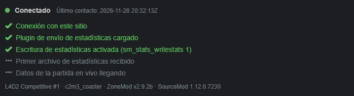
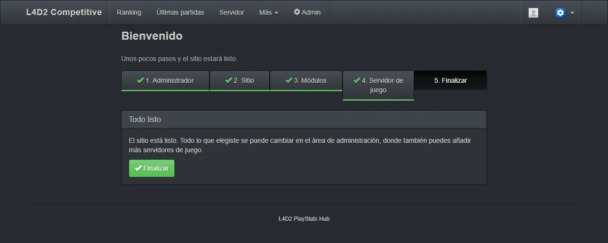
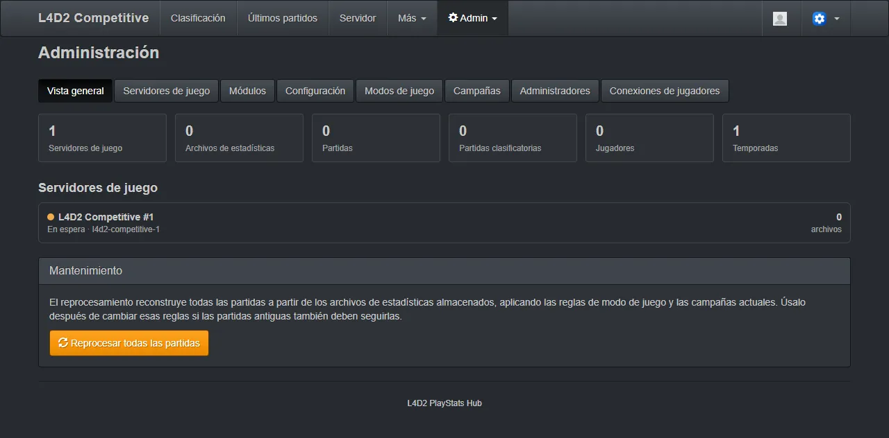
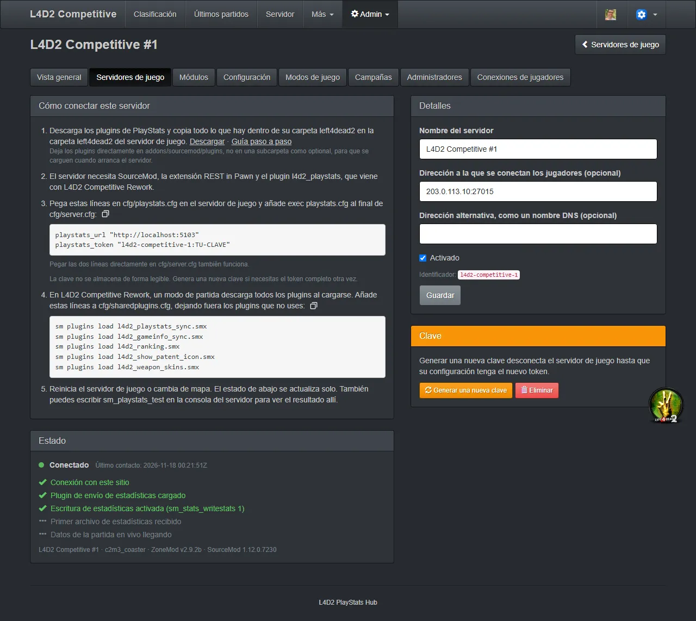

# Configuración inicial

🌐 [English](first-run.md) | [Português](first-run.pt.md) | **Español**

Después de la instalación, el sitio abre un asistente de configuración. Se ejecuta una sola vez. Hace de tu cuenta de Steam el primer administrador, pide la configuración básica y registra tu primer servidor de juego. Todo lo que elijas aquí se puede cambiar después en el [área de administración](administration.es.md).

[Volver al manual](README.es.md)

## Contenido

- [Antes de empezar](#antes-de-empezar)
- [Paso 1: el código de configuración](#paso-1-el-código-de-configuración)
- [Paso 2: el sitio](#paso-2-el-sitio)
- [Paso 3: los módulos](#paso-3-los-módulos)
- [Paso 4: el servidor de juego](#paso-4-el-servidor-de-juego)
- [Paso 5: finalizar](#paso-5-finalizar)
- [El estado de la conexión](#el-estado-de-la-conexión)
- [Si te detienes a la mitad](#si-te-detienes-a-la-mitad)

## Antes de empezar

Necesitas:

- la dirección del sitio y el **código de configuración**, que muestra el instalador ([Linux](../install-linux.es.md#paso-2-ejecuta-el-instalador), [Docker](../install-docker.es.md#el-código-de-configuración));
- la cuenta de Steam que será la del administrador;
- acceso a los archivos de tu servidor de juego, para pegar dos líneas en su configuración y copiar los plugins.

Mientras la configuración no esté terminada, todas las páginas del sitio llevan al asistente.

## Paso 1: el código de configuración

Pega el código de configuración y haz clic en **Continuar con Steam**. Steam te pide que inicies sesión y te devuelve al sitio.

La cuenta de Steam con la que inicias sesión se convierte en el primer administrador. Desde ese momento el código deja de funcionar y solo tu cuenta puede continuar la configuración.

El código se vuelve a mostrar con `playstats-hub setup-code` en Linux, o en el registro de la aplicación (`docker compose logs hub | grep "setup code"`). También queda guardado en el archivo `setup-code.txt` de la carpeta de datos.

## Paso 2: el sitio

| Campo | Qué hace |
|---|---|
| Nombre del sitio | Se muestra en el menú (cuando no hay logo), en el título de las páginas y en las páginas dentro del juego. |
| Logo del sitio (opcional) | Una imagen que se muestra en el menú en lugar del nombre. PNG, JPG, WEBP o GIF, de hasta 1 MB. |
| Idioma predeterminado | El idioma de un visitante que no eligió ninguno. Cada visitante puede cambiarlo en el menú. |
| Zona horaria | El reloj que se usa para las fechas del sitio y para el inicio y el fin de cada temporada. Elige la zona horaria de tu comunidad. |
| Duración de la temporada, en meses | Cuánto dura una temporada, de 1 a 24 meses. El ranking vuelve a empezar en cada temporada. Consulta [Temporadas e historia](seasons-and-history.es.md). |
| Clave de la Steam Web API (opcional) | Los avatares y los nombres de los jugadores cargan sin ella. Con una clave cargan más rápido. Consigues una clave en [steamcommunity.com/dev/apikey](https://steamcommunity.com/dev/apikey). |

## Paso 3: los módulos

Elige qué tiene el sitio. Cada módulo se explica en [Administración > Módulos](administration.es.md#módulos). Si no estás seguro, deja los valores predeterminados: el ranking y el servidor en vivo están activados, el resto está desactivado, y puedes activar cosas más adelante.

## Paso 4: el servidor de juego

Dale al servidor de juego un nombre, el que conocen los jugadores. La dirección a la que se conectan los jugadores es opcional: cuando está completa, la página del servidor en vivo la muestra con un botón para copiar y un comando `connect`. **Omitir por ahora** va al último paso sin servidor; puedes agregar uno después.

Haz clic en **Crear**. El sitio crea un identificador y una clave para el servidor y muestra qué hacer en el servidor de juego.

1. Descarga los plugins y copia todo lo que hay dentro de su carpeta `left4dead2` en la carpeta `left4dead2` del servidor de juego. [Conectar un servidor de juego](../game-server.es.md) explica dónde va cada archivo.
2. El servidor de juego necesita SourceMod, la extensión REST in Pawn y el plugin `l4d2_playstats` que viene con L4D2 Competitive Rework.
3. Pega las dos líneas en `cfg/playstats.cfg` en el servidor de juego y añade `exec playstats.cfg` al final de `cfg/server.cfg`. La primera línea es la dirección del sitio; la segunda es el token de este servidor. Pegar las dos líneas directamente en `cfg/server.cfg` también funciona.
4. En L4D2 Competitive Rework, un modo de partida descarga todos los plugins al cargarse. Añade las líneas `sm plugins load` que muestra la página a `cfg/sharedplugins.cfg`, dejando fuera los plugins que no uses. El botón de copiar junto a ellas las copia todas.
5. Reinicia el servidor de juego o cambia de mapa.

**Copia el token ahora.** La clave se muestra una sola vez. El sitio guarda solo un hash de ella, así que no puede volver a mostrarla. Si la pierdes, genera una nueva clave en la página del servidor en [Administración > Servidores de juego](administration.es.md#servidores-de-juego).

Debajo de las instrucciones, el panel muestra el [estado de la conexión](#el-estado-de-la-conexión) del servidor: **Esperando la primera conexión** hasta que el servidor de juego llegue al sitio. Se actualiza solo cada 3 segundos y se pone verde cuando el servidor de juego se conecta:

No tienes que esperarlo. Haz clic en **Continuar** para ir al último paso. Las mismas instrucciones y el mismo estado están en la página del servidor en [Administración > Servidores de juego](administration.es.md#servidores-de-juego), donde puedes seguir la conexión después de la configuración.

## Paso 5: finalizar

Haz clic en **Finalizar**. El sitio abre su primera página. Hasta que se juegue la primera partida de ranking, el ranking está vacío:

A partir de aquí:

- agrega más servidores de juego en [Administración > Servidores de juego](administration.es.md#servidores-de-juego);
- revisa qué modos de juego cuentan para el ranking en [Modos de juego y campañas](game-modes-and-campaigns.es.md);
- agrega otros administradores en [Administración > Administradores](administration.es.md#administradores).

## El estado de la conexión

El mismo panel aparece en el asistente y en la página de cada servidor de juego en el área de administración. Muestra el estado de la conexión y una lista de verificación, y se actualiza solo cada 3 segundos. Esta es la página del servidor creado arriba, unos segundos después de que el servidor de juego enviara su primera señal:

| Estado | Significado |
|---|---|
| Esperando la primera conexión | El sitio nunca recibió nada de este servidor. |
| Conectado | El servidor envió una señal en los últimos 90 segundos. |
| Fuera de línea | El servidor ya estuvo conectado antes. El panel muestra el último contacto. |
| Clave inválida | En los últimos 10 minutos llegó una solicitud con el identificador de este servidor y una clave incorrecta. |

| Verificación | Se pone en verde cuando |
|---|---|
| Conexión con este sitio | El servidor está conectado ahora. Se pone en rojo cuando el servidor ya se vio antes y ahora está fuera de línea. |
| Plugin de envío de estadísticas cargado | `l4d2_playstats_sync` está cargado en el servidor. |
| Escritura de estadísticas activada (sm_stats_writestats 1) | El servidor escribe archivos de estadísticas. |
| Primer archivo de estadísticas recibido | Llegó al menos un archivo de estadísticas. Se muestra la cantidad de archivos. |
| Datos de la partida en vivo llegando | Los datos del servidor en vivo llegaron al menos una vez. Se muestra solo con el módulo de servidor en vivo. |
| Plugin de skins de armas cargado | `l4d2_weapon_skins` está cargado. Se muestra solo con el módulo de la tienda de skins. |

Las mismas verificaciones se pueden ejecutar desde la consola del servidor de juego con `sm_playstats_test`. [Conectar un servidor de juego](../game-server.es.md) indica qué hacer en cada problema.

## Si te detienes a la mitad

Una vez que tu cuenta es la del administrador, el código de configuración ya no hace falta. Vuelve a abrir el sitio e inicia sesión con la misma cuenta de Steam: el asistente se abre en el paso del sitio, con lo que ya guardaste completado. Recorre los pasos de nuevo con **Continuar**. Un servidor de juego que ya creaste sigue registrado; no necesitas crearlo dos veces.

Cualquier otra persona que abra el sitio antes de que termines ve una página que dice que la configuración inicial está en curso.
