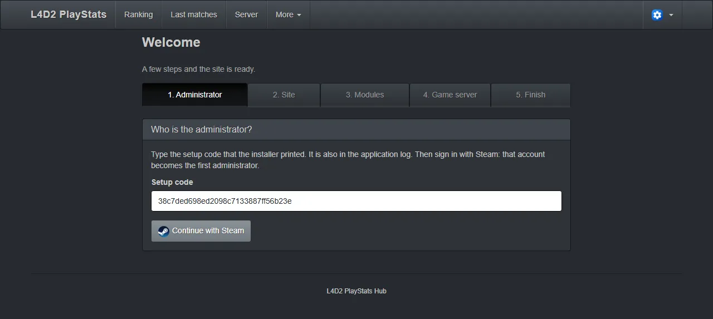
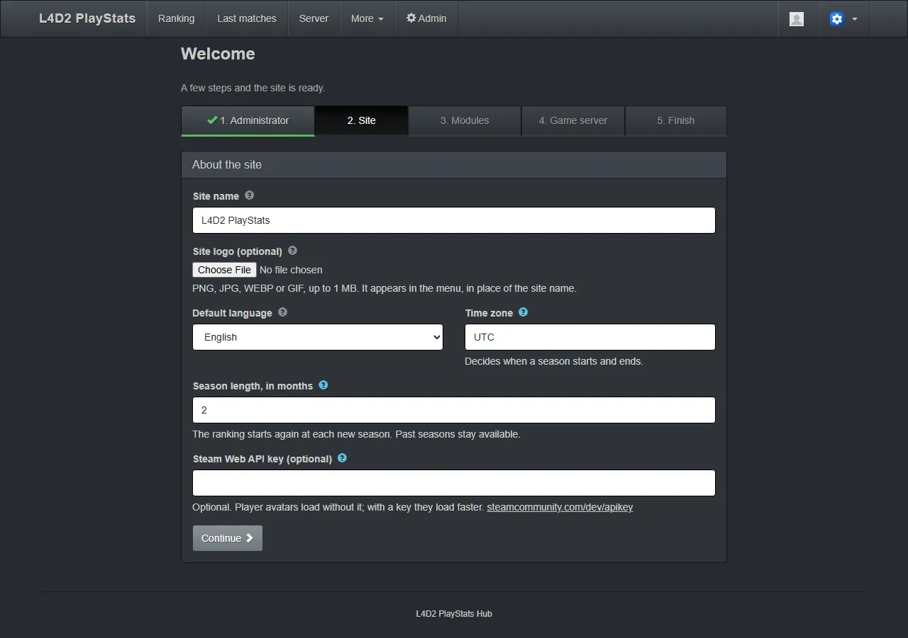
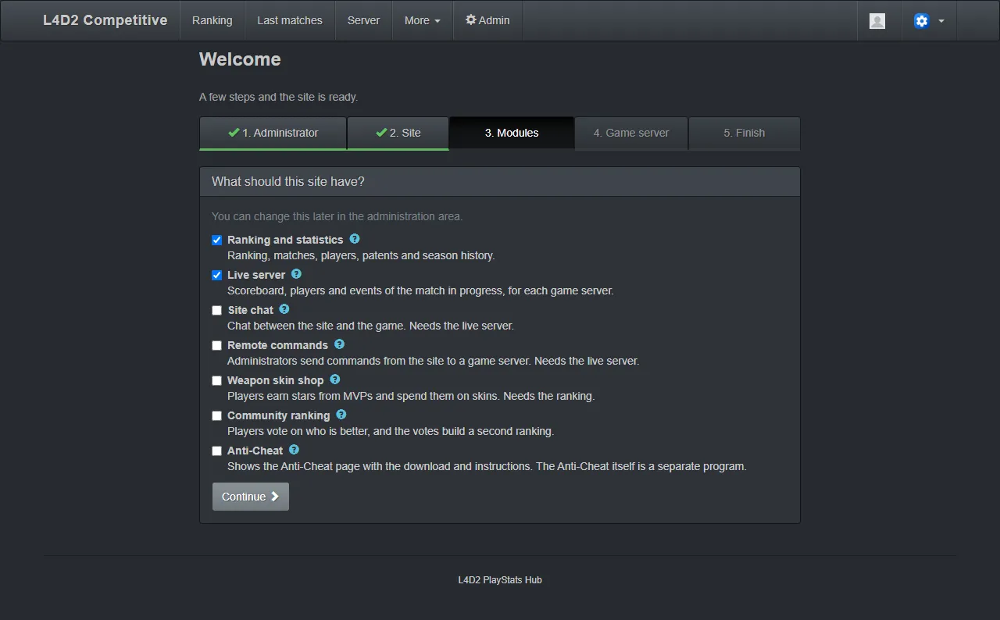
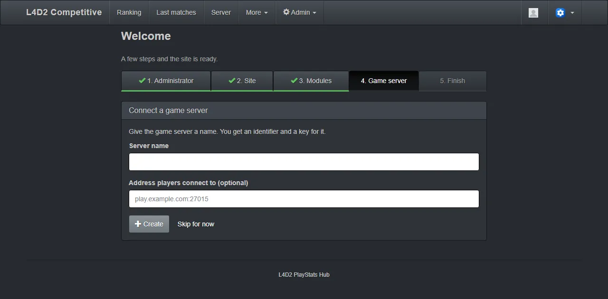
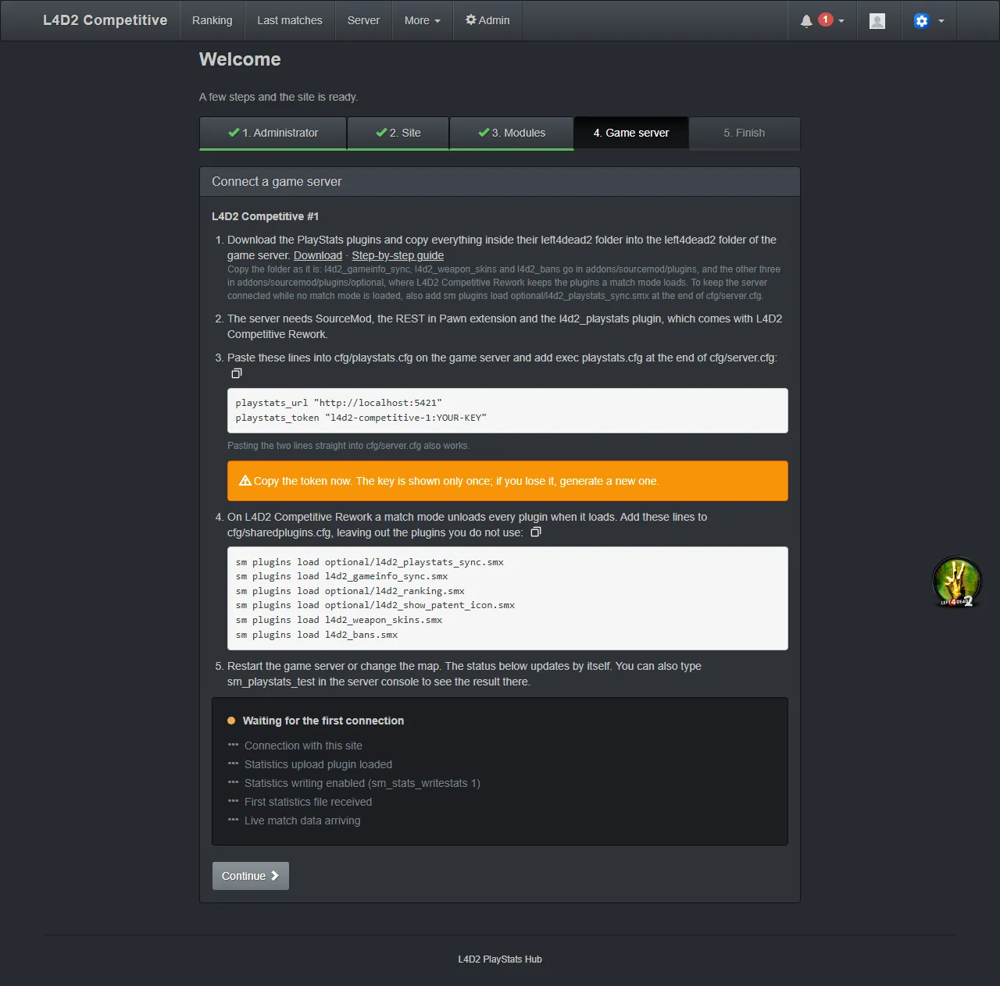
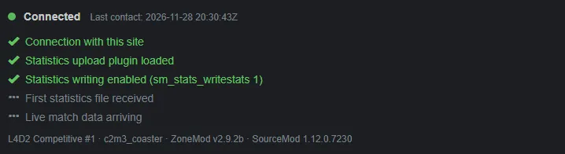
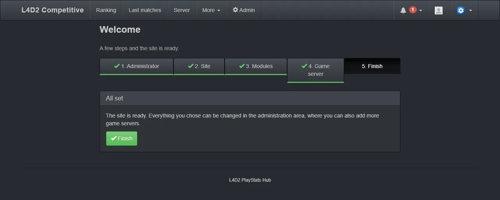
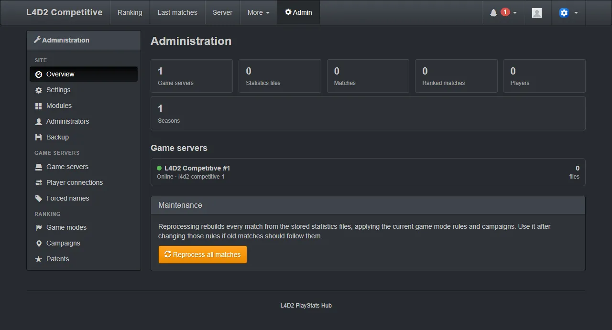
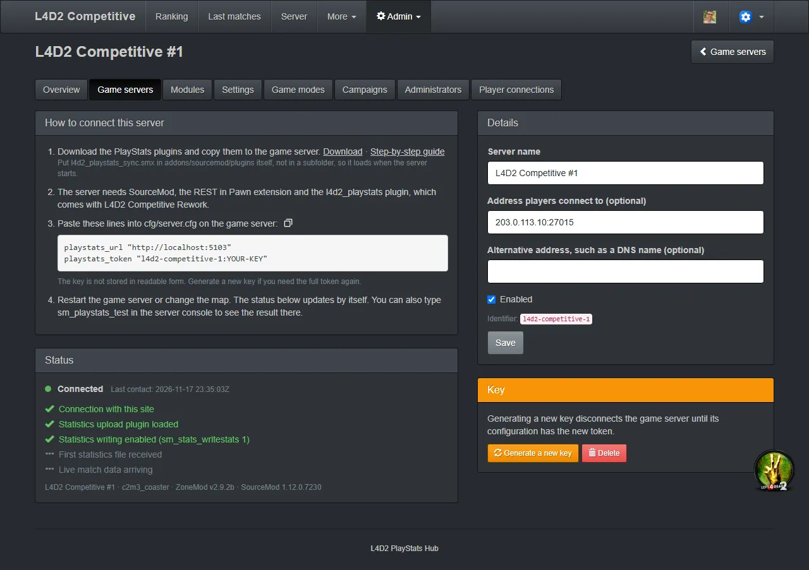

# First-run setup

🌐 **English** | [Português](first-run.pt.md) | [Español](first-run.es.md)

After the installation, the site opens a setup wizard. It runs once. It makes your Steam account the first administrator, asks for the basic settings, and registers your first game server. Everything chosen here can be changed later in the [administration area](administration.md).

[Back to the manual](README.md)

## Contents

- [Before you start](#before-you-start)
- [Step 1: the setup code](#step-1-the-setup-code)
- [Step 2: the site](#step-2-the-site)
- [Step 3: the modules](#step-3-the-modules)
- [Step 4: the game server](#step-4-the-game-server)
- [Step 5: finish](#step-5-finish)
- [The connection status](#the-connection-status)
- [If you stop halfway](#if-you-stop-halfway)

## Before you start

You need:

- the address of the site, and the **setup code**, both printed by the installer ([Linux](../install-linux.md#step-2-run-the-installer), [Docker](../install-docker.md#the-setup-code));
- the Steam account that will be the administrator;
- access to the files of your game server, to paste two lines in its configuration and copy the plugins.

While the setup is not finished, every page of the site leads to the wizard.

## Step 1: the setup code

Paste the setup code and click **Continue with Steam**. Steam asks you to sign in and sends you back to the site.

The Steam account you sign in with becomes the first administrator. After that, the code stops working, and only your account can continue the setup.

The code is shown again with `playstats-hub setup-code` on Linux, or in the log of the application (`docker compose logs hub | grep "setup code"`). It is also saved in the file `setup-code.txt` in the data folder.

## Step 2: the site

| Field | What it does |
|---|---|
| Site name | Shown in the menu (when there is no logo), in the title of the pages and in the pages inside the game. |
| Site logo (optional) | An image shown in the menu in place of the name. PNG, JPG, WEBP or GIF, up to 1 MB. |
| Default language | The language of a visitor who has not chosen one. Each visitor can change it in the menu. |
| Time zone | The clock used for dates on the site and for the start and end of each season. Choose the time zone of your community. |
| Season length, in months | How long a season lasts, from 1 to 24 months. The ranking starts again at each season. See [Seasons and history](seasons-and-history.md). |
| Steam Web API key (optional) | Player avatars and names load without it. With a key they load faster. You get a key at [steamcommunity.com/dev/apikey](https://steamcommunity.com/dev/apikey). |

## Step 3: the modules

Choose what the site has. Each module is explained in [Administration > Modules](administration.md#modules). If you are not sure, keep the defaults: the ranking and the live server are on, the rest is off, and you can turn things on later.

## Step 4: the game server

Give the game server a name, as players know it. The address players connect to is optional: when it is filled, the live server page shows it with a copy button and a `connect` command. **Skip for now** goes to the last step without a server; you can add one later.

Click **Create**. The site creates an identifier and a key for the server and shows what to do on the game server.

1. Download the plugins and copy everything inside their `left4dead2` folder into the `left4dead2` folder of the game server. [Connecting a game server](../game-server.md) explains where each file goes.
2. The game server needs SourceMod, the REST in Pawn extension, and the `l4d2_playstats` plugin that comes with L4D2 Competitive Rework.
3. Paste the two lines into `cfg/playstats.cfg` on the game server, and add `exec playstats.cfg` at the end of `cfg/server.cfg`. The first line is the address of the site; the second is the token of this server. Pasting the two lines straight into `cfg/server.cfg` also works.
4. On L4D2 Competitive Rework, a match mode unloads every plugin when it loads. Add the `sm plugins load` lines shown on the page to `cfg/sharedplugins.cfg`, leaving out the plugins you do not use. The copy button next to them copies them all.
5. Restart the game server or change the map.

**Copy the token now.** The key is shown only once. The site keeps only a hash of it, so it cannot show it again. If you lose it, generate a new key on the page of the server in [Administration > Game servers](administration.md#game-servers).

Under the instructions, the panel shows the [connection status](#the-connection-status) of the server: **Waiting for the first connection** until the game server reaches the site. It updates by itself every 3 seconds, and turns green when the game server connects:

You do not have to wait for it. Click **Continue** to go to the last step. The same instructions and status are on the page of the server in [Administration > Game servers](administration.md#game-servers), where you can follow the connection after the setup.

## Step 5: finish

Click **Finish**. The site opens its first page. Until the first ranked match is played, the ranking is empty:

From here:

- add more game servers in [Administration > Game servers](administration.md#game-servers);
- check which game modes count for the ranking in [Game modes and campaigns](game-modes-and-campaigns.md);
- add other administrators in [Administration > Administrators](administration.md#administrators).

## The connection status

The same panel appears in the wizard and on the page of each game server in the administration area. It shows the state of the connection and a checklist, and updates by itself every 3 seconds. This is the page of the server created above, a few seconds after the game server sent its first signal:

| State | Meaning |
|---|---|
| Waiting for the first connection | The site never received anything from this server. |
| Connected | The server sent a signal in the last 90 seconds. |
| Offline | The server was connected before. The panel shows the last contact. |
| Invalid key | In the last 10 minutes, a request arrived with this server's identifier and a wrong key. |

| Check | Turns green when |
|---|---|
| Connection with this site | The server is connected now. It turns red when the server was seen before and is now offline. |
| Statistics upload plugin loaded | `l4d2_playstats_sync` is loaded on the server. |
| Statistics writing enabled (sm_stats_writestats 1) | The server writes statistics files. |
| First statistics file received | At least one statistics file arrived. The number of files is shown. |
| Live match data arriving | The live server data arrived at least once. Shown only with the live server module. |
| Weapon skins plugin loaded | `l4d2_weapon_skins` is loaded. Shown only with the skin shop module. |

The same checks can be run from the game server console with `sm_playstats_test`. [Connecting a game server](../game-server.md) lists what to do for each problem.

## If you stop halfway

Once your account is the administrator, the setup code is no longer needed. Open the site again and sign in with the same Steam account: the wizard opens at the site step, with what you already saved filled in. Go through the steps again with **Continue**. A game server you already created stays registered; you do not need to create it twice.

Anyone else who opens the site before you finish sees a page saying that the setup is in progress.
