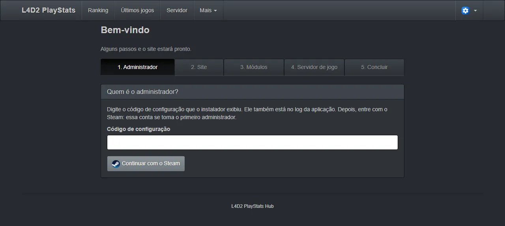
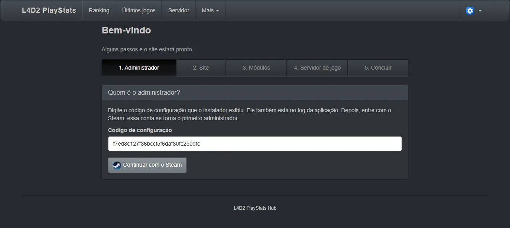
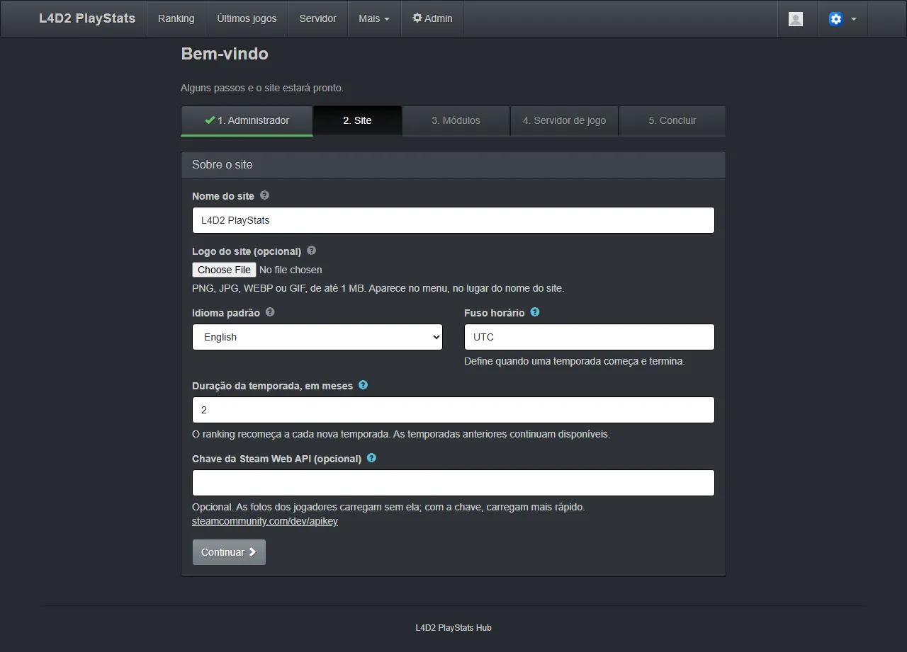
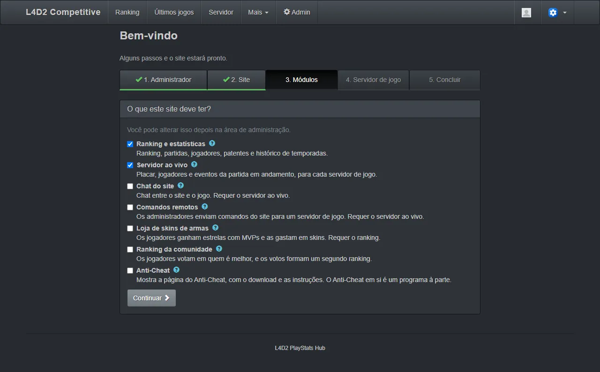
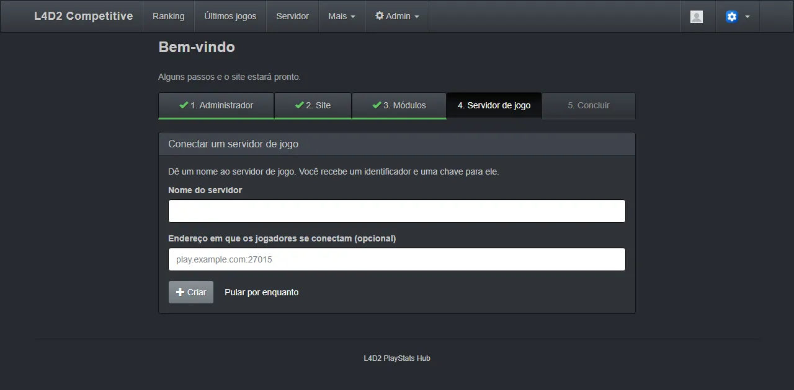
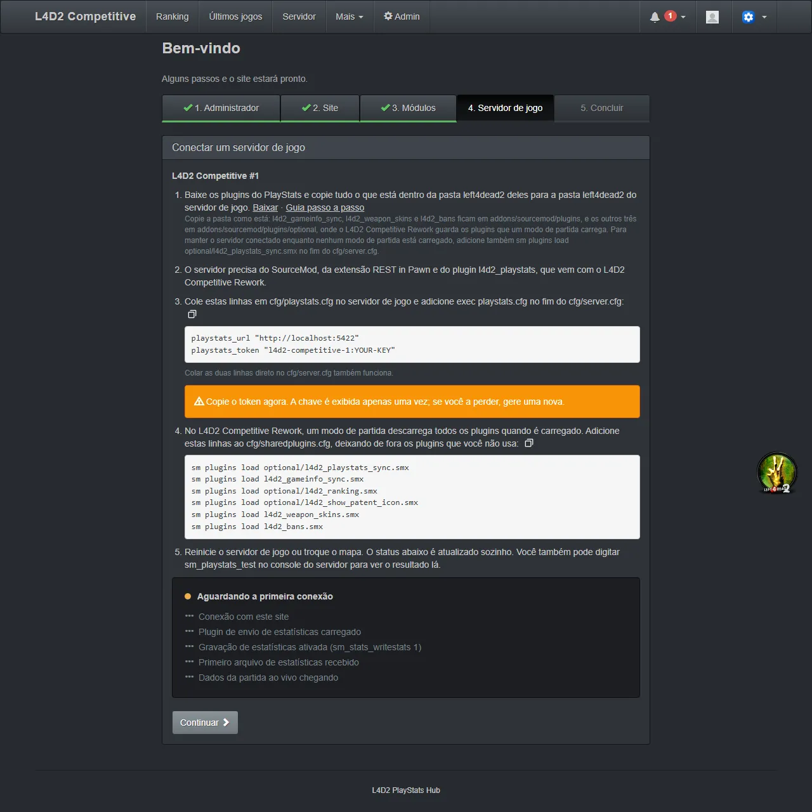
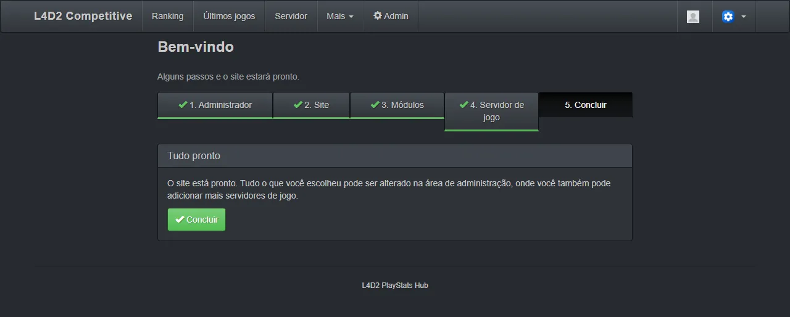
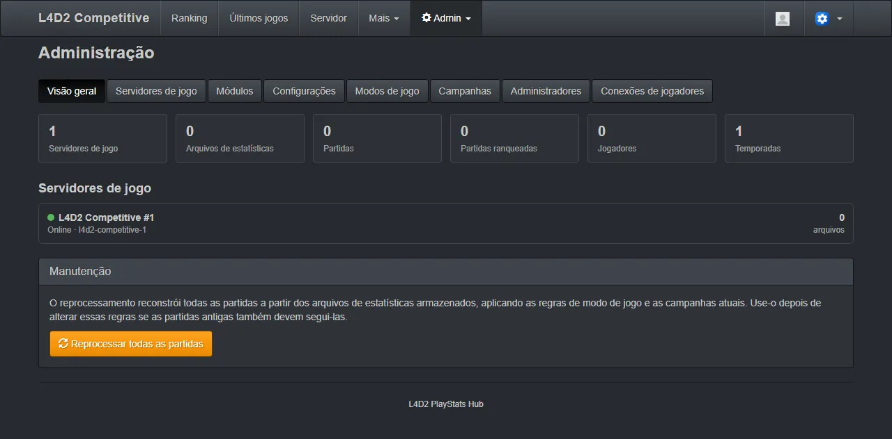
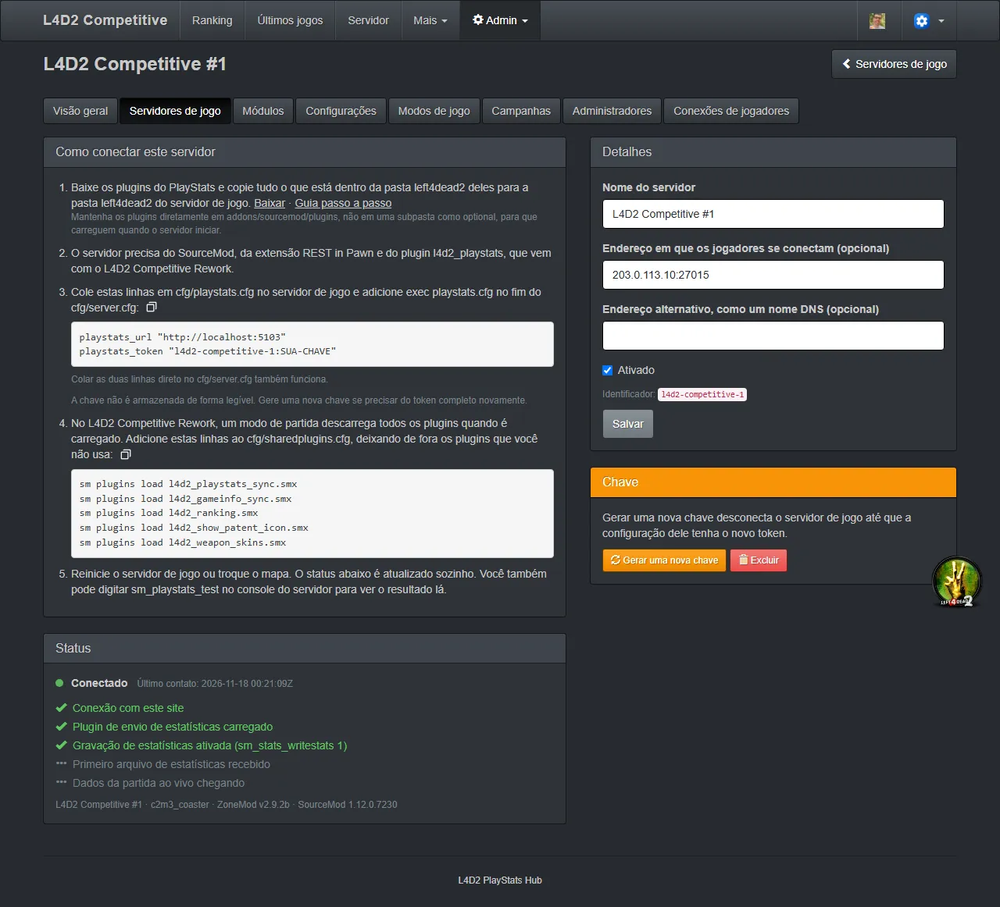

# Configuração inicial

🌐 [English](first-run.md) | **Português** | [Español](first-run.es.md)

Depois da instalação, o site abre um assistente de instalação. Ele roda uma única vez. Ele torna a sua conta Steam o primeiro administrador, pede as configurações básicas e cadastra o seu primeiro servidor de jogo. Tudo o que for escolhido aqui pode ser alterado depois na [área de administração](administration.pt.md).

[Voltar ao manual](README.pt.md)

## Conteúdo

- [Antes de começar](#antes-de-começar)
- [Passo 1: o código de configuração](#passo-1-o-código-de-configuração)
- [Passo 2: o site](#passo-2-o-site)
- [Passo 3: os módulos](#passo-3-os-módulos)
- [Passo 4: o servidor de jogo](#passo-4-o-servidor-de-jogo)
- [Passo 5: concluir](#passo-5-concluir)
- [O status da conexão](#o-status-da-conexão)
- [Se você parar no meio](#se-você-parar-no-meio)

## Antes de começar

Você precisa de:

- o endereço do site e o **código de configuração**, os dois mostrados pelo instalador ([Linux](../install-linux.pt.md#passo-2-execute-o-instalador), [Docker](../install-docker.pt.md#o-código-de-configuração));
- a conta Steam que será a administradora;
- acesso aos arquivos do seu servidor de jogo, para colar duas linhas na configuração dele e copiar os plugins.

Enquanto a configuração não for concluída, todas as páginas do site levam ao assistente.

## Passo 1: o código de configuração

Cole o código de configuração e clique em **Continuar com o Steam**. A Steam pede que você faça login e manda você de volta para o site.

A conta Steam com que você faz login se torna o primeiro administrador. Depois disso, o código deixa de funcionar, e só a sua conta pode continuar a configuração.

O código pode ser mostrado de novo com `playstats-hub setup-code` no Linux, ou no log da aplicação (`docker compose logs hub | grep "setup code"`). Ele também fica salvo no arquivo `setup-code.txt` na pasta de dados.

## Passo 2: o site

| Campo | O que faz |
|---|---|
| Nome do site | Aparece no menu (quando não há logo), no título das páginas e nas páginas dentro do jogo. |
| Logo do site (opcional) | Uma imagem mostrada no menu no lugar do nome. PNG, JPG, WEBP ou GIF, de até 1 MB. |
| Idioma padrão | O idioma de um visitante que ainda não escolheu um. Cada visitante pode mudar o idioma no menu. |
| Fuso horário | O relógio usado nas datas do site e no início e no fim de cada temporada. Escolha o fuso horário da sua comunidade. |
| Duração da temporada, em meses | Quanto tempo dura uma temporada, de 1 a 24 meses. O ranking recomeça a cada temporada. Veja [Temporadas e histórico](seasons-and-history.pt.md). |
| Chave da Steam Web API (opcional) | Os avatares e os nomes dos jogadores carregam sem ela. Com uma chave, eles carregam mais rápido. Você obtém uma chave em [steamcommunity.com/dev/apikey](https://steamcommunity.com/dev/apikey). |

## Passo 3: os módulos

Escolha o que o site vai ter. Cada módulo é explicado em [Administração > Módulos](administration.pt.md#módulos). Se estiver em dúvida, mantenha o padrão: o ranking e o servidor ao vivo ficam ligados, o resto fica desligado, e você pode ligar outros recursos depois.

## Passo 4: o servidor de jogo

Dê ao servidor de jogo um nome, como os jogadores o conhecem. O endereço em que os jogadores se conectam é opcional: quando ele é preenchido, a página do servidor ao vivo o mostra com um botão de copiar e um comando `connect`. **Pular por enquanto** vai para o último passo sem servidor; você pode adicionar um depois.

Clique em **Criar**. O site cria um identificador e uma chave para o servidor e mostra o que fazer no servidor de jogo.

1. Baixe os plugins e copie-os para o servidor de jogo. [Conectando um servidor de jogo](../game-server.pt.md) explica para onde vai cada arquivo.
2. O servidor de jogo precisa do SourceMod, da extensão REST in Pawn e do plugin `l4d2_playstats`, que vem com o L4D2 Competitive Rework.
3. Cole as duas linhas no `cfg/server.cfg` do servidor de jogo. A primeira linha é o endereço do site; a segunda é o token deste servidor.
4. Reinicie o servidor de jogo ou troque o mapa.

**Copie o token agora.** A chave aparece só uma vez. O site guarda só um hash dela, então não consegue mostrá-la de novo. Se você a perder, gere uma nova chave na página do servidor em [Administração > Servidores de jogo](administration.pt.md#servidores-de-jogo).

Embaixo das instruções, o painel mostra o [status da conexão](#o-status-da-conexão) do servidor: **Aguardando a primeira conexão** até o servidor de jogo chegar ao site.

Você não precisa esperar. Clique em **Continuar** para ir ao último passo. As mesmas instruções e o mesmo status estão na página do servidor em [Administração > Servidores de jogo](administration.pt.md#servidores-de-jogo), onde você pode acompanhar a conexão depois da configuração.

## Passo 5: concluir

Clique em **Concluir**. O site abre a sua primeira página. Até a primeira partida ranqueada ser jogada, o ranking fica vazio:

A partir daqui:

- adicione mais servidores de jogo em [Administração > Servidores de jogo](administration.pt.md#servidores-de-jogo);
- confira quais modos de jogo contam para o ranking em [Modos de jogo e campanhas](game-modes-and-campaigns.pt.md);
- adicione outros administradores em [Administração > Administradores](administration.pt.md#administradores).

## O status da conexão

O mesmo painel aparece no assistente e na página de cada servidor de jogo na área de administração. Ele mostra o estado da conexão e uma lista de verificação, e na página do servidor se atualiza sozinho a cada 3 segundos. Esta é a página do servidor criado acima, alguns segundos depois que o servidor de jogo enviou o primeiro sinal:

| Estado | Significado |
|---|---|
| Aguardando a primeira conexão | O site nunca recebeu nada deste servidor. |
| Conectado | O servidor enviou um sinal nos últimos 90 segundos. |
| Offline | O servidor já esteve conectado. O painel mostra o último contato. |
| Chave inválida | Nos últimos 10 minutos, chegou uma requisição com o identificador deste servidor e uma chave errada. |

| Verificação | Fica verde quando |
|---|---|
| Conexão com este site | O servidor está conectado agora. Fica vermelha quando o servidor já foi visto antes e agora está offline. |
| Plugin de envio de estatísticas carregado | O `l4d2_playstats_sync` está carregado no servidor. |
| Gravação de estatísticas ativada (sm_stats_writestats 1) | O servidor grava arquivos de estatísticas. |
| Primeiro arquivo de estatísticas recebido | Chegou pelo menos um arquivo de estatísticas. O número de arquivos é mostrado. |
| Dados da partida ao vivo chegando | Os dados do servidor ao vivo chegaram pelo menos uma vez. Só aparece com o módulo do servidor ao vivo. |
| Plugin de skins de armas carregado | O `l4d2_weapon_skins` está carregado. Só aparece com o módulo da loja de skins. |

As mesmas verificações podem ser feitas pelo console do servidor de jogo com `sm_playstats_test`. [Conectando um servidor de jogo](../game-server.pt.md) diz o que fazer em cada problema.

## Se você parar no meio

Depois que a sua conta é a administradora, o código de configuração não é mais necessário. Abra o site de novo e faça login com a mesma conta Steam: o assistente abre no passo do site, com o que você já salvou preenchido. Passe pelos passos de novo com **Continuar**. Um servidor de jogo que você já criou continua cadastrado; você não precisa criá-lo duas vezes.

Qualquer outra pessoa que abrir o site antes de você terminar vê uma página dizendo que a configuração está em andamento.
