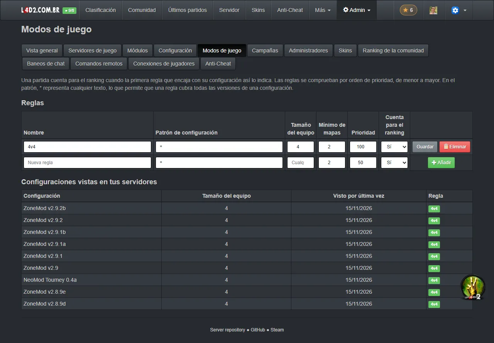
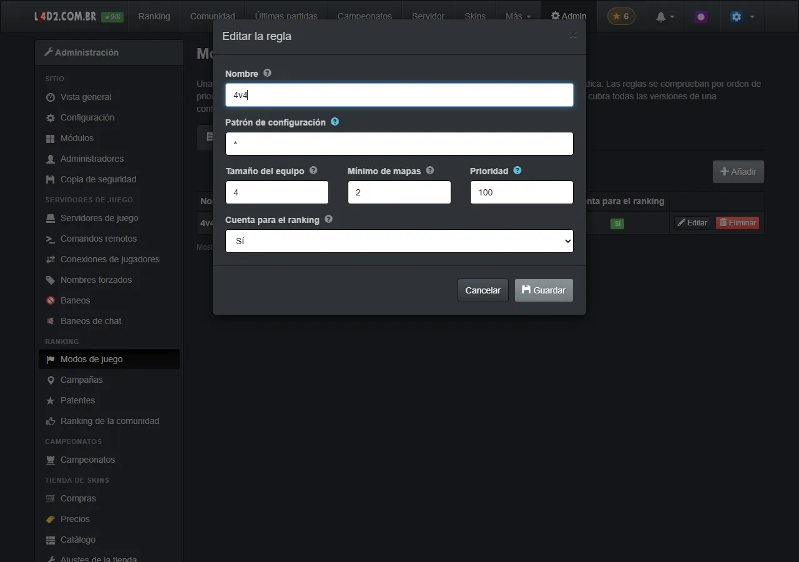
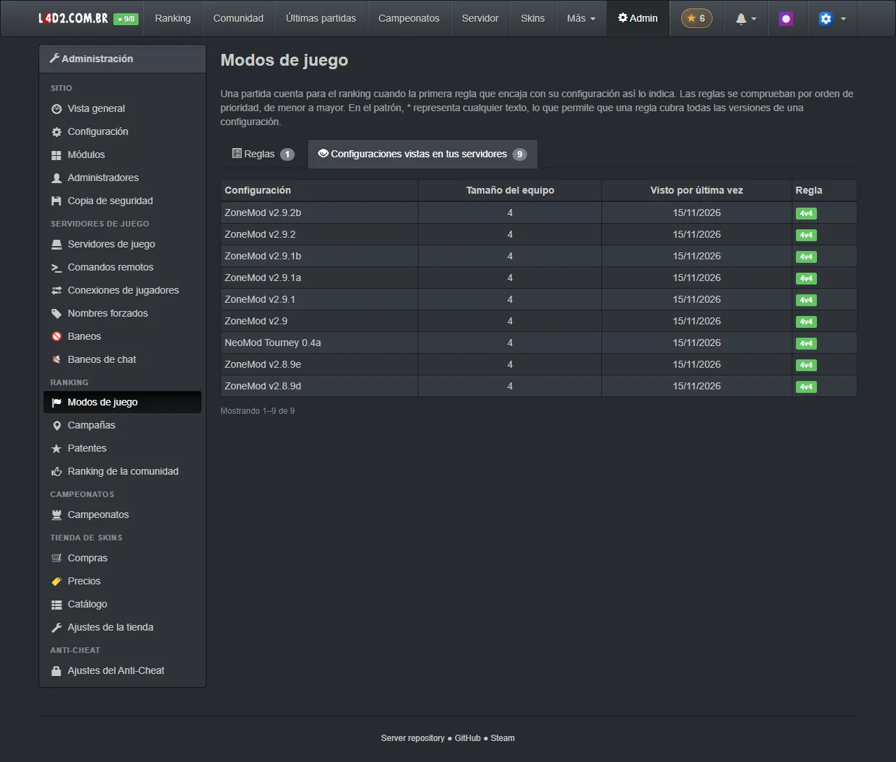
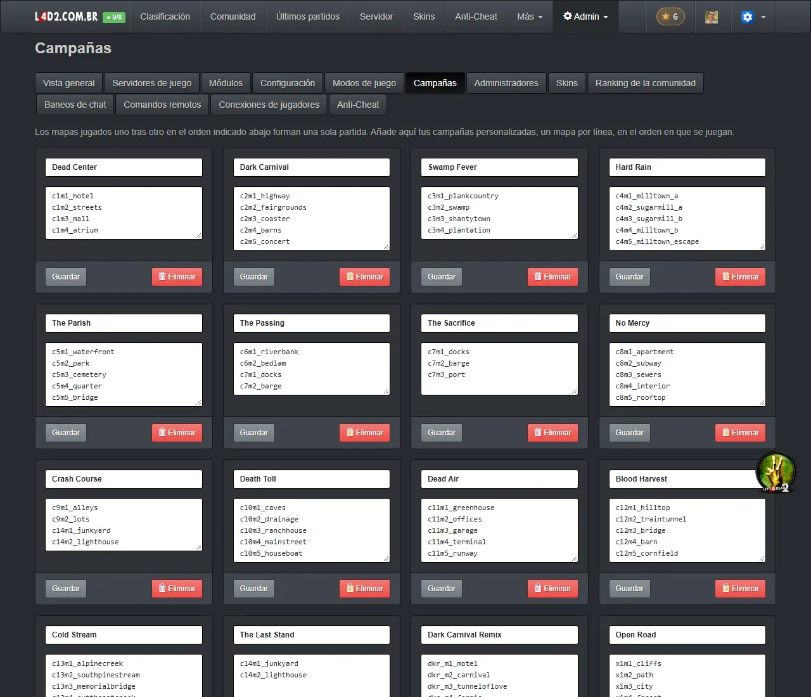
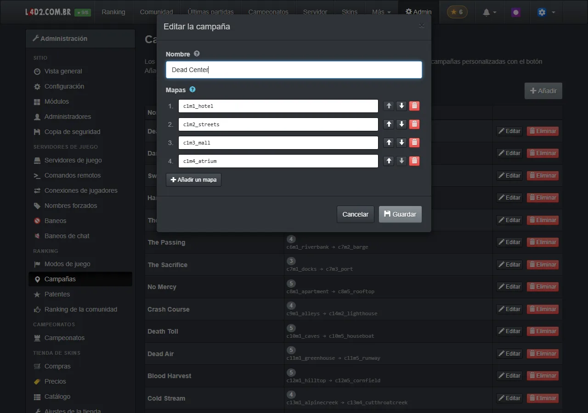

# Modos de juego y campañas

🌐 [English](game-modes-and-campaigns.md) | [Português](game-modes-and-campaigns.pt.md) | **Español**

Dos páginas de administración deciden cómo los archivos de estadísticas se convierten en partidas del ranking:

- **Modos de juego** deciden qué partidas cuentan para el ranking.
- **Campañas** deciden qué mapas, jugados uno tras otro, forman una partida.

[Volver al manual](README.es.md)

## Contenido

- [Modos de juego](#modos-de-juego)
- [Cómo escribir las reglas](#cómo-escribir-las-reglas)
- [Ejemplos](#ejemplos)
- [Campañas](#campañas)
- [Aplicar los cambios a las partidas antiguas](#aplicar-los-cambios-a-las-partidas-antiguas)

## Modos de juego

Cada archivo de estadísticas lleva el nombre de la configuración que ejecutaba el servidor, como `ZoneMod v2.9.2b`, y el tamaño del equipo. El sitio registra cada configuración que recibe y las lista en la pestaña **Configuraciones vistas en tus servidores**, 20 por página, con la regla que se aplica a cada una.

La pestaña **Reglas** lista las reglas, 20 por página, en orden de prioridad. El botón **Añadir**, encima de la lista a la derecha, abre una ventana con los campos de una regla nueva; **Editar**, en cada fila, abre la misma ventana con los datos de esa regla, y **Guardar** guarda los cambios. **Eliminar** borra una regla después de una confirmación. Una regla tiene:

| Campo | Significado |
|---|---|
| Nombre | Una etiqueta para ti, como `4v4` o `1v1 practice`. |
| Patrón de configuración | Los nombres de configuración que cubre la regla. `*` representa cualquier texto y `?` un carácter. Las mayúsculas y minúsculas no importan. `*` por sí solo cubre todas las configuraciones. |
| Tamaño del equipo | La cantidad de jugadores por equipo que cubre la regla, o **Cualquiera**. |
| Mínimo de mapas | Cuántos mapas necesita una partida para contar. Como mínimo 1. |
| Prioridad | El orden en que se revisan las reglas, de menor a mayor. |
| Cuenta para el ranking | Si las partidas que cubre la regla entran en el ranking. |

Para cada partida, el sitio toma la **primera regla que encaja** con su configuración y su tamaño de equipo, en orden de prioridad:

- si esa regla cuenta para el ranking y la partida tiene al menos su mínimo de mapas, la partida es **Competitiva** y cuenta;
- si esa regla no cuenta, o la partida es demasiado corta, la partida es **Casual**;
- si ninguna regla encaja, la partida es **Casual**, y la vista general del área de administración te avisa sobre esa configuración.

Un sitio nuevo tiene una regla: **4v4**, patrón `*`, tamaño de equipo 4, mínimo 2 mapas, cuenta para el ranking, prioridad 100. Pone en el ranking todas las partidas 4v4 de dos mapas o más, sea cual sea la configuración.

## Cómo escribir las reglas

- Pon primero las reglas específicas (número de prioridad bajo) y al final las generales.
- Una regla que **no** cuenta sirve para excluir algo que una regla general cubriría, como una configuración de práctica.
- La lista **Configuraciones vistas en tus servidores** muestra, para cada nombre de configuración y tamaño de equipo, cuándo se vio por última vez y qué regla se aplica, o **Sin regla: fuera del ranking**. Úsala para revisar tus reglas después de un cambio.

## Ejemplos

| Objetivo | Reglas, en orden de prioridad |
|---|---|
| Poner en el ranking todas las partidas 4v4 de 2 mapas o más (lo predeterminado). | `4v4`: patrón `*`, tamaño de equipo 4, mínimo 2, cuenta. |
| Poner en el ranking solo ZoneMod, de cualquier versión. | `ZoneMod`: patrón `ZoneMod*`, tamaño de equipo 4, mínimo 2, cuenta. Elimina o desactiva la regla predeterminada. |
| Poner en el ranking el 4v4, excepto una configuración de práctica. | 1. `Practice`: patrón `*Practice*`, cualquier tamaño de equipo, no cuenta. 2. `4v4`: patrón `*`, tamaño de equipo 4, mínimo 2, cuenta. |
| Poner en el ranking también el 3v3, con una campaña completa. | Agrega `3v3`: patrón `*`, tamaño de equipo 3, mínimo 4, cuenta. |

## Campañas

La lista de campañas da, para cada campaña, sus mapas en el orden en que se juegan. Los mapas de una misma campaña jugados en ese orden forman una partida; consulta [Partidas > Cómo los archivos se convierten en partidas](matches.es.md#cómo-los-archivos-se-convierten-en-partidas).

La lista muestra cada campaña, 20 por página, con la cantidad de mapas y el primero y el último. Un sitio nuevo viene con 35 campañas: las oficiales y algunas personalizadas conocidas, como Open Road, Detour Ahead y Suicide Blitz 2. Para agregar una campaña personalizada:

1. Haz clic en **Añadir**, encima de la lista a la derecha. Se abre una ventana.
2. Escribe el nombre de la campaña tal como lo conocen los jugadores.
3. Haz clic en **Añadir un mapa** por cada mapa y escríbelo con el nombre que usa el servidor (como `c1m1_hotel`). Las flechas suben o bajan un mapa, para que la lista siga el orden de juego, y el botón de la papelera lo quita.
4. Haz clic en **Guardar**.

**Editar**, en cada fila, abre la misma ventana con el nombre y los mapas de esa campaña. **Eliminar** la borra después de una confirmación. El nombre de la campaña es lo que muestran la lista de partidas y las páginas de los jugadores.

Los mapas que no están en ninguna campaña se conservan como mapas desconocidos de forma predeterminada. La opción está en [Configuración > Puntos del ranking](administration.es.md#puntos-del-ranking).

## Aplicar los cambios a las partidas antiguas

Un cambio en los modos de juego o en las campañas se aplica a los archivos que llegan desde ese momento. Para aplicarlo a todas las partidas ya construidas, usa **Reprocesar todas las partidas** en [Administración > Vista general](administration.es.md#vista-general).
