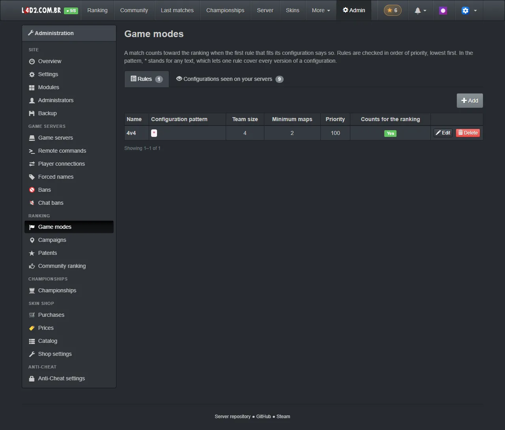
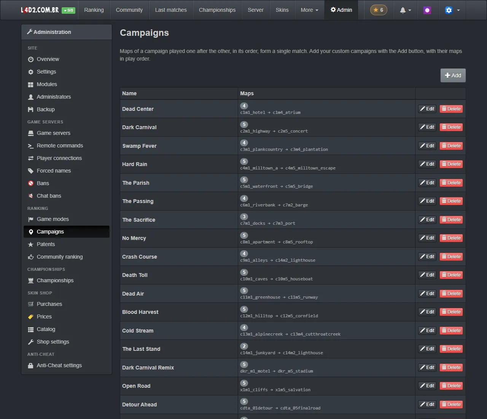

# Game modes and campaigns

🌐 **English** | [Português](game-modes-and-campaigns.pt.md) | [Español](game-modes-and-campaigns.es.md)

Two administration pages decide how statistics files become ranked matches:

- **Game modes** decide which matches count for the ranking.
- **Campaigns** decide which maps, played one after the other, make one match.

[Back to the manual](README.md)

## Contents

- [Game modes](#game-modes)
- [Writing rules](#writing-rules)
- [Examples](#examples)
- [Campaigns](#campaigns)
- [Applying changes to old matches](#applying-changes-to-old-matches)

## Game modes

Every statistics file carries the name of the configuration the server was running, such as `ZoneMod v2.9.2b`, and the team size. The site records every configuration it receives and lists them in the **Configurations seen on your servers** tab, 20 per page, with the rule that applies to each one.

The **Rules** tab lists the rules, 20 per page, in order of priority. The **Add** button, above the list on the right, opens a window with the fields of a new rule; **Edit**, on each row, opens the same window filled in with that rule, and **Save** keeps the changes. **Delete** removes a rule after a confirmation. A rule has:

| Field | Meaning |
|---|---|
| Name | A label for you, such as `4v4` or `1v1 practice`. |
| Configuration pattern | The configuration names the rule covers. `*` stands for any text and `?` for one character. Upper and lower case do not matter. `*` alone covers every configuration. |
| Team size | The number of players per team the rule covers, or **Any**. |
| Minimum maps | How many maps a match needs to count. At least 1. |
| Priority | The order in which rules are checked, lowest first. |
| Counts for the ranking | Whether matches covered by the rule are ranked. |

For each match, the site takes the **first rule that fits** its configuration and team size, in order of priority:

- if that rule counts for the ranking and the match has at least its minimum maps, the match is **Competitive** and counts;
- if that rule does not count, or the match is too short, the match is **Casual**;
- if no rule fits, the match is **Casual**, and the overview of the administration area warns you about that configuration.

A new site has one rule: **4v4**, pattern `*`, team size 4, minimum 2 maps, counts for the ranking, priority 100. It ranks every 4v4 match of two maps or more, whatever the configuration.

## Writing rules

- Put the specific rules first (low priority number) and the general ones last.
- A rule that does **not** count is useful to exclude something a general rule would cover, such as a practice configuration.
- The list **Configurations seen on your servers** shows, for each configuration name and team size, when it was last seen and which rule applies, or **No rule: not ranked**. Use it to check your rules after a change.

## Examples

| Goal | Rules, in order of priority |
|---|---|
| Rank every 4v4 match of 2 maps or more (the default). | `4v4`: pattern `*`, team size 4, minimum 2, counts. |
| Rank only ZoneMod, any version. | `ZoneMod`: pattern `ZoneMod*`, team size 4, minimum 2, counts. Remove or turn off the default rule. |
| Rank 4v4 except one practice configuration. | 1. `Practice`: pattern `*Practice*`, any team size, does not count. 2. `4v4`: pattern `*`, team size 4, minimum 2, counts. |
| Also rank 3v3, with a whole campaign. | Add `3v3`: pattern `*`, team size 3, minimum 4, counts. |

## Campaigns

The campaign list gives, for each campaign, its maps in the order they are played. Maps of the same campaign played in that order make one match; see [Matches > How files become matches](matches.md#how-files-become-matches).

The list shows each campaign, 20 per page, with the number of maps and the first and the last one. A new site comes with 35 campaigns: the official ones and well-known custom ones such as Open Road, Detour Ahead and Suicide Blitz 2. To add a custom campaign:

1. Click **Add**, above the list on the right. A window opens.
2. Write the name of the campaign as players know it.
3. Click **Add a map** for each map and write it with the name the server uses (such as `c1m1_hotel`). The arrows move a map up or down, so the list follows the play order, and the trash button removes it.
4. Click **Save**.

**Edit**, on each row, opens the same window with the name and the maps of that campaign. **Delete** removes it after a confirmation. The name of the campaign is what the match list and the player pages show.

Maps that are in no campaign are kept as unknown maps by default. The option is in [Settings > Ranking points](administration.md#ranking-points).

## Applying changes to old matches

A change to the game modes or to the campaigns applies to files that arrive from then on. To apply it to every match already built, use **Reprocess all matches** in [Administration > Overview](administration.md#overview).
