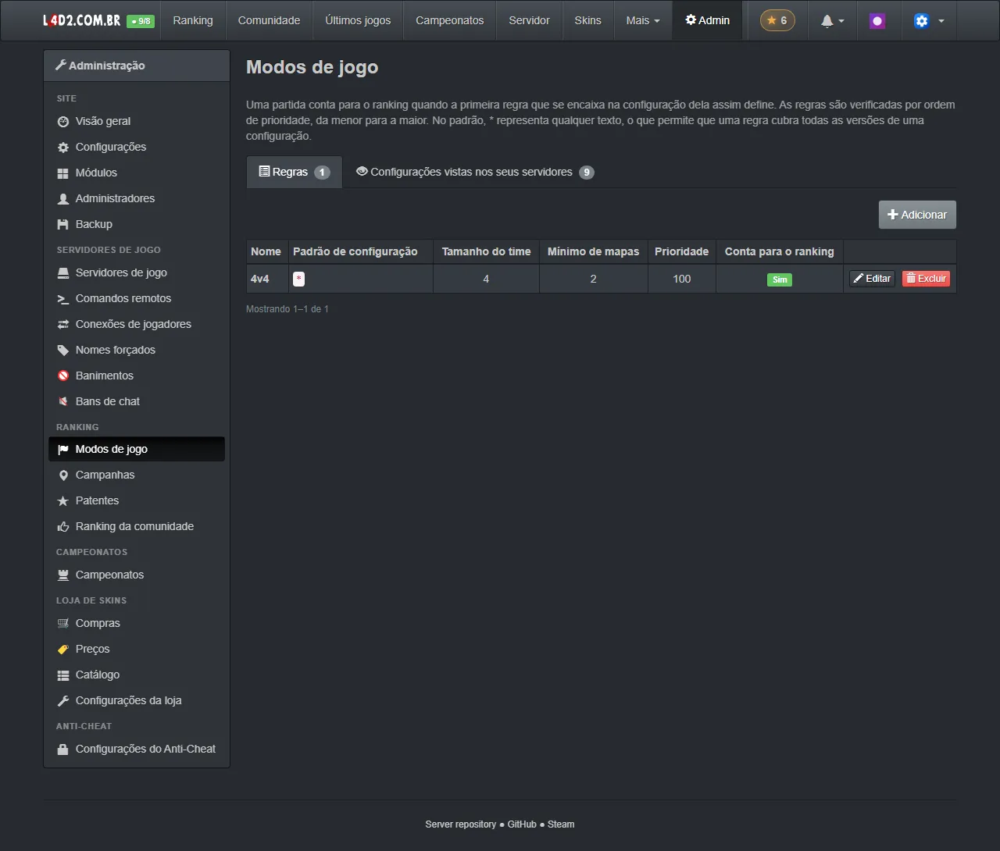
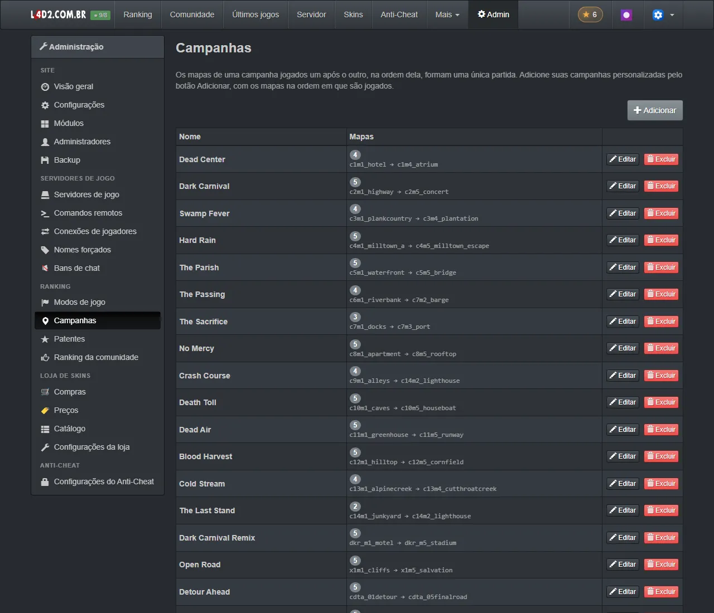

# Modos de jogo e campanhas

🌐 [English](game-modes-and-campaigns.md) | **Português** | [Español](game-modes-and-campaigns.es.md)

Duas páginas da administração decidem como os arquivos de estatísticas viram partidas ranqueadas:

- **Modos de jogo** decidem quais partidas contam para o ranking.
- **Campanhas** decidem quais mapas, jogados um depois do outro, formam uma partida.

[Voltar ao manual](README.pt.md)

## Conteúdo

- [Modos de jogo](#modos-de-jogo)
- [Escrevendo regras](#escrevendo-regras)
- [Exemplos](#exemplos)
- [Campanhas](#campanhas)
- [Aplicando mudanças às partidas antigas](#aplicando-mudanças-às-partidas-antigas)

## Modos de jogo

Todo arquivo de estatísticas traz o nome da configuração que o servidor estava rodando, como `ZoneMod v2.9.2b`, e o tamanho do time. O site registra todas as configurações que recebe e as lista no fim da página, com a regra que vale para cada uma.

Uma regra tem:

| Campo | Significado |
|---|---|
| Nome | Um rótulo para você, como `4v4` ou `1v1 practice`. |
| Padrão de configuração | Os nomes de configuração que a regra cobre. `*` representa qualquer texto e `?` um caractere. Maiúsculas e minúsculas não importam. `*` sozinho cobre todas as configurações. |
| Tamanho do time | O número de jogadores por time que a regra cobre, ou **Qualquer**. |
| Mínimo de mapas | Quantos mapas uma partida precisa ter para contar. No mínimo 1. |
| Prioridade | A ordem em que as regras são verificadas, da menor para a maior. |
| Conta para o ranking | Se as partidas cobertas pela regra são ranqueadas. |

Para cada partida, o site pega a **primeira regra que se encaixa** na configuração e no tamanho do time dela, por ordem de prioridade:

- se essa regra conta para o ranking e a partida tem pelo menos o mínimo de mapas dela, a partida é **Competitiva** e conta;
- se essa regra não conta, ou a partida é curta demais, a partida é **Casual**;
- se nenhuma regra se encaixa, a partida é **Casual**, e a visão geral da área de administração avisa sobre essa configuração.

Um site novo tem uma regra: **4v4**, padrão `*`, tamanho do time 4, mínimo de 2 mapas, conta para o ranking, prioridade 100. Ela ranqueia toda partida 4v4 de dois mapas ou mais, seja qual for a configuração.

## Escrevendo regras

- Coloque as regras específicas primeiro (número de prioridade baixo) e as gerais por último.
- Uma regra que **não** conta serve para excluir algo que uma regra geral cobriria, como uma configuração de treino.
- A lista **Configurações vistas nos seus servidores** mostra, para cada nome de configuração e tamanho de time, quando ela foi vista por último e qual regra vale, ou **Sem regra: fora do ranking**. Use-a para conferir as suas regras depois de uma mudança.

## Exemplos

| Objetivo | Regras, por ordem de prioridade |
|---|---|
| Ranquear toda partida 4v4 de 2 mapas ou mais (o padrão). | `4v4`: padrão `*`, tamanho do time 4, mínimo 2, conta. |
| Ranquear só o ZoneMod, de qualquer versão. | `ZoneMod`: padrão `ZoneMod*`, tamanho do time 4, mínimo 2, conta. Remova ou desligue a regra padrão. |
| Ranquear 4v4, menos uma configuração de treino. | 1. `Practice`: padrão `*Practice*`, qualquer tamanho de time, não conta. 2. `4v4`: padrão `*`, tamanho do time 4, mínimo 2, conta. |
| Ranquear também 3v3, com uma campanha inteira. | Adicione `3v3`: padrão `*`, tamanho do time 3, mínimo 4, conta. |

## Campanhas

A lista de campanhas dá, para cada campanha, os mapas dela na ordem em que são jogados. Mapas da mesma campanha jogados nessa ordem formam uma partida; veja [Partidas > Como os arquivos viram partidas](matches.pt.md#como-os-arquivos-viram-partidas).

Um site novo vem com 35 campanhas: as oficiais e campanhas personalizadas conhecidas, como Open Road, Detour Ahead e Suicide Blitz 2. Para adicionar uma campanha personalizada:

1. Em **Nova campanha**, escreva o nome dela como os jogadores a conhecem.
2. Escreva os mapas dela, um por linha, na ordem de jogo, com os nomes de mapa que o servidor usa (como `c1m1_hotel`).
3. Clique em **Adicionar**.

Cada campanha pode ser editada ou excluída na mesma página. O nome da campanha é o que a lista de partidas e as páginas dos jogadores mostram.

Mapas que não estão em nenhuma campanha são mantidos como mapas desconhecidos por padrão. A opção fica em [Configurações > Pontos do ranking](administration.pt.md#pontos-do-ranking).

## Aplicando mudanças às partidas antigas

Uma mudança nos modos de jogo ou nas campanhas vale para os arquivos que chegarem a partir de então. Para aplicá-la a todas as partidas já montadas, use **Reprocessar todas as partidas** em [Administração > Visão geral](administration.pt.md#visão-geral).
