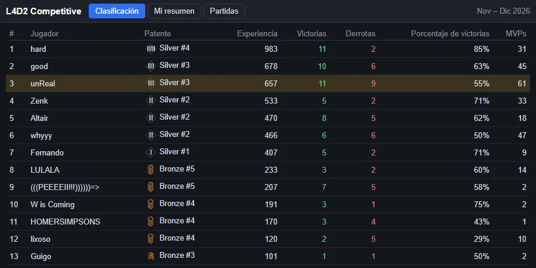
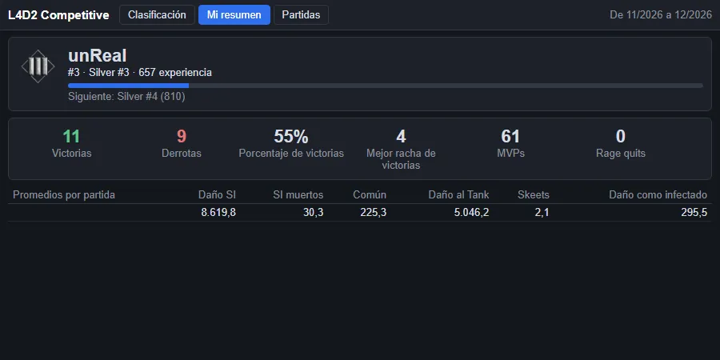
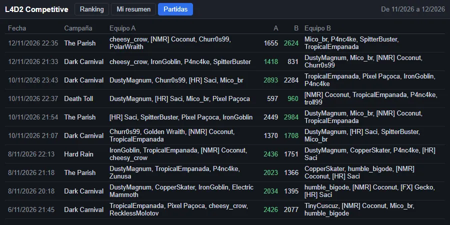
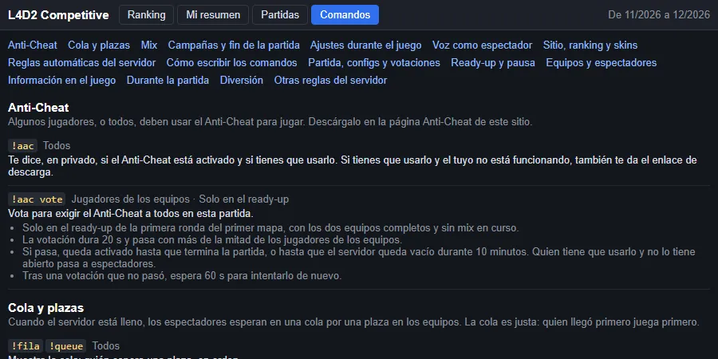

# Páginas dentro del juego

🌐 [English](in-game-pages.md) | [Português](in-game-pages.pt.md) | **Español**

Los jugadores pueden ver el ranking sin salir de Left 4 Dead 2. El comando de chat `!ranking` abre el sitio en el panel del propio juego: de forma predeterminada el ranking de la página de inicio o, con `ranking_motd_path "/ingame"` en el servidor de juego, la versión ligera que se describe aquí. `!comandos` y `!commands` siempre abren su página Comandos. Con el plugin `l4d2_ranking` también se abre automáticamente para los jugadores que entran antes de que empiece una partida.

[Volver al manual](README.es.md)

## Contenido

- [Las cuatro páginas](#las-cuatro-páginas)
- [Por qué se ven distintas](#por-qué-se-ven-distintas)
- [La dirección que usa el juego](#la-dirección-que-usa-el-juego)

## Las cuatro páginas

El panel tiene cuatro pestañas. Las tres primeras muestran solo la temporada actual, y solo las partidas del ranking. La barra de arriba nombra esa temporada como lo hace el sitio, por ejemplo **De 11/2026 a 12/2026**.

**Ranking**: los 50 mejores jugadores, con patente, experiencia, victorias, derrotas, porcentaje de victorias, MVP y tank wipes. La fila del jugador que abrió el panel aparece resaltada.

**Mi resumen**: la patente del jugador que abrió el panel, la experiencia y el progreso hacia la próxima patente, victorias, derrotas, porcentaje de victorias, mejor racha de victorias, MVP, tank wipes y rage quits, y los promedios por partida.

Un jugador sin ninguna partida del ranking en la temporada ve un mensaje corto en su lugar.

**Partidas**: las últimas 10 partidas del ranking de la temporada, con la fecha y la hora, la campaña, los jugadores de cada equipo y el marcador. El marcador ganador está en verde.

**Comandos**: los comandos que los jugadores pueden usar en el servidor, del mismo catálogo que la [página de comandos](commands.es.md), sin los comandos de los administradores. Una fila de enlaces arriba lleva a cada sección. Los jugadores también la abren directamente con `!comandos` o `!commands`.

Las páginas están en `/ingame`, `/ingame/player`, `/ingame/matches` y `/ingame/commands`. El juego agrega el SteamID64 del jugador a la dirección, para que el sitio sepa quién abrió el panel. También se pueden abrir en un navegador normal, por ejemplo `/ingame?steamid=76561198000000000`.

## Por qué se ven distintas

El panel del juego es un navegador de 2012, de 900 × 450 píxeles. Solo ejecuta JavaScript antiguo y le falta la mayor parte del CSS actual. Estas páginas están hechas para él: sin scripts, con ancho fijo y solo lo que cabe en una pantalla. [El navegador dentro del juego](../in-game-browser.es.md) registra lo que ese navegador soporta.

Son de solo lectura y necesitan el módulo del ranking.

## La dirección que usa el juego

No se espera que el navegador del juego abra sitios HTTPS actuales. Dale al juego una dirección HTTP simple del sitio, como `http://203.0.113.10:5080`, en el ajuste `playstats_ingame_url` del servidor de juego. Cuando está vacío, el plugin usa `playstats_url`.

- [Instalar en un VPS Linux](../install-linux.es.md#la-dirección-usada-dentro-del-juego) explica por qué el puerto sigue abierto cuando usas un dominio con HTTPS.
- [Conectar un servidor de juego](../game-server.es.md) muestra dónde va el ajuste.
