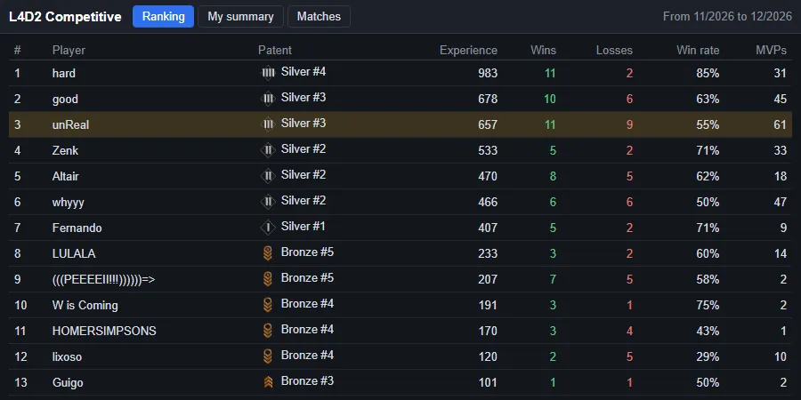
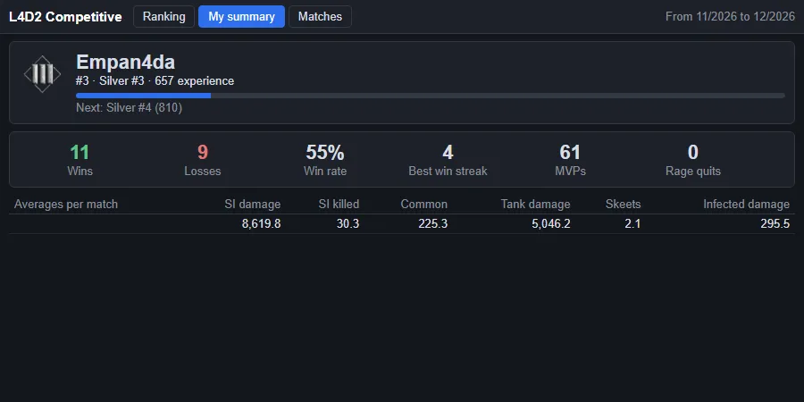
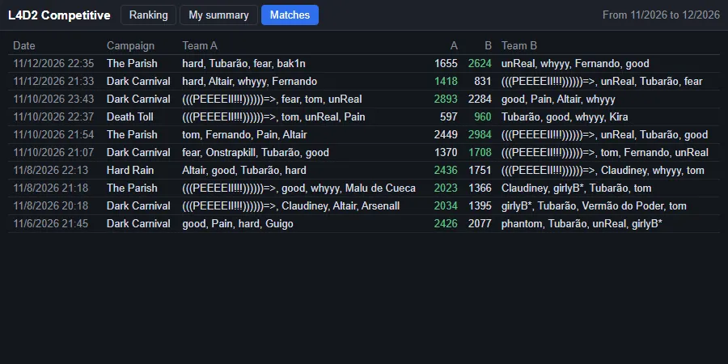

# Pages inside the game

🌐 **English** | [Português](in-game-pages.pt.md) | [Español](in-game-pages.es.md)

Players can see the ranking without leaving Left 4 Dead 2. The `!ranking` chat command opens a light version of the site in the game's own panel. With the `l4d2_ranking` plugin it also opens by itself for players who join before a match starts.

[Back to the manual](README.md)

## Contents

- [The three pages](#the-three-pages)
- [Why they look different](#why-they-look-different)
- [The address used by the game](#the-address-used-by-the-game)

## The three pages

The panel has three tabs. They show the current season only, and only ranked matches.

**Ranking**: the top 50 players, with patent, experience, wins, losses, win rate and MVPs. The row of the player who opened the panel is highlighted.

**My summary**: the patent of the player who opened the panel, the experience and the progress towards the next patent, wins, losses, win rate, best win streak, MVPs and rage quits, and the averages per match.

A player with no ranked match in the season sees a short message instead.

**Matches**: the last 10 ranked matches of the season, with the date (day/month), the campaign, the players of each team and the score. The winning score is green.

The pages are at `/ingame`, `/ingame/player` and `/ingame/matches`. The game adds the SteamID64 of the player to the address, so the site knows who opened the panel. They can be opened in a normal browser too, for example `/ingame?steamid=76561198000000000`.

## Why they look different

The panel of the game is a browser from 2012, 900 × 450 pixels. It runs old JavaScript only and lacks most of today's CSS. These pages are made for it: no script, a fixed width, and only what fits on one screen. [In-game browser](../in-game-browser.md) records what that browser supports.

They are read-only and need the ranking module.

## The address used by the game

The game's browser is not expected to open current HTTPS sites. Give the game a plain HTTP address of the site, such as `http://203.0.113.10:5080`, in the `playstats_ingame_url` setting of the game server. When it is empty, the plugin uses `playstats_url`.

- [Installing on a Linux VPS](../install-linux.md#the-address-used-inside-the-game) explains why the port stays open when you use a domain with HTTPS.
- [Connecting a game server](../game-server.md) shows where the setting goes.
