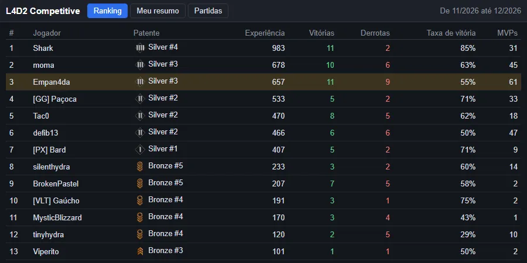
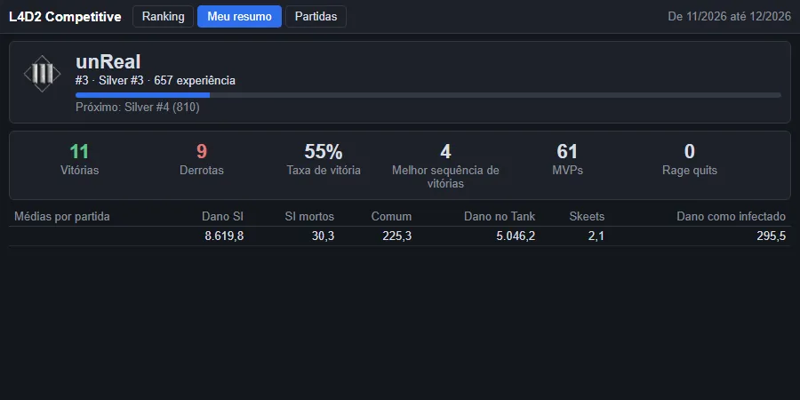
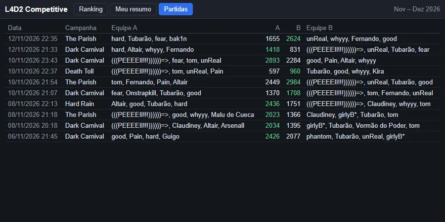

# Páginas dentro do jogo

🌐 [English](in-game-pages.md) | **Português** | [Español](in-game-pages.es.md)

Os jogadores podem ver o ranking sem sair do Left 4 Dead 2. O comando de chat `!ranking` abre uma versão leve do site no painel do próprio jogo. Com o plugin `l4d2_ranking`, ele também abre sozinho para os jogadores que entram antes de a partida começar.

[Voltar ao manual](README.pt.md)

## Conteúdo

- [As três páginas](#as-três-páginas)
- [Por que elas são diferentes](#por-que-elas-são-diferentes)
- [O endereço usado pelo jogo](#o-endereço-usado-pelo-jogo)

## As três páginas

O painel tem três abas. Elas mostram só a temporada atual, e só as partidas ranqueadas.

**Ranking**: os 50 melhores jogadores, com patente, experiência, vitórias, derrotas, taxa de vitória e MVPs. A linha do jogador que abriu o painel fica destacada.

**Meu resumo**: a patente do jogador que abriu o painel, a experiência e o progresso até a próxima patente, vitórias, derrotas, taxa de vitória, maior sequência de vitórias, MVPs e rage quits, e as médias por partida.

Um jogador sem nenhuma partida ranqueada na temporada vê uma mensagem curta no lugar.

**Partidas**: as últimas 10 partidas ranqueadas da temporada, com a data e a hora, a campanha, os jogadores de cada time e o placar. O placar vencedor fica em verde.

As páginas ficam em `/ingame`, `/ingame/player` e `/ingame/matches`. O jogo acrescenta o SteamID64 do jogador ao endereço, e assim o site sabe quem abriu o painel. Elas também podem ser abertas em um navegador comum, por exemplo `/ingame?steamid=76561198000000000`.

## Por que elas são diferentes

O painel do jogo é um navegador de 2012, com 900 × 450 pixels. Ele só roda JavaScript antigo e não tem a maior parte do CSS de hoje. Estas páginas são feitas para ele: sem script, com largura fixa e só o que cabe em uma tela. O [navegador do jogo](../in-game-browser.pt.md) registra o que esse navegador suporta.

Elas são somente leitura e precisam do módulo de ranking.

## O endereço usado pelo jogo

Não dá para esperar que o navegador do jogo abra sites HTTPS atuais. Passe para o jogo um endereço HTTP simples do site, como `http://203.0.113.10:5080`, na configuração `playstats_ingame_url` do servidor de jogo. Quando ela está vazia, o plugin usa a `playstats_url`.

- [Instalando em uma VPS Linux](../install-linux.pt.md#o-endereço-usado-dentro-do-jogo) explica por que a porta continua aberta quando você usa um domínio com HTTPS.
- [Conectando um servidor de jogo](../game-server.pt.md) mostra onde vai a configuração.
