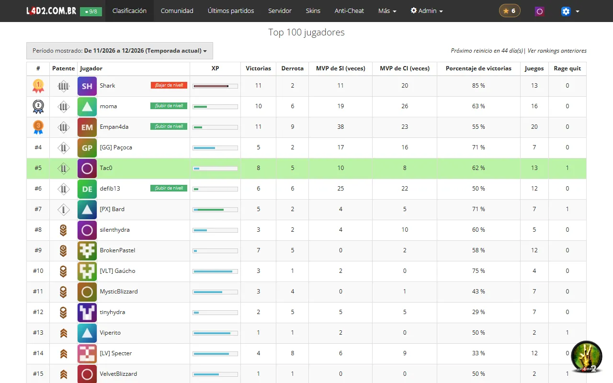
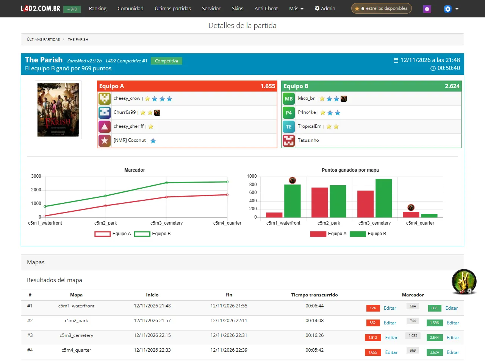
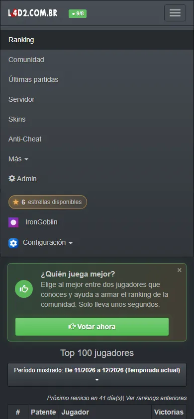
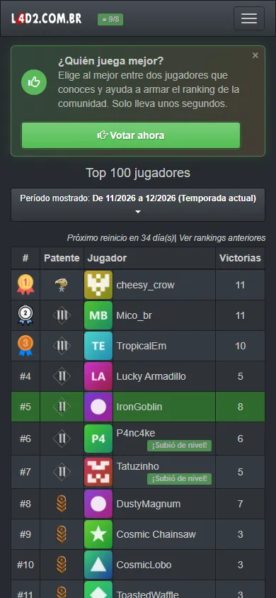
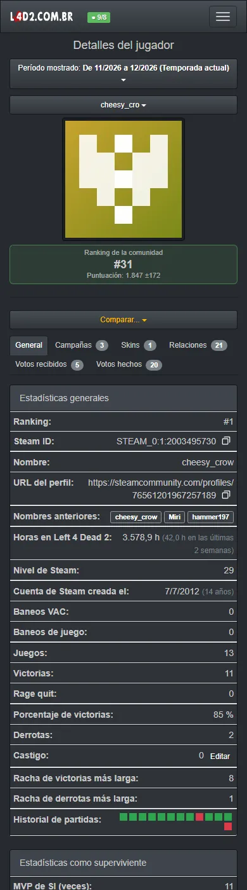
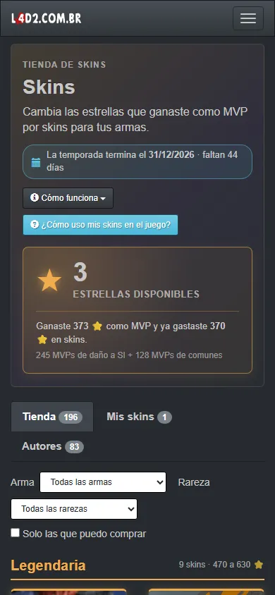

# Idiomas, temas y teléfonos

🌐 [English](languages-and-themes.md) | [Português](languages-and-themes.pt.md) | **Español**

El sitio habla tres idiomas, tiene un tema oscuro y uno claro, y funciona en un teléfono.

[Volver al manual](README.es.md)

## Contenido

- [Idiomas](#idiomas)
- [Temas](#temas)
- [En un teléfono](#en-un-teléfono)

## Idiomas

El sitio está en **inglés**, **portugués** y **español**. Todas las páginas están traducidas, incluidas el área de administración, las páginas dentro del juego y la página del Anti-Cheat.

- El visitante elige el idioma en el menú de configuración, el ícono del engranaje a la derecha de la barra del menú. La elección se recuerda en ese navegador.
- Un visitante que nunca eligió uno ve el **idioma predeterminado**, que el administrador define en [Configuración > Sitio](administration.es.md#sitio).
- Los nombres y las descripciones de las skins vienen del catálogo, que puede tener textos en varios idiomas. La tienda muestra el idioma del visitante cuando el catálogo lo tiene, y el inglés en caso contrario.
- Los nombres de los jugadores, los mensajes del chat, los motivos de los baneos y otros textos escritos por personas se muestran tal como se escribieron.

## Temas

El tema oscuro es el predeterminado. El tema claro se elige en el mismo menú de configuración, con **Cambiar a tema claro**, y se recuerda en ese navegador.

## En un teléfono

En una pantalla angosta, el menú se pliega en un botón arriba a la derecha. Tócalo para abrir el menú.

Las tablas mantienen sus columnas más importantes y ocultan las menos importantes. La página del jugador y el servidor en vivo apilan sus bloques uno debajo del otro.

