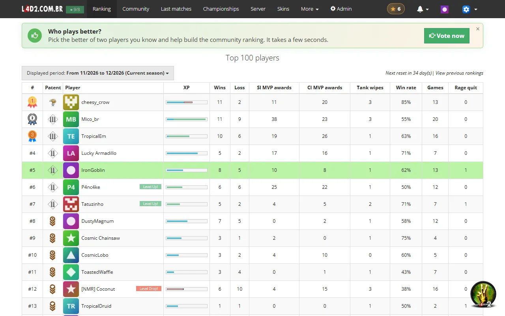
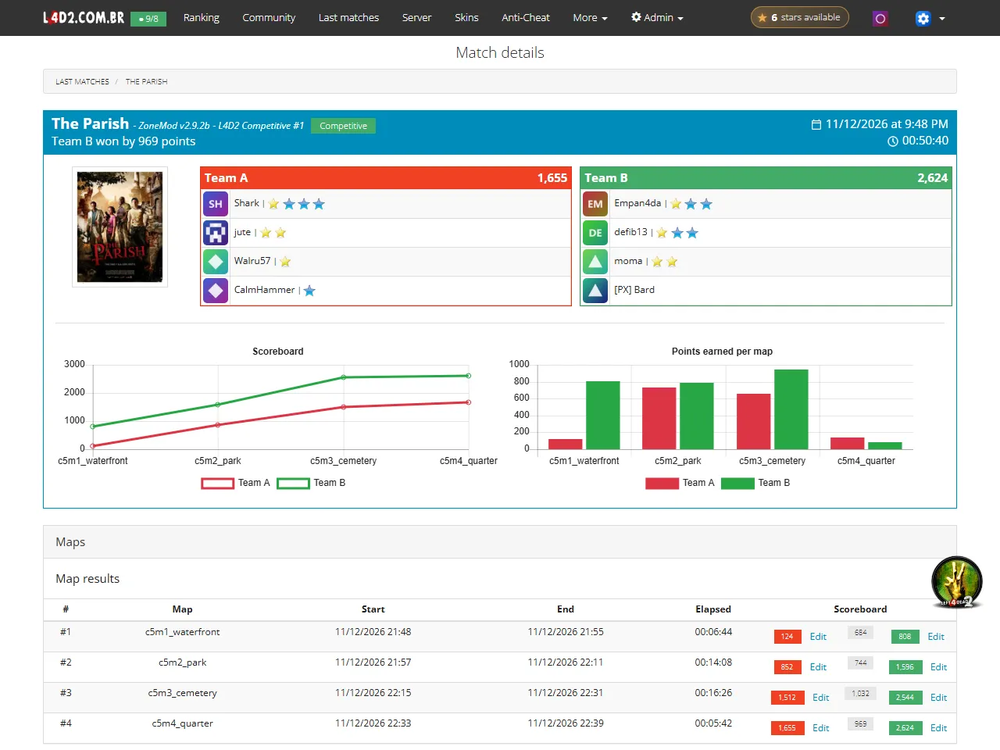
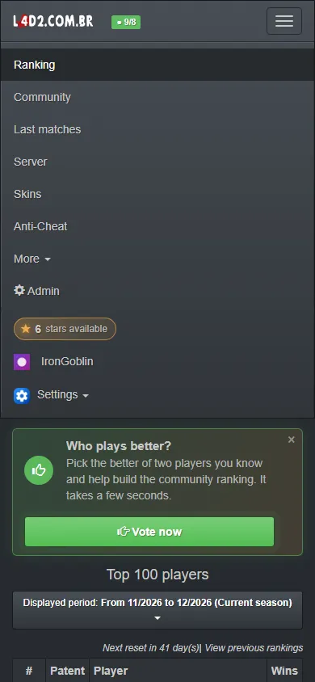
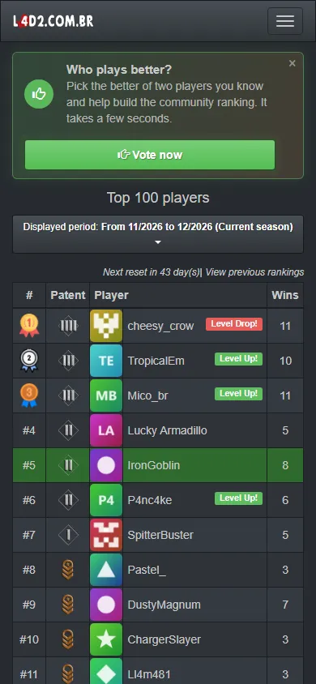
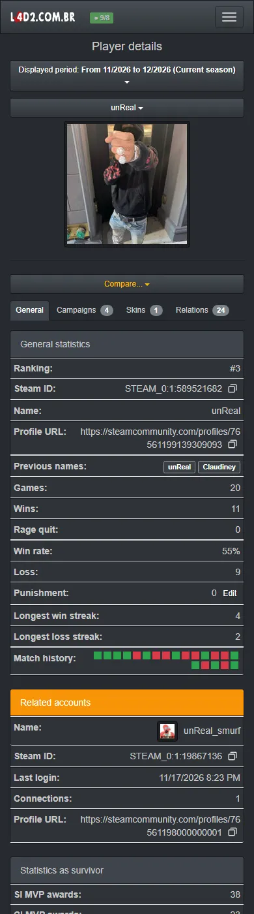
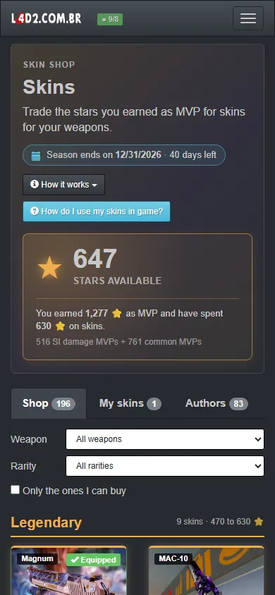

# Languages, themes and phones

🌐 **English** | [Português](languages-and-themes.pt.md) | [Español](languages-and-themes.es.md)

The site speaks three languages, has a dark and a light theme, and works on a phone.

[Back to the manual](README.md)

## Contents

- [Languages](#languages)
- [Themes](#themes)
- [On a phone](#on-a-phone)

## Languages

The site is in **English**, **Portuguese** and **Spanish**. Every page is translated, including the administration area, the pages inside the game and the Anti-Cheat page.

- A visitor chooses the language in the settings menu, the gear icon at the right of the menu bar. The choice is remembered in that browser.
- A visitor who never chose one sees the **default language**, set by the administrator in [Settings > Site](administration.md#site).
- The names and descriptions of the skins come from the catalog, which can have texts in several languages. The shop shows the visitor's language when the catalog has it, and English otherwise.
- Player names, chat messages, ban reasons and other texts written by people are shown as they were written.

## Themes

The dark theme is the default. The light theme is chosen in the same settings menu, with **Switch to light theme**, and is remembered in that browser.

## On a phone

On a narrow screen the menu folds into a button at the top right. Tap it to open the menu.

Tables keep their most important columns, and the less important ones are hidden. The player page and the live server stack their blocks one under the other.

