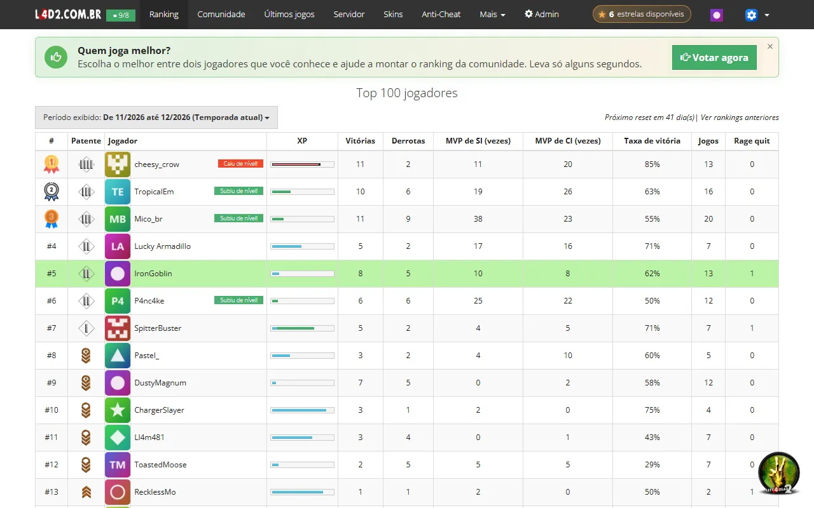
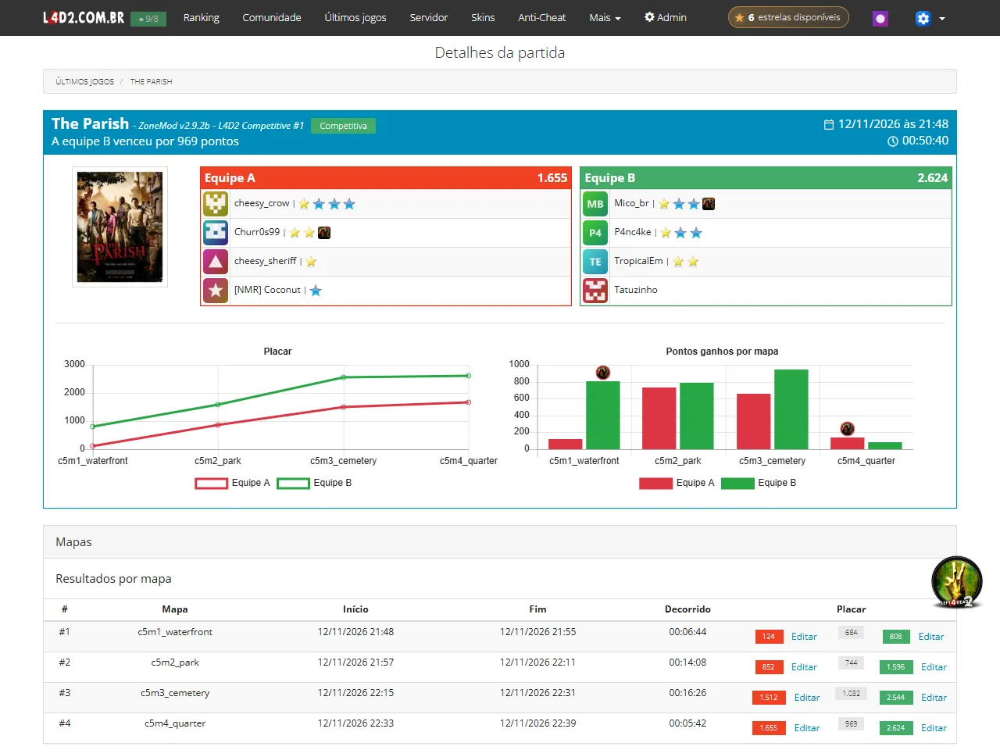
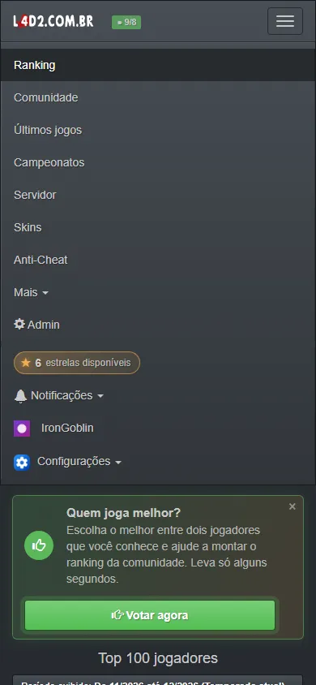
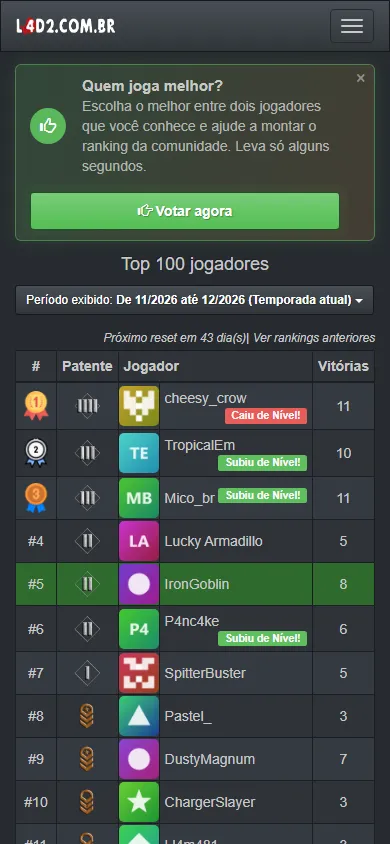
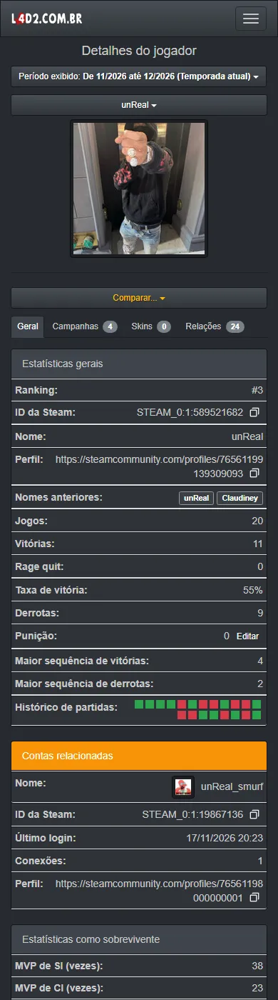
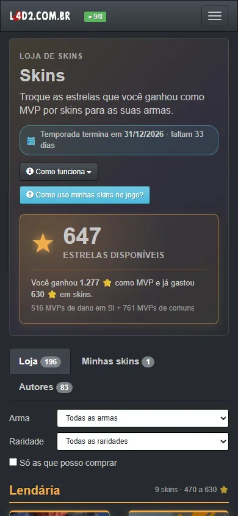
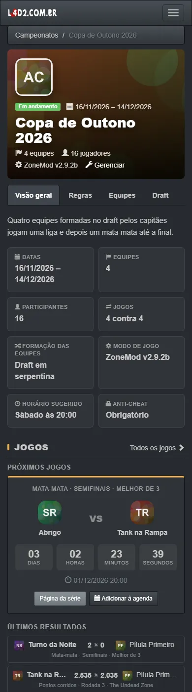

# Idiomas, temas e celulares

🌐 [English](languages-and-themes.md) | **Português** | [Español](languages-and-themes.es.md)

O site fala três idiomas, tem um tema escuro e um claro, e funciona no celular.

[Voltar ao manual](README.pt.md)

## Conteúdo

- [Idiomas](#idiomas)
- [Temas](#temas)
- [No celular](#no-celular)

## Idiomas

O site está em **inglês**, **português** e **espanhol**. Todas as páginas são traduzidas, inclusive a área de administração, as páginas dentro do jogo e a página do Anti-Cheat.

- O visitante escolhe o idioma no menu de configurações, o ícone de engrenagem à direita da barra do menu. A escolha fica salva naquele navegador.
- Um visitante que nunca escolheu um vê o **idioma padrão**, definido pelo administrador em [Configurações > Site](administration.pt.md#site).
- Os nomes e as descrições das skins vêm do catálogo, que pode ter textos em vários idiomas. A loja mostra o idioma do visitante quando o catálogo tem esse idioma, e inglês quando não tem.
- Nomes de jogadores, mensagens do chat, motivos de banimento e outros textos escritos por pessoas aparecem como foram escritos.

## Temas

O tema escuro é o padrão. O tema claro é escolhido no mesmo menu de configurações, com **Mudar para o tema claro**, e fica salvo naquele navegador.

## No celular

Em uma tela estreita, o menu se recolhe em um botão no canto superior direito. Toque nele para abrir o menu. O [menu da administração](administration.pt.md#o-menu-da-administração) se recolhe do mesmo jeito, em uma barra acima da página.

As tabelas mantêm as colunas mais importantes, e as menos importantes ficam escondidas. A página do jogador e o servidor ao vivo empilham os blocos um embaixo do outro.

