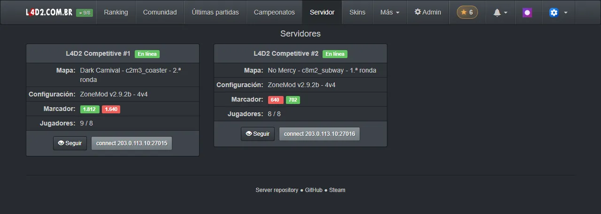
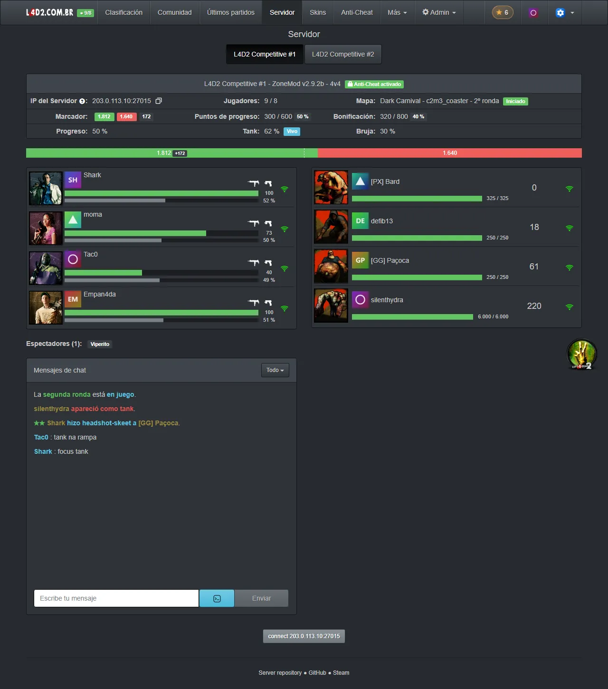
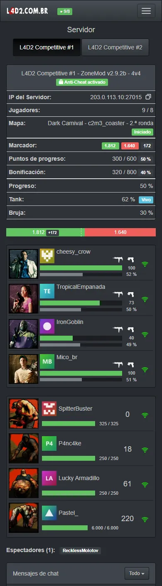

# Servidor en vivo

🌐 [English](live-server.md) | [Português](live-server.pt.md) | **Español**

La página **Servidor** muestra la partida en curso en cada uno de tus servidores de juego: el marcador, los jugadores con su salud y su progreso, y los eventos y el chat de la partida. La alimenta el plugin `l4d2_gameinfo_sync`.

[Volver al manual](README.es.md)

## Contenido

- [Elegir un servidor](#elegir-un-servidor)
- [La página en vivo](#la-página-en-vivo)
- [Eventos y chat](#eventos-y-chat)
- [Escribir en el chat desde el sitio](#escribir-en-el-chat-desde-el-sitio)
- [Conectarse al servidor](#conectarse-al-servidor)
- [En el teléfono](#en-el-teléfono)
- [Para tener en cuenta](#para-tener-en-cuenta)

## Elegir un servidor

Con un solo servidor de juego, **Servidor** abre directamente su página en vivo. Con dos o más, muestra una tarjeta por servidor con su estado, mapa, configuración, marcador y cantidad de jugadores. **Seguir** abre la página en vivo de ese servidor, y el botón de al lado copia el comando `connect`.

Mientras un servidor está en línea, la barra del menú muestra junto al nombre del sitio una pequeña insignia verde con la cantidad de jugadores. Enlaza a la página del servidor. Aparece después del primer movimiento del ratón, desplazamiento, toque o tecla en la página, y no se actualiza mientras la pestaña está en segundo plano.

Solo aparecen los servidores habilitados. Un servidor se habilita o deshabilita en su página en [Administración > Servidores de juego](administration.es.md#servidores-de-juego).

## La página en vivo

De arriba abajo:

- **Pestañas de servidores**, para cambiar entre servidores cuando hay varios.
- **El encabezado**: el nombre del servidor, la configuración y el tamaño de equipo, y una insignia **Anti-Cheat activado** cuando el servidor informa que el Anti-Cheat está activo.
- **IP del Servidor**, con un botón para copiar. El ícono ⓘ abre la dirección y, si está definida, la dirección alternativa (como un nombre DNS).
- **Jugadores**: jugadores conectados y plazas.
- **Mapa**: la campaña, el mapa y la ronda, con **Iniciado** o **Pausado**.
- **Marcador**: los puntos de los supervivientes y de los infectados, y la diferencia.
- **Puntos de progreso**, **Bonificación** y **Progreso**: hasta dónde llegaron los supervivientes en este mapa y la bonificación que queda.
- **Tank** y **Bruja**: en qué parte del mapa aparecen, y si el Tank está vivo o muerto.
- **La barra del marcador**: los dos equipos lado a lado.
- **Supervivientes**: el personaje, el jugador, la salud (con la salud temporal en un color más claro), las armas, el progreso y la calidad de la conexión. Los jugadores incapacitados, en blanco y negro y muertos aparecen marcados.
- **Infectado**: la clase, el jugador, la salud y el daño hecho en esta ronda. Los jugadores que todavía están por aparecer se muestran marcados.
- **Espectadores**.
- **Mensajes de chat**: los eventos y el chat de la partida.
- **Un botón `connect`** al final, que copia el comando para entrar al servidor.

La página se actualiza sola. El sitio le avisa en cuanto algo cambia y, cuando esa conexión no se puede abrir, la página vuelve a consultar por su cuenta.

## Eventos y chat

El panel **Mensajes de chat** lista, con lo más reciente abajo:

- eventos de la partida, como el inicio o el fin de la ronda, las pausas, la aparición y la muerte del Tank, skeets, levels, crowns, high pounces, death charges, cortes de lengua, rocas y alarmas de autos;
- lo que los jugadores escriben en el chat del juego;
- los mensajes escritos en el sitio.

El botón **Todo / Eventos / Mensajes** filtra la lista. Los mensajes cortos de binds que se usan en el juego, como `gogogo` o `tank tank`, se dejan fuera. La lista conserva la última hora.

## Escribir en el chat desde el sitio

Con el módulo de chat del sitio activado, un jugador con la sesión iniciada puede escribir en el cuadro debajo del chat. El mensaje aparece en el chat del juego de ese servidor y en el panel.

- Un mensaje tiene como máximo 200 caracteres.
- Después de un mensaje, el mismo jugador espera 30 segundos antes de enviar otro. Después de cualquier mensaje, todos esperan 15 segundos.
- Esos son los valores predeterminados; un administrador cambia los tres límites en la [página de baneos del chat](moderation.es.md#baneos-del-chat).
- Un jugador [baneado del chat](moderation.es.md#baneos-del-chat) ve el motivo y no puede escribir.
- Los administradores no tienen tiempo de espera. Con el módulo de comandos remotos activado, un administrador que escribe un comando de SourceMod como `!forcestart` o `sm_kick name` lo envía al servidor de juego como un [comando remoto](moderation.es.md#comandos-remotos), y el botón **Terminal** junto al cuadro ayuda a armar uno.

## Conectarse al servidor

Cuando el administrador completó la dirección a la que se conectan los jugadores, la página la muestra con un botón para copiar, y el botón `connect` copia `connect <address>`. Pégalo en la consola del juego para entrar. El ícono ⓘ explica cuándo conviene la dirección IP y cuándo la dirección alternativa.

## En el teléfono

En una pantalla angosta los equipos se apilan uno debajo del otro.

## Para tener en cuenta

- La página en vivo va unos 15 segundos detrás del juego, a propósito, como en el sitio que este proyecto reemplaza. El retraso se define en **Administración > Servidores de juego > Página del servidor en vivo**, de 0 a 600 segundos, y se aplica de inmediato; los mensajes enviados desde el sitio no se retrasan.
- El sitio avisa a cada página en vivo abierta cuando la partida cambió, nunca antes del retraso y como máximo una vez por intervalo de actualización de la **Página del servidor en vivo**. Esto usa un WebSocket en `/hubs/live`; cuando no se puede abrir, como detrás de un proxy sin soporte de WebSocket, pasa a Server-Sent Events o long polling, y si eso también falla la página consulta en cada intervalo de actualización, como antes. Con la conexión abierta, la página sigue revisando cada 30 segundos.
- La partida en curso se guarda solo en memoria. Si el sitio se reinicia, la página queda vacía hasta que el servidor de juego envíe la siguiente actualización.
- Cada servidor de juego tiene su propio estado en vivo, su chat y su cola de comandos.
- El módulo de servidor en vivo se puede desactivar en [Módulos](administration.es.md#módulos). El elemento **Servidor** desaparece del menú, y también el chat del sitio y los comandos remotos, que lo necesitan.
