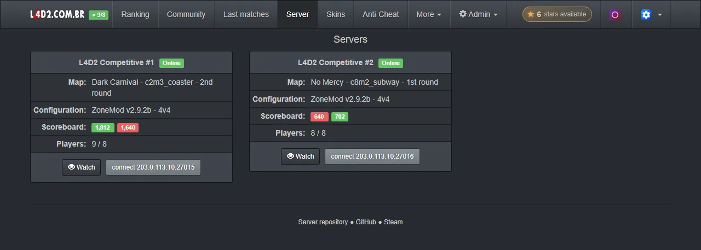
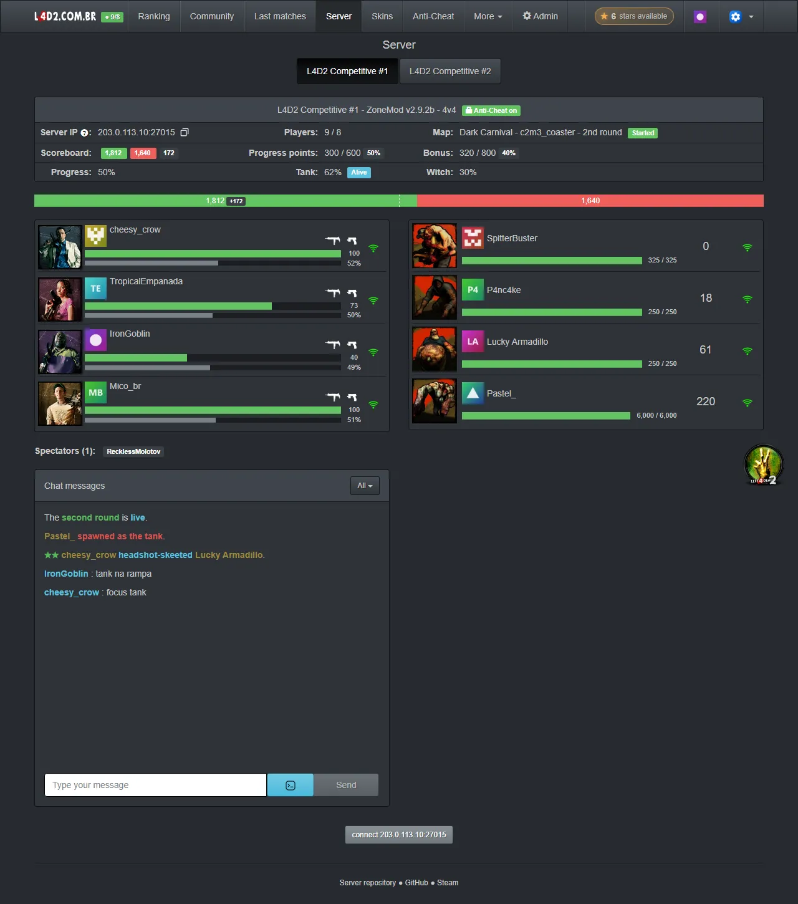
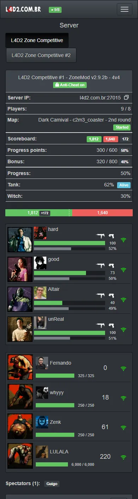

# Live server

🌐 **English** | [Português](live-server.pt.md) | [Español](live-server.es.md)

The **Server** page shows the match in progress on each of your game servers: the scoreboard, the players with their health and progress, and the events and chat of the match. It is fed by the `l4d2_gameinfo_sync` plugin.

[Back to the manual](README.md)

## Contents

- [Choosing a server](#choosing-a-server)
- [The live page](#the-live-page)
- [Events and chat](#events-and-chat)
- [Writing in the chat from the site](#writing-in-the-chat-from-the-site)
- [Connecting to the server](#connecting-to-the-server)
- [On a phone](#on-a-phone)
- [Good to know](#good-to-know)

## Choosing a server

With one game server, **Server** opens its live page directly. With two or more, it shows a card for each server with its state, map, configuration, score and number of players. **Watch** opens the live page of that server, and the button next to it copies the `connect` command.

While a server is online, the menu bar shows a small green badge with the number of players next to the site name. It links to the server page. It appears after the first mouse move, scroll, tap or key on the page, and is not refreshed while the tab is in the background.

Only enabled servers appear. A server is enabled or disabled on its page in [Administration > Game servers](administration.md#game-servers).

## The live page

From top to bottom:

- **Server tabs**, to switch between servers when there are several.
- **The header**: the name of the server, the configuration and the team size, and an **Anti-Cheat on** badge when the server reports that the Anti-Cheat is active.
- **Server IP**, with a copy button. The ⓘ icon opens the address and, if set, the alternative address (such as a DNS name).
- **Players**: players connected and slots.
- **Map**: the campaign, the map and the round, with **Started** or **Paused**.
- **Scoreboard**: the score of the survivors and of the infected and the difference.
- **Progress points**, **Bonus** and **Progress**: how far the survivors went in this map and the bonus left.
- **Tank** and **Witch**: where in the map they spawn, and whether the Tank is alive or dead.
- **The score bar**: both teams side by side.
- **Survivors**: the character, the player, the health (with temporary health in a lighter colour), the weapons, the progress and the connection quality. Incapacitated, black and white and dead players are marked.
- **Infected**: the class, the player, the health and the damage done in this round. Players still spawning are marked.
- **Spectators**.
- **Chat messages**: the events and the chat of the match.
- **A `connect` button** at the bottom, which copies the command to join the server.

The page updates by itself. The site tells it as soon as something changes, and it asks again on its own when that link cannot be opened.

## Events and chat

The **Chat messages** panel lists, newest at the bottom:

- events of the match, such as the round going live or ending, pauses, the Tank spawning and dying, skeets, levels, crowns, high pounces, death charges, tongue cuts, rocks and car alarms;
- what the players write in the game chat;
- messages written on the site.

The **All / Events / Messages** button filters the list. Short bind messages used in the game, such as `gogogo` or `tank tank`, are left out. The list keeps the last hour.

## Writing in the chat from the site

With the site chat module on, a signed-in player can write in the box under the chat. The message appears in the game chat of that server, and in the panel.

- A message has at most 200 characters.
- After a message, the same player waits 30 seconds before sending another. After any message, everybody waits 15 seconds.
- These are the defaults; an administrator changes the three limits on [the chat bans page](moderation.md#chat-bans).
- A player [banned from the chat](moderation.md#chat-bans) sees the reason and cannot write.
- Administrators have no waiting time. With the remote commands module on, an administrator who writes a SourceMod command such as `!forcestart` or `sm_kick name` sends it to the game server as a [remote command](moderation.md#remote-commands), and the **Terminal** button next to the box helps to build one.

## Connecting to the server

When the administrator filled the address players connect to, the page shows it with a copy button, and the `connect` button copies `connect <address>`. Paste it in the game console to join. The ⓘ icon explains when to prefer the IP address and when the alternative address.

## On a phone

On a narrow screen the teams stack one under the other.

## Good to know

- The live page is about 15 seconds behind the game, on purpose, as on the site this project replaces. The delay is set in **Administration > Game servers > Live server page**, from 0 to 600 seconds, and applies at once; messages sent from the site are not delayed.
- The site tells each open live page when the match changed, never before the delay and at most once per refresh interval of **Live server page**. This uses a WebSocket at `/hubs/live`; when it cannot be opened, as behind a proxy without WebSocket support, it falls back to Server-Sent Events or long polling, and if that fails too the page asks every refresh interval, as before. While the link is open the page still checks every 30 seconds.
- The match in progress is kept in memory only. If the site restarts, the page is empty until the game server sends the next update.
- Each game server has its own live state, chat and command queue.
- The live server module can be turned off in [Modules](administration.md#modules). The **Server** menu item disappears, and so do the site chat and remote commands, which need it.
