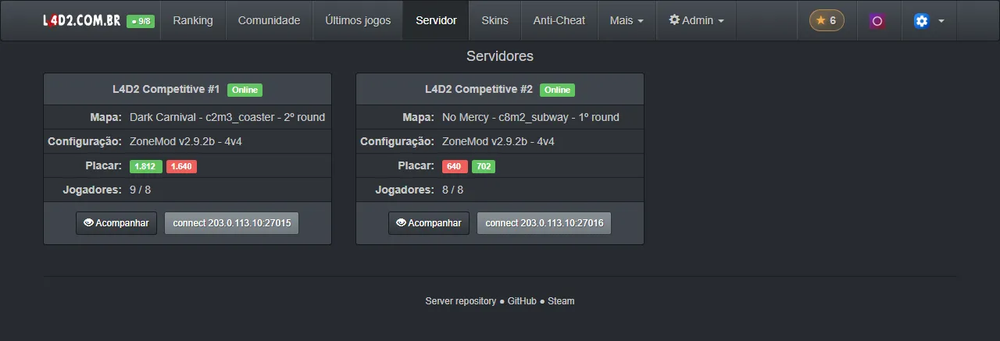
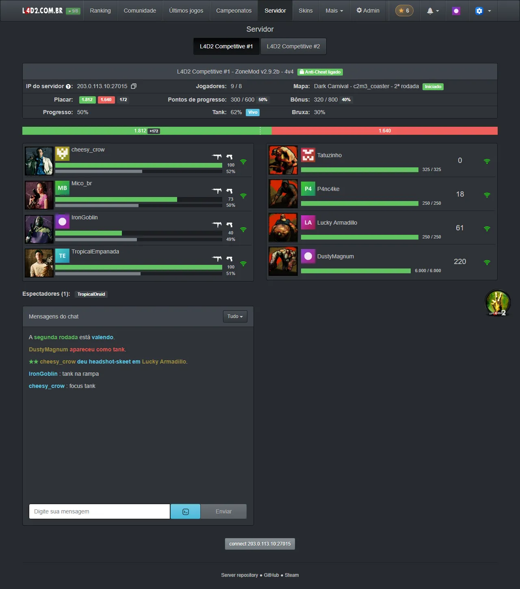
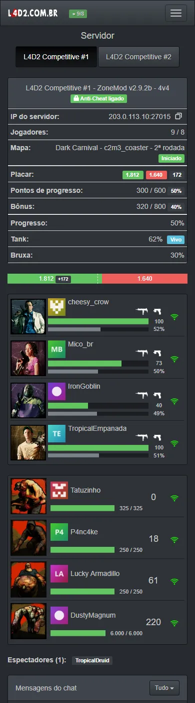

# Servidor ao vivo

🌐 [English](live-server.md) | **Português** | [Español](live-server.es.md)

A página **Servidor** mostra a partida em andamento em cada um dos seus servidores de jogo: o placar, os jogadores com a vida e o progresso deles, e os eventos e o chat da partida. Ela é alimentada pelo plugin `l4d2_gameinfo_sync`.

[Voltar ao manual](README.pt.md)

## Conteúdo

- [Escolhendo um servidor](#escolhendo-um-servidor)
- [A página ao vivo](#a-página-ao-vivo)
- [Eventos e chat](#eventos-e-chat)
- [Escrevendo no chat pelo site](#escrevendo-no-chat-pelo-site)
- [Conectando ao servidor](#conectando-ao-servidor)
- [No celular](#no-celular)
- [Bom saber](#bom-saber)

## Escolhendo um servidor

Com um único servidor de jogo, **Servidor** abre direto a página ao vivo dele. Com dois ou mais, aparece um cartão para cada servidor com o estado, o mapa, a configuração, o placar e o número de jogadores. **Acompanhar** abre a página ao vivo daquele servidor, e o botão ao lado copia o comando `connect`.

Enquanto um servidor está online, a barra do menu mostra um pequeno selo verde com o número de jogadores ao lado do nome do site. Ele leva à página do servidor.

Só os servidores ativados aparecem. Um servidor é ativado ou desativado na página dele em [Administração > Servidores de jogo](administration.pt.md#servidores-de-jogo).

## A página ao vivo

De cima para baixo:

- **Abas dos servidores**, para trocar de servidor quando há vários.
- **O cabeçalho**: o nome do servidor, a configuração e o tamanho das equipes, e um selo **Anti-Cheat ligado** quando o servidor informa que o Anti-Cheat está ativo.
- **IP do Servidor**, com um botão de copiar. O ícone ⓘ abre o endereço e, se estiver definido, o endereço alternativo (como um nome DNS).
- **Jogadores**: jogadores conectados e vagas.
- **Mapa**: a campanha, o mapa e a rodada, com **Iniciado** ou **Pausado**.
- **Placar**: o placar dos sobreviventes e dos infectados e a diferença.
- **Pontos de progresso**, **Bônus** e **Progresso**: até onde os sobreviventes chegaram neste mapa e o bônus que resta.
- **Tank** e **Bruxa**: em que ponto do mapa eles aparecem, e se o Tank está vivo ou morto.
- **A barra de placar**: as duas equipes lado a lado.
- **Sobreviventes**: o personagem, o jogador, a vida (com a vida temporária em uma cor mais clara), as armas, o progresso e a qualidade da conexão. Jogadores incapacitados, em preto e branco e mortos são marcados.
- **Infectado**: a classe, o jogador, a vida e o dano causado nesta rodada. Os jogadores que ainda estão nascendo são marcados.
- **Espectadores**.
- **Mensagens do chat**: os eventos e o chat da partida.
- **Um botão `connect`** embaixo, que copia o comando para entrar no servidor.

A página se atualiza sozinha.

## Eventos e chat

O painel **Mensagens do chat** lista, com as mais recentes embaixo:

- eventos da partida, como a rodada começando ou terminando, pausas, o Tank aparecendo e morrendo, skeets, levels, crowns, high pounces, death charges, tongue cuts, pedras e alarmes de carro;
- o que os jogadores escrevem no chat do jogo;
- mensagens escritas no site.

O botão **Tudo / Eventos / Mensagens** filtra a lista. Mensagens curtas de bind usadas no jogo, como `gogogo` ou `tank tank`, ficam de fora. A lista guarda a última hora.

## Escrevendo no chat pelo site

Com o módulo do chat do site ligado, um jogador logado pode escrever na caixa embaixo do chat. A mensagem aparece no chat do jogo daquele servidor e no painel.

- Uma mensagem tem no máximo 200 caracteres.
- Depois de uma mensagem, o mesmo jogador espera 30 segundos para enviar outra. Depois de qualquer mensagem, todo mundo espera 15 segundos.
- Um jogador [banido do chat](moderation.pt.md#banimentos-do-chat) vê o motivo e não pode escrever.
- Os administradores não têm tempo de espera. Com o módulo de comandos remotos ligado, um administrador que escreve um comando do SourceMod como `!forcestart` ou `sm_kick name` o envia ao servidor de jogo como um [comando remoto](moderation.pt.md#comandos-remotos), e o botão **Terminal** ao lado da caixa ajuda a montar um.

## Conectando ao servidor

Quando o administrador preencheu o endereço em que os jogadores se conectam, a página o mostra com um botão de copiar, e o botão `connect` copia `connect <address>`. Cole no console do jogo para entrar. O ícone ⓘ explica quando é melhor usar o endereço IP e quando usar o endereço alternativo.

## No celular

Em uma tela estreita, as equipes ficam uma embaixo da outra.

## Bom saber

- A página ao vivo fica uns 15 segundos atrás do jogo, de propósito, como no site que este projeto substitui.
- A partida em andamento fica só na memória. Se o site reiniciar, a página fica vazia até o servidor de jogo enviar a próxima atualização.
- Cada servidor de jogo tem o seu próprio estado ao vivo, chat e fila de comandos.
- O módulo do servidor ao vivo pode ser desligado em [Módulos](administration.pt.md#módulos). O item **Servidor** do menu some, e somem também o chat do site e os comandos remotos, que dependem dele.
