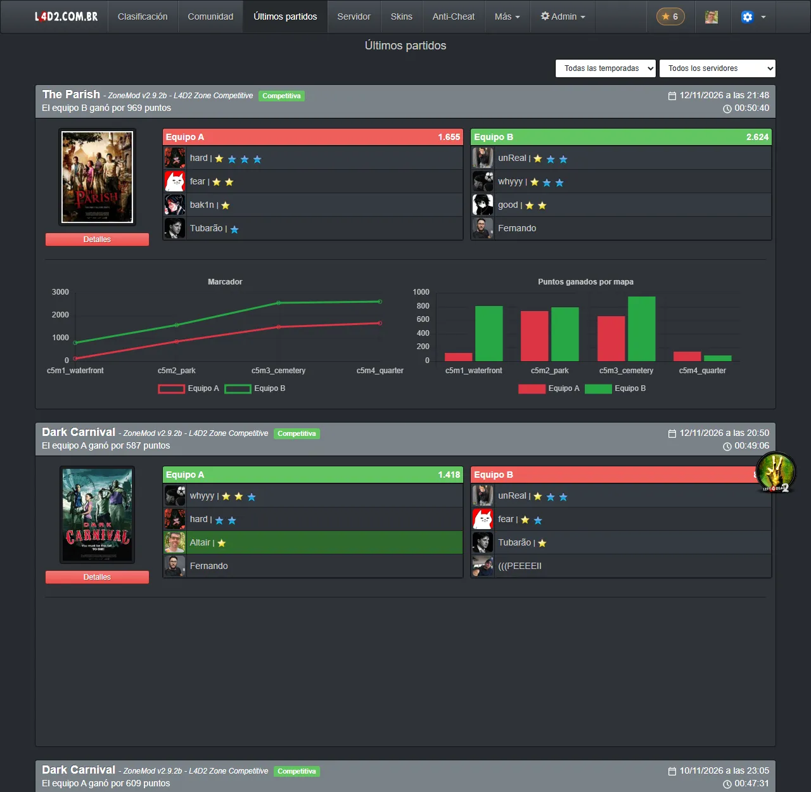
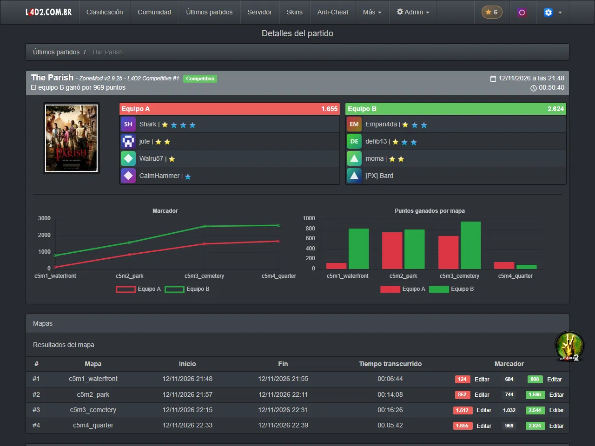
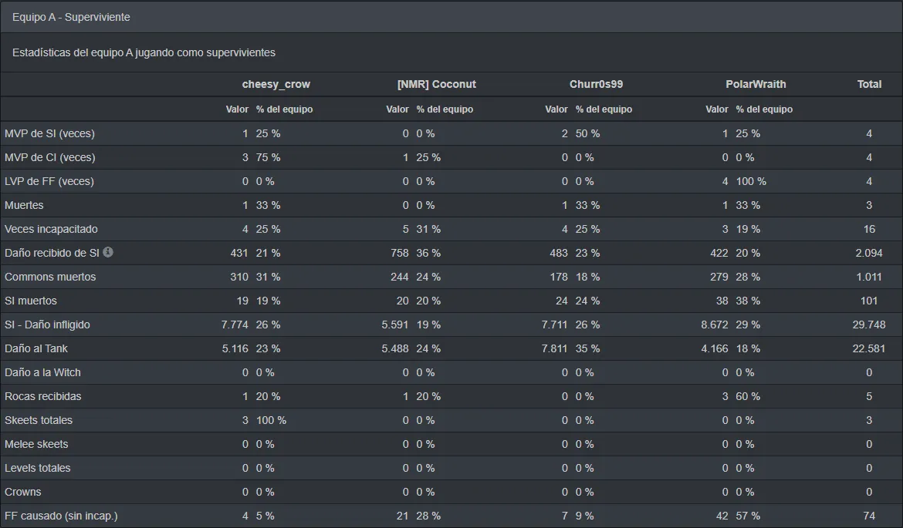
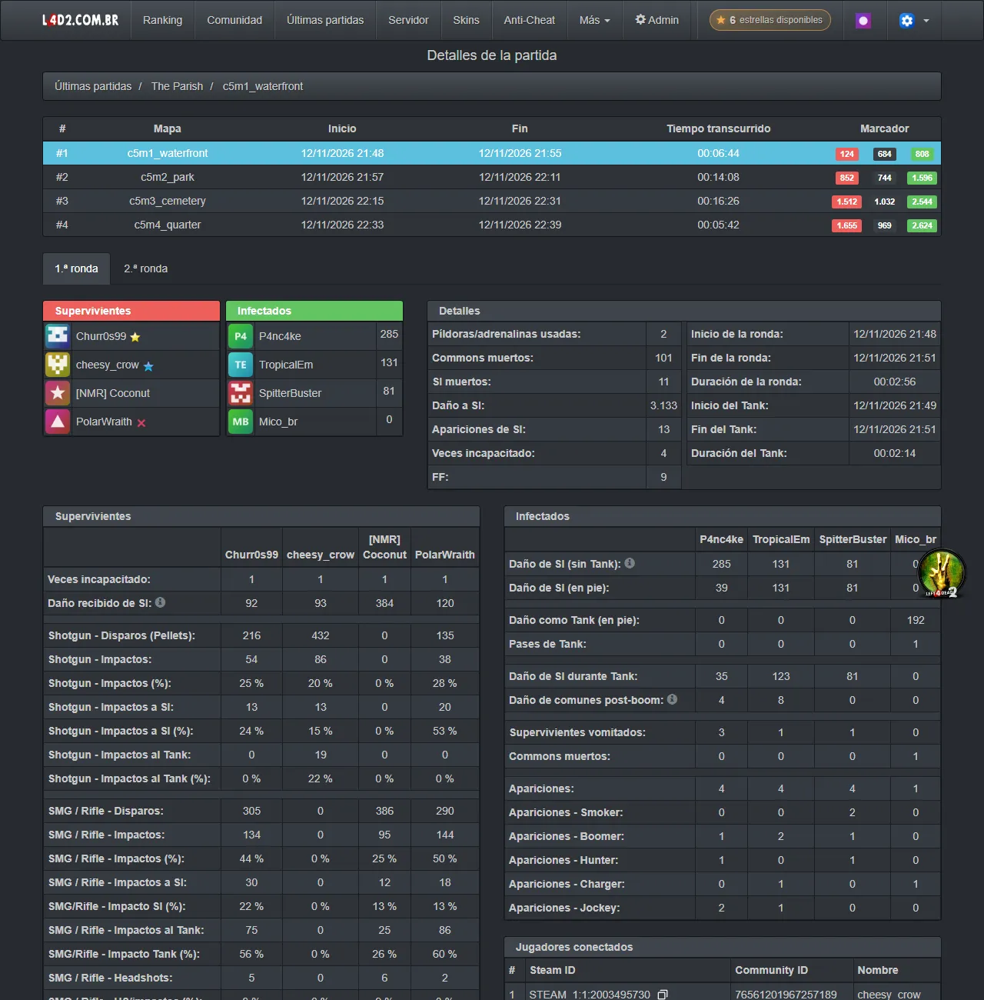

# Partidas

🌐 [English](matches.md) | [Português](matches.pt.md) | **Español**

Cada partida jugada en tus servidores de juego tiene una página con los equipos, el marcador de cada mapa y las estadísticas de cada jugador. Esta página explica la lista de partidas, los detalles de una partida, las estadísticas de un mapa y cómo el sitio arma las partidas a partir de los archivos que envían los servidores de juego.

[Volver al manual](README.es.md)

## Contenido

- [La lista de partidas](#la-lista-de-partidas)
- [Detalles de la partida](#detalles-de-la-partida)
- [Estadísticas de un mapa](#estadísticas-de-un-mapa)
- [Editar el marcador de un mapa](#editar-el-marcador-de-un-mapa)
- [Cómo los archivos se convierten en partidas](#cómo-los-archivos-se-convierten-en-partidas)
- [Partidas competitivas y casuales](#partidas-competitivas-y-casuales)
- [Reconstruir las partidas](#reconstruir-las-partidas)

## La lista de partidas

**Últimos partidos** lista las partidas, de la más reciente a la más antigua.

Cada tarjeta muestra:

- la campaña, la configuración (como `ZoneMod v2.9.2b`) y una etiqueta **Competitiva** o **Casual**;
- la fecha y la hora de la partida y cuánto duró;
- qué equipo ganó y por cuántos puntos;
- los dos equipos con su marcador final, y cada jugador con sus premios de MVP: una estrella amarilla por cada MVP de SI y una estrella azul por cada MVP de CI;
- un botón **Detalles**.

Los filtros de arriba eligen una temporada, un año o todas las temporadas, y un servidor de juego o todos. Con un solo servidor de juego registrado, el filtro de servidor tiene solo ese servidor.

## Detalles de la partida

La página de detalles tiene:

- los equipos y el resultado, como en la lista;
- **Marcador**: un gráfico del marcador de cada equipo después de cada mapa;
- **Puntos ganados por mapa**: un gráfico de barras con los puntos que hizo cada equipo en cada mapa;
- **Resultados del mapa**: una fila por mapa con el inicio, el fin, el tiempo que llevó y el marcador. Haz clic en un mapa para abrir sus estadísticas;
- una tabla por equipo y lado: el equipo A y el equipo B como supervivientes, y después como infectados.

Las tablas de supervivientes muestran, para cada jugador, el valor y la parte del equipo (% del equipo): premios de MVP de SI y de CI, premios de LVP de FF, muertes, veces incapacitado, daño recibido de infectados especiales, comunes eliminados, infectados especiales eliminados, daño hecho a infectados especiales, al Tank y a la Bruja, rocas del Tank recibidas, skeets, melee skeets, levels, crowns y fuego amigo. Las tablas de infectados muestran el daño hecho a los supervivientes, el daño hecho como Tank, el daño de spitter y el daño de pounce. Los íconos ⓘ explican las columnas menos obvias.

## Estadísticas de un mapa

La página de un mapa muestra el marcador, la hora de inicio y de fin, y una pestaña por mitad de ronda. Cada mitad lista los supervivientes y los infectados con sus números, el MVP y el LVP de la mitad, los tiempos de la ronda, de las pausas y de cada Tank, y los jugadores que estuvieron conectados.

## Editar el marcador de un mapa

A veces un mapa termina con un marcador equivocado, por ejemplo después de un crash. Un administrador ve un enlace **Editar** junto a cada marcador en **Resultados del mapa**. Pide el nuevo marcador de ese equipo.

Después del cambio, el sitio reconstruye las partidas alrededor de ese mapa, así que el ganador, la experiencia y las estrellas siguen el nuevo marcador. El archivo original se conserva con el marcador corregido.

## Cómo los archivos se convierten en partidas

El servidor de juego envía un archivo de estadísticas por mapa. El sitio los une en partidas con estas reglas:

1. Los archivos se separan por servidor de juego, por temporada, y por configuración y tamaño de equipo. Una partida nunca mezcla dos servidores, dos temporadas ni dos configuraciones.
2. Los mapas de la misma campaña jugados en orden forman una partida. `c2m1_highway` seguido de `c2m2_fairgrounds` es una partida. Si el siguiente archivo es un mapa de otra campaña, o de la misma campaña fuera de orden, empieza una partida nueva.
3. Qué mapas pertenecen a qué campaña, y en qué orden, sale de la [lista de campañas](game-modes-and-campaigns.es.md#campañas). Ahí se pueden agregar campañas personalizadas.
4. Un mapa que terminó 0 a 0 se ignora. Un mapa que aparece dos veces seguidas se cuenta una vez.
5. Los mapas que no están en ninguna campaña de la lista son **mapas desconocidos**. Por defecto se conservan: los mapas desconocidos consecutivos se unen en una partida cuando el número de ronda sube de a uno y pasaron menos de 2 horas entre ellos. Un administrador puede desactivar esto en [Configuración](administration.es.md#puntos-del-ranking); los mapas desconocidos pasan entonces a ignorarse.

Cada archivo se guarda tal como llegó, así que las partidas se pueden reconstruir en cualquier momento con reglas nuevas.

## Partidas competitivas y casuales

Una partida es **Competitiva** (de ranking) cuando la primera [regla de modo de juego](game-modes-and-campaigns.es.md#modos-de-juego) que corresponde a su configuración y tamaño de equipo dice que cuenta para el ranking, y la partida tiene al menos el mínimo de mapas de esa regla. Si no, es **Casual**.

La regla predeterminada cuenta las partidas 4v4 de cualquier configuración con al menos 2 mapas. Un solo mapa nunca es de ranking con la regla predeterminada.

Las partidas casuales aparecen en la lista y tienen sus estadísticas, pero no dan experiencia, ni victorias o derrotas, ni estrellas.

## Reconstruir las partidas

Los cambios en los modos de juego, en la lista de campañas o en la opción de los mapas desconocidos se aplican a los archivos nuevos. Para aplicarlos a las partidas ya armadas, usa **Reprocesar todas las partidas** en [Administración > Vista general](administration.es.md#vista-general). Reconstruye todas las partidas a partir de los archivos guardados.
