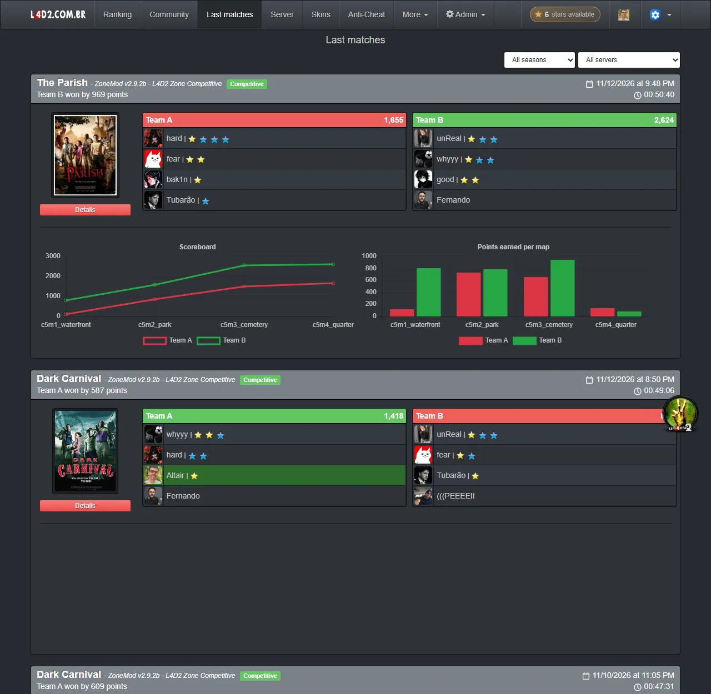
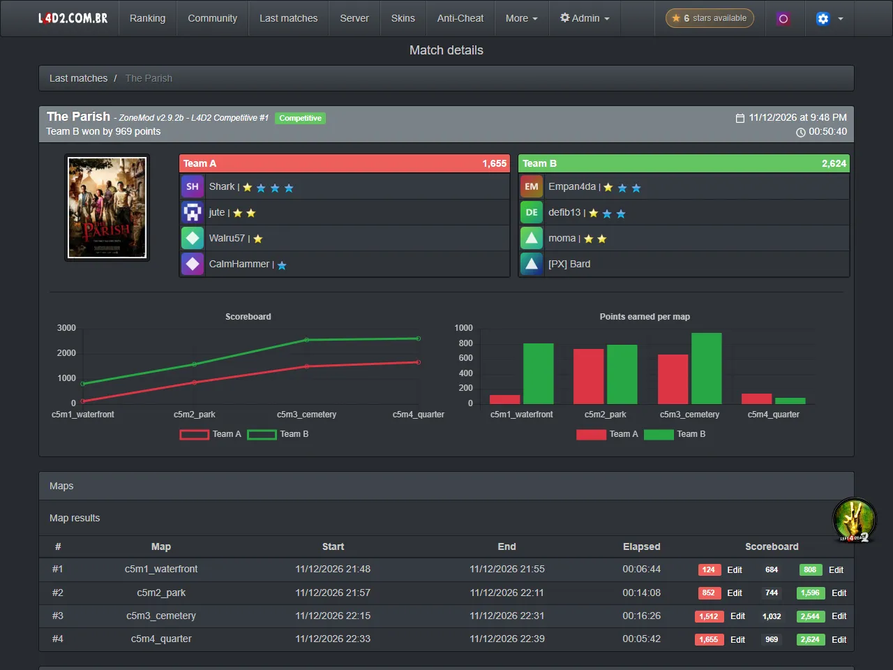
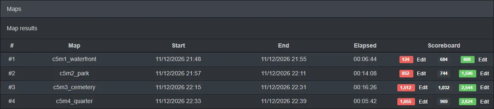
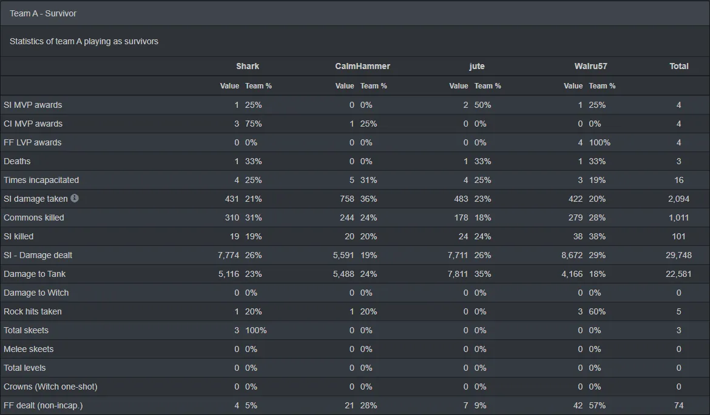
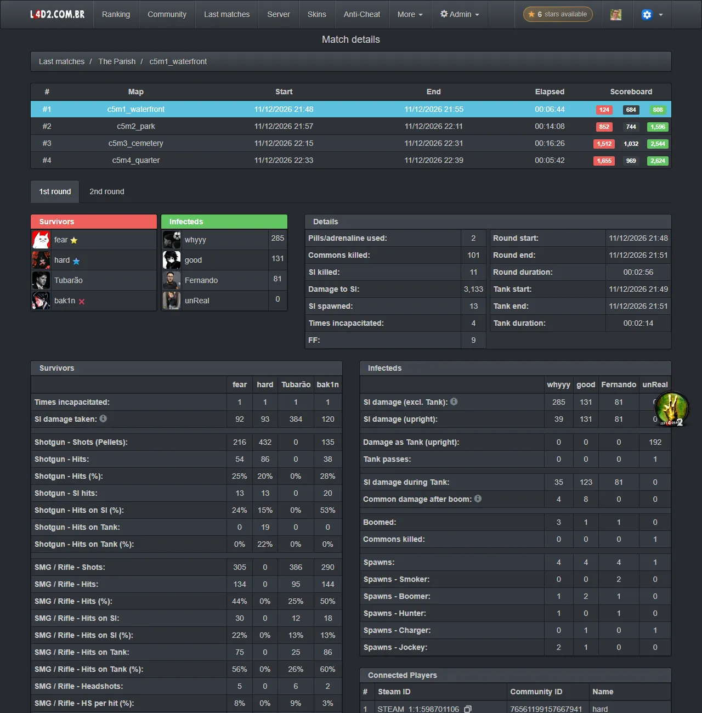

# Matches

🌐 **English** | [Português](matches.pt.md) | [Español](matches.es.md)

Every match played on your game servers has a page with the teams, the score of each map and the statistics of every player. This page explains the match list, the match details, the statistics of one map, and how the site builds matches from the files the game servers send.

[Back to the manual](README.md)

## Contents

- [The match list](#the-match-list)
- [Match details](#match-details)
- [Map statistics](#map-statistics)
- [Editing the score of a map](#editing-the-score-of-a-map)
- [How files become matches](#how-files-become-matches)
- [Competitive and casual matches](#competitive-and-casual-matches)
- [Rebuilding the matches](#rebuilding-the-matches)

## The match list

**Last matches** lists the matches, newest first.

Each card shows:

- the campaign, the configuration (such as `ZoneMod v2.9.2b`) and a **Competitive** or **Casual** label;
- the date and time of the match, in the time zone of the site, and how long it lasted;
- which team won and by how many points;
- the two teams with their final score, and each player with their MVP awards and tank wipes: a yellow star for each SI MVP, a blue star for each CI MVP and a Tank for each [tank wipe](ranking.md#tank-wipes);
- a **Details** button.

The filters at the top choose a season, a year or all seasons, and one game server or all of them. Seasons are named by their first and last month, as in the period selectors: **From 01/2026 to 02/2026**. With one game server registered, the server filter has only that server.

## Match details

The details page has:

- the teams and the result, as in the list;
- **Scoreboard**: a chart of the score of each team after each map;
- **Points earned per map**: a bar chart of the points each team made in each map. A Tank above a bar marks a map where that team got a [tank wipe](ranking.md#tank-wipes); hover the bar to see who did it;
- **Map results**: one row per map with the start, the end, the time it took and the score. Click a map to open its statistics;
- one table per team and side: team A and team B as survivors, then as infected.

The survivor tables show, for each player, the value and the share of the team (Team %): SI and CI MVP awards, FF LVP awards, deaths, times incapacitated, damage taken from special infected, commons killed, special infected killed, damage dealt to special infected, to the Tank and to the Witch, Tank rocks taken, skeets, melee skeets, levels, crowns and friendly fire. The infected tables show the tank wipes, the damage done to survivors, the damage done as Tank, the spitter damage and the pounce damage. The ⓘ icons explain the less obvious columns.

## Map statistics

The page of one map shows the score, the start and end time, and one tab per round half. Each half lists the survivors and the infected with their numbers, the MVP and LVP of the half, a Tank next to the infected player who ended the half with a tank wipe, the times of the round, of pauses and of each Tank, and the players who were connected.

## Editing the score of a map

Sometimes a map ends with a wrong score, for example after a crash. An administrator sees an **Edit** link next to each score in **Map results**. It asks for the new score of that team.

After the change, the site rebuilds the matches around that map, so the winner, the experience and the stars follow the new score. The original file is kept with the corrected score.

## How files become matches

The game server sends one statistics file per map. The site joins them into matches with these rules:

1. Files are kept apart by game server, by season, and by configuration and team size. A match never mixes two servers, two seasons or two configurations.
2. Maps of the same campaign played in order make one match. `c2m1_highway` followed by `c2m2_fairgrounds` is one match. If the next file is a map of another campaign, or the same campaign out of order, a new match starts.
3. Which maps belong to which campaign, and in which order, comes from the [campaign list](game-modes-and-campaigns.md#campaigns). Custom campaigns can be added there.
4. A map that ended 0 to 0 is ignored. A map that appears twice in a row is counted once.
5. Maps that are in no campaign of the list are **unknown maps**. By default they are kept: consecutive unknown maps are joined into one match when the round number goes up by one and less than 2 hours passed between them. An administrator can turn this off in [Settings](administration.md#ranking-points); unknown maps are then ignored.

Every file is stored as it arrived, so the matches can be rebuilt at any time with new rules.

## Competitive and casual matches

A match is **Competitive** (ranked) when the first [game mode rule](game-modes-and-campaigns.md#game-modes) that fits its configuration and team size says it counts for the ranking, and the match has at least the minimum number of maps of that rule. Otherwise it is **Casual**.

The default rule counts 4v4 matches of any configuration with at least 2 maps. A single map is never ranked with the default rule.

Casual matches are listed and have their statistics, but they give no experience, no wins or losses and no stars.

## Rebuilding the matches

Changes to the game modes, the campaign list or the option about unknown maps apply to new files. To apply them to the matches already built, use **Reprocess all matches** in [Administration > Overview](administration.md#overview). It rebuilds every match from the stored files.
