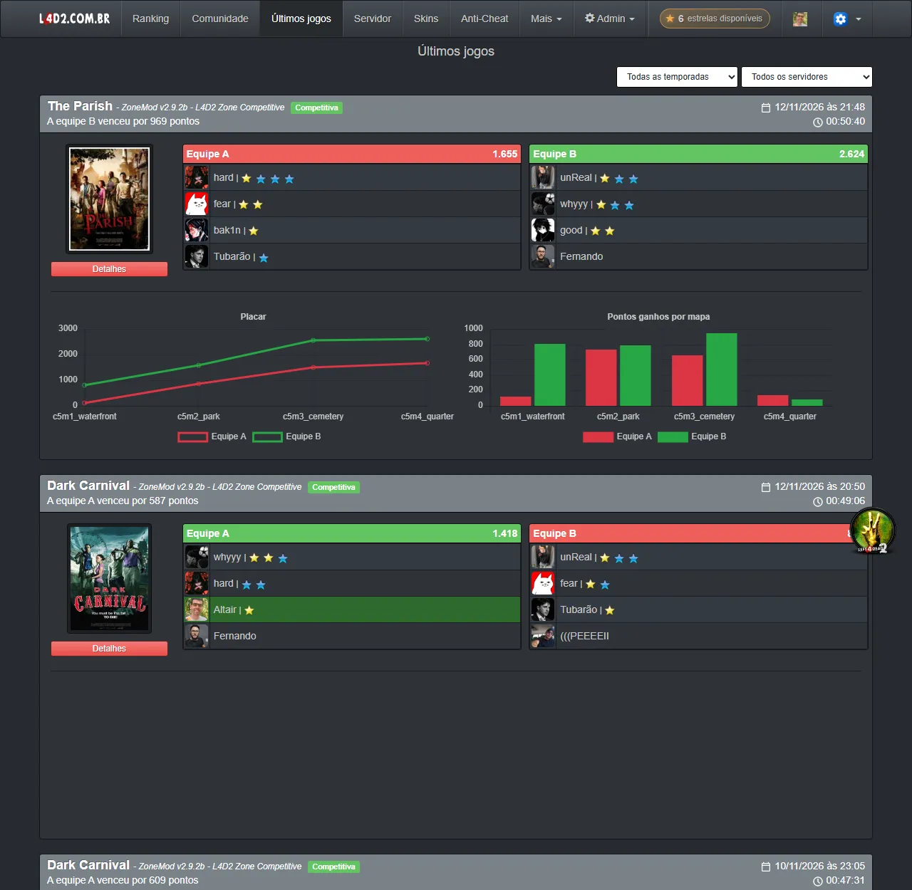
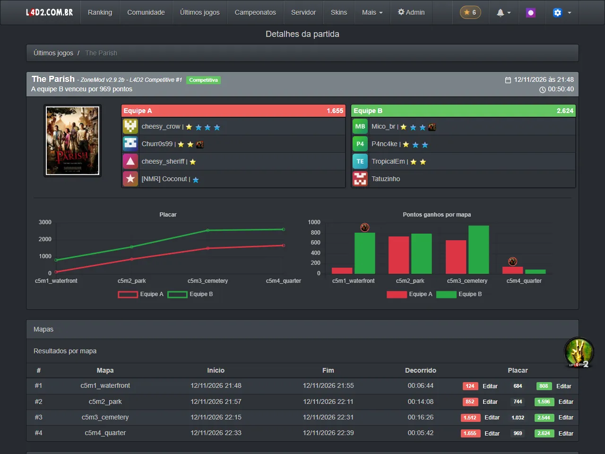
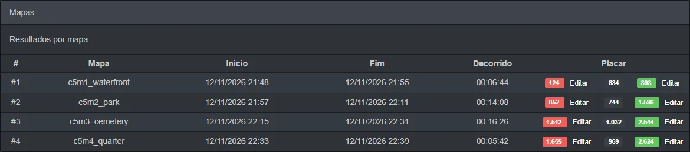
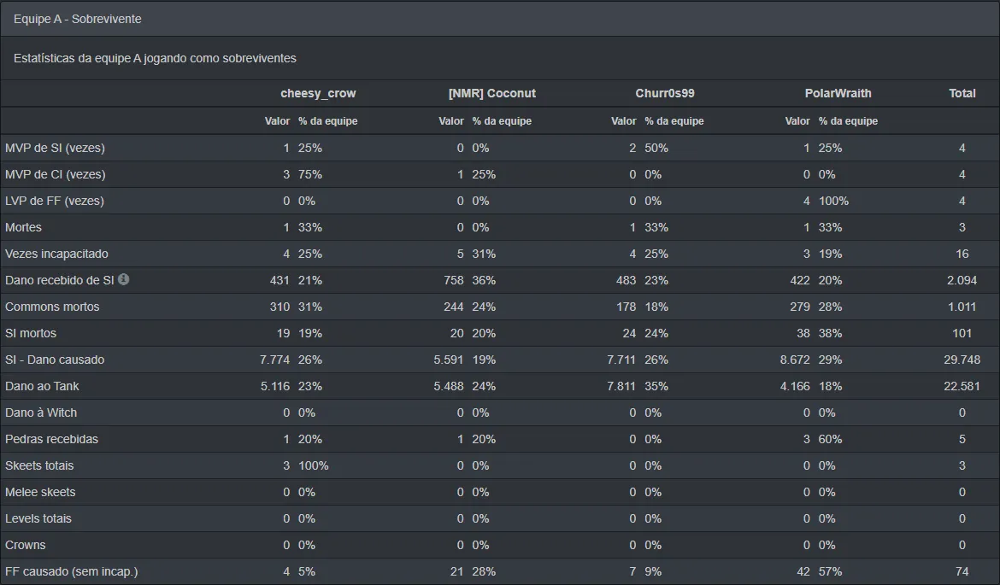
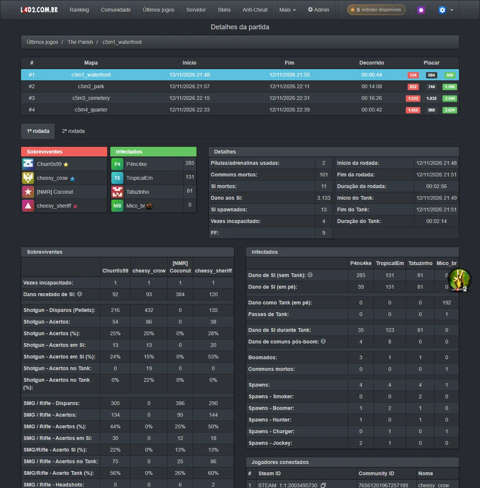

# Partidas

🌐 [English](matches.md) | **Português** | [Español](matches.es.md)

Toda partida jogada nos seus servidores de jogo tem uma página com as equipes, o placar de cada mapa e as estatísticas de cada jogador. Esta página explica a lista de partidas, os detalhes da partida, as estatísticas de um mapa e como o site monta as partidas a partir dos arquivos que os servidores de jogo enviam.

[Voltar ao manual](README.pt.md)

## Conteúdo

- [A lista de partidas](#a-lista-de-partidas)
- [Detalhes da partida](#detalhes-da-partida)
- [Estatísticas do mapa](#estatísticas-do-mapa)
- [Editando o placar de um mapa](#editando-o-placar-de-um-mapa)
- [Trocando um jogador](#trocando-um-jogador)
- [Como os arquivos viram partidas](#como-os-arquivos-viram-partidas)
- [Partidas competitivas e casuais](#partidas-competitivas-e-casuais)
- [Reconstruindo as partidas](#reconstruindo-as-partidas)

## A lista de partidas

**Últimos jogos** lista as partidas, das mais recentes para as mais antigas.

Cada cartão mostra:

- a campanha, a configuração (como `ZoneMod v2.9.2b`) e uma etiqueta **Competitiva** ou **Casual**;
- a data e a hora da partida, no fuso horário do site, e quanto tempo ela durou;
- qual equipe ganhou e por quantos pontos;
- as duas equipes com o placar final, e cada jogador com os seus prêmios de MVP e tank wipes: uma estrela amarela para cada MVP de SI, uma estrela azul para cada MVP de CI e um Tank para cada [tank wipe](ranking.pt.md#tank-wipes);
- um botão **Detalhes**.

Os filtros no topo escolhem uma temporada, um ano ou todas as temporadas, e um servidor de jogo ou todos. As temporadas aparecem pelo primeiro e pelo último mês, como nos seletores de período: **De 01/2026 até 02/2026**. Com um único servidor de jogo cadastrado, o filtro de servidor tem só esse servidor.

## Detalhes da partida

A página de detalhes tem:

- as equipes e o resultado, como na lista;
- **Placar**: um gráfico do placar de cada equipe depois de cada mapa;
- **Pontos ganhos por mapa**: um gráfico de barras com os pontos que cada equipe fez em cada mapa. Um Tank em cima de uma barra marca um mapa em que aquela equipe fez um [tank wipe](ranking.pt.md#tank-wipes); passe o mouse sobre a barra para ver quem fez;
- **Resultados por mapa**: uma linha por mapa com o início, o fim, o tempo que levou e o placar. Clique em um mapa para abrir as estatísticas dele;
- uma tabela por equipe e lado: equipe A e equipe B como sobreviventes, depois como infectados.

As tabelas de sobreviventes mostram, para cada jogador, o valor e a parcela da equipe (% da equipe): MVPs de SI e de CI, LVPs de FF, mortes, vezes incapacitado, dano recebido de infectados especiais, comuns mortos, infectados especiais mortos, dano causado em infectados especiais, no Tank e na Bruxa, pedras do Tank recebidas, skeets, melee skeets, levels, crowns e fogo amigo. As tabelas de infectados mostram os tank wipes, o dano causado nos sobreviventes, o dano causado como Tank, o dano da spitter e o dano de pounce. Os ícones ⓘ explicam as colunas menos óbvias.

## Estatísticas do mapa

A página de um mapa mostra o placar, a hora de início e de fim e uma aba por metade de rodada. Cada metade lista os sobreviventes e os infectados com os seus números, o MVP e o LVP da metade, um Tank ao lado do jogador infectado que encerrou a metade com um tank wipe, os tempos da rodada, das pausas e de cada Tank, e os jogadores que estavam conectados.

## Editando o placar de um mapa

Às vezes um mapa termina com o placar errado, por exemplo depois de um crash. Um administrador vê um link **Editar** ao lado de cada placar em **Resultados por mapa**. Ele pede o novo placar daquela equipe.

Depois da alteração, o site reconstrói as partidas em volta daquele mapa, então o vencedor, a experiência e as estrelas acompanham o novo placar. O arquivo original é mantido com o placar corrigido.

## Trocando um jogador

Quando um substituto entra no lugar de um jogador, os arquivos têm o jogador que saiu nos primeiros mapas, ou na primeira metade de um mapa, e o substituto no resto. O resultado de uma partida só conta para quem jogou o primeiro e o último mapa, então o jogador que saiu leva um rage quit e o substituto não leva nem a vitória nem a derrota.

Um administrador corrige isso na página do mapa. Cada sobrevivente e cada infectado de cada metade tem um lápis ao lado do nome: clique nele, escolha o novo jogador na janela de busca de jogadores e confirme. Aquela linha, com os números dela, passa para o novo jogador, e o site reconstrói a partida, então o vencedor, os rage quits, a experiência e o ranking acompanham a troca. O arquivo de estatísticas do mapa é gravado com a troca; para desfazer, use o lápis de novo e escolha o jogador anterior.

A troca é recusada quando o novo jogador já está naquela metade, no mesmo lado, ou jogou o mapa pela outra equipe.

Por exemplo, se A foi sobrevivente na primeira metade do primeiro mapa e B jogou o resto da partida, o lápis ao lado de A na primeira metade daquele mapa, escolhendo B, dá a B o resultado da partida e tira o rage quit de A. B também fica com os números que A fez naquela metade.

## Como os arquivos viram partidas

O servidor de jogo envia um arquivo de estatísticas por mapa. O site junta os arquivos em partidas com estas regras:

1. Os arquivos são separados por servidor de jogo, por temporada e por configuração e tamanho de equipe. Uma partida nunca mistura dois servidores, duas temporadas ou duas configurações. Arquivos de um servidor de jogo com mais de 6 horas de intervalo (a configuração **Horas sem arquivos que separam duas partidas**, em [Configurações](administration.pt.md#pontos-do-ranking)) também começam uma nova partida.
2. Mapas da mesma campanha jogados em ordem formam uma partida. `c2m1_highway` seguido de `c2m2_fairgrounds` é uma partida. Se o próximo arquivo for um mapa de outra campanha, ou da mesma campanha fora de ordem, começa uma nova partida.
3. Quais mapas pertencem a qual campanha, e em que ordem, vem da [lista de campanhas](game-modes-and-campaigns.pt.md#campanhas). Campanhas personalizadas podem ser adicionadas lá.
4. Um mapa que terminou 0 a 0 é ignorado. Um mapa que aparece duas vezes seguidas é contado uma vez.
5. Mapas que não estão em nenhuma campanha da lista são **mapas desconhecidos**. Por padrão eles são mantidos: mapas desconhecidos consecutivos são juntados em uma partida quando o número da rodada aumenta em um e passaram menos de 2 horas entre eles. Um administrador pode desligar isso em [Configurações](administration.pt.md#pontos-do-ranking); os mapas desconhecidos passam então a ser ignorados.

Cada arquivo é guardado como chegou, então as partidas podem ser reconstruídas a qualquer momento com novas regras.

## Partidas competitivas e casuais

Uma partida é **Competitiva** (ranqueada) quando a primeira [regra de modo de jogo](game-modes-and-campaigns.pt.md#modos-de-jogo) que se encaixa na configuração e no tamanho de equipe dela diz que ela conta para o ranking, e a partida tem pelo menos o número mínimo de mapas dessa regra. Caso contrário, ela é **Casual**.

A regra padrão conta partidas 4v4 de qualquer configuração com pelo menos 2 mapas. Um mapa sozinho nunca é ranqueado com a regra padrão.

As partidas casuais aparecem na lista e têm as suas estatísticas, mas não dão experiência, vitórias, derrotas nem estrelas.

## Reconstruindo as partidas

As mudanças nos modos de jogo, na lista de campanhas ou na opção sobre mapas desconhecidos valem para os novos arquivos. Para aplicá-las às partidas já montadas, use **Reprocessar todas as partidas** em [Administração > Visão geral](administration.pt.md#visão-geral). Isso reconstrói todas as partidas a partir dos arquivos guardados.
