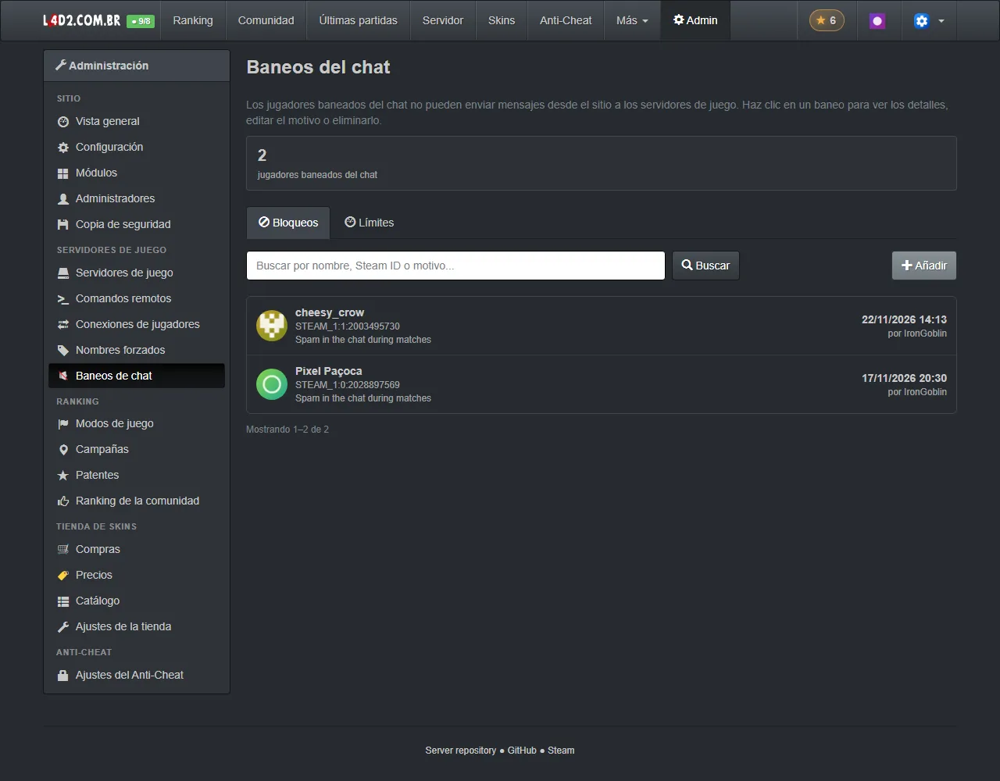
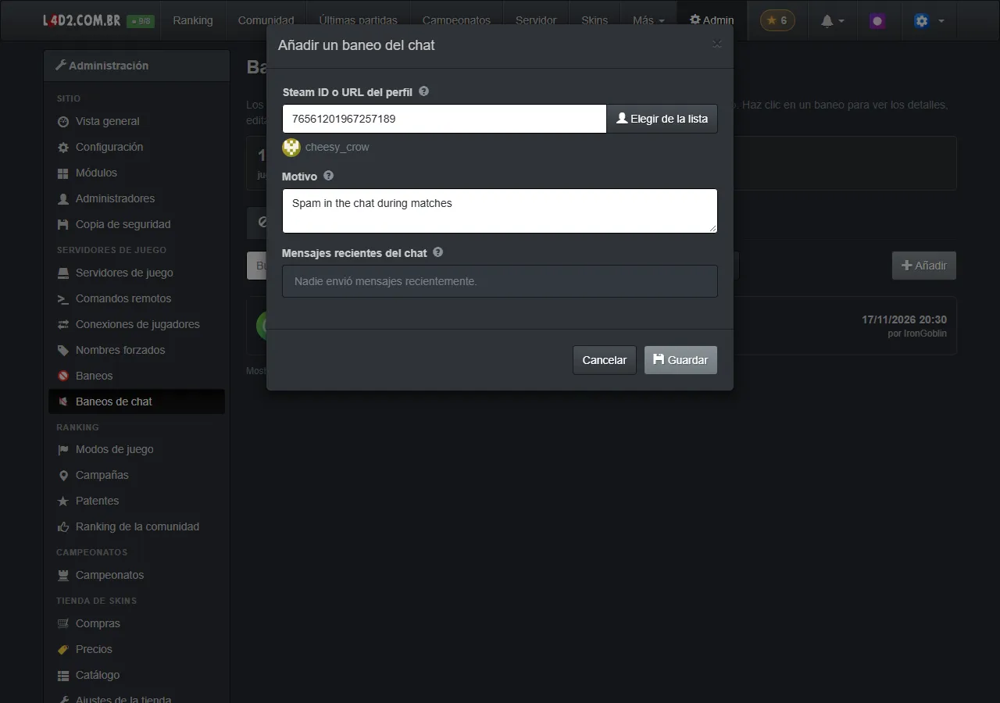
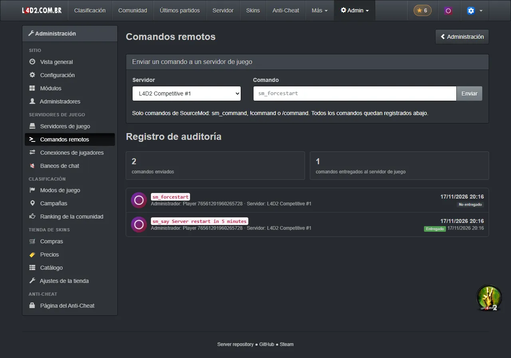
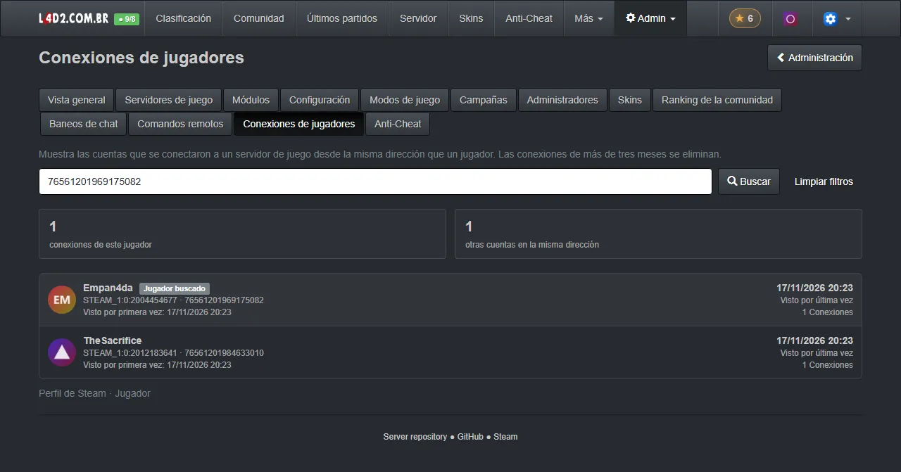

# Moderación

🌐 [English](moderation.md) | [Português](moderation.pt.md) | **Español**

Las herramientas que tiene un administrador para tratar con los jugadores: castigos en el ranking, baneos del chat del sitio, comandos enviados a un servidor de juego y las cuentas que comparten una dirección.

[Volver al manual](README.es.md)

## Contenido

- [Castigos](#castigos)
- [Baneos del chat](#baneos-del-chat)
- [Comandos remotos](#comandos-remotos)
- [Conexiones de jugadores](#conexiones-de-jugadores)

## Castigos

Un castigo le quita experiencia a un jugador en una temporada.

1. Abre la página del jugador, con la temporada elegida en el selector de período.
2. Junto a **Castigo**, haz clic en **Editar**.
3. Escribe cuántos puntos de experiencia debe perder el jugador. Se sugiere 150.

- Un número mayor que cero agrega un castigo. Varios castigos en la misma temporada se suman.
- `0` quita todos los castigos de ese jugador en esa temporada.
- El castigo se resta de la experiencia del jugador en esa temporada, que nunca baja de cero. Se muestra en la página del jugador.
- No pasa a la temporada siguiente y no se aplica a los rankings de un año ni de todos los tiempos.

Los castigos necesitan el módulo del ranking.

## Baneos del chat

Con el módulo del chat del sitio activado, los jugadores que iniciaron sesión pueden escribir en el chat de un servidor de juego desde la [página del servidor en vivo](live-server.es.md#escribir-en-el-chat-desde-el-sitio). **Administración > Baneos de chat** impide que un jugador lo haga. Su panel **Límites de los mensajes enviados desde el sitio** define los segundos entre dos mensajes cualesquiera en un servidor de juego (15 de forma predeterminada), los segundos entre dos mensajes del mismo jugador (30) y el máximo de caracteres por mensaje (200, que también es lo máximo que acepta el chat del juego). 0 desactiva una pausa, y los administradores no quedan sujetos a las pausas.

La página lista todos los baneos, con el jugador, la fecha, el motivo y quién baneó. Busca por nombre, Steam ID o motivo. Haz clic en un baneo para ver sus detalles, cambiar el motivo o quitarlo.

**Agregar baneo** pide el jugador y un motivo:

- Escribe un Steam ID en cualquier formato o un enlace de perfil, o elige de la lista. **Mensajes recientes del chat** lista a quienes escribieron en el chat del sitio en la última hora, así que el jugador que se acaba de portar mal está a un clic. Cuando escribes un ID, el nombre y la foto del jugador aparecen debajo del campo tras un momento.
- El motivo es opcional, de hasta 300 caracteres. El jugador baneado lo ve en lugar del cuadro de chat.

Un baneo se aplica al chat del sitio de todos los servidores de juego. No silencia al jugador dentro del juego; eso se hace con las herramientas del servidor de juego.

## Comandos remotos

Con el módulo de comandos remotos activado, los administradores pueden enviar comandos de SourceMod desde el sitio a un servidor de juego, sin RCON.

1. Elige el servidor.
2. Escribe el comando: `sm_command`, `!command` o `/command`, con sus argumentos. `!forcestart` y `/forcestart` se envían como `sm_forcestart`. Un comando no puede contener `;` y tiene como máximo 256 caracteres.
   O haz clic en el botón de la terminal junto a la caja: lista los comandos de la terminal de la página en vivo con lo que hace cada uno y pide cada argumento paso a paso (modo de juego, campaña, equipo, duración, motivo; el nombre del jugador se escribe, ya que esta página no lista quién está conectado). El comando armado llena la caja, y aún puedes editarlo antes de enviarlo.
3. Haz clic en **Enviar**.

El comando queda en cola. El servidor de juego le pide al sitio los comandos en cola en su próxima consulta y ejecuta el comando. Si ningún servidor de juego lo recoge en 5 minutos, se descarta.

Cada comando queda en el **Registro de auditoría**: el comando, el administrador, el servidor, cuándo se envió, y si se entregó al servidor de juego y cuándo. El registro muestra 50 comandos por página, los más recientes primero, y los contadores muestran cuántos comandos se enviaron y cuántos se entregaron en total. El registro también lista el `sm_aac sync` que el sitio envía a cada servidor de juego después de un cambio en los [Ajustes del Anti-Cheat](anti-cheat.es.md#para-administradores); ese se envía incluso con este módulo desactivado.

Los administradores también pueden enviar un comando desde el cuadro de chat de la página del servidor en vivo, y el botón **Terminal** de esa página ayuda a armarlo.

## Conexiones de jugadores

Con el módulo del servidor en vivo activado, los servidores de juego informan la dirección desde la que se conecta cada jugador. **Administración > Conexiones de jugadores** encuentra las cuentas que se conectaron desde la misma dirección que un jugador, lo que a menudo significa una segunda cuenta.

Escribe el Steam ID o el enlace del perfil del jugador y haz clic en **Buscar**, o haz clic en el botón de jugador junto al campo y elige en la [búsqueda de jugadores](administration.es.md#la-búsqueda-de-jugadores); la búsqueda se hace en cuanto eliges. La página muestra:

- cuántas conexiones tiene el jugador y cuántas otras cuentas usaron la misma dirección;
- cada cuenta, con su Steam ID (el SteamID64 aparece al pasar el ratón), cuándo se vio por primera y por última vez, y cuántas conexiones tiene.

La dirección en sí nunca se muestra. Las conexiones de más de tres meses se borran.

Las mismas cuentas se muestran en la página del jugador como [Cuentas relacionadas](players.es.md#cuentas-relacionadas), a todos los visitantes o solo a los administradores, según [Configuración > Privacidad](administration.es.md#privacidad).
