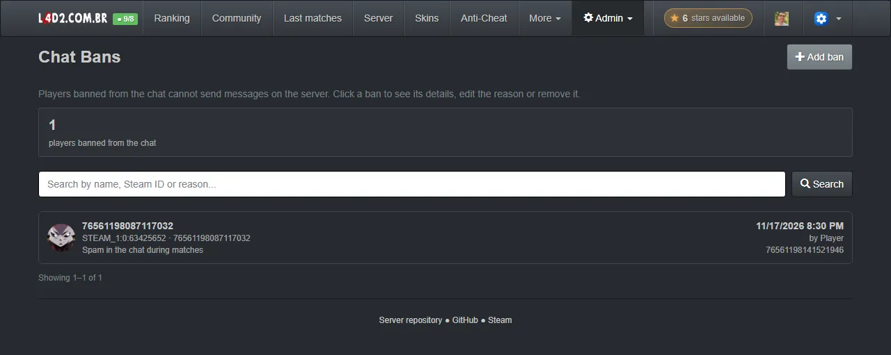
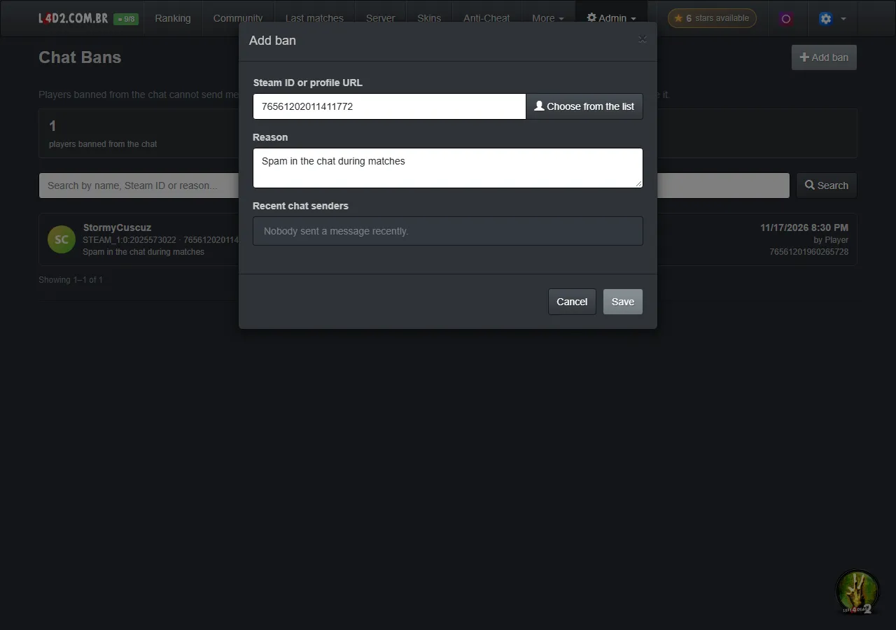
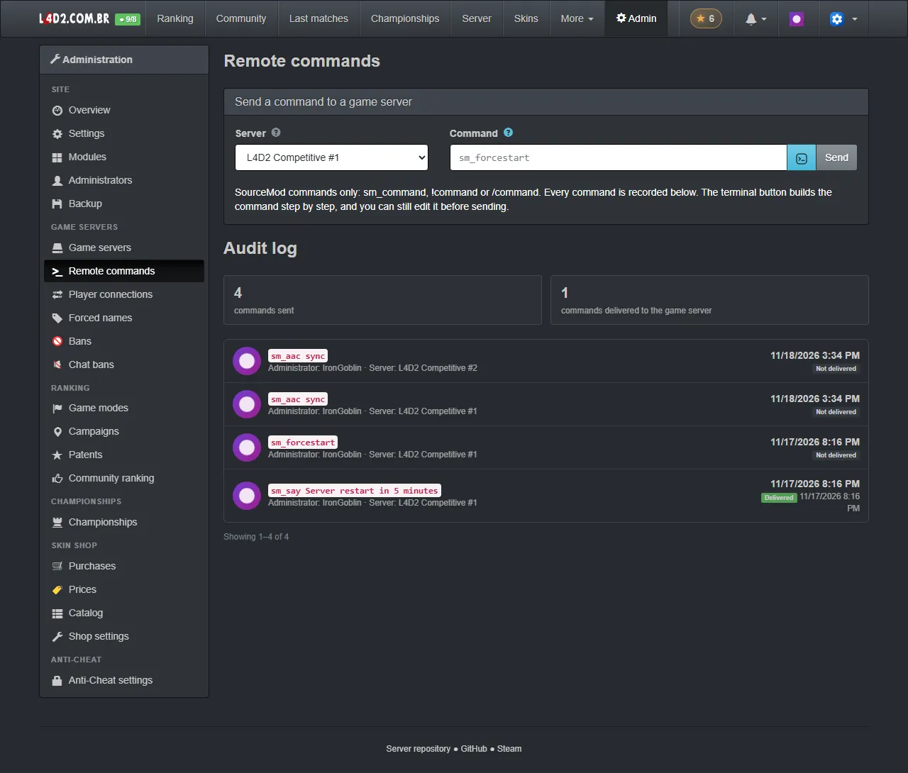
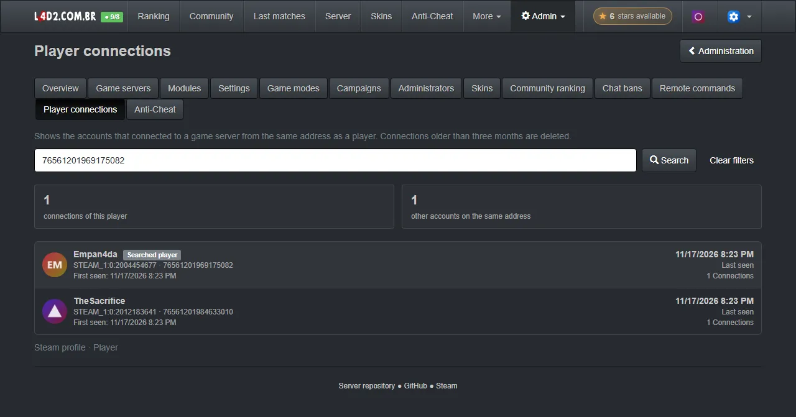

# Moderation

🌐 **English** | [Português](moderation.pt.md) | [Español](moderation.es.md)

The tools an administrator has to deal with players: punishments in the ranking, bans from the site chat, commands sent to a game server, and the accounts that share an address.

[Back to the manual](README.md)

## Contents

- [Punishments](#punishments)
- [Chat bans](#chat-bans)
- [Remote commands](#remote-commands)
- [Player connections](#player-connections)

## Punishments

A punishment takes experience away from a player in one season.

1. Open the player page, with the season selected in the period selector.
2. Next to **Punishment**, click **Edit**.
3. Type how many experience points the player should lose. 150 is suggested.

- A number above zero adds a punishment. Several punishments in the same season add up.
- `0` removes every punishment of that player in that season.
- The punishment is subtracted from the player's experience in that season, which never goes below zero. It is shown on the player page.
- It does not carry over to the next season and does not apply to the rankings of a year or of all time.

Punishments need the ranking module.

## Chat bans

With the site chat module on, signed-in players can write in the chat of a game server from the [live server page](live-server.md#writing-in-the-chat-from-the-site). **Administration > Chat bans** stops a player from doing that. Its panel **Limits of the messages sent from the site** sets the seconds between any two messages on a game server (15 by default), the seconds between two messages of the same player (30) and the maximum characters per message (200, which is also the most the game chat takes). 0 turns a pause off, and administrators are not held by the pauses.

The page lists every ban, with the player, the date, the reason and who banned. Search by name, Steam ID or reason. Click a ban to see its details, change the reason or remove it.

**Add ban** asks for the player and a reason:

- Type a Steam ID in any format or a profile link, or choose from the list. **Recent chat senders** lists who wrote in the site chat in the last hour, so the player who just misbehaved is one click away. When you type an ID instead, the name and the photo of the player show under the field after a moment.
- The reason is optional, up to 300 characters. The banned player sees it in place of the chat box.

A ban applies to the site chat of every game server. It does not mute the player inside the game; that is done with the tools of the game server.

## Remote commands

With the remote commands module on, administrators can send SourceMod commands from the site to a game server, without RCON.

1. Choose the server.
2. Type the command: `sm_command`, `!command` or `/command`, with its arguments. `!forcestart` and `/forcestart` are sent as `sm_forcestart`. A command cannot contain `;` and has at most 256 characters.
   Or click the terminal button next to the box: it lists the commands of the live page terminal with what each one does, and asks for each argument step by step (match mode, campaign, team, duration, reason; the player name is typed, since this page does not list who is connected). The built command fills the box, and you can still edit it before sending.
3. Click **Send**.

The command is queued. The game server asks the site for queued commands on its next check and runs the command. If no game server picks it up within 5 minutes, it is dropped.

Every command is recorded in the **Audit log**: the command, the administrator, the server, when it was sent, and whether it was delivered to the game server and when. The log shows 50 commands per page, the most recent first, and the counters show how many commands were sent and how many were delivered in total. The log also lists the `sm_aac sync` the site sends to every game server after a change on the [Anti-Cheat settings](anti-cheat.md#for-administrators); that one is sent even when this module is off.

Administrators can also send a command from the chat box of the live server page, and the **Terminal** button there helps to build one.

## Player connections

With the live server module on, the game servers report the address each player connects from. **Administration > Player connections** finds the accounts that connected from the same address as a player, which often means a second account.

Type the Steam ID or the profile link of the player and click **Search**, or click the player button next to the field and choose in the [player search](administration.md#the-player-search); the search runs as soon as you choose. The page shows:

- how many connections the player has and how many other accounts used the same address;
- each account, with its Steam ID (the SteamID64 shows when you point at it), when it was first and last seen, and how many connections it has.

The address itself is never shown. Connections older than three months are deleted.

The same accounts are shown on the player page as [Related accounts](players.md#related-accounts), to every visitor or only to administrators depending on [Settings > Privacy](administration.md#privacy).
